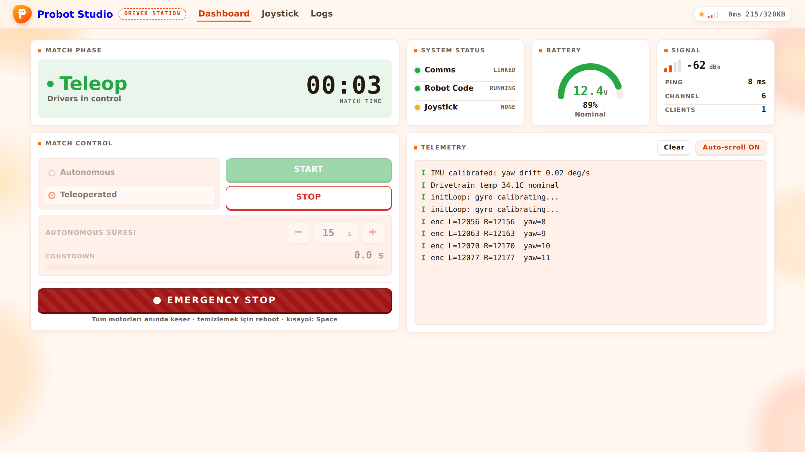
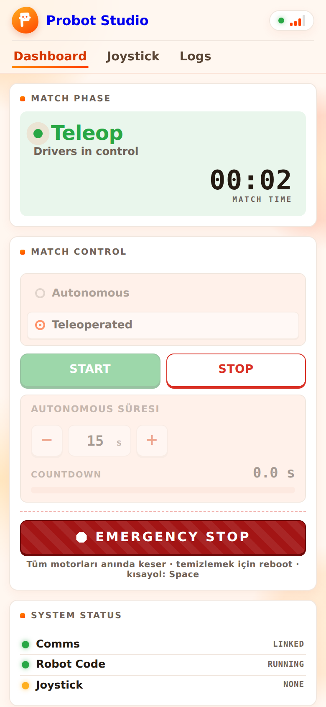
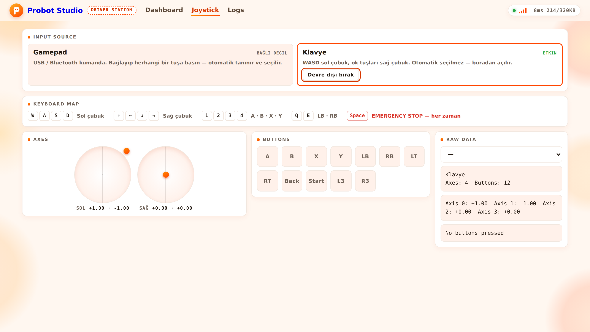
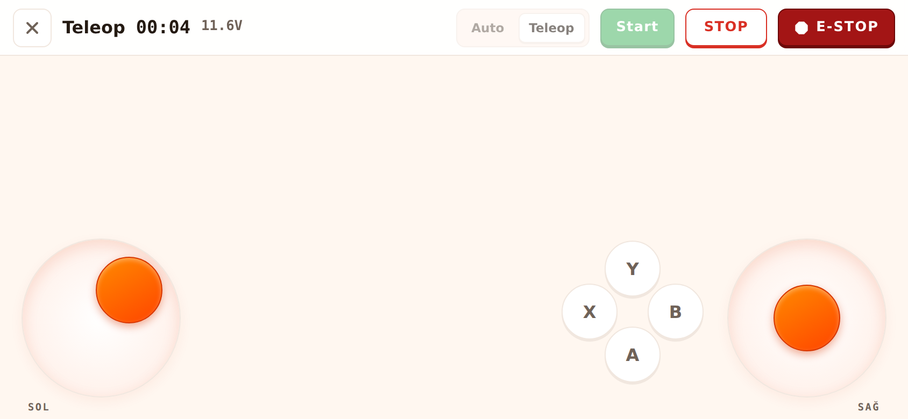

# İlk Bakış

Bu sayfa Probot'un nasıl çalıştığını gösterir. Sonunda: bir kod ESP32'ye yüklü, telefon robota bağlı, Driver Station açık, joystick sol çubuğu ekranda değer değiştiriyor.

---

## Nasıl Çalışır

Normal bir Arduino projesinde kod doğrudan çalışır: kart açılır, program başlar. Probot'ta araya bir katman giriyor.

ESP32 açılınca bir **WiFi erişim noktası** oluşturur. Adı ve şifresi kodda tanımlanır. Telefon veya tablet bu ağa bağlanır; tarayıcıda `192.168.4.1` adresi açılınca **Driver Station** arayüzü yüklenir. Arayüzden mod seçilir (Otonom veya TeleOp), Init ve Start yapılır; robot ancak o zaman çalışmaya başlar.

Joystick verisi de aynı yoldan gider. Kumanda, arayüzü açan cihaza bağlı olmalı. Tarayıcı joystick değerlerini alır ve ESP32'ye iletir. Bu yüzden kumandayı bilgisayara değil, telefon veya tablete bağlamak gerekir.

Kod tarafında normal Arduino'nun `setup()` ve `loop()` fonksiyonları yok; kütüphane bunlara sahip, kullanıcı tanımlarsa derleme hatası alınır. Bunların yerine maçın fazlarına karşılık gelen hook'lar tanımlanır; dördü zorunludur (`autonomousLoop`, `autonomousStop`, `teleopLoop`, `teleopStop`), kalanlar opsiyoneldir. Gövdeleri boş olabilir.

---

## Minimal Kod

Arduino IDE'ye yapıştırılıp doğrudan yüklenebilir. Üç makro değiştirilmeli:

```cpp
#define PROBOT_WIFI_AP_SSID     "RobotAdi"      // WiFi ağ adı
#define PROBOT_WIFI_AP_PASSWORD "sifre1234"     // en az 8 karakter
#define PROBOT_WIFI_AP_CHANNEL  1               // 1, 6 veya 11 önerilir
#include <probot.h>

void autonomousInit() {}
void autonomousLoop() {}
void autonomousStop() {}
void teleopInit()     {}
void teleopLoop()     {}
void teleopStop()     {}
```

**Makrolar neden `#include`'dan önce?** Kütüphane bu değerleri derleme sırasında okur; `#include`'dan sonra tanımlanırsa kütüphane göremez. Sıra zorunlu.

**Loop neden boş?** Kütüphane loop'u sabit hızda, varsayılan olarak 20 ms'de bir (~50 Hz) çağırır ve turlar arasında kendisi bekler; içi boş olsa da çalışır. Loop'a `delay()` koyma: bekleme turun süresine eklenir ve periyot kadar (ör. `delay(20)`) ya da daha uzun bir bekleme periyodu aşar ([Loop Periyodu](yazilim.md#loop-periyodu)). Motorlar bağlandığında buraya gerçek kod yazılır.

Kodu derle ve yükle. Serial Monitör (115200 baud) açılınca şuna benzer bir çıktı gelir:

```
[DS   ] WiFi SSID: RobotAdi
[DS   ] IP Address: 192.168.4.1
[DS   ] HTTP server started on port 80
```

---

## WiFi Bağlantısı

1. Telefon veya tabletin WiFi ayarlarından `RobotAdi` ağına bağlan.
2. Tarayıcı bir **captive portal** açabilir; açılırsa Driver Station oraya yüklenir. Açılmazsa adres çubuğuna `http://192.168.4.1` yaz. `https` değil, `http`; tarayıcı otomatik `https`'e çevirmeye çalışırsa adres çubuğuna tekrar `http://` ile başlayarak yaz.
3. Sayfanın yüklenmesi birkaç saniye sürebilir; ESP32 aynı anda hem HTTP hem WebSocket sunuyor.

---

## Driver Station Arayüzü



Arayüz dört sekmeden oluşur. **Dashboard** maçın yönetildiği yer: Match Control (mod seçici Autonomous / Teleoperated / Utility, kod listelediyse OpMode seçimi, Init / Start / Stop butonları, otonom süresi), kırmızı **Emergency Stop**, maç fazı ve sayacı, batarya/sinyal göstergeleri, telemetri paneli ve Match Control'ün altında **Maç Bilgisi** kartı (istasyon, oyun verisi, maç numarası; robot dururken girilir, [Maç bilgisi](yazilim.md#mac-bilgisi)). **Veri** sekmesi robot kodunun yayınladığı değerleri canlı bir ağaçta gösterir; kod izin verdiyse değerler buradan değiştirilir ([Dashboard Topic Deposu](yazilim.md#dashboard-topic-deposu)). **Joystick** sekmesinden girdi kaynağı yönetilir, **Logs** sekmesinde robot konsolu (kodun `probot::console` ile yazdığı kalıcı uyarı ve hatalar, [Konsol](yazilim.md#konsol)), kod klasör paylaştıysa robotun dosyaları (**Dosyalar** kartı, [Dosya Paylaşımı](yazilim.md#dosya-paylasimi)), WiFi ayarları, sistem bilgisi ve geçmiş grafikleri var. Başka sekmedeyken konsola uyarı ya da hata gelirse (bu tarayıcıda henüz görülmemiş eskiler dahil) **Logs** sekmesinin adında okunmamış sayısı belirir.

Klavyedeki **Space tuşu her zaman Emergency Stop'tur** — arayüz açıkken hangi sekmede olursan ol, sayı kutusuna yazarken bile çalışır. Tek istisna robot devre dışıyken (STOPPED ya da TRANSITION): o zaman odaktaki açılır liste, **Veri** sekmesindeki metin kutusu ya da **Maç Bilgisi** kartındaki metin alanı (Oyun verisi, Etkinlik) Space'i kendisi alır (liste açılır, boşluk yazılır). Diğer fazlarda bunlarda da Emergency Stop'tur.

Arayüzdeki akış her maçta aynı sırayı izler:

| Buton | Ne yapar | LED |
|---|---|---|
| **Mod seçici** | Otonom veya TeleOp seçilir. **Utility** (kurulum ve bakım modu) yalnız kod `utilityLoop()` tanımladıysa ya da bir utility seçeneği listelediyse görünür. Kod seçili mod için program listelediyse mod listesinin altındaki açılır listeden program seçilir; bu liste yalnız Dashboard'daki Match Control'dedir ([OpMode Listesi](yazilim.md#opmode-listesi)). Yalnız robot dururken değiştirilebilir; Init veya Start sonrası reddedilir, önce Stop gerekir. | Mavi yanıp söner |
| **Init** | Seçili modun init hook'u (`autonomousInit()`, `teleopInit()` veya `utilityInit()`) bir kez çalışır. Robot hazır, hareketsiz. | Sarı sabit |
| **Start** | Seçili modun loop hook'u (`autonomousLoop()`, `teleopLoop()` veya `utilityLoop()`) ~50 Hz çalışmaya başlar. | Otonomda turuncu, TeleOp'ta yeşil, Utility'de mor yanıp söner |
| **Stop** | Seçili modun stop hook'u (`autonomousStop()`, `teleopStop()` veya `utilityStop()`) bir kez çalışır. Robot durur. Kooperatiftir: o anki loop turu bittikten sonra devreye girer. | Mavi yanıp söner |
| **Emergency Stop** | Acil durdurma: kullanıcı task'ı anında öldürülür, aktif modun stop hook'u watchdog'lu çalıştırılır, robot **reboot'a kadar kilitlenir** (Init/Start reddedilir). Donmuş bir loop'u bile durdurur. | — |

Telefonda aynı arayüz dikey düzende yüklenir:

{ width="360" }

Robota bağlanıldığında LED mavi yanıp sönüyorsa Driver Station bağlı, mod seçimi ve Init bekleniyor demektir. LED mavi sabit yanıyorsa robot durdurulmuştur ve hiçbir cihaz bağlı değildir.

---

## Joystick Bağlama

Kumanda, arayüzü açan cihaza bağlı olmalı; bilgisayara değil. Bunun nedeni: joystick verisi tarayıcıdaki Gamepad API üzerinden alınır ve WebSocket ile robota iletilir. Kumanda bilgisayara bağlıysa tarayıcı onu göremez.

Kumanda bağlandıktan sonra Joystick sekmesindeki Gamepad kartında yazdığı gibi **herhangi bir tuşa bas** — kumanda otomatik tanınır ve seçilir. Tarayıcı Gamepad API'si güvenlik kısıtı nedeniyle kullanıcı bir butona basmadan joystick'i yazılıma açmaz.

İkinci bir kumandayı (örneğin mekanizmayı süren oyuncu için) aynı cihaza bağlayıp bir tuşuna basınca o kumanda boş olan ilk portu (genelde port 1) alır ve Gamepad kartında "Port 1: <kumanda adı>" satırı görünür. Kodda bu kumanda `makeForPort(1)` ile okunur: [Yazılım - Birden Çok Kumanda](yazilim.md#birden-cok-kumanda).

Buton basıldıktan sonra arayüzde joystick göstergelerinin güncellenmesi gerekir. Güncellenmiyorsa kumanda profili uyumsuz olabilir; [Yazılım - Kumanda Profili](yazilim.md#kumanda-profili) sayfasına bakılabilir.

**Kumanda yoksa** Joystick sekmesindeki alternatif kaynaklar elle etkinleştirilebilir; ikisi de otomatik seçilmez, karttaki **Etkinleştir** ile açılır:



- **Klavye** (yalnız masaüstünde görünür): WASD sol çubuk, ok tuşları sağ çubuk, 1-4 = A/B/X/Y, Q/E = LB/RB. Space burada da E-stop'tur.
- **Dokunmatik** (yalnız telefon/tablette görünür): etkinleştirilince tam ekran **sürüş ekranı** otomatik açılır — alt köşelerde iki sanal çubuk, sağda A/B/X/Y.



Sürüş ekranının üst barında maç kontrolünün tamamı var: faz, maç saati, otonom geri sayımı, batarya, Auto/Teleop mod seçimi, Init/Start, STOP ve E-STOP. Sürücü maçı yönetmek için ekran değiştirmez; kilit kuralları ana Match Control ile aynıdır. **X** ile normal arayüze dönülür — kaynak açık kalır, **Sürüş ekranı** butonuyla tekrar girilir. Telefon dik tutulursa görünüm 90° döner (doğal kullanım telefonu yan çevirmektir); destekleyen tarayıcıda otomatik yatay kilit de denenir.

---

## İlk Joystick Verisi

`teleopLoop()`'u aşağıdaki kodla değiştir. Sol çubuğun dikey değeri her loop turunda Driver Station ekranına yazılır:

```cpp
void teleopLoop() {
    auto js = probot::io::joystick_api::makeDefault();
    probot::clearTelemetry();
    probot::printf("Sol Y: %.2f\n", js.getLeftY());
}
```

TeleOp modunu seç, Init → Start yap, sol çubuğu hareket ettir. Dashboard'daki telemetri panelinde değer değişiyor olmalı: çubuk ileri pozitif, geri negatif.

`clearTelemetry()` ekranı her turda temizler; yoksa önceki değerler birikir. `printf` format dizgisi `"%.2f"` ondalık sayıyı iki basamakla yazar.

---

Buradan sonra: [Yazılım](yazilim.md) sayfasında tüm hook'lar, joystick API'si, motor ve servo kontrolü.
