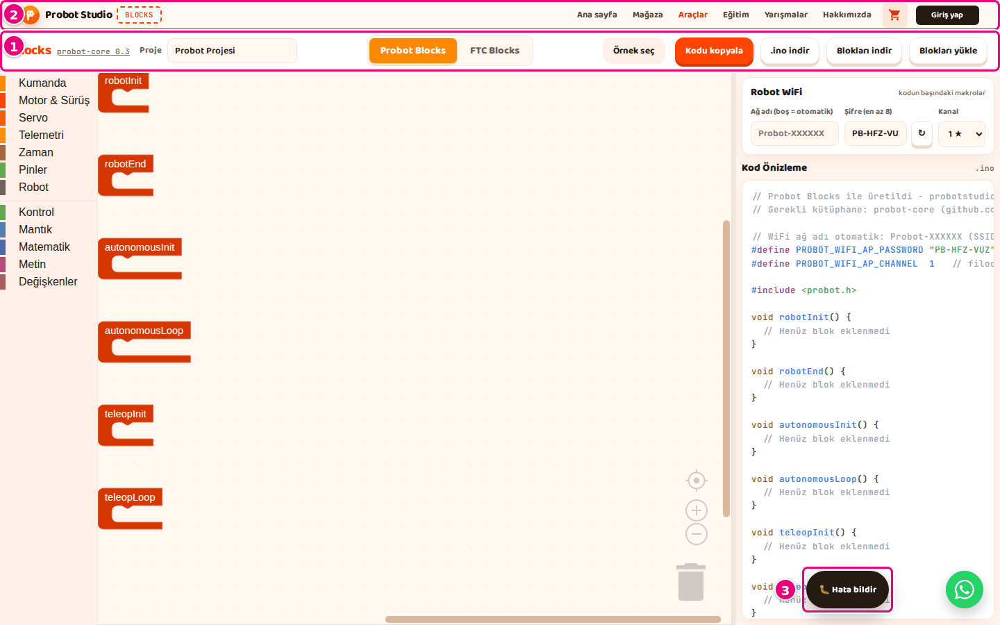
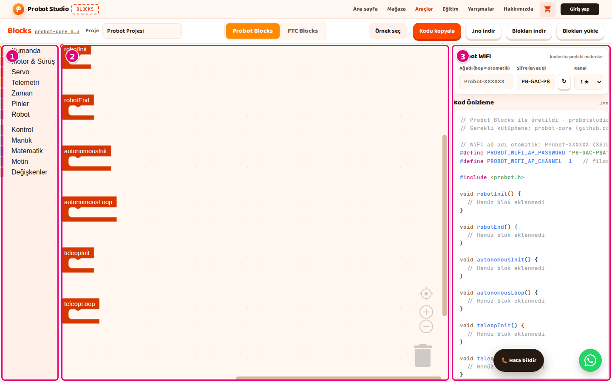

# Arayüz turu

Bu sayfa Blocks ekranındaki her bölgeyi ve her düğmeyi tanıtır. Görev sayfalarında geçen bölge adları
burada tanımlanır.

Blocks tek sayfadır. Araç çubuğundaki **Probot Blocks** ve **FTC Blocks** sekmeleri modu seçer. Seçilen
moda göre araç çubuğunun düğmeleri, blok listesi ve yan panel değişir.

## Ortak bölgeler

Bu bölgeler iki modda da aynıdır.

<!-- CAPTURE: url=https://probotstudio.com/blocks/ | hazirla=giriş kartı ve çerez bandı kapalı, Probot Blocks sekmesi | hedef=probot-header; header.toolbar; text="Hata bildir" | isaret=1,2,3 | bekle=text="Kod Önizleme" -->
<!-- SAY: Site başlığı, araç çubuğu ve Hata bildir düğmesi iki modda da aynı kalıyor. -->

| # | Ad | Ne yapar | Kısayol | İlgili görev |
|---|---|---|---|---|
| 1 | Site başlığı | Probot Studio logosu, "BLOCKS" rozeti ve site menüsü (**Ana sayfa**, **Mağaza**, **Araçlar**, **Eğitim**, **Yarışmalar**, **Hakkımızda**). Sepet simgesi ve **Giriş yap** site geneline aittir; Blocks giriş istemez. | | |
| 2 | Araç çubuğu | Mod sekmeleri, proje ya da OpMode adı ve dosya düğmeleri. Düğmeler moda göre değişir (aşağıda). | | |
| 3 | **Hata bildir** | Ekibe hata ya da öneri gönderme formunu açar. Ekranın köşesinde hep durur. | | [Hata bildir](hata-bildir.md) |
| | WhatsApp düğmesi (yeşil, yuvarlak) | Probot Studio ile WhatsApp yazışmasını yeni sekmede açar. Site geneline aittir. | | |
| | Bildirim kutusu | Bir işin sonucunu gösterir: başarıda turuncu, hatada kırmızı. 5 saniye sonra kaybolur. | | |
| | Giriş kartı | Sayfa her açıldığında çıkan "Kodlama aracı geliştirme aşamasında" kartı. **Anladım, devam et** kartı kapatır; **Hata bildir** formu açar. | <kbd>Esc</kbd> kapatır | [İlk 10 dakika](ilk-10-dakika.md) |
| | Çerez bandı | İlk ziyarette çıkar. **Kabul et** ayrıntılı ölçüme izin verir; **Sadece zorunlu** çerezsiz sayımla sınırlar. | | |

### Mod sekmeleri

| Ad | Ne yapar | Kısayol | İlgili görev |
|---|---|---|---|
| **Probot Blocks** | Probot kiti moduna geçer. | | [Hazır örnekle başla](probot-ornekle-basla.md) |
| **FTC Blocks** | FTC moduna geçer. İlk seçimde FTC editörü yüklenir; sonra modlar arasında geçince program kaybolmaz. | | [FTC örneğiyle başla](ftc-ornekle-basla.md) |

Hiç seçim yapmadıysan araç **FTC Blocks** sekmesinde açılır. Son seçtiğin sekme tarayıcıda hatırlanır.

## Probot Blocks ekranı

<!-- CAPTURE: url=https://probotstudio.com/blocks/ | hazirla=Probot Blocks sekmesi, boş proje | hedef=.blocklyToolboxDiv; .blocklySvg; aside.side-panel | isaret=1,2,3 | bekle=text="robotInit" -->
<!-- SAY: Probot Blocks ekranı blok listesi, çalışma alanı ve yan panel olmak üzere üç bölgeden oluşuyor. -->

### Araç çubuğu (Probot)

<!-- CAPTURE: url=https://probotstudio.com/blocks/ | hazirla=Probot Blocks sekmesi | hedef=header.toolbar; role=textbox[name="Proje"]; role=button[name="Örnek seç"]; role=button[name="Kodu kopyala"] | isaret=1,2,3 | bekle=text="Kodu kopyala" -->
<!-- SAY: Araç çubuğunda proje adı, örnekler ve kod düğmeleri yan yana duruyor. -->

| Ad | Ne yapar | Kısayol | İlgili görev |
|---|---|---|---|
| "Blocks" yazısı | Aracın adı. Tıklanmaz. | | |
| **probot-core 0.3** | Kodun hangi kütüphane sürümü için üretildiğini gösterir. Basınca Probot Core dokümanını açar. O doküman daha yeni bir sürümü anlatır; orada geçen `autonomousStop()` gibi fonksiyonları Blocks üretmez. | | [Kodu Probot kartına yükle](probot-karta-yukle.md) |
| **Proje** | Proje adı, en çok 60 karakter. İndirilen dosyaların adı buradan gelir. Boşsa "Probot Projesi" görünür. | | [Projeyi kaydet](probot-projeyi-kaydet.md) |
| **Örnek seç** | "Probot örnekleri" penceresini açar. Örnek yüklüyse düğmede "Örnek: <ad>" yazar. | | [Hazır örnekle başla](probot-ornekle-basla.md) |
| **Kodu kopyala** | **Kod Önizleme**'deki kodu panoya kopyalar. | | [Kodu kopyala ya da indir](probot-kodu-al.md) |
| **.ino indir** | Kodu `<proje-adı>.ino` dosyası olarak indirir. | | [Kodu kopyala ya da indir](probot-kodu-al.md) |
| **Blokları indir** | Projeyi `<proje-adı>.probot.json` dosyası olarak indirir: bloklar, proje adı, WiFi ayarları. | | [Projeyi kaydet](probot-projeyi-kaydet.md) |
| **Blokları yükle** | Bir `.probot.json` dosyasını açar. Çalışma alanındaki projenin yerine geçer, onay sormaz. | | [Projeyi kaydet](probot-projeyi-kaydet.md) |

### Blok listesi (Probot)

Kategoriye basınca blok paneli açılır. Bloğu panelden çalışma alanına sürüklersin. Her bloğun ne yaptığı
[Probot blok listesi](probot-blok-listesi.md) sayfasındadır.

| Kategori | İçinde ne var |
|---|---|
| **Kumanda** | Kumandayı okuma, çubuk, tuş ve D-Pad blokları. |
| **Motor & Sürüş** | Motor tanımlama, sürme, durdurma; tank ve arcade sürüş. |
| **Servo** | Servo tanımlama, açı verme, sinyali kesme. |
| **Telemetri** | Driver Station ekranına yazı ve değer yazma. |
| **Zaman** | Geçen süre ve bekleme. |
| **Pinler** | Kartın pinlerini okuma, yazma; Serial çıktısı. |
| **Robot** | Pil gerilimi, faz ve robot durumu. |
| **Kontrol** | Eğer, tekrarla, döngü blokları. |
| **Mantık** | Karşılaştırma, ve/veya, doğru/yanlış. |
| **Matematik** | Sayılar ve işlemler. |
| **Metin** | Metin ve metin birleştirme. |
| **Değişkenler** | **Değişken oluştur...** ve oluşturulan değişkenlerin blokları. |

### Çalışma alanı (Probot)

| Ad | Ne yapar | Kısayol | İlgili görev |
|---|---|---|---|
| Yaşam döngüsü blokları | Altı hazır blok: **robotInit**, **robotEnd**, **autonomousInit**, **autonomousLoop**, **teleopInit**, **teleopLoop**. Silinemez. Yalnız bunların içine bağlı bloklar koda girer. | | [Sürüş programı yaz](probot-surus-programi-yaz.md) |
| Izgara | Noktalı zemin. Bloklar noktalara yapışır. | | |
| Merkez düğmesi (hedef simgesi) | Görünümü ortalar ve ölçeği sıfırlar. | | [Blokları düzenle](probot-bloklari-duzenle.md) |
| **+** | Yakınlaştırır (en çok 2 kat). | <kbd>Ctrl</kbd>+tekerlek | [Blokları düzenle](probot-bloklari-duzenle.md) |
| **−** | Uzaklaştırır (en az 0,3 kat). | <kbd>Ctrl</kbd>+tekerlek | [Blokları düzenle](probot-bloklari-duzenle.md) |
| Çöp kutusu | Üstüne bırakılan bloğu siler. Basınca silinen bloklar panelde listelenir; oradan geri sürükleyebilirsin. | | [Blokları düzenle](probot-bloklari-duzenle.md) |

**Boş alana sağ tıklayınca açılan menü:**

| Öğe | Ne yapar | Kısayol |
|---|---|---|
| **Geri al** | Son işlemi geri alır. | <kbd>Ctrl</kbd>+<kbd>Z</kbd> |
| **Yinele** | Geri alınan işlemi yeniden yapar. | <kbd>Ctrl</kbd>+<kbd>Y</kbd> |
| **Blokları Temizle** | Blokları alt alta düzgün dizer. Silmez. | |
| **<n> Bloğunu Sil** | Yaşam döngüsü blokları dışındaki tüm blokları siler. İki ya da daha çok blokta onay sorar. | |

**Bloğa sağ tıklayınca açılan menü:**

| Öğe | Ne yapar | Kısayol |
|---|---|---|
| **Yinele** | Bloğun kopyasını çıkarır (yanına koyar). Boş alan menüsündeki **Yinele** ile adı aynıdır, işi farklıdır. | <kbd>Ctrl</kbd>+<kbd>C</kbd>, <kbd>Ctrl</kbd>+<kbd>V</kbd> |
| **Satır içi Girişler** / **Harici Girişler** | Bloğun girişlerini yan yana ya da alt alta gösterir. | |
| **Bloğu Devre Dışı Bırak** / **Bloğu Etkinleştir** | Bloğu koddan geçici çıkarır ya da geri alır (yaşam döngüsü blokları hariç). Devre dışı blok soluk görünür. | |
| **Bloğu Sil** / **<n> Bloğunu Sil** | Bloğu ve içindeki blokları siler. | <kbd>Delete</kbd> |
| **Yardım** | Bloğun yardım sayfasını açar. Yalnız **Kontrol**, **Mantık**, **Matematik**, **Metin** ve **Değişkenler** bloklarında bulunur. | |
| **'set <ad>' oluştur** / **'get <ad>' oluştur** | Yalnız değişken bloklarında: aynı değişkenin değer verme (**ayarla**) ya da okuma bloğunu yanına koyar. | |

Yaşam döngüsü bloklarının menüsünde yalnız **Satır içi Girişler** ve **Bloğu Devre Dışı Bırak** vardır.
Yaşam döngüsü bloğunu devre dışı bırakmak kodu değiştirmez: içindeki bloklar soluk görünse de koda girmeye
devam eder. Bir bölümü koddan çıkarmak için içindeki blokları tek tek devre dışı bırak.

**Değişken açılır listesine (ör. `solMotor ▾`) basınca açılan menü:**

| Öğe | Ne yapar |
|---|---|
| Değişken adları | Blokta kullanılacak değişkeni seçer. |
| **Değişkeni yeniden adlandır...** | Değişkenin adını her yerde değiştirir. |
| **'<ad>' değişkenini silmek istiyor musunuz?** | Değişkeni ve onu kullanan blokları siler; menüde soru gibi yazar. Değişkeni başka bloklar da kullanıyorsa önce "'<ad>' değişkeninin <n> kullanımını silmek istiyor musunuz?" diye onay sorar (<n> = toplam blok sayısı). Değişkeni yalnız bu blok kullanıyorsa sormadan siler. |

### Yan panel (Probot)

| Ad | Ne yapar | Kısayol | İlgili görev |
|---|---|---|---|
| Panel tutamağı | Çalışma alanıyla yan panel arasındaki ince şerit. Sürükleyince yan panel genişler ya da daralır. Yalnız fareyle çalışır. | | [Blokları düzenle](probot-bloklari-duzenle.md) |
| **Robot WiFi** bölümü | Robotun yayınlayacağı WiFi ağının ayarları. Değerler kodun başına yazılır. | | [Robot WiFi ayarlarını yap](probot-wifi-ayarla.md) |
| **Ağ adı (boş = otomatik)** | Ağ adı, en çok 24 karakter. Boşsa robot `Probot-XXXXXX` biçiminde kendi adını kullanır. | | [Robot WiFi ayarlarını yap](probot-wifi-ayarla.md) |
| **Şifre (en az 8)** | Ağ şifresi, 8-24 karakter. Yalnız büyük harf, rakam ve `-` kabul eder; küçük harf büyüğe çevrilir. | | [Robot WiFi ayarlarını yap](probot-wifi-ayarla.md) |
| **↻** (Yeni şifre üret) | `PB-XXX-XXX` biçiminde yeni şifre üretir. | | [Robot WiFi ayarlarını yap](probot-wifi-ayarla.md) |
| **Kanal** | WiFi kanalı, 1-13. Yıldızlı kanallar (1, 6, 11) önerilir. | | [Robot WiFi ayarlarını yap](probot-wifi-ayarla.md) |
| **Kod Önizleme** bölümü | Bloklardan üretilen `.ino` kodu. Her değişiklikte anında yenilenir. Bu alana yazılmaz. | | [Kodu kopyala ya da indir](probot-kodu-al.md) |

### Probot örnekleri penceresi

| Ad | Ne yapar | Kısayol | İlgili görev |
|---|---|---|---|
| **Örnek ara...** | Örnek adında ve açıklamasında arar. Pencere açılınca imleç buradadır. | | [Hazır örnekle başla](probot-ornekle-basla.md) |
| Örnek kartı | Örneği yükler ve pencereyi kapatır. Yüklü örneğin kartı vurgulu görünür. | | [Hazır örnekle başla](probot-ornekle-basla.md) |
| **×** | Pencereyi kapatır. Pencere dışına tıklamak da kapatır. | <kbd>Esc</kbd> | |

## FTC Blocks ekranı

FTC editörünün içi İngilizcedir: kategoriler, bloklar ve sağ tık menüleri FTC'nin kendi editöründen gelir.
Yan panel ve araç çubuğu Türkçedir.

<!-- CAPTURE: url=https://probotstudio.com/blocks/ | hazirla=FTC Blocks sekmesi, Yeni program | hedef=iframe.ftc-cerceve >> text="OpMode"; text="Robot yapılandırması"; text="OnBot Java" | isaret=1,2,3 | bekle=text="runOpMode" -->
<!-- SAY: FTC Blocks ekranında yan panelde OpMode ayarları, robot yapılandırması ve Java kodu bulunuyor. -->

### Araç çubuğu (FTC)

| Ad | Ne yapar | Kısayol | İlgili görev |
|---|---|---|---|
| "Control Hub" yazısı | Bu modun REV Control Hub için olduğunu gösterir. Tıklanmaz. | | |
| **OpMode** | OpMode adı, en çok 60 karakter. Java sınıf adı ve dosya adları buradan türetilir. | | [Yeni FTC programı yaz](ftc-program-yaz.md) |
| **Örnek seç** | "FTC örnekleri" penceresini açar. | | [FTC örneğiyle başla](ftc-ornekle-basla.md) |
| **Yeni program** | Onay sorar, sonra programı ilk hâline döndürür. Robot yapılandırması ve OpMode adı kalır. | | [Yeni FTC programı yaz](ftc-program-yaz.md) |
| **Java kopyala** | **OnBot Java** bölümündeki kodu panoya kopyalar. | | [Programı kaydet](ftc-programi-kaydet.md) |
| **.blk indir** | Programı `<SınıfAdı>.blk` dosyası olarak indirir. | | [Programı kaydet](ftc-programi-kaydet.md) |
| **.blk yükle** | Bir `.blk` dosyasını açar. Programın yerine geçer, onay sormaz. | | [Programı kaydet](ftc-programi-kaydet.md) |
| **.java indir** | Java kodunu `<SınıfAdı>.java` dosyası olarak indirir. | | [Programı kaydet](ftc-programi-kaydet.md) |

### Blok listesi (FTC)

Kategoriler İngilizcedir. Ok işaretli kategoriler alt kategori içerir. Blokların listesi
[FTC blok listesi](ftc-blok-listesi.md) sayfasındadır.

| Kategori | İçinde ne var |
|---|---|
| **LinearOpMode** | `waitForStart`, `opModeIsActive`, `sleep` gibi OpMode komutları. |
| **Gamepad** | Kumanda çubukları ve tuşları. Alt kategoriler: **Pressed**, **Rumble**. |
| **Actuators** | Motor ve servolar. Alt kategoriler: **DcMotor**, **Servo**, **CRServo**; altlarında cihaz adların. |
| **Sensors** | Sensörler. Alt kategori: **IMU**. |
| **Utilities** | **ElapsedTime**, **Range**, **Telemetry**, **Time**. |
| **Logic**, **Loops**, **Math**, **Text**, **Lists** | Genel programlama blokları. |
| **Variables** | **Create variable...** ve değişken blokları. |
| **Functions** | Fonksiyon tanımlama ve çağırma blokları. |

Cihaz kategorileri **Robot yapılandırması**ndan kurulur. Yapılandırmada o türde cihaz yoksa kategori görünmez.

### Çalışma alanı (FTC)

| Ad | Ne yapar | Kısayol | İlgili görev |
|---|---|---|---|
| **to runOpMode** bloğu | Programın ana bloğu. Silinemez. Bloklar bunun içine dizilir. | | [Yeni FTC programı yaz](ftc-program-yaz.md) |
| Merkez düğmesi | Görünümü ortalar. | | |
| **+** / **−** | Yakınlaştırır (en çok 3 kat) / uzaklaştırır (en az 0,3 kat). | Tekerlek | |
| Çöp kutusu | Üstüne bırakılan bloğu siler. Basınca silinen bloklar panelde listelenir; oradan geri sürükleyebilirsin. | | |

**Boş alana sağ tıklayınca açılan menü:** **Undo** (geri al), **Redo** (yinele), **Clean up Blocks**
(blokları diz), **Collapse Blocks** (tüm blokları daralt), **Expand Blocks** (tüm blokları aç),
**Delete <n> Blocks** (silinebilen tüm blokları sil).

**Bloğa sağ tıklayınca açılan menü:**

| Öğe | Ne yapar |
|---|---|
| **Duplicate** | Bloğu çoğaltır. |
| **Add Comment** / **Remove Comment** | Bloğa not ekler ya da notu kaldırır. |
| **Inline Inputs** / **External Inputs** | Girişleri yan yana ya da alt alta gösterir. |
| **Collapse Block** / **Expand Block** | Bloğu tek satıra daraltır ya da açar. |
| **Disable Block** / **Enable Block** | Bloğu programdan geçici çıkarır ya da geri alır. |
| **Delete Block** | Bloğu siler. **to runOpMode** bloğunda yoktur. |
| **Help** | Bloğun yardım sayfasını açar. Bazı bloklarda soluktur. |
| **Create "<ad>"** | Fonksiyon bloğunda: o fonksiyonu çağıran bloğu oluşturur. |

**Değişken açılır listesine basınca açılan menü:**

| Öğe | Ne yapar |
|---|---|
| Değişken adları | Blokta kullanılacak değişkeni seçer. |
| **Rename variable...** | Değişkenin adını her yerde değiştirir. |
| **Delete the "<ad>" variable** | Değişkeni ve onu kullanan blokları siler. Değişkeni başka bloklar da kullanıyorsa önce "Delete <n> uses of the "<ad>" variable?" diye onay sorar. |

### Yan panel (FTC)

| Ad | Ne yapar | Kısayol | İlgili görev |
|---|---|---|---|
| Panel tutamağı | Yan paneli genişletir ya da daraltır. Fareyle ve dokunarak çalışır. | | |
| **OpMode** bölümü | `.blk` dosyasına yazılan OpMode ayarları. | | [Yeni FTC programı yaz](ftc-program-yaz.md) |
| **Tür** | **TeleOp** ya da **Autonomous**. | | [Yeni FTC programı yaz](ftc-program-yaz.md) |
| **Grup** | Driver Station'daki grup adı, en çok 40 karakter. Boş bırakılabilir. | | [Yeni FTC programı yaz](ftc-program-yaz.md) |
| **Robot yapılandırması** bölümü | Control Hub'daki cihaz adları. Her satır: cihaz türü, ad, **×**. | | [Robot yapılandırmasını ayarla](ftc-yapilandirmayi-ayarla.md) |
| Cihaz türü | **Motor (DcMotor)**, **Servo**, **Sürekli servo (CRServo)**, **IMU**. | | [Robot yapılandırmasını ayarla](ftc-yapilandirmayi-ayarla.md) |
| Cihaz adı | Harfle başlar; harf, rakam ve `_` içerir. Ad değişince o cihazı kullanan bloklar da yeni adı alır. | | [Robot yapılandırmasını ayarla](ftc-yapilandirmayi-ayarla.md) |
| **×** | Cihazı listeden kaldırır. | | [Robot yapılandırmasını ayarla](ftc-yapilandirmayi-ayarla.md) |
| **+ Cihaz ekle** | Listeye yeni bir motor ekler (`motor1`, `motor2`...). | | [Robot yapılandırmasını ayarla](ftc-yapilandirmayi-ayarla.md) |
| **OnBot Java** bölümü | Bloklardan üretilen Java kodu. Başlıkta dosya adı yazar (ör. `ProbotOpMode.java`). Bu alana yazılmaz. | | [Programı kaydet](ftc-programi-kaydet.md) |

### FTC örnekleri penceresi

Probot örnekleri penceresiyle aynı çalışır: **Örnek ara...**, örnek kartları ve **×**.

## Dar ekranda

Pencere 860 pikselden darsa bölgeler alt alta dizilir. Yan panel çalışma alanının altına iner, panel
tutamağı görünmez.

Telefonda giriş kartı "Kodlama aracı bilgisayarda kullanım için tasarlandı" yazar.
**Yine de devam et** düğmesi 3 saniye sonra açılır.

<!-- SAY: Dar ekranda yan panel çalışma alanının altına iniyor. -->
