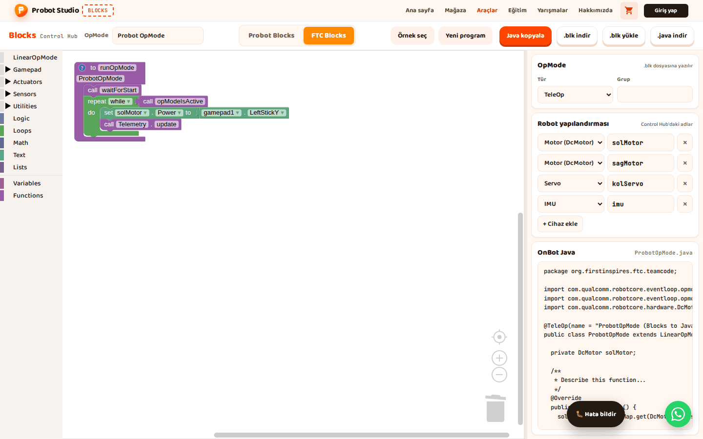

# Yeni FTC programı yaz

Bu sayfada boş bir FTC programı başlatacak, OpMode adını ve türünü ayarlayacak ve bir motoru kumandayla
süren ilk bloklarını dizeceksin. FTC editörünün blokları İngilizcedir.

<!-- CAPTURE: url=https://probotstudio.com/blocks/ | hazirla=FTC Blocks, Yeni program, set solMotor.Power to gamepad1.LeftStickY eklenmiş | hedef=body | isaret=yok | bekle=text="LeftStickY" -->
<!-- SAY: Sayfanın sonunda sol motor kumandanın sol çubuğuyla dönecek. -->

## Başlamadan önce

- Blocks açık ve **FTC Blocks** sekmesi seçili.
- **Robot yapılandırması** Control Hub'la aynı. Bkz. [Robot yapılandırmasını ayarla](ftc-yapilandirmayi-ayarla.md).
- Yapılandırmada `solMotor` adlı bir **Motor (DcMotor)** var. Varsayılan yapılandırmada bu motor bulunur.

Hazır bir sürüş programı görmek istersen **Örnek seç** > **Tank Şasi TeleOp**'u aç.

Örnek açtıysan yapılandırmada yalnız örneğin cihazları kalır (Tank Şasi TeleOp'ta `left_drive` ve `right_drive`).
**Yeni program** bu cihazları geri getirmez. Bu durumda yan paneldeki **Robot yapılandırması** bölümünde
**+ Cihaz ekle**'ye bas ve eklenen `motor1` adını `solMotor` yap ya da adımlarda solMotor yerine kendi motorunun adını kullan.

## Yeni program başlat

!!! warning "Dikkat"
    **Yeni program** çalışma alanındaki programı siler. Saklamak istediğin programı 1. adımda indir.

1. Araç çubuğunda **.blk indir**'e bas. "<SınıfAdı>.blk indirildi." bildirimi çıkar.
2. Araç çubuğunda **Yeni program**'a bas.
3. "FTC programı ilk hâline dönsün mü?" sorusunda **Tamam**'a bas.
   
   <!-- CAPTURE: url=https://probotstudio.com/blocks/ | hazirla=FTC Blocks, Yeni program onaylandı | hedef=role=button[name="Yeni program"]; iframe.ftc-cerceve >> text="runOpMode" | isaret=2,3 | bekle=text="waitForStart" -->
   <!-- SAY: Yeni program ile FTC çalışma alanını ilk hâline döndürüyoruz. -->

Sonuç: Çalışma alanında yalnız ilk hâliyle **to runOpMode** bloğu kalır. Yan paneldeki **OpMode** bölümünde
**Tür** **TeleOp**'a döner, **Grup** boşalır. **Robot yapılandırması** ve araç çubuğundaki **OpMode** adı değişmez.

## Programın yapısını tanı

**to runOpMode** bloğu programın kendisidir ve silinemez. İçinde üç parça hazır gelir:

| Blok | Ne zaman çalışır | Buraya ne konur |
|---|---|---|
| **call waitForStart** öncesi | Driver Station'da INIT'e basınca | Hazırlık: motor yönü, başlangıç değerleri |
| **call waitForStart** | START'a basılana kadar bekler | |
| **repeat while call opModeIsActive** içi | START'tan STOP'a kadar, sürekli | Kumanda okuma, motor sürme, telemetri |

Döngünün sonundaki **call Telemetry.update** telemetri yazılarını Driver Station'a gönderir.

<!-- SAY: FTC programında hazırlık kısmı START'tan önce, sürüş kısmı döngünün içinde çalışıyor. -->

## OpMode adını ve türünü ayarla

1. Araç çubuğunda **OpMode** kutusuna programın adını yaz, ör. `Ilk Surus`. Kutu en çok 60 karakter alır.
2. Yan panelde **OpMode** bölümünde **Tür** listesinden **TeleOp**'u ya da **Autonomous**'u seç.
3. İstersen **Grup** kutusuna en çok 40 karakterlik bir grup adı yaz. Boş bırakabilirsin.

Sonuç: **OnBot Java** bölümünün başlığında dosya adı `IlkSurus.java` olur. Java'da `@TeleOp(name = "IlkSurus (Blocks to Java)")`
satırı oluşur. Grup yazdıysan grup adı parantezin içine eklenir, ör. `@TeleOp(name = "IlkSurus (Blocks to Java)", group = "Surus")`.
**Autonomous** seçersen satır `@Autonomous` ile başlar.

OpMode adından Java sınıf adı türetilir: Türkçe harfler sadeleşir, kelimeler bitişik ve baş harfleri büyük
yazılır. Ad rakamla başlarsa başına `Op` eklenir. Ad boşsa sınıf adı `ProbotOpMode` olur.

<!-- SAY: OpMode'a bir ad veriyoruz ve TeleOp mu otonom mu olduğunu seçiyoruz. -->

## Motoru kumandayla sür

!!! tip "İpucu"
    **DcMotor** altında **solMotor** yoksa yapılandırmada bu adda motor yok. **+ Cihaz ekle** ile ekle ya da
    adımlarda kendi motorunun adını seç.

1. Blok listesinde **Actuators** > **DcMotor** > **solMotor** kategorisini seç.
2. **set solMotor.Power to 1** bloğunu **repeat while** döngüsünün **do** ağzına, **call Telemetry.update**'in üstüne sürükle.
3. Blok listesinde **Gamepad** kategorisini seç.
4. **gamepad1.LeftStickY** bloğunu **set solMotor.Power to** bloğundaki `1` yuvasına sürükle.
   
   <!-- CAPTURE: url=https://probotstudio.com/blocks/ | hazirla=FTC Blocks, Yeni program, set solMotor.Power to gamepad1.LeftStickY eklenmiş | hedef=iframe.ftc-cerceve >> text="Power"; text="LeftStickY" | isaret=2,4 | bekle=text="LeftStickY" -->
   <!-- SAY: Döngünün içine motor gücü bloğunu koyup değerini kumanda çubuğundan alıyoruz. -->

Sonuç: **OnBot Java** bölümünde `solMotor.setPower(gamepad1.left_stick_y);` satırı oluşur. Robotta START'tan
sonra sol çubuğu ittiğinde solMotor döner, çubuğu bırakınca durur.

FTC'de çubuk ileri itilince `LeftStickY` eksi değer verir. Motor ters dönüyorsa **Math** kategorisindeki
eksi işaret bloğunu araya koy ya da motorun **Direction** değerini değiştir.

## Telemetriye yaz

1. Blok listesinde **Utilities** > **Telemetry** kategorisini seç.
2. **key** ve **number** yuvalı **call Telemetry.addData** bloğunu döngüde **call Telemetry.update**'in üstüne sürükle.
3. **key** yuvasındaki `key` metnine bas ve `Guc` yaz.
4. Blok listesinde **Actuators** > **DcMotor** > **solMotor** kategorisini seç.
5. **solMotor.Power** bloğunu **number** yuvasındaki `123`'ün üstüne sürükle.

Sonuç: **OnBot Java** bölümünde `telemetry.addData("Guc", solMotor.getPower());` satırı oluşur. Driver Station
ekranında START'tan sonra `Guc` satırı çıkar. Sol çubuğu ittikçe değeri -1 ile 1 arasında değişir.

<!-- SAY: Telemetri bloklarıyla Driver Station ekranına değer yazdırıyoruz. -->

## Blokları düzenle

FTC çalışma alanı Probot'takine benzer çalışır. Çöp kutusu da aynıdır: basınca silinen bloklar listelenir,
oradan geri sürükleyebilirsin. Farklar:

- Tekerlek kaydırmaz, doğrudan yakınlaştırır. Kaydırmak için boş alanı sürükle.
- Yinele kısayolu yalnız <kbd>Ctrl</kbd>+<kbd>Shift</kbd>+<kbd>Z</kbd>'dir; <kbd>Ctrl</kbd>+<kbd>Y</kbd> çalışmaz.
- Bloğa sağ tıklayınca **Duplicate**, **Add Comment**, birden çok girişli bloklarda (ör. **call Telemetry.addData**)
  **Inline Inputs** ya da **External Inputs**, **Collapse Block**, **Disable Block**, **Delete Block**, **Help** gelir.
- Bloğun yuvalarına takılı bloklar varsa **Delete Block** yerine sayılı öğe çıkar. Sayıya yuvadaki sayı ve metin
  kutuları da girer: `set solMotor.Power to 1` için **Delete 2 Blocks** yazar. Altına takılı bloklar silinmez, yığın kopmadan birleşir.
- Boş alana sağ tıklayınca **Undo**, **Redo**, **Clean up Blocks**, **Collapse Blocks**, **Expand Blocks** ve
  silme öğesi (ör. **Delete 5 Blocks**) gelir.

Tüm menü öğeleri: [Arayüz turu](arayuz.md). Kısayollar: [Kısayollar](kisayollar.md).

<!-- SAY: FTC editöründe fare tekerleği doğrudan yakınlaştırıyor. -->

## Değişken oluştur

1. Blok listesinde **Variables** kategorisini seç.
2. **Create variable...**'a bas.
3. "New variable name:" kutusuna değişkenin adını yaz, ör. `hiz`.
4. **OK**'a (ya da **Tamam**'a) bas.

Sonuç: **Variables** kategorisinde **set hiz to** ve **hiz** blokları çıkar.

Adı değiştirmek ya da değişkeni silmek için bir **hiz** bloğundaki ad listesini aç. **Rename variable...** adı
tüm bloklarda değiştirir. **Delete the "hiz" variable** değişkeni onu kullanan bloklarla birlikte siler; birden çok
blok kullanıyorsa önce "Delete 2 uses of the "hiz" variable?" gibi bir onay sorar.

<!-- SAY: Değişkenle bir değeri bir ad altında saklıyoruz. -->

## Fonksiyon oluştur

1. Blok listesinde **Functions** kategorisini seç.
2. **to do something** bloğunu çalışma alanında boş bir yere sürükle.
3. Bloktaki **do something** adına bas ve `ileriGit` yaz.
4. Blok listesinde **Functions** kategorisini yeniden seç.
5. **ileriGit** bloğunu döngüde **call Telemetry.update**'in üstüne sürükle.

Sonuç: **OnBot Java** bölümünde döngünün içinde `ileriGit();` satırı oluşur.

Çağırma bloğunda **call** yazmaz, yalnız fonksiyonun adı yazar. Bu blok fonksiyon bloğu çalışma alanına
konduktan sonra listede çıkar. Aynı bloğu fonksiyon bloğuna sağ tıklayıp **Create "ileriGit"**'i seçerek de alabilirsin.

<!-- SAY: Uzun programları fonksiyonlara bölebiliyoruz. -->

## Sorun mu var?

- **solMotor kategorisi çıkmıyor:** Yapılandırmada bu adda motor yok. Hiç motor yoksa **DcMotor** kategorisi de
  çıkmaz. Motoru [Başlamadan önce](#baslamadan-once) bölümündeki gibi ekle.
- **Blokta "There is no ... named ... in the current robot configuration" uyarısı:** Blok, yapılandırmada olmayan
  bir cihaz adını kullanıyor. Bkz. [Sorun giderme](sorunlar.md).
- **"Ad harfle başlamalı; yalnız harf, rakam ve _ olabilir." yazıyor:** Cihaz adı harfle başlamalı; boşluk, Türkçe harf
  ya da tire olamaz. Bkz. [Sorun giderme](sorunlar.md).

## Sonraki adım

[Programı kaydet, aç ve Java'yı al](ftc-programi-kaydet.md)
