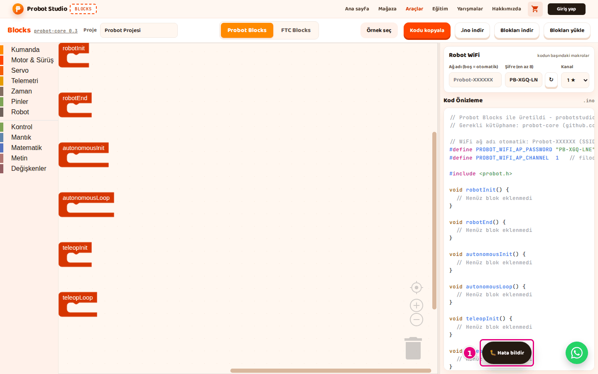

# Hata bildir

Blocks'ta bir hata görürsen ya da önerin varsa sayfadan çıkmadan ekibe yazabilirsin. Bu sayfada hata
bildirme formunu dolduracaksın.

## Başlamadan önce

- Blocks açık ve internete bağlısın. Hesap gerekmez.

## Formu gönder

!!! tip "İpucu"
    Form internet bağlantısıyla gönderilir. "Gönderilemedi" yazarsa yazdıkların kutularda kalır,
    **Gönder**'e yeniden basabilirsin.

1. Ekranın köşesindeki **Hata bildir**'e bas.
   Form açılır ve imleç **Başlık** kutusunda durur.
   
   <!-- CAPTURE: url=https://probotstudio.com/blocks/ | hazirla=giriş kartı ve çerez bandı kapalı | hedef=probot-devnote >> role=button[name="🐛 Hata bildir"] | isaret=1 | bekle=text="Hata bildir" -->
   <!-- SAY: Bir hata görürsek köşedeki Hata bildir düğmesiyle ekibe yazıyoruz. -->
2. **Başlık** kutusuna sorunu kısaca yaz. En çok 120 karakter.
3. **Mesaj** kutusuna şu dört bilgiyi yaz. En çok 4000 karakter.
    - Açık sekme ve örnek ya da proje, ör. "**Probot Blocks**, Tank Sürüş örneği".
    - Son bastığın düğme ya da tuş.
    - Ekrandaki yazı, tırnak içinde birebir.
    - Tarayıcın, ör. Chrome.
4. **Gönder**'e bas.

Sonuç: Kartta "Alındı, teşekkürler! 🎉" yazar. Kartı kapatmak için **Kapat**'a bas.

Gönderirken düğmede "Gönderiliyor…" yazar. Başlık ya da mesaj boşsa "Başlık ve mesaj gerekli." yazar.

Göndermekten vazgeçmek için **Vazgeç**'e ya da <kbd>Esc</kbd>'ye bas. Kartın dışına tıklamak da formu kapatır.

Giriş kartındaki **Hata bildir** de aynı formu açar.

## İyi bir bildirim

Mesajda dört bilgi de olunca ekip sana geri sormadan sorunu yeniden üretir. Sayfanın adresini yazman
gerekmez, form onu mesaja kendisi ekler.

Örnek **Mesaj**:

```text
Probot Blocks sekmesi, Tank Sürüş örneği açık.
Blokları yükle'ye bastım, indirdiğim proje.probot.json dosyasını seçtim.
Ekranda "Blok projesi yüklenemedi." yazdı.
Tarayıcı: Chrome.
```

<!-- SAY: Ne yaptığımızı ve ekranda ne gördüğümüzü yazınca ekip sorunu daha hızlı buluyor. -->

## Sorun mu var?

- **"Gönderilemedi - tekrar dene ya da İletişim sayfasını kullan." yazıyor:** İnternet bağlantını kontrol
  edip yeniden gönder. Olmazsa yazıdaki **İletişim sayfasını** bağlantısını kullan.
- **"Başlık ve mesaj gerekli." yazıyor:** İki kutudan biri boş. **Başlık** ve **Mesaj** kutularını
  doldurup **Gönder**'e yeniden bas.

<!-- SAY: Form gönderilemezse aynı mesajı İletişim sayfasından iletiyoruz. -->

## Sonraki adım

[Sorun giderme](sorunlar.md)
