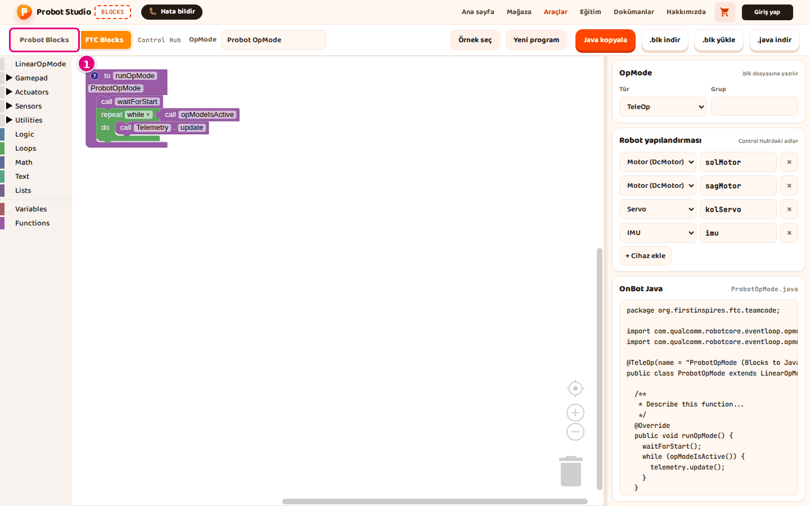
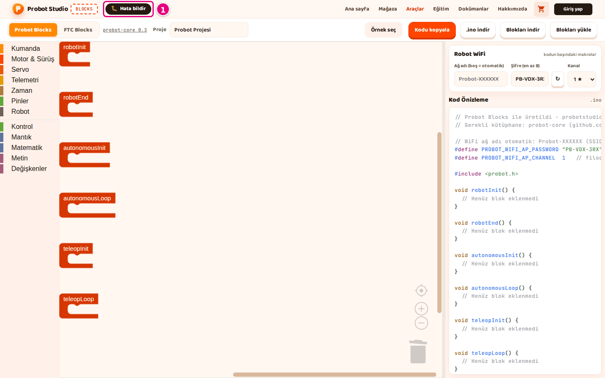

# Hoca hazırlığı

## Bu derste

Bu bir araç tanıtım sunumu, ders değil. Blocks kullanım dokümanının giriş, İlk 10 dakika ve Arayüz turu sayfalarını slayt slayt anlatır ve videoya dönüştürülür. Seslendirilecek metin her sayfanın Söyle satırındadır.

## Dersten önce

- Canlı anlatılacaksa probotstudio.com/blocks adresini ayrı bir sekmede açık tutun.
- Görseller dokümandaki prod ekran görüntüleridir, ekranınız aynı görünür.

## Zaman planı

| Sayfalar | Konu |
|---|---|
| 1-6 | Blocks ne yapar, ne yapmaz, iki mod |
| 7-13 | İlk 10 dakika, örnekten iki dosyaya |
| 14-15 | Ekranın bölgeleri, özet |

Toplam yaklaşık 4 dakika.

# Sayfalar

## Blocks'a başla {kapak}

::: hoca
**Söyle:** "Bu sunumda Blocks'un ne işe yaradığını ve iki modunu tanıyoruz. Ardından ilk on dakikada hazır bir sürüş programı açıyor, kodunu inceliyor ve bilgisayarımıza indiriyoruz. En sonda ekranın bölgelerini görüyoruz."
:::

## Blocks ne işe yarar

- Robot programını blokları dizerek yazıyoruz
- Probot kiti için Arduino kodu (`.ino`) üretir
- FTC robotu için `.blk` dosyası üretir
- Tarayıcıda çalışır, hesap ve kurulum istemez

::: hoca
**Söyle:** "Blocks, robot programını blokları dizerek yazdığımız bir araç. Bloklardan hazır kod üretiyor, Probot kiti için Arduino kodu, FTC robotu için .blk dosyası çıkıyor. Araç tarayıcıda çalışıyor, hesap ya da kurulum istemiyor."
:::

## Blocks neyi yapmaz

- Kodu derlemez, karta göndermez
- Programı Control Hub'a kendisi göndermez
- Hesaba ya da buluta kaydetmez
- Robot tasarlamaz, robot Builder'da kurulur

::: hoca
**Söyle:** "Blocks kodu üretiyor ama derlemiyor ve karta göndermiyor. Probot kodunu Arduino IDE ile, FTC programını Control Hub'ın kendi sayfasından yüklüyoruz. Robotun tasarımı ise Builder'da yapılıyor."
:::

## Çalışmanız tarayıcıda saklanır

- Hesap ve bulut kaydı yok
- Çalışma yalnız bu tarayıcıda durur
- Probot için kalıcı kopya **Blokları indir**
- FTC için kalıcı kopya **.blk indir**

::: hoca
**Söyle:** "Blocks'ta hesap ve bulut kaydı olmadığı için çalışmamız yalnız bu tarayıcıda saklanıyor. Kalıcı bir kopya için Probot modunda Blokları indir, FTC modunda .blk indir düğmesiyle dosyaya kaydediyoruz."
:::

## İki mod

- **Probot Blocks** Probot kiti (ESP32 kart) için
- **FTC Blocks** FTC robotu (REV Control Hub) için
- İlk açılışta **FTC Blocks** seçili gelir
- Son seçilen sekme hatırlanır

::: hoca
**Söyle:** "Araç çubuğundaki iki sekmeyle modu seçiyoruz. Probot Blocks Probot kiti için .ino kodu, FTC Blocks ise Control Hub için .blk dosyası üretiyor. Araç ilk açılışta FTC Blocks ile açılıyor, sonra son seçtiğimiz sekmeyi hatırlıyor."
:::

## Nereden başlarız

- Probot kiti varsa **İlk 10 dakika**
- FTC robotu varsa **FTC örneğiyle başla**
- Arayüz turu, kısayollar ve sorun giderme iki modda ortak

::: hoca
**Söyle:** "Probot kitimiz varsa ilk on dakika sayfasından, FTC robotumuz varsa FTC örneğiyle başlıyoruz. Bu sunumda Probot kitinin ilk on dakikasını adım adım izliyoruz. FTC başlangıcını ayrı bir sunumda görüyoruz."
:::

## Blocks'u açın

- Adres probotstudio.com/blocks
- Giriş kartında **Anladım, devam et**
- Çerez bandı çıkarsa seçeneklerden biri seçilir
- Araç çubuğu ve çalışma alanı görünür

::: hoca
**Söyle:** "Tarayıcıda probotstudio.com/blocks adresini açıyoruz. Kodlama aracı geliştirme aşamasında yazan bir kart çıkıyor, Anladım, devam et düğmesiyle kartı kapatıyoruz. Çerez bandı çıkarsa seçeneklerden birini seçiyoruz ve çalışma alanı açılıyor."
:::

## Probot Blocks sekmesine geçin

- Araç çubuğunun en solunda **Probot Blocks**
- Çalışma alanında altı hazır blok
- **robotInit** Init'e basınca bir kez çalışır
- **teleopLoop** saniyede yaklaşık 50 kez çalışır

::: hoca
**Söyle:** "Probot kiti için araç çubuğunun en solundaki Probot Blocks sekmesini seçiyoruz. Çalışma alanında altı hazır blok var. robotInit Init'e basınca bir kez, teleopLoop ise Teleop boyunca saniyede yaklaşık 50 kez çalışıyor ve yalnız bu blokların içindeki bloklar koda giriyor."
:::

## Tank Sürüş örneğini yükleyin

- Araç çubuğunda **Örnek seç**
- "Probot örnekleri" penceresinde **Tank Sürüş**
- Köşede "Tank Sürüş örneği yüklendi." bildirimi
- Örnek, açık projenin yerine onay sormadan geçer

::: hoca
**Söyle:** "Araç çubuğunda Örnek seç düğmesine basıyoruz ve açılan pencerede Tank Sürüş kartını seçiyoruz. Örnek, çalışma alanındaki projenin yerine onay sormadan geçiyor. Bu yüzden önceden bir projemiz varsa önce Blokları indir ile kaydediyoruz."
:::

## Örnek yüklendi

- **Probot Blocks** sekmesi turuncu
- Araç çubuğundaki düğmede örneğin adı yazar
- **robotInit** içinde iki **motor tanımla**
- **teleopLoop** içinde **kumandayı oku** ve **tank sürüş**

::: hoca
**Söyle:** "Örnek yüklenince Probot Blocks sekmesi turuncu görünüyor ve araç çubuğundaki düğmede örneğin adı yazıyor. robotInit içinde iki motor tanımla bloğu, teleopLoop içinde kumandayı oku ve tank sürüş blokları duruyor."
:::

## Kodu inceleyin

- Yan panelde **Kod Önizleme**
- Tekerlekle `void teleopLoop()` satırına inilir
- İki `setMotor(` satırı iki motoru sürer
- Blok değişince kod anında değişir

::: hoca
**Söyle:** "Yan paneldeki Kod Önizleme bölümünde blokların karşılığı olan kodu görüyoruz. Fare tekerleğiyle teleopLoop satırına kadar iniyoruz. Burada sol çubuk sol motoru, sağ çubuk sağ motoru sürüyor ve bir bloğu değiştirdiğimizde kod anında değişiyor."
:::

## WiFi şifresini yazın

- **Robot WiFi** bölümünde **Şifre (en az 8)**
- Örnek şifre `TAKIM-2026`
- Şifre bu tarayıcıda saklanır
- Şifre not edilir, robota bağlanırken gerekir

::: hoca
**Söyle:** "Robot kendi WiFi ağını yayınlıyor. Şifre kutusunu temizleyip TAKIM-2026 gibi bir şifre yazıyoruz ve bir kenara not ediyoruz. Blocks şifreyi bu tarayıcıda saklıyor, kodun başındaki şifre satırı da aynı anda değişiyor."
:::

## Projeyi ve kodu indirin

- **Blokları indir** ile `tank-surus.probot.json`
- **.ino indir** ile `tank-surus.ino`
- `.probot.json` projeyi sonra açmak için
- `.ino` karta yüklenecek kod

::: hoca
**Söyle:** "Son olarak araç çubuğunda önce Blokları indir, sonra .ino indir düğmesine basıyoruz. İndirilenler klasöründe iki dosya oluyor. Proje dosyasını sonra açmak için saklıyoruz, .ino dosyasını ise karta yüklüyoruz."
:::

## Ekranın bölgeleri

- Blok listesi, blokların kategorileri
- Çalışma alanı, blokları dizdiğimiz yer
- Yan panel, ayarlar ve kod
- **Hata bildir** site başlığında, iki modda da aynı yerde

::: hoca
**Söyle:** "Probot Blocks ekranı üç bölgeden oluşuyor. Blok listesi kategorileri gösteriyor, çalışma alanında blokları diziyoruz, yan panelde ise ayarlar ve kod duruyor. Site başlığı, araç çubuğu ve Hata bildir düğmesi iki modda da aynı kalıyor."
:::

## Özet

- Blocks bloklardan kod üretir, karta yüklemez
- İki mod, **Probot Blocks** ve **FTC Blocks**
- İlk 10 dakikada örnek, kod, şifre ve iki dosya
- Sıradaki sunum örnekler ve bloklar

::: hoca
**Söyle:** "Bu sunumda Blocks'u açtık, Tank Sürüş örneğini yükledik, kodunu inceledik, WiFi şifresini yazdık ve iki dosyayı indirdik. Sonraki sunumda Probot Blocks'ta hazır örnekleri ve blokları düzenlemeyi ayrıntılı olarak görüyoruz."
:::

# Ödevler

## İlk kodunuzu indirin {#blocks-sunum-01-odev tur=yazi}

Blocks'ta Tank Sürüş örneğini açın, WiFi şifresini kendiniz yazın ve .ino dosyasını indirin. Kod Önizleme'nin başındaki şifre satırını buraya yapıştırın.

::: hoca
Tamam. Satır `#define PROBOT_WIFI_AP_PASSWORD` ile başlıyor ve şifre en az 8 karakter.
Tekrar. Satır yok ya da şifre 8 karakterden kısa.
:::
