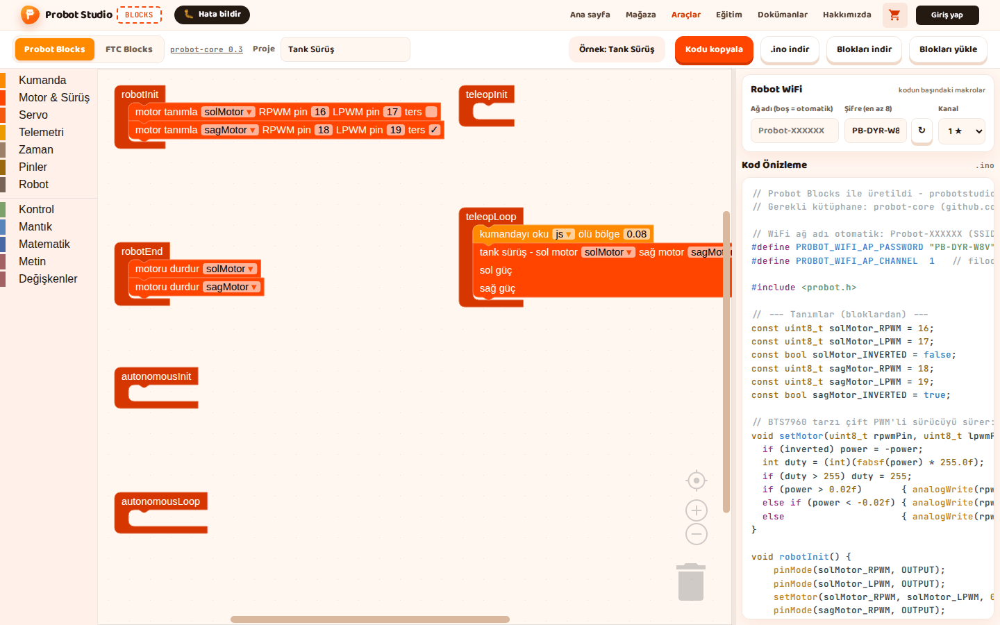
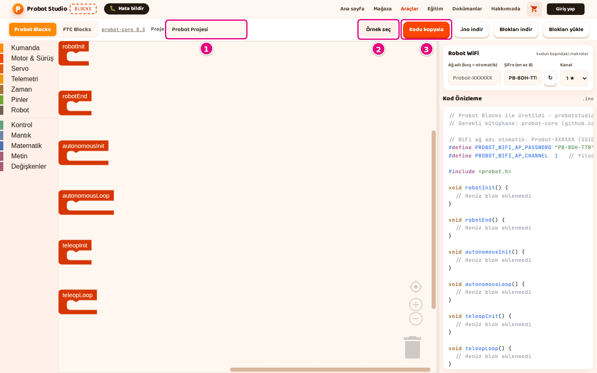

# Hoca hazırlığı

## Bu derste

Bu bir araç tanıtım sunumu, ders değil. Probot Blocks'ta hazır örnek açmayı ve blokları eklemeyi, takmayı, silmeyi ve düzenlemeyi anlatır, videoya dönüştürülür. Seslendirilecek metin her sayfanın Söyle satırındadır.

## Dersten önce

- Canlı anlatılacaksa probotstudio.com/blocks adresinde Probot Blocks sekmesini açık tutun.
- Eğer bloğunun dişli simgesi için dokümanda ayrı ekran görüntüsü yok, canlı gösterim daha anlaşılır olur.

## Zaman planı

| Sayfalar | Konu |
|---|---|
| 1-6 | Hazır örnekler, arama, pinler, kaydetme |
| 7-13 | Blok ekleme, yuva, değer, silme, çoğaltma, düzenleme |
| 14 | Özet |

Toplam yaklaşık 4 dakika.

# Sayfalar

## Örnekler ve bloklarla çalışmak {kapak}

::: hoca
**Söyle:** "Bu sunumda Probot Blocks'taki hazır örnekleri açıyoruz. Ardından blokları eklemeyi, birbirine takmayı, silmeyi, çoğaltmayı ve çalışma alanında gezinmeyi öğreniyoruz."
:::

## Örnek açın

- **Probot Blocks** sekmesinde **Örnek seç**
- "Probot örnekleri" penceresinde **Arcade Sürüş**
- Bildirim 5 saniye sonra kaybolur
- **Proje** kutusunda örneğin adı yazar

::: hoca
**Söyle:** "Probot Blocks sekmesinde Örnek seç düğmesine basıyoruz ve açılan pencerede Arcade Sürüş kartını seçiyoruz. Örneğin blokları çalışma alanına geliyor, Proje kutusunda da örneğin adı yazıyor. FTC Blocks sekmesindeki Örnek seç ise FTC örneklerini açıyor."
:::

## Örnek arayın

- İmleç **Örnek ara...** kutusunda
- `servo` yazınca **Servo Testi** kalır
- Arama ad ve açıklamada, büyük küçük harf ayırmadan
- Pencere **×** ya da <kbd>Esc</kbd> ile kapanır

::: hoca
**Söyle:** "Pencere açılınca imleç Örnek ara kutusunda duruyor. Kutuya servo yazınca listede Servo Testi kalıyor. Arama örneğin adında ve açıklamasında yapılıyor, eşleşme yoksa Eşleşen örnek bulunamadı yazısı çıkıyor."
:::

## Hangi örnek ne yapar

- **Tank Sürüş** ve **Arcade Sürüş** iki motoru kumandayla sürer
- **Kumanda Testi** ve **Robot Durumu** telemetriye değer yazar
- **Servo Testi** A ile 0, B ile 180 dereceye gider
- Otonom örneği iki motoru 2 saniye sürüp durur

::: hoca
**Söyle:** "Altı örneğin her biri farklı bir işi gösteriyor. Tank Sürüş ve Arcade Sürüş iki motoru kumandayla sürüyor, Kumanda Testi ile Robot Durumu telemetriye değer yazıyor. Servo Testi servoyu A ile 0, B ile 180 dereceye götürüyor, otonom örneği ise iki motoru 2 saniye sürüp durduruyor."
:::

## Pinleri robotunuza uydurun

- Sol motor RPWM 16, LPWM 17
- Sağ motor 18 ve 19, **ters** işaretli
- Servo pin 4, LEDC kanal 7
- Kablolar farklıysa pin sayıları değiştirilir

::: hoca
**Söyle:** "Örneklerdeki motor tanımla blokları sol motoru 16 ve 17, sağ motoru 18 ve 19 numaralı pinlere bağlıyor. Servo ise pin 4'e bağlı. Robotumuzda kablolar farklıysa bu bloklardaki pin sayılarını değiştiriyoruz."
:::

## Değiştirdiğiniz örneği kaydedin

- **Proje** kutusuna kendi adımız, ör. `Takım Arcade`
- **Blokları indir** ile `takim-arcade.probot.json`
- Örnek, bir blok değişene kadar tarayıcıya kaydedilmez
- Tarayıcı kaydını başka bilgisayar görmez

::: hoca
**Söyle:** "Örneği değiştirdiysek Proje kutusuna kendi adımızı yazıyoruz ve Blokları indir ile bilgisayarımıza kaydediyoruz. Tarayıcı, yüklenen örneği biz bir bloğu değiştirene kadar kaydetmiyor. Tarayıcıdaki kaydı da başka bir bilgisayar görmüyor."
:::

## Blok ekleyin

- Blok listesinde **Telemetri**
- **telemetriye yaz** bloğu **teleopLoop**'un ağzına
- Ağız vurgulanınca bırakılır
- Serbest duran blok koda girmez

::: hoca
**Söyle:** "Blok listesinden Telemetri kategorisini seçiyoruz ve telemetriye yaz bloğunu teleopLoop bloğunun ağzına sürüklüyoruz. Ağız vurgulanınca bırakıyoruz ve Kod Önizleme'de yeni satır beliriyor. Yalnız yaşam döngüsü bloklarının içine bağlı bloklar koda giriyor."
:::

## Bloğu bir yuvaya takın

- **motoru sür** bloğunun güç yuvası
- **Kumanda**'dan **js sol çubuk ↕ (ileri +)**
- Serbest kalan `0.5` bloğu çöp kutusuna
- Kodda `0.5` yerine `js.getLeftY()` yazar

::: hoca
**Söyle:** "Bazı blokların değer yuvası var. motoru sür bloğunun güç yuvasına Kumanda kategorisinden sol çubuk bloğunu takıyoruz. Yuvadan çıkan sayı bloğunu çöp kutusuna atıyoruz ve kodda sabit sayının yerine çubuğun değeri yazıyor."
:::

## Bloktaki değeri değiştirin

- Sayıya ya da metne basılır, yeni değer yazılır
- <kbd>Enter</kbd> ya da boş alana tıklama
- `▾` işaretli alanlarda listeden seçim
- **ters** gibi kutular işaretlenir

::: hoca
**Söyle:** "Bloktaki sayıya ya da metne basıp yeni değeri yazıyoruz ve Enter tuşuyla onaylıyoruz. Açılır listeli alanlarda listeden seçim yapıyor, ters gibi onay kutularını işaretliyoruz. Kod her değişiklikte anında güncelleniyor."
:::

## Eğer bloğuna değilse kolu ekleyin

- **Kontrol**'den **eğer** bloğu
- Dişli simgesi küçük bir düzenleme alanı açar
- **değilse** parçası **eğer** parçasının altına
- **değilse eğer** birden çok kez eklenebilir

::: hoca
**Söyle:** "Kontrol kategorisindeki eğer bloğunun tek kolu var. Bloğun dişli simgesine basıp açılan küçük alanda değilse parçasını eğer parçasının altına sürüklüyoruz. Dişliye yeniden basınca alan kapanıyor ve blokta yeni kol görünüyor."
:::

## Bloğu silin, geri getirin

- <kbd>Delete</kbd>, **Bloğu Sil** ya da çöp kutusuna sürükleme
- Yaşam döngüsü blokları silinmez
- Çöp kutusuna basınca silinenler listelenir
- <kbd>Ctrl</kbd>+<kbd>Z</kbd> geri alır, <kbd>Ctrl</kbd>+<kbd>Y</kbd> yineler

::: hoca
**Söyle:** "Bloğu Delete tuşuyla, sağ tık menüsündeki Bloğu Sil ile ya da çöp kutusuna sürükleyerek siliyoruz. Çöp kutusuna sürüklersek altına bağlı bloklar da gidiyor. Yanlış sildiğimiz bloğu çöp kutusuna basıp panelden geri sürüklüyoruz ya da Ctrl Z ile geri alıyoruz."
:::

## Bloğu çoğaltın

- Bloğa sağ tıklanır
- Menüdeki **Çoğalt** bloğun kopyasını çıkarır
- Kopya, içindeki bloklarla birlikte gelir
- Klavyede <kbd>Ctrl</kbd>+<kbd>C</kbd>, <kbd>Ctrl</kbd>+<kbd>V</kbd>

::: hoca
**Söyle:** "Bloğa sağ tıklayıp menüden Çoğalt komutunu seçiyoruz. Çoğalt, bloğu içindekilerle birlikte kopyalıyor. Aynı işi Ctrl C ve Ctrl V ile de yapabiliyoruz."
:::

## Bloğu geçici olarak kapatın

- Sağ tık, **Bloğu Devre Dışı Bırak**
- Blok soluk görünür, satırı koddan çıkar
- Geri açmak için **Bloğu Etkinleştir**
- **Satır içi Girişler** yuvaları yan yana dizer

::: hoca
**Söyle:** "Bir bloğu silmeden denemek için sağ tıklayıp Bloğu Devre Dışı Bırak komutunu seçiyoruz. Blok soluk görünüyor ve satırı Kod Önizleme'den kayboluyor. Bloğu Etkinleştir ile bloğu geri getiriyoruz."
:::

## Blokları dizin, alanda gezinin

- **Blokları Temizle** blokları dizer, silmez
- Merkez düğmesi görünümü ortalar
- **+** ve **−** ya da <kbd>Ctrl</kbd>+tekerlek
- Panel tutamağı yan paneli genişletir

::: hoca
**Söyle:** "Boş alana sağ tıklayıp Blokları Temizle komutunu seçince bloklar silinmiyor, alt alta düzgünce diziliyor. Merkez düğmesi görünümü ortalıyor, artı ve eksi düğmeleriyle yakınlaştırıp uzaklaştırıyoruz. Kodu daha rahat okumak için yan paneli tutamağından sürükleyip genişletiyoruz."
:::

## Özet

- Altı hazır örnek **Örnek seç** penceresinde
- Bloklar yaşam döngüsü bloklarına takılır
- Silinen blok çöp kutusundan geri gelir
- Sıradaki sunum sürüş programı ve değişkenler

::: hoca
**Söyle:** "Bu sunumda hazır örnekleri açtık, blokları ekleyip taktık, sildik ve çoğalttık. Sonraki sunumda boş bir projeden sürüş programını kendimiz yazıyoruz ve değişkenleri kullanıyoruz."
:::

# Ödevler

## Örneği değiştirip kaydedin {#blocks-sunum-02-odev tur=yazi}

Blocks'ta Arcade Sürüş örneğini açın. Bir bloğu devre dışı bırakın, Proje kutusuna kendi adınızı yazın ve Blokları indir ile kaydedin. İnen dosyanın adını buraya yazın.

::: hoca
Tamam. Dosya adı `.probot.json` ile bitiyor ve proje adından türemiş, ör. `takim-arcade.probot.json`.
Tekrar. Dosya adı `arcade` ile başlıyorsa proje adı değiştirilmemiş.
:::
