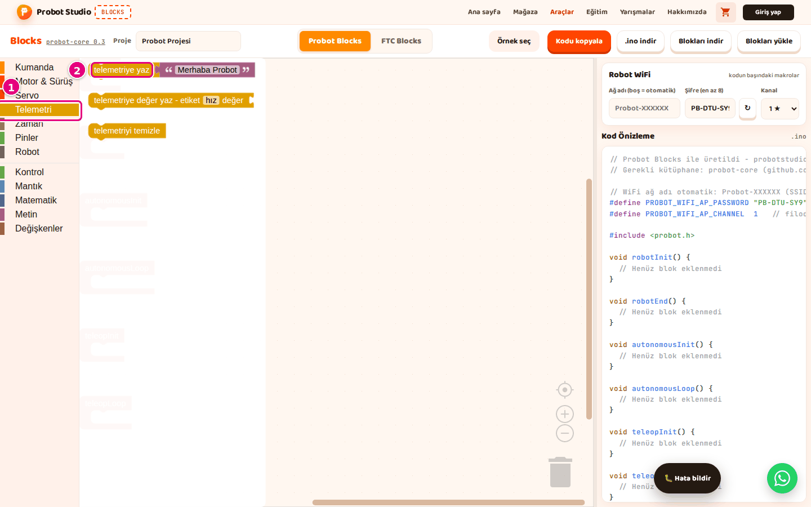
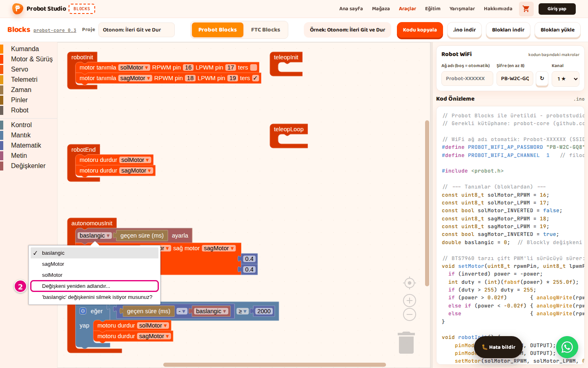

# Hoca hazırlığı

## Bu derste

Bu bir araç tanıtım sunumu, ders değil. Probot Blocks'ta boş projeden iki motorlu sürüş programı yazmayı ve değişken kullanmayı anlatır, videoya dönüştürülür. Seslendirilecek metin her sayfanın Söyle satırındadır.

## Dersten önce

- Canlı anlatılacaksa Probot Blocks'u boş projeyle açık tutun, karşılaştırma için ikinci sekmede Tank Sürüş örneği.
- Pinler örneklerdeki gibi, sol motor 16 ve 17, sağ motor 18 ve 19.

## Zaman planı

| Sayfalar | Konu |
|---|---|
| 1-9 | Yaşam döngüsü, motorlar, sürüş, kod kontrolü |
| 10-14 | Değişken oluşturma, değer verme, kullanma, adlandırma |
| 15 | Özet |

Toplam yaklaşık 4 dakika.

# Sayfalar

## Sürüş programı ve değişkenler {kapak}

::: hoca
**Söyle:** "Bu sunumda boş bir projeden iki motorlu, kumandayla sürülen bir program yazıyoruz. Ardından bir değeri saklamak için değişken oluşturuyor, ona değer veriyor ve değerini başka bir blokta kullanıyoruz."
:::

## Yaşam döngüsü bloklarını tanıyın

- **robotInit** Init'te, **robotEnd** Stop'ta bir kez
- **autonomousInit** ve **teleopInit** başlarken bir kez
- **autonomousLoop** ve **teleopLoop** saniyede yaklaşık 50 kez
- Döngüde 2 saniyeden uzun bekleme yapılmaz

::: hoca
**Söyle:** "Program altı bloğa bölünüyor ve her blok robotun farklı bir anında çalışıyor. robotInit Init'e basınca, robotEnd Stop'a basınca bir kez çalışıyor. Döngü blokları saniyede yaklaşık 50 kez çalıştığı için içlerinde 2 saniyeden uzun bekleme yapmıyoruz."
:::

## Boş projeyle başlayın

- Çalışma alanında yalnız altı yaşam döngüsü bloğu
- Değilse boş alan menüsünde **12 Bloğunu Sil** gibi öğe
- Sol motor 16 ve 17, sağ motor 18 ve 19 numaralı pin
- Hazır sonuç **Tank Sürüş** örneğinde

::: hoca
**Söyle:** "Çalışma alanında yalnız altı yaşam döngüsü bloğuyla başlıyoruz. Bu sunumda örneklerdeki pinleri kullanıyoruz, sol motor 16 ve 17, sağ motor 18 ve 19 numaralı pinlere bağlı. Hazır sonucu görmek istersek Tank Sürüş örneğini açıyoruz."
:::

## Sağ motorun adını oluşturun

- Motor adları değişken olarak tutulur
- **Değişkenler** kategorisinde **Değişken oluştur...**
- Ad `sagMotor`, ardından **Tamam**
- Adda Türkçe harf ve boşluk yok

::: hoca
**Söyle:** "Motor adları değişken olarak tutuluyor ve sagMotor adı motor bloklarında hazır gelmiyor. Değişkenler kategorisinde Değişken oluştur düğmesine basıp sagMotor yazıyoruz. Türkçe harf kullanmıyoruz, yoksa ad kodda okunmaz hâle geliyor."
:::

## Motorları tanımlayın

- İki **motor tanımla** bloğu **robotInit** içine
- İkinci blokta ad **sagMotor**
- İkinci blokta pinler `18` ve `19`
- Sağ motor ters dönüyorsa **ters** işaretlenir

::: hoca
**Söyle:** "Motor ve Sürüş kategorisinden iki motor tanımla bloğunu robotInit içine alt alta takıyoruz. İkinci blokta adı sagMotor yapıyor, pinleri 18 ve 19 olarak değiştiriyoruz. Sağ motor ters dönüyorsa ters kutusunu işaretliyoruz."
:::

## Motorları durdurun

- İki **motoru durdur** bloğu **robotEnd** içine
- İkinci blokta **sagMotor** seçilir
- Stop'a basınca iki motor da durur

::: hoca
**Söyle:** "Stop'a basıldığında iki motorun da durması için robotEnd içine iki motoru durdur bloğu koyuyoruz. İkinci blokta listeden sagMotor adını seçiyoruz ve kodda robotEnd içinde iki satır beliriyor."
:::

## Kumandayla sürün

- **teleopLoop** içine **kumandayı oku**, altına **tank sürüş**
- **sol güç** yuvasına sol çubuk
- **sağ güç** yuvasına **sağ çubuk ↕ (ileri +)**
- Yuvalardan düşen `0` blokları çöp kutusuna

::: hoca
**Söyle:** "teleopLoop içine önce kumandayı oku, altına da tank sürüş bloğunu takıyoruz. Sol güç yuvasına sol çubuğu, sağ güç yuvasına sağ çubuğu bağlıyoruz. Çubuk tam ileri itilince değer artı 1 oluyor ve robotta her çubuk kendi tarafındaki motoru sürüyor."
:::

## Kodu kontrol edin

- Dışarıda kalan blok çöp kutusuna
- **Kod Önizleme**'de `void teleopLoop()`
- `auto js` satırı ve iki `setMotor(` satırı
- Kaydetmek için **Blokları indir**, yüklemek için **.ino indir**

::: hoca
**Söyle:** "Yaşam döngüsü bloklarının dışında blok kaldıysa onu çöp kutusuna atıyoruz. Kod Önizleme'de teleopLoop içinde kumandayı okuyan satırı ve iki motor satırını görünce program karta yüklenmeye hazır oluyor."
:::

## Sürüşte sorun varsa

- Blok koda girmiyorsa yaşam döngüsü bloğuna yeniden takılır
- İki motor aynı yöne dönmüyorsa **ters** kutusu
- Robot hep biraz kayıyorsa **ölü bölge** büyütülür
- **ölü bölge** en çok `0.5`

::: hoca
**Söyle:** "Bir blok koda girmiyorsa yaşam döngüsü bloğuna tam oturmamış oluyor, onu yeniden takıyoruz. İki motor aynı yöne dönmüyorsa ters dönen motorun ters kutusunu işaretliyoruz. Robot hep biraz kayıyorsa kumandayı oku bloğundaki ölü bölge değerini büyütüyoruz."
:::

## Değişken oluşturun

- **Değişkenler** kategorisinde **Değişken oluştur...**
- Ad `baslangic`, ardından **Tamam**
- **ayarla**, **göre değiştir** ve okuma blokları gelir
- Aynı adla ikinci değişken oluşturulamaz

::: hoca
**Söyle:** "Bir değeri saklamak için değişken kullanıyoruz ve örnek olarak otonomun başladığı anı saklıyoruz. Değişkenler kategorisinde Değişken oluştur düğmesine basıp baslangic yazıyoruz. Panelde bu değişkenin değer veren, değiştiren ve okuyan blokları beliriyor."
:::

## Değişkene değer verin

- **ayarla** bloğu **autonomousInit** içine
- Bloktaki listeden **baslangic**
- Yuvaya **Zaman**'dan **geçen süre (ms)**
- Kodda `baslangic = millis();` satırı

::: hoca
**Söyle:** "Değişkenler kategorisinden ayarla bloğunu autonomousInit içine takıyoruz ve listeden baslangic adını seçiyoruz. Yuvasına Zaman kategorisinden geçen süre bloğunu bağlıyoruz. Böylece otonom başlarken o anki süre baslangic değişkenine yazılıyor."
:::

## Değişkenin değerini kullanın

- **telemetriye değer yaz** **autonomousLoop** içine
- **değer** yuvasına **Matematik**'ten **+**
- **+** bloğunun ilk yuvasına **baslangic**
- **göre değiştir** değeri artırır, eksi sayı azaltır

::: hoca
**Söyle:** "Değişkeni okuyan bloğu bir yaşam döngüsü bloğundaki bloğa takıyoruz. autonomousLoop içine telemetriye değer yaz bloğunu koyup değer yuvasına bir toplama bloğu, onun ilk yuvasına da baslangic bloğunu bağlıyoruz. Değeri değiştirmek için göre değiştir bloğunu kullanıyoruz."
:::

## Değişkenin adını değiştirin ya da silin

- Bloktaki `baslangic ▾` listesi
- **Değişkeni yeniden adlandır...** adı her yerde değiştirir
- Silme öğesi değişkeni ve kullanan blokları siler
- Geri almak için <kbd>Ctrl</kbd>+<kbd>Z</kbd>

::: hoca
**Söyle:** "Bloktaki değişken listesine basıp Değişkeni yeniden adlandır komutunu seçiyoruz ve adı bütün bloklarda tek seferde değiştiriyoruz. Aynı listedeki silme öğesi değişkeni onu kullanan bloklarla birlikte siliyor. Yanlışlıkla silersek Ctrl Z ile geri alıyoruz."
:::

## Motor, servo ve kumanda adları

- **solMotor**, **sagMotor**, **kolServo** ve **js** de değişken
- Bu adlarla **ayarla** ya da **göre değiştir** kullanılmaz
- Adlar motor, servo ve kumanda bloklarının listesinden seçilir

::: hoca
**Söyle:** "solMotor, sagMotor ve js gibi adlar da değişken olduğu için Değişkenler listesinde görünüyor. Bunlara sayı vermiyoruz, çünkü kod anlamsız bir sayı değişkeni üretiyor. Bu adları yalnız motor, servo ve kumanda bloklarındaki listelerden seçiyoruz."
:::

## Özet

- Motorlar **robotInit**'te tanımlanır, **robotEnd**'de durur
- Sürüş **teleopLoop** içinde
- Değişken bir değeri adıyla saklar
- Sıradaki sunum WiFi ayarları ve proje kaydı

::: hoca
**Söyle:** "Bu sunumda sürüş programını kendimiz kurduk, sonra bir değişken oluşturup kullandık. Sonraki sunumda robotun WiFi ayarlarını yapıyoruz ve projemizi kaydedip yeniden açmayı görüyoruz."
:::

# Ödevler

## Sürüş programını kendiniz kurun {#blocks-sunum-03-odev tur=yazi}

Boş bir Probot projesinde iki motoru tanımlayın, robotEnd içinde durdurun ve teleopLoop içinde tank sürüş bloğuyla iki çubuğa bağlayın. Kod Önizleme'de teleopLoop içinde kaç tane `setMotor(` satırı olduğunu yazın.

::: hoca
Tamam. İki satır. Program Tank Sürüş örneğiyle aynı bloklardan oluşuyor.
Tekrar. Satır yoksa bloklar yaşam döngüsü bloğuna takılmamış.
:::
