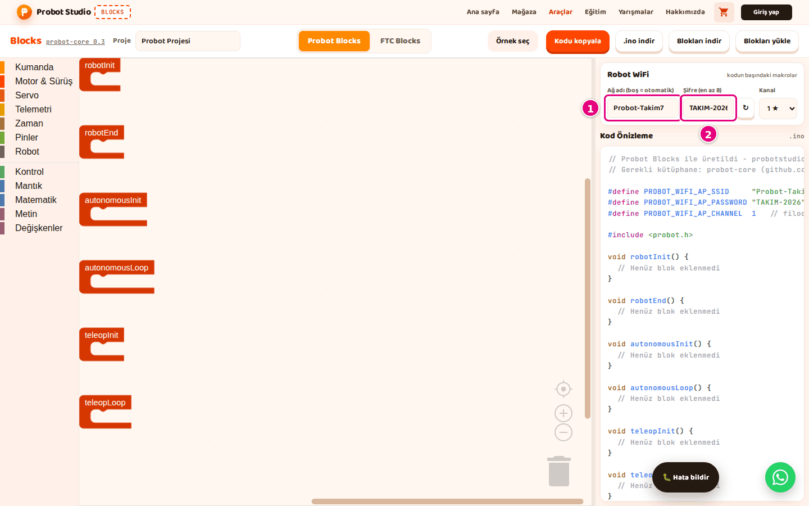
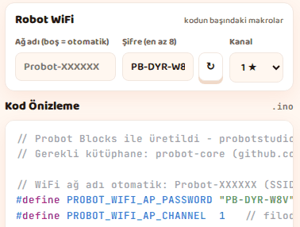
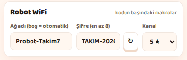
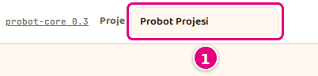
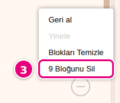

# Hoca hazırlığı

## Bu derste

Bu bir araç tanıtım sunumu, ders değil. Probot Blocks'ta robotun WiFi ayarlarını yapmayı ve projeyi dosyaya kaydedip açmayı anlatır, videoya dönüştürülür. Seslendirilecek metin her sayfanın Söyle satırındadır.

## Dersten önce

- Canlı anlatılacaksa Probot Blocks'ta Arcade Sürüş örneğini açık tutun.
- Ekranda görünen WiFi şifresi robotun kendi ağının şifresidir, hesap şifresi değildir.

## Zaman planı

| Sayfalar | Konu |
|---|---|
| 1-7 | Ağ adı, şifre, kanal, ayarların saklanması |
| 8-12 | Proje adı, kaydetme, açma, yeniden başlama, otomatik kayıt |
| 13 | Özet |

Toplam yaklaşık 3 dakika.

# Sayfalar

## WiFi ayarları ve proje kaydı {kapak}

::: hoca
**Söyle:** "Bu sunumda robotun yayınladığı WiFi ağının adını, şifresini ve kanalını ayarlıyoruz. Ardından projemizi dosyaya kaydediyor, kayıtlı dosyayı açıyor ve boş bir projeyle yeniden başlıyoruz."
:::

## Robot kendi ağını yayınlar

- Bilgisayar ya da telefon robotun ağına bağlanır
- Ayarlar kodun başına yazılır
- Kod karta yüklenince geçerli olur
- Blocks'un ürettiği şifre tarayıcıda saklanır

::: hoca
**Söyle:** "Probot kartı kendi WiFi ağını yayınlıyor, bilgisayarımız ya da telefonumuz bu ağa bağlanıp robotu sürüyor. Ayarlar kodun başına yazılıyor ve kodu karta yükleyince geçerli oluyor. Şifreyi elle yazmasak da Blocks ilk açılışta bir şifre üretip tarayıcıda saklıyor."
:::

## Ağ adını ve şifreyi yazın

- **Ağ adı (boş = otomatik)**, ör. `Probot-Takim7`, en çok 24 karakter
- **Şifre (en az 8)**, 8-24 karakter, ör. `TAKIM-2026`
- Şifrede yalnız büyük harf, rakam ve `-`
- 8 karakterden kısa şifreyle kod derlenmez

::: hoca
**Söyle:** "Ağ adı kutusuna robotun ağ adını, örneğin Probot-Takim7 yazıyoruz. Şifre kutusuna 8 ile 24 karakter arasında bir şifre yazıp not ediyoruz. Şifre 8 karakterden kısaysa kutu uyarı veriyor ve kod derlenmiyor."
:::

## Ağ adını boş bırakırsanız

- Robot `Probot-XXXXXX` biçiminde kendi adını kullanır
- Kodda ad satırının yerinde bir yorum durur
- Sınıfta her robota ayrı ad verilir

::: hoca
**Söyle:** "Ağ adı kutusunu boş bırakırsak robot Probot ile başlayan kendi adını kullanıyor ve kodda ad satırının yerinde bir yorum duruyor. Sınıfta birden çok robot varsa her robota ayrı bir ad veriyoruz."
:::

## Yeni şifre üretin

- Şifre kutusunun yanındaki **↻**
- `PB-XXX-XXX` biçiminde şifre, tarayıcıda saklanır
- Şifre not edilir, **.ino indir** ile yeni kod alınır

::: hoca
**Söyle:** "İstersek şifre kutusunun yanındaki yenile düğmesiyle rastgele bir şifre ürettiriyoruz. Yeni şifreyi not edip .ino dosyasını yeniden indiriyoruz. Robot yeni şifreyi bu kod karta yüklenince kullanıyor."
:::

## Kanalı seçin

- **Kanal** listesinde yıldızlı bir kanal, burada **5 ★**
- Yıldızlılar **1 ★**, **5 ★**, **9 ★** ve **13 ★**
- Aynı odadaki her robota bu dört kanaldan farklı biri verilir
- Bazı cihazlar 12 ve 13. kanalı görmez, o zaman 1-11 seçilir

::: hoca
**Söyle:** "Aynı odadaki robotlar birbirini bozmasın diye Kanal listesinden yıldızlı kanallardan birini seçiyoruz, burada 5 seçili. 1, 5, 9 ve 13 numaralı kanallar birbirini bozmuyor. Bazı tablet ve dizüstüler 13. kanalı görmüyor; o cihazın bağlanacağı robota 1 ile 11 arası bir kanal veriyoruz."
:::

## Ayarlar nerede saklanır

- Tarayıcıda ve `.probot.json` dosyasında
- Dosyadan gelen şifre tarayıcıya kaydedilir
- Dosyadan gelen ağ adı ve kanal bir kez elle değiştirilir
- Dosya WiFi şifresini açık metin taşır

::: hoca
**Söyle:** "Ağ adı, şifre ve kanal hem tarayıcıda hem proje dosyasında saklanıyor. Dosyadan gelen şifre tarayıcıya kaydediliyor, ağ adı ve kanalın kalıcı olması için ise ikisini bir kez elle değiştiriyoruz. Proje dosyası şifreyi açık metin olarak taşıdığı için onu paylaşırken dikkat ediyoruz."
:::

## Projeye ad verin

- Araç çubuğunda **Proje** kutusu, en çok 60 karakter
- `Takım Robotu` adı `takim-robotu` dosya adı olur
- Türkçe harfler sadeleşir, boşluklar `-` olur
- Kutu boşsa dosya adı `probot-projesi`

::: hoca
**Söyle:** "Önce araç çubuğundaki Proje kutusuna projemizin adını yazıyoruz. İndirilen dosyalar bu adı alıyor, Türkçe harfler sadeleşiyor ve boşluklar tireye dönüyor."
:::

## Projeyi dosyaya kaydedin

- Araç çubuğunda **Blokları indir**
- "Blok projesi indirildi." bildirimi
- Dosyada bloklar, proje adı ve WiFi ayarları
- Tarayıcı kaydı yalnız bu tarayıcıda durur

::: hoca
**Söyle:** "Projeyi kaybetmemek için Blokları indir ile bilgisayarımıza kaydediyoruz. Tarayıcıdaki otomatik kayıt yalnız bu tarayıcıda duruyor ve tarayıcı verisi temizlenince siliniyor. Bu yüzden en güvenli kayıt dosyaya indirmek oluyor."
:::

## Kayıtlı projeyi açın

- **Blokları yükle**, dosya seçilir, **Aç**
- "Blok projesi yüklendi." bildirimi
- Dosya açık projenin yerine onay sormadan geçer
- Hatalı dosyada "Blok projesi yüklenemedi." yazar

::: hoca
**Söyle:** "Kaydettiğimiz projeyi Blokları yükle ile açıyoruz. Dosya, çalışma alanındaki projenin yerine onay sormadan geçiyor, bu yüzden önce açık projeyi indiriyoruz. Dosya bozuksa Blok projesi yüklenemedi yazısı çıkıyor."
:::

## Yeniden başlayın

- Probot Blocks'ta **Yeni** düğmesi yok
- Önce **Blokları indir**
- Boş alana sağ tık, ör. **9 Bloğunu Sil**
- Onay sorusunda **Tamam**, altı blok kalır

::: hoca
**Söyle:** "Probot Blocks'ta Yeni düğmesi yok, boş projeye blokları silerek dönüyoruz. Önce projeyi indiriyoruz, sonra boş alana sağ tıklayıp blokları silme öğesini seçiyor ve onay sorusunda Tamam diyoruz. Geriye yalnız altı yaşam döngüsü bloğu kalıyor."
:::

## Otomatik kayıt nasıl çalışır

- Bloklar, yan panel genişliği ve sekme kendiliğinden saklanır
- Büyük proje de kaydedilir, blokların süresi dolmaz
- Başka tarayıcı ya da bilgisayar kaydı görmez
- Önemli proje dosyaya indirilir

::: hoca
**Söyle:** "Blocks projemizi tarayıcıda kendiliğinden saklıyor ve aynı tarayıcıda sayfayı açınca proje geri geliyor. Büyük proje de kaydediliyor ve blokların süresi dolmuyor, ama bu kayıt başka bir bilgisayardan görünmüyor. Önemli projeyi bu yüzden her zaman dosyaya indiriyoruz."
:::

## Özet

- Ağ adı, şifre ve kanal kodun başına yazılır
- Şifre elle yazılır ve not edilir
- **Blokları indir** ve **Blokları yükle** ile dosya
- Sıradaki sunum kodu alıp karta yüklemek

::: hoca
**Söyle:** "Bu sunumda robotun WiFi ayarlarını yaptık ve projemizi dosyaya kaydedip yeniden açtık. Sonraki sunumda kodu bilgisayarımıza alıyor, Arduino IDE ile karta yüklüyor ve blokları FTC Blocks'a taşıyoruz."
:::

# Ödevler

## Robotunuzun ağını ayarlayın {#blocks-sunum-04-odev tur=yazi}

Probot Blocks'ta Ağ adı kutusuna takımınıza özel bir ad yazın, şifreyi elle yazın ve kanal olarak 1, 5, 9 ya da 13 seçin. Kod Önizleme'nin başındaki üç WiFi satırını buraya yapıştırın.

::: hoca
Tamam. `PROBOT_WIFI_AP_SSID`, `PROBOT_WIFI_AP_PASSWORD` ve `PROBOT_WIFI_AP_CHANNEL` satırları var, kanal 1, 5, 9 ya da 13.
Tekrar. Ad satırı yerine yorum varsa ağ adı boş bırakılmış.
:::
