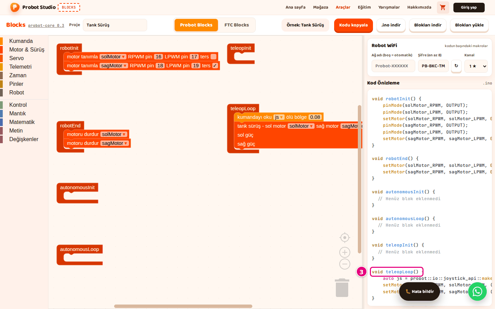
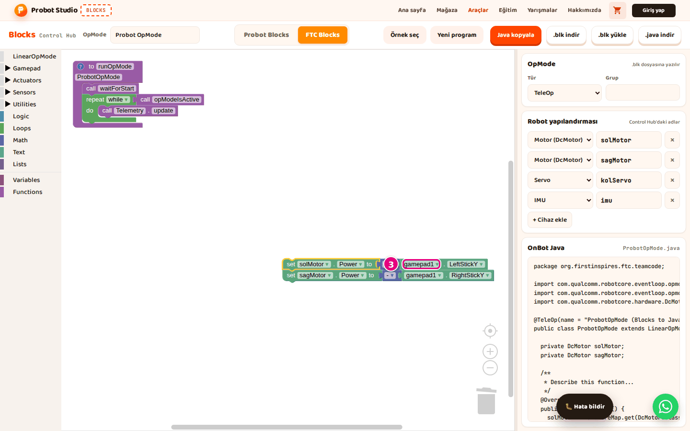
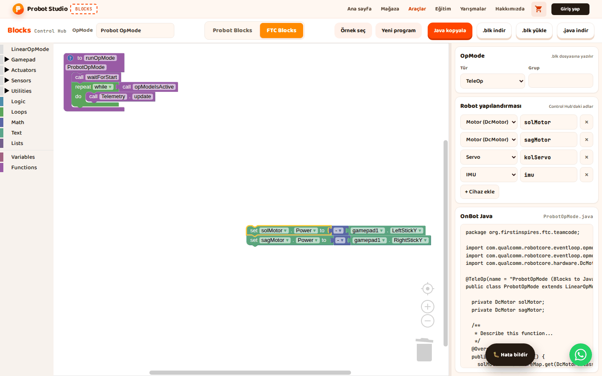
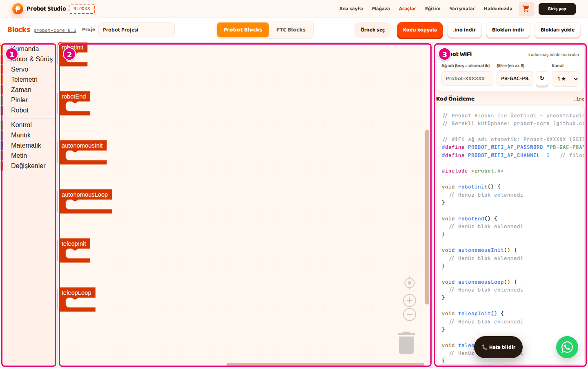

# Hoca hazırlığı

## Bu derste

Bu bir araç tanıtım sunumu, ders değil. Probot Blocks'ta üretilen kodu almayı, Arduino IDE ile Probot kartına yüklemeyi ve blokları FTC Blocks'a taşımayı anlatır, videoya dönüştürülür. Seslendirilecek metin her sayfanın Söyle satırındadır.

## Dersten önce

- Dokümanda Arduino IDE ve Driver Station ekran görüntüsü yok. Bu sayfalarda Blocks ekranından ilgili görüntü kullanılır.
- Canlı anlatılacaksa Arduino IDE, ESP32 kart paketi ve `probot` kütüphanesi kurulu olsun.

## Zaman planı

| Sayfalar | Konu |
|---|---|
| 1-4 | .ino indirme, kodu kopyalama, kodun yapısı |
| 5-10 | Arduino IDE, karta yükleme, robotun ağı, sorunlar |
| 11-15 | FTC Blocks'a taşıma, karşılıklar, blok listesi, özet |

Toplam yaklaşık 4 dakika.

# Sayfalar

## Kodu al, karta yükle, FTC'ye taşı {kapak}

::: hoca
**Söyle:** "Bu sunumda bloklardan üretilen kodu bilgisayarımıza alıyor ve Arduino IDE ile Probot kartına yüklüyoruz. Ardından robotun ağına bağlanıp programı başlatıyor, en sonda da blokları FTC Blocks'a taşıyoruz."
:::

## Kodu .ino dosyası olarak indirin

- **Proje** kutusuna ad, ör. `Tank Sürüş`
- Araç çubuğunda **.ino indir**
- ".ino dosyası indirildi." bildirimi
- İndirilenler klasöründe `tank-surus.ino`

::: hoca
**Söyle:** "Önce Proje kutusuna dosyanın adını yazıyoruz, sonra araç çubuğunda .ino indir düğmesine basıyoruz. İndirilenler klasöründe proje adını taşıyan bir .ino dosyası oluyor. Proje kutusu boşsa dosyanın adı probot-projesi oluyor."
:::

## Kodu panoya kopyalayın

- Araç çubuğunda **Kodu kopyala**
- Arduino IDE'de yeni sketch, hazır metin silinir
- <kbd>Ctrl</kbd>+<kbd>V</kbd> ile yapıştırma
- Pano izni yoksa "Kopyalama başarısız oldu."

::: hoca
**Söyle:** "Arduino IDE açıksa kodu Kodu kopyala düğmesiyle panoya alıyoruz. Yeni bir sketch açıp içindeki hazır metni siliyor ve Ctrl V ile kodu yapıştırıyoruz. Tarayıcı panoya izin vermezse .ino indir düğmesini kullanıyoruz."
:::

## Kodda ne var

- Başlık yorumu ve WiFi ayarları
- `#include <probot.h>` ve tanımlar
- Altı yaşam döngüsü fonksiyonu
- `setup()` ve `loop()` yok, kütüphane sağlar

::: hoca
**Söyle:** "Üretilen kod bir başlık yorumu ve WiFi ayarlarıyla başlıyor. Ardından kütüphane satırı, motor pinleri ve değişkenler geliyor, kod altı yaşam döngüsü fonksiyonuyla bitiyor. setup ve loop fonksiyonlarını kütüphane sağladığı için kodda görmüyoruz."
:::

## Arduino IDE'yi hazırlayın

- ESP32 kart paketi
- `probot` ve `Adafruit NeoPixel` kütüphaneleri
- **Huge APP (3MB No OTA)** bölümleme
- Probot kartı ve USB veri kablosu

::: hoca
**Söyle:** "Blocks kodu üretiyor ama karta yüklemiyor, bu işi Arduino IDE ile yapıyoruz. IDE'de ESP32 kart paketi, probot ve Adafruit NeoPixel kütüphaneleri kurulu olmalı. Blocks probot-core 0.3 için kod üretiyor, Probot Core dokümanından yalnız kurulum adımlarını izliyoruz."
:::

## Dosyayı Arduino IDE'de açın

- **File** > **Open**, Türkçe arayüzde **Dosya** > **Aç**
- İndirilen `.ino` dosyası seçilir
- Klasör önerisinde **OK**
- İlk satır `// Probot Blocks ile üretildi`

::: hoca
**Söyle:** "Arduino IDE'de File menüsünden Open komutunu seçip indirdiğimiz .ino dosyasını açıyoruz. IDE dosyayı aynı adlı bir klasöre taşımayı önerirse OK diyoruz. Kodun ilk satırında Probot Blocks ile üretildi yazısını görüyoruz."
:::

## Karta yükleyin

- Kart USB veri kablosuyla bilgisayara
- **Araçlar** > **Kart** menüsünde **ESP32S3 Dev Module**
- **Port** ve **Partition Scheme** kontrol edilir
- **Upload** sonrası "Done uploading."

::: hoca
**Söyle:** "Kartı USB veri kablosuyla bağlıyor, kart olarak ESP32S3 Dev Module seçili mi diye bakıyoruz. Port menüsünden kartın portunu, Partition Scheme menüsünden Huge APP seçeneğini seçiyoruz. Upload düğmesine basınca IDE'de Done uploading yazıyor ve robotun ağı birkaç saniye sonra görünüyor."
:::

## Robotun ağına bağlanın

- WiFi listesinde Blocks'taki **Ağ adı**
- Blocks'taki şifreyle bağlantı
- Karşılama sayfasında **Driver Station'ı Aç**
- Açılmazsa tarayıcıda `http://192.168.4.1`

::: hoca
**Söyle:** "Bilgisayarımızın ya da telefonumuzun WiFi listesinde robotun ağını seçip Blocks'ta yazdığımız şifreyle bağlanıyoruz. Açılan karşılama sayfasında Driver Station'ı Aç düğmesine basıyoruz. Sayfa açılmazsa normal tarayıcıda 192.168.4.1 adresini açıyoruz."
:::

## Programı başlatın

- Kumanda bağlanır, bir düğmeye basılır
- "Not Connected" yazısı "Connected" olur
- **Init**, ardından **Start**
- Otonom 30 saniye, ardından Teleop

::: hoca
**Söyle:** "Kumandayı cihaza bağlayıp bir düğmesine basıyoruz ve Driver Station'da Connected yazısını görüyoruz. Init düğmesine, ardından Start düğmesine basıyoruz. Autonomous işaretliyse önce otonom bölümü çalışıyor, varsayılan 30 saniye dolunca robotu kumandayla sürüyoruz."
:::

## Yüklemede sorun varsa

- **Port** listesi boşsa şarj kablosu yerine veri kablosu
- "Sketch too big" ise **Huge APP (3MB No OTA)**
- `probot.h` bulunamazsa `probot` kütüphanesi
- Şifre hatasında şifre düzeltilir, `.ino` yeniden indirilir

::: hoca
**Söyle:** "Port listesi boşsa kablo yalnız şarj kablosu olabiliyor, veri kablosu kullanıyoruz. Sketch too big hatasında bölümleme ayarını düzeltiyor, probot.h bulunamıyorsa kütüphaneyi kuruyoruz. Şifre 8 karakterden kısaysa Blocks'ta düzeltip .ino dosyasını yeniden indiriyoruz."
:::

## Probot bloğunu kopyalayın

- **Probot Blocks** sekmesinde blok seçilir
- <kbd>Ctrl</kbd>+<kbd>C</kbd>, "Blok kopyalandı." bildirimi
- Yuvalardaki bloklar da kopyalanır
- Bölümün tamamı için **teleopLoop** gibi bölüm bloğu

::: hoca
**Söyle:** "Probot Blocks sekmesinde taşımak istediğimiz bloğu, örneğin tank sürüş bloğunu seçip Ctrl C ile kopyalıyoruz. Blocks bloğun FTC karşılığını da panoya yazıyor. Bir bölümün tamamını taşımak için teleopLoop gibi bölüm bloğunu seçiyoruz."
:::

## FTC Blocks'a yapıştırın

- **FTC Blocks** sekmesi, alanda bir tık
- <kbd>Ctrl</kbd>+<kbd>V</kbd>, bloklar farenin yerinde
- Bloklar **to runOpMode** içine sürüklenir
- Döngü bölümleri **repeat while** bloğunun **do** ağzına

::: hoca
**Söyle:** "FTC Blocks sekmesine geçip çalışma alanında bloğun gideceği yere bir kez tıklıyor ve Ctrl V ile yapıştırıyoruz. Blokları to runOpMode içinde doğru yere sürüklüyoruz. robotInit bölümü waitForStart'tan önceye, döngü bölümleri repeat while bloğunun içine gidiyor."
:::

## Neyin karşılığı ne olur

- Motor blokları aynı adlı motorun **Power** bloğu
- Kumanda blokları **gamepad1**
- Telemetri blokları `telemetry.addData`
- Karşılığı olmayan blok atlanır

::: hoca
**Söyle:** "Motorlar aynı adlı FTC motorlarının Power bloğuna, kumanda blokları da gamepad1 bloklarına dönüşüyor. Motor adları Robot yapılandırmasında yoksa listeye ekleniyor. Karşılığı olmayan bir bloğu tek başına kopyalarsak panoya bir şey yazılmıyor ve bu işi FTC'nin kendi bloğuyla yapıyoruz."
:::

## Probot blok listesi

- Her blok kategori sırasıyla
- Blok etiketleri ekrandaki gibi
- **Ürettiği kod** sütunu Kod Önizleme'deki kod
- Bloğun üstünde beklenince kısa açıklama

::: hoca
**Söyle:** "Dokümandaki Probot blok listesi sayfası her bloğu kategori sırasıyla gösteriyor. Her bloğun ne yaptığını ve Kod Önizleme'de hangi kodu ürettiğini orada buluyoruz. Ekranda da bir bloğun üstünde beklersek kısa açıklaması çıkıyor."
:::

## Özet

- **.ino indir** ya da **Kodu kopyala** ile kod
- Arduino IDE ile karta yükleme
- Robotun ağı, Driver Station, **Init** ve **Start**
- Sıradaki sunum FTC Blocks ile başlangıç

::: hoca
**Söyle:** "Bu sunumda kodu bilgisayarımıza aldık, Arduino IDE ile karta yükledik ve robotun ağından programı başlattık. Blokları FTC Blocks'a taşımayı da gördük. Sonraki sunumda FTC Blocks ile bir FTC programına baştan başlıyoruz."
:::

# Ödevler

## Kodu karta yükleyin {#blocks-sunum-05-odev tur=yazi}

Tank Sürüş örneğinin .ino dosyasını indirin ve Arduino IDE ile Probot kartına yükleyin. Yükleme bitince IDE'nin alt bölümünde yazan son satırı buraya yazın.

::: hoca
Tamam. "Done uploading." yazıyor.
Tekrar. Hata satırı varsa Yüklemede sorun varsa sayfasındaki dört duruma bakılır.
:::
