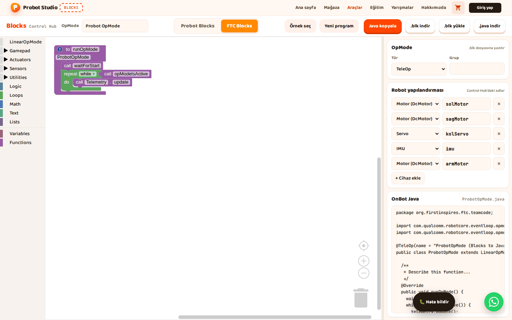
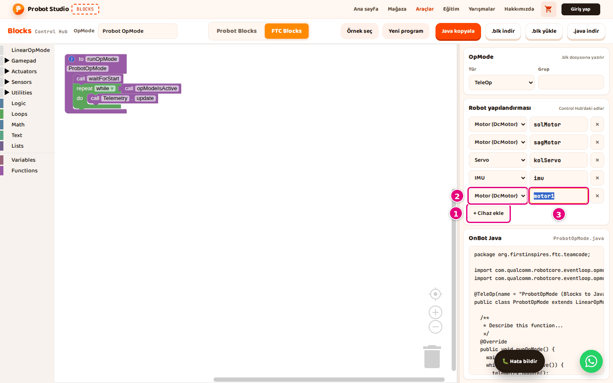
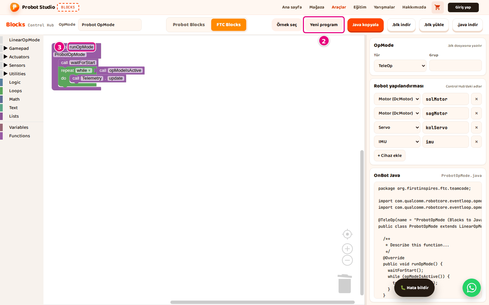
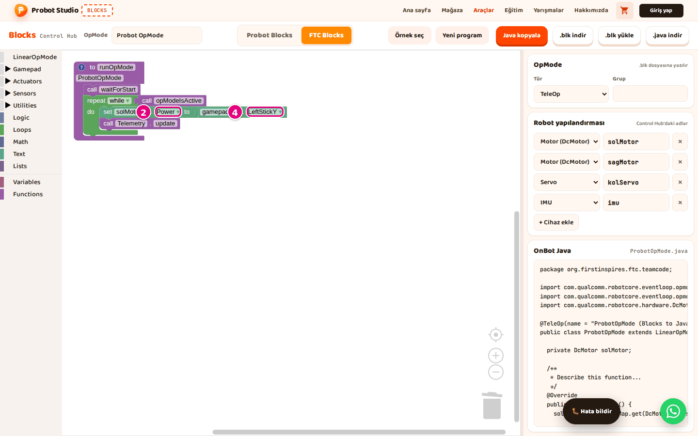

# Hoca hazırlığı

## Bu derste

Bu bir araç tanıtım sunumu, ders değil. FTC Blocks'ta hazır örnek açmayı, Robot yapılandırmasını Control Hub'la aynı yapmayı ve yeni bir programda motoru kumandayla sürmeyi anlatır, videoya dönüştürülür. Seslendirilecek metin her sayfanın Söyle satırındadır.

## Dersten önce

- Canlı anlatılacaksa Blocks'ta FTC Blocks sekmesini açık tutun.
- FTC editörünün blokları İngilizcedir, sayfalarda blok adları ekrandaki gibi yazılır.

## Zaman planı

| Sayfalar | Konu |
|---|---|
| 1-4 | FTC Blocks ekranı ve örnekler |
| 5-9 | Robot yapılandırması, cihaz ekleme, ad, kaldırma, uyarılar |
| 10-15 | Yeni program, yapı, OpMode, motor, telemetri, özet |

Toplam yaklaşık 4 dakika.

# Sayfalar

## FTC Blocks ile başla {kapak}

::: hoca
**Söyle:** "Bu sunumda FTC Blocks'ta hazır bir örnek açıyor ve Robot yapılandırmasını Control Hub'daki adlarla aynı yapıyoruz. Ardından yeni bir program başlatıp bir motoru kumandayla sürüyor ve değerini telemetriye yazıyoruz."
:::

## FTC Blocks ekranı

- Araç çubuğunda **FTC Blocks** sekmesi
- Bloklar İngilizce, FTC'nin kendi editöründeki gibi
- Yan panelde **OpMode** ve **Robot yapılandırması**
- Program `.blk` dosyası olarak Control Hub'a gider

::: hoca
**Söyle:** "FTC Blocks sekmesinde blok listesi, çalışma alanı ve yan panel var. Bloklar FTC'nin kendi editöründeki gibi İngilizce ve Control Hub'daki aynı adlı bloklarla aynı çalışıyor. Yan panelde OpMode ayarlarını ve Robot yapılandırmasını görüyoruz."
:::

## FTC örneği açın

- Araç çubuğunda **Örnek seç**
- "FTC örnekleri" penceresinde **Tank Şasi TeleOp**
- **OpMode** kutusunda örneğin adı
- Örnek açık programın ve cihaz listesinin yerine geçer

::: hoca
**Söyle:** "FTC Blocks sekmesinde Örnek seç düğmesine basıyor ve Tank Şasi TeleOp kartını seçiyoruz. Örnek açık programın yerine onay sormadan geçiyor ve Robot yapılandırması da örneğin cihazlarıyla değişiyor. Kendi programımızı korumak için önce .blk indir düğmesine basıyoruz."
:::

## Hangi örnek ne yapar

- Sekiz hazır program
- Altı Starter Bot programı, iki teleop ve dört otonom
- İki şasi sürüşü, dört motorlu ve iki motorlu
- **Örnek ara...** kutusu listeyi daraltır

::: hoca
**Söyle:** "FTC Blocks'ta sekiz hazır program var. Starter Bot için iki teleop ve dört otonom örneği, ayrıca dört motorlu ve iki motorlu birer şasi sürüşü bulunuyor. Örnek ara kutusuna yazınca liste adında ya da açıklamasında o sözcük geçen örneklere iniyor."
:::

## Cihaz adlarını robotunuza uydurun

- Program cihazları Control Hub'daki adlarıyla bulur
- **Robot yapılandırması**ndaki adlar okunur
- Control Hub yapılandırmasıyla karşılaştırılır
- Varsayılan liste `solMotor`, `sagMotor`, `kolServo`, `imu`

::: hoca
**Söyle:** "FTC programı motorları ve sensörleri Control Hub'daki adlarıyla buluyor. Yan paneldeki Robot yapılandırması listesindeki adları okuyup Control Hub'daki yapılandırmayla karşılaştırıyoruz. Ad farklıysa program cihazı bulamıyor, bu yüzden adı Blocks'ta değiştiriyoruz."
:::

## Cihaz ekleyin

- **+ Cihaz ekle** her zaman bir motor ekler
- Tür listesinde **Motor (DcMotor)**, **Servo**, **Sürekli servo (CRServo)**, **IMU**
- Ad kutusuna Control Hub'daki ad, ör. `armMotor`
- Blok listesinde cihazın adıyla kategori

::: hoca
**Söyle:** "Robot yapılandırması bölümünde Cihaz ekle düğmesine basıyoruz ve listeye bir motor ekleniyor. Türünü listeden seçiyor, ad kutusuna Control Hub'daki adı yazıp Enter tuşuna basıyoruz. Blok listesinde bu cihazın adıyla yeni bir kategori çıkıyor."
:::

## Cihazın adını değiştirin

- Ad kutusuna basılır, yeni ad yazılır
- Ad İngilizce harfle ya da `_` ile başlar
- Türkçe harf ve boşluk kabul edilmez
- Cihazı kullanan bütün bloklar yeni adı alır

::: hoca
**Söyle:** "Cihazın ad kutusuna basıp eski adı siliyor ve yeni adı yazıyoruz. Ad İngilizce bir harfle başlıyor ve Türkçe harf ya da boşluk içermiyor, yoksa kutuya eski ad geri geliyor. Cihazı kullanan bütün bloklar yeni adı kendiliğinden alıyor."
:::

## Cihazı kaldırın

- Cihazın satırında **×**
- Cihazı kullanan bloklarda uyarı simgesi
- Uyarı simgeli bloklar <kbd>Delete</kbd> ile silinir
- Blok kalırsa cihaz listeye geri gelir

::: hoca
**Söyle:** "Robotta olmayan bir cihazı satırındaki çarpı düğmesiyle listeden kaldırıyoruz. Onu kullanan bloklar silinmiyor, üstlerinde uyarı simgesi çıkıyor. Bu blokları da silmezsek sayfa yeniden açılınca cihaz listeye geri geliyor."
:::

## Uyarı simgeli blokları düzeltin

- Balonda cihazın türü ve adı yazar
- **+ Cihaz ekle**, balondaki tür ve ad
- Ya da bloktaki listeden var olan cihaz
- Uyarı simgesi ve balon kaybolur

::: hoca
**Söyle:** "Uyarı simgesi bir bloğun listede olmayan bir cihazı kullandığını gösteriyor. Açılan balonda cihazın türünü ve adını okuyup aynı tür ve adla bir cihaz ekliyoruz. Control Hub'da bu adla cihaz yoksa bloktaki listeden var olan bir cihazı seçiyoruz."
:::

## Yeni program başlatın

- Önce **.blk indir**
- Araç çubuğunda **Yeni program**
- "FTC programı ilk hâline dönsün mü?" sorusunda **Tamam**
- **Robot yapılandırması** ve **OpMode** adı değişmez

::: hoca
**Söyle:** "Yeni program düğmesi çalışma alanındaki programı sildiği için önce .blk indir ile programımızı kaydediyoruz. Sonra Yeni program düğmesine basıp soruya Tamam diyoruz. Alanda ilk hâliyle to runOpMode bloğu kalıyor."
:::

## Programın yapısını tanıyın

- **to runOpMode** programın kendisi, silinemez
- **call waitForStart** öncesi INIT'te çalışır
- **repeat while call opModeIsActive** START ile STOP arası
- **call Telemetry.update** yazıları Driver Station'a gönderir

::: hoca
**Söyle:** "to runOpMode bloğu programın kendisi ve silinemiyor. waitForStart bloğundan önceki hazırlık kısmı INIT'e basınca, döngünün içi ise START'tan STOP'a kadar sürekli çalışıyor. Döngünün sonundaki Telemetry.update bloğu yazıları Driver Station'a gönderiyor."
:::

## OpMode adını ve türünü ayarlayın

- Araç çubuğunda **OpMode** kutusu, ör. `Ilk Surus`
- Yan panelde **Tür**, **TeleOp** ya da **Autonomous**
- **Grup** isteğe bağlı, en çok 40 karakter
- Dosya adı OpMode adından türetilir

::: hoca
**Söyle:** "Araç çubuğundaki OpMode kutusuna programın adını yazıyoruz. Yan paneldeki Tür listesinden programın TeleOp mu Autonomous mu olduğunu seçiyoruz. İstersek bir grup adı da yazıyoruz, bu kutuyu boş bırakabiliyoruz."
:::

## Motoru kumandayla sürün

- **Actuators** > **DcMotor** > **solMotor**
- **set solMotor.Power to 1** döngünün **do** ağzına
- **Gamepad**'den **gamepad1.LeftStickY** `1` yuvasına
- Çubuk ileri itilince değer eksi

::: hoca
**Söyle:** "solMotor kategorisinden motor gücü bloğunu döngünün içine, Telemetry.update bloğunun üstüne sürüklüyoruz. Gamepad kategorisinden sol çubuğun dikey değerini bloğun yuvasına takıyoruz. FTC'de çubuk ileri itilince değer eksi oluyor, motor ters dönerse araya eksi işaret bloğu koyuyoruz."
:::

## Telemetriye yazın

- **Utilities** > **Telemetry**, **call Telemetry.addData**
- **key** yuvasına `Guc`
- **number** yuvasına **solMotor.Power**
- Driver Station'da `Guc` satırı, -1 ile 1 arası

::: hoca
**Söyle:** "Telemetry kategorisinden addData bloğunu döngüye, Telemetry.update bloğunun üstüne koyuyoruz. Anahtar yuvasına Guc yazıyor, sayı yuvasına motorun güç bloğunu takıyoruz. START'tan sonra Driver Station ekranında Guc satırı çıkıyor ve sol çubuğu ittikçe değişiyor."
:::

## Özet

- Örnek, program ve cihaz listesinin yerine geçer
- Cihaz adları Control Hub'daki adlarla aynı
- Hazırlık INIT'te, sürüş döngünün içinde
- Sıradaki sunum kaydetme, yükleme ve Sim

::: hoca
**Söyle:** "Bu sunumda FTC örneği açtık, Robot yapılandırmasını ayarladık ve yeni bir programda motoru kumandayla sürdük. Sonraki sunumda değişken ve fonksiyon ekliyor, programı kaydediyor, Control Hub'a yüklüyor ve Sim'de açıyoruz."
:::

# Ödevler

## İlk FTC programınızı yazın {#blocks-sunum-06-odev tur=yazi}

FTC Blocks'ta yeni bir program başlatın, solMotor gücünü gamepad1 sol çubuğuna bağlayın ve gücü Guc etiketiyle telemetriye yazın. Döngünün içinde hangi blokların hangi sırayla durduğunu yazın.

::: hoca
Tamam. Sırayla set solMotor.Power to, call Telemetry.addData ve call Telemetry.update.
Tekrar. Telemetry.update en sonda değilse ya da bloklar döngünün dışındaysa.
:::
