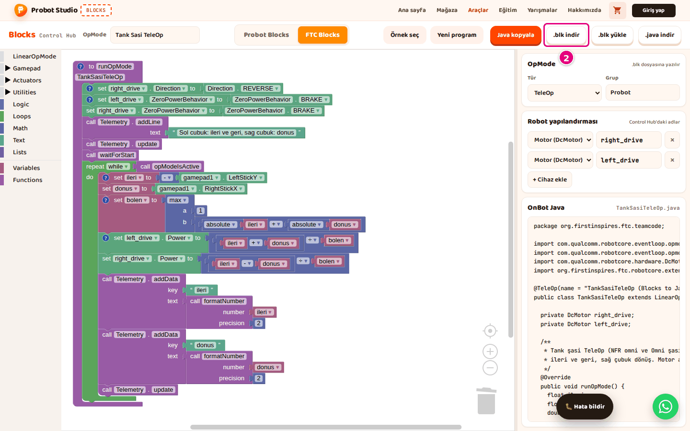
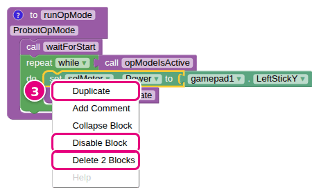
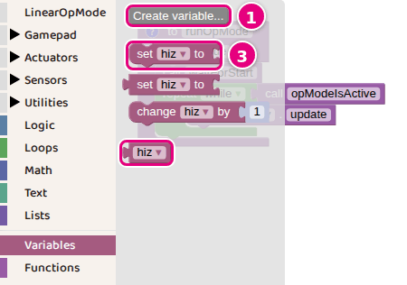
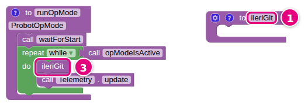
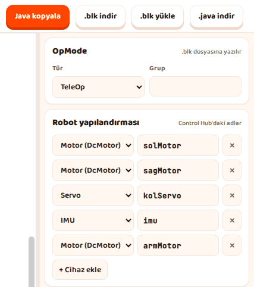
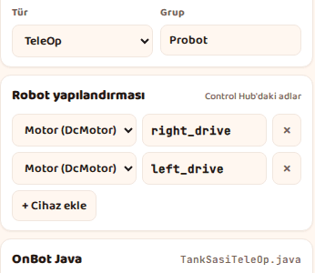
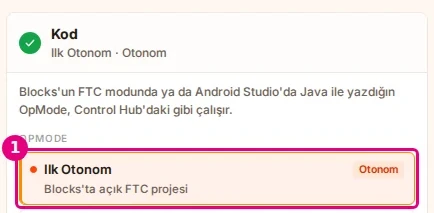
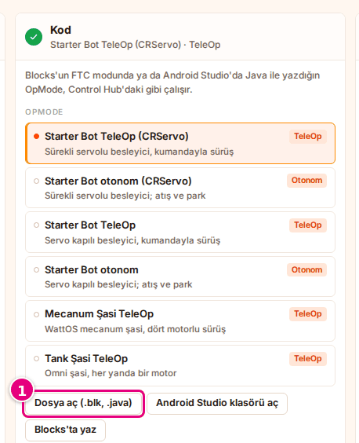
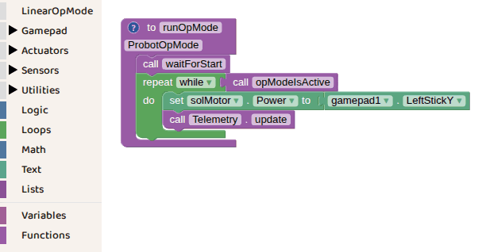

# Hoca hazırlığı

## Bu derste

Bu bir araç tanıtım sunumu, ders değil. FTC Blocks'ta değişken ve fonksiyon eklemeyi, programı .blk dosyası olarak kaydedip açmayı, Control Hub'a yüklemeyi ve Probot Sim'de açmayı anlatır, videoya dönüştürülür. Seslendirilecek metin her sayfanın Söyle satırındadır.

## Dersten önce

- Dokümanda Control Hub ve Driver Station ekran görüntüsü yok. Bu sayfalarda Blocks'ta o adımın girdisi (.blk indir, Tür ve dosya adı), Sim sayfalarında Sim dokümanının ekran görüntüleri kullanılır.
- Canlı anlatılacaksa FTC Blocks'ta Tank Şasi TeleOp örneğini açık tutun.

## Zaman planı

| Sayfalar | Konu |
|---|---|
| 1-4 | FTC'de düzenleme, değişken, fonksiyon |
| 5-9 | .blk kaydetme ve açma, otomatik kayıt, Control Hub |
| 10-13 | Sim, FTC blok listesi, özet |

Toplam yaklaşık 3 dakika.

# Sayfalar

## FTC programını kaydet, yükle, Sim'de dene {kapak}

::: hoca
**Söyle:** "Bu sunumda FTC programına değişken ve fonksiyon ekliyoruz. Ardından programı .blk dosyası olarak kaydediyor, Control Hub'a yükleyip çalıştırıyor ve robota yüklemeden Probot Sim'de deniyoruz."
:::

## FTC'de blokları düzenleyin

- Tekerlek doğrudan yakınlaştırır, boş alan sürüklenir
- Yinele yalnız <kbd>Ctrl</kbd>+<kbd>Shift</kbd>+<kbd>Z</kbd>
- Bloğa sağ tık, **Duplicate**, **Disable Block** ve silme öğesi
- Yuvadaki bloklar da sayılır, ör. **Delete 2 Blocks**

::: hoca
**Söyle:** "FTC çalışma alanı Probot'takine benzer çalışıyor ve çöp kutusu da aynı. Farklı olarak fare tekerleği doğrudan yakınlaştırıyor, kaydırmak için boş alanı sürüklüyoruz. Menü öğeleri İngilizce, örneğin bloğu çoğaltmak için Duplicate öğesini seçiyoruz."
:::

## Değişken oluşturun

- **Variables** kategorisinde **Create variable...**
- "New variable name:" kutusuna `hiz`, **OK**
- **set hiz to** ve **hiz** blokları
- **Rename variable...** adı her yerde değiştirir

::: hoca
**Söyle:** "Variables kategorisinde Create variable düğmesine basıp hiz adını yazıyor ve OK diyoruz. Kategoride değer veren set hiz to bloğu ile değeri okuyan hiz bloğu çıkıyor. Adı değiştirmek için bloktaki listeden Rename variable öğesini seçiyoruz."
:::

## Fonksiyon oluşturun

- **Functions**'tan **to do something** boş alana
- **do something** adına basılır, `ileriGit` yazılır
- **ileriGit** bloğu döngüye, **call Telemetry.update** üstüne
- Çağırma bloğunda **call** yazmaz

::: hoca
**Söyle:** "Uzun programları fonksiyonlara bölüyoruz. Functions kategorisinden to do something bloğunu boş bir yere sürükleyip adını ileriGit yapıyoruz. Ardından aynı kategoride çıkan ileriGit bloğunu döngünün içine koyuyoruz ve program fonksiyonu her turda çağırıyor."
:::

## Programı .blk olarak kaydedin

- **OpMode** kutusunda ad, ör. `Tank Şasi TeleOp`
- Araç çubuğunda **.blk indir**
- "TankSasiTeleOp.blk indirildi." bildirimi
- Dosyada bloklar, **Tür** ve **Grup**

::: hoca
**Söyle:** "OpMode kutusuna programın adını yazıp .blk indir düğmesine basıyoruz. Dosya adı OpMode adından türetiliyor, Türkçe harfler sadeleşiyor ve boşluklar kalkıyor. Bu dosyayı hem Control Hub hem Probot Sim tanıyor."
:::

## Kayıtlı .blk dosyasını açın

- **.blk yükle**, dosya seçilir, **Aç**
- Dosya açık programın yerine onay sormadan geçer
- Eksik cihazlar **Robot yapılandırması**na eklenir
- Sensör ya da görüntü işleme bloklu dosya açılmaz

::: hoca
**Söyle:** "Kaydettiğimiz ya da Control Hub'dan indirdiğimiz .blk dosyasını .blk yükle düğmesiyle açıyoruz. Dosya açık programın yerine geçtiği için önce çalışmamızı indiriyoruz. Blocks'ta olmayan sensör blokları içeren dosya açılmıyor ve ekrandaki program silinebiliyor."
:::

## Otomatik kayıt

- Program, **Robot yapılandırması** ve **OpMode** adı saklanır
- Probot Blocks sekmesine geçip dönünce program yerinde
- Başka tarayıcı ya da bilgisayar kaydı görmez
- Taşımak için **.blk indir**

::: hoca
**Söyle:** "FTC programı, Robot yapılandırması ve OpMode adı tarayıcıda kendiliğinden saklanıyor. Probot Blocks sekmesine geçip dönünce program yerinde duruyor. Başka bir bilgisayara taşımak için programı .blk dosyası olarak indiriyoruz."
:::

## .blk dosyasını Control Hub'a yükleyin

- Dosya Blocks'ta **.blk indir** ile alınır
- Bilgisayar Control Hub'ın ağında
- Control Hub sayfasında **Blocks** sekmesi, **Upload Op Mode**
- Program Control Hub editöründe açılınca kaydedilir

::: hoca
**Söyle:** "Blocks programı Control Hub'a kendisi göndermiyor, dosyayı .blk indir ile alıyoruz. Bilgisayarımız Control Hub'ın ağındayken tarayıcıda Control Hub'ın sayfasını açıyor, Blocks sekmesinde Upload Op Mode düğmesine basıp .blk dosyasını seçiyoruz. Program Control Hub'ın editöründe açılınca onu kaydediyoruz."
:::

## OpMode'u çalıştırın

- Driver Station'da **Tür** altında dosya adı, ör. `TankSasiTeleOp`
- **INIT**, ardından **START**
- Program **STOP**'a kadar çalışır
- INIT'te hata varsa **Robot yapılandırması** adları karşılaştırılır

::: hoca
**Söyle:** "Driver Station'da OpMode'u Blocks'ta seçtiğimiz türün altında buluyoruz. Listede OpMode kutusundaki ad değil, dosyanın adı görünüyor. INIT ve START düğmelerine basıyoruz, program STOP'a kadar çalışıyor. INIT'te cihaz bulunamadı hatası çıkarsa Robot yapılandırmasındaki adları harf harf karşılaştırıyoruz."
:::

## Açık programı Sim'de seçin

- **OpMode** listesinin başında "Blocks'ta açık FTC projesi" satırı
- Satırın adı Blocks'taki **OpMode** adı, ör. `Ilk Otonom`
- Blocks ve Sim aynı tarayıcıda, Blocks'ta **FTC Blocks** sekmesi seçili
- Blocks'taki değişiklikleri Sim yeniden okur

::: hoca
**Söyle:** "Probot Sim FTC programını robota yüklemeden sanal sahada çalıştırıyor. Blocks ile Sim aynı tarayıcıda açıksa Sim, Blocks'taki FTC programını Kod bölümündeki OpMode listesinin başına kendisi ekliyor. Satırda programın adı ve altında Blocks'ta açık FTC projesi yazıyor. Bu satırı seçiyoruz ve Blocks'ta yaptığımız değişiklikleri Sim yeniden okuyor."
:::

## .blk dosyasını Sim'de açın

- Blocks'ta **.blk indir**
- Sim'de **Kod** bölümünde **Dosya aç (.blk, .java)**
- Program listenin sonuna eklenir ve seçilir
- Probot Blocks dosyaları Sim'de açılmaz

::: hoca
**Söyle:** "Blocks başka bir tarayıcıda ya da bilgisayarda açıksa programı .blk dosyasıyla taşıyoruz. Sim'in Kod bölümünde Dosya aç düğmesine basıp dosyayı seçiyoruz. Sim FTC Blocks programlarını ve Java ile yazılmış OpMode'ları çalıştırıyor; Probot Blocks dosyaları Sim'de açılmıyor."
:::

## FTC blok listesi

- Kategoriler ve içlerindeki bloklar
- Bloklar Control Hub'dakilerle aynı çalışır
- Cihaz türleri DcMotor, Servo, CRServo ve IMU
- Renk, mesafe ve dokunma sensörleri yok

::: hoca
**Söyle:** "Dokümandaki FTC blok listesi sayfası kategorileri ve içlerindeki blokları gösteriyor. Araç kutusunda okul robotu için gereken bloklar var ve cihaz türleri motor, servo, sürekli servo ve IMU ile sınırlı. Ayrıntılı açıklama için FTC'nin kendi dokümanına bakıyoruz."
:::

## Özet

- Değişken ve fonksiyon İngilizce menülerden
- Program **.blk indir** ile dosyaya
- Control Hub'da **Upload Op Mode**, Driver Station'da **INIT**
- Sıradaki sunum Control Hub'da derlenen kod

::: hoca
**Söyle:** "Bu sunumda FTC programına değişken ve fonksiyon ekledik, programı .blk dosyası olarak kaydettik, Control Hub'a yükledik ve Sim'de açtık. Sonraki kısa sunumda aynı programın Control Hub'da derlenen kod karşılığını alıyoruz."
:::

# Ödevler

## Programı Sim'de açın {#blocks-sunum-07-odev tur=yazi}

FTC Blocks'ta Tank Şasi TeleOp örneğini açın ve .blk dosyası olarak indirin. İnen dosyanın adını ve dosyayı Sim'de açınca OpMode listesinde görünen satırın adını yazın.

::: hoca
Tamam. Dosya `TankSasiTeleOp.blk`, Sim'deki satır TankSasiTeleOp.
Tekrar. Dosya adı farklıysa OpMode kutusundaki ad değiştirilmiş.
:::
