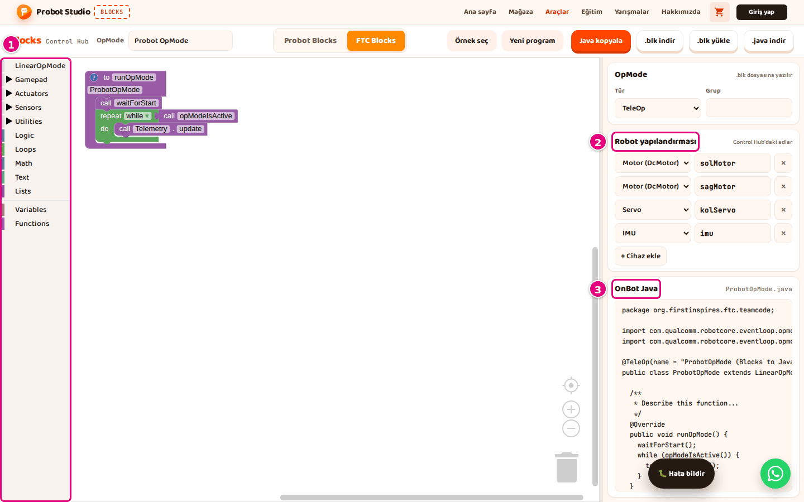
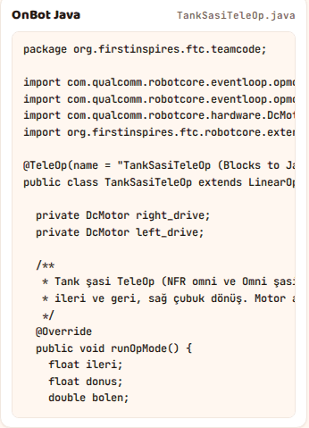
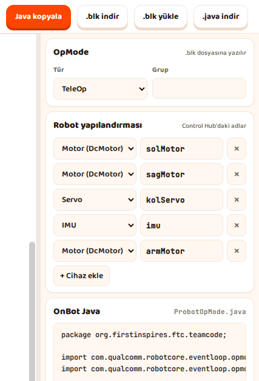
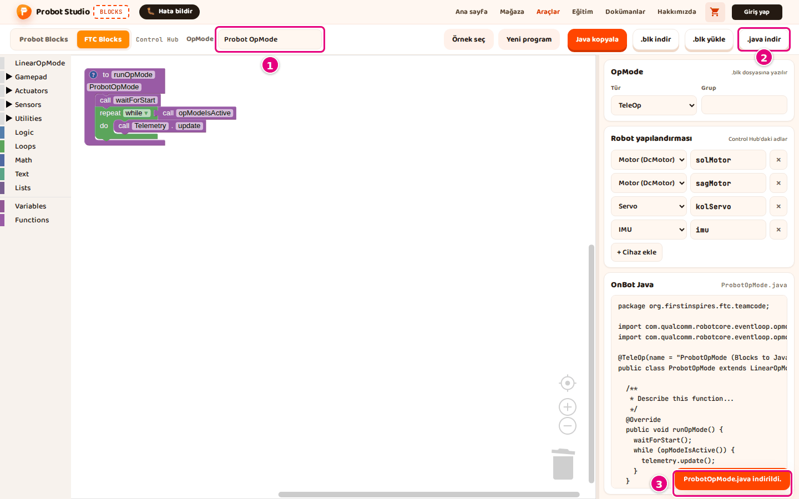

# Hoca hazırlığı

## Bu derste

Bu bir araç tanıtım sunumu, ders değil. FTC Blocks'taki programın OnBot Java karşılığını kopyalamayı, dosya olarak indirmeyi ve Control Hub'da derlemeyi anlatır, videoya dönüştürülür. Seslendirilecek metin her sayfanın Söyle satırındadır.

## Dersten önce

- Arayüzdeki düğme ve bölüm adları bu konuyu doğrudan adlandırdığı için bu sunum ayrı tutulmuştur.
- Dokümanda Control Hub ekran görüntüsü yok. Control Hub sayfasında Blocks'taki OnBot Java bölümü ve dosya adı gösterilir.

## Zaman planı

| Sayfalar | Konu |
|---|---|
| 1-2 | OnBot Java bölümü ve sınıf adı |
| 3-5 | Kopyalama, indirme, Control Hub'da derleme |
| 6 | Özet |

Toplam yaklaşık 2 dakika.

# Sayfalar

## FTC programının OnBot Java karşılığı {kapak}

::: hoca
**Söyle:** "Bu kısa sunumda FTC Blocks'taki programın OnBot Java karşılığını alıyoruz. Kodu kopyalıyor ya da dosya olarak indiriyor, ardından Control Hub'da OnBot Java'ya ekleyip derliyoruz."
:::

## OnBot Java bölümü ve sınıf adı

- Yan panelde **OnBot Java** bölümü
- Başlığın yanında dosya adı, ör. `TankSasiTeleOp.java`
- Sınıf adı **OpMode** adından türetilir
- **OpMode** boşsa ad `ProbotOpMode`

::: hoca
**Söyle:** "Yan paneldeki OnBot Java bölümü blokların kod karşılığını gösteriyor. Başlığın yanındaki dosya adı OpMode adından türetiliyor, Türkçe harfler sadeleşiyor ve kelimeler bitişik yazılıyor. Bu ad koddaki sınıf adıyla aynı oluyor."
:::

## OnBot Java kodunu kopyalayın

- **OnBot Java** başlığının yanındaki dosya adı not edilir
- Araç çubuğunda **Java kopyala**
- "OnBot Java panoya kopyalandı." bildirimi
- Pano izni yoksa **.java indir**

::: hoca
**Söyle:** "Önce OnBot Java başlığının yanındaki dosya adını not ediyoruz. Araç çubuğunda Java kopyala düğmesine basınca kodun tamamı panoya geçiyor. Tarayıcı panoya izin vermezse .java indir düğmesini kullanıyoruz."
:::

## OnBot Java kodunu dosya olarak indirin

- **OpMode** kutusunda ad, ör. `Probot OpMode`
- Araç çubuğunda **.java indir**
- "ProbotOpMode.java indirildi." bildirimi
- Dosya adı ve sınıf adı aynı

::: hoca
**Söyle:** "OpMode kutusuna programın adını yazıp .java indir düğmesine basıyoruz. İndirilen dosyanın adı ile içindeki sınıf adı aynı oluyor. OnBot Java bu eşleşmeyi istediği için dosyanın adını değiştirmiyoruz."
:::

## OnBot Java'ya ekleyin

- Control Hub sayfasında **OnBot Java** sekmesi
- Dosya adı Blocks'taki gibi, ör. `TankSasiTeleOp.java`
- Anahtar simgeli **Build**
- Listede **(Blocks to Java)** ekiyle

::: hoca
**Söyle:** "Control Hub'ın sayfasında OnBot Java sekmesini açıp .java dosyasını yüklüyoruz. Ya da Blocks'taki adla yeni bir dosya açıp kopyaladığımız kodu yapıştırıyoruz. Build düğmesine basınca program derleniyor ve Driver Station listesinde Blocks to Java ekiyle görünüyor."
:::

## Özet

- **Java kopyala** ya da **.java indir**
- Dosya adı koddaki sınıf adıyla aynı
- OnBot Java'da **Build**
- Sıradaki sunum ortak konular

::: hoca
**Söyle:** "Bu sunumda programın OnBot Java karşılığını kopyaladık, dosya olarak indirdik ve Control Hub'da derledik. Build başarısız olursa önce dosya adını kontrol ediyoruz. Sonraki sunumda iki modda ortak olan hata bildirimi, kısayollar ve sorun gidermeyi görüyoruz."
:::

# Ödevler

## Programı derleyin {#blocks-sunum-08-odev tur=yazi}

FTC Blocks'ta bir programın OpMode adını değiştirin ve OnBot Java başlığının yanındaki dosya adını yazın. Ardından aynı programı .java dosyası olarak indirip dosya adlarının aynı olup olmadığını yazın.

::: hoca
Tamam. İki ad aynı, ör. `IlkSurus.java`.
Tekrar. Ad farklıysa indirme sırasında dosya yeniden adlandırılmış.
:::
