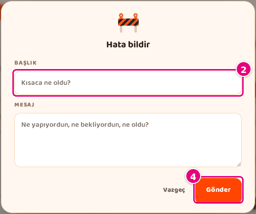
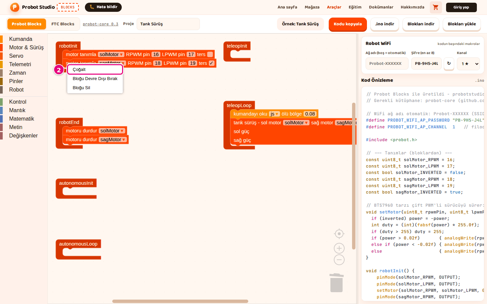
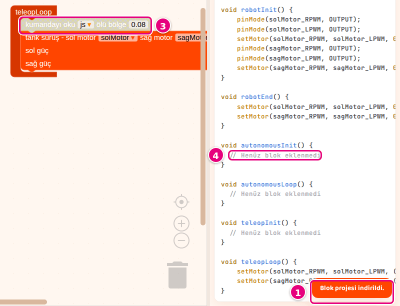
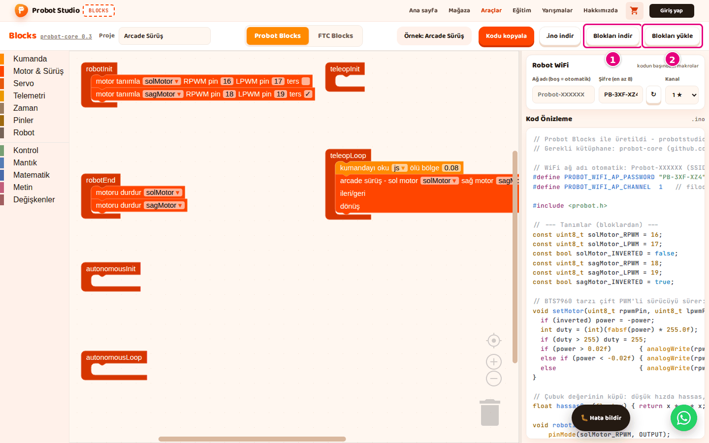
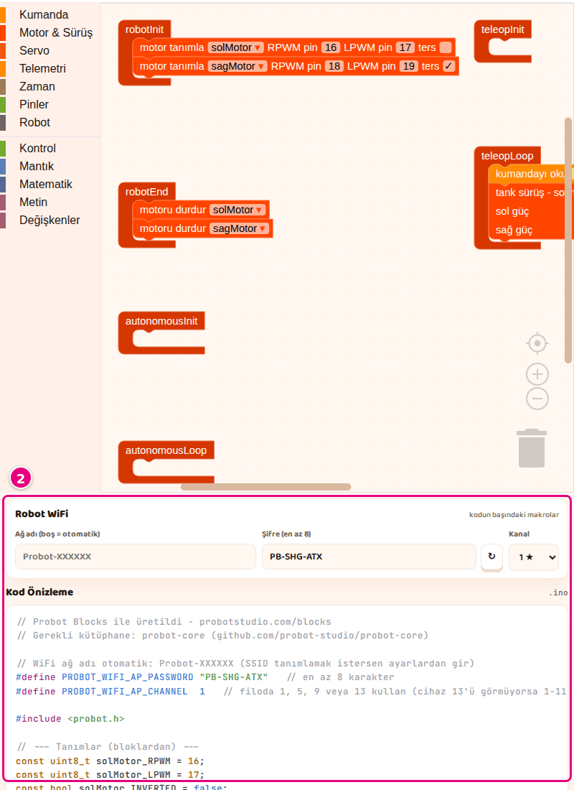

# Hoca hazırlığı

## Bu derste

Bu bir araç tanıtım sunumu, ders değil. Blocks'un iki modunda ortak olan hata bildirim formunu, klavye ve fare kısayollarını ve sık sorunların çözümünü anlatır, videoya dönüştürülür. Seslendirilecek metin her sayfanın Söyle satırındadır.

## Dersten önce

- Canlı anlatılacaksa hata formunu açıp göstermek yeterlidir, deneme bildirimi göndermeyin.
- Sorunların tam listesi dokümandaki Sorun giderme sayfasındadır.

## Zaman planı

| Sayfalar | Konu |
|---|---|
| 1-3 | Hata bildir formu, iyi bir bildirim |
| 4-5 | Klavye ve fare kısayolları |
| 6-10 | Durum göstergeleri, kayıt, FTC, dar ekran, özet |

Toplam yaklaşık 3 dakika.

# Sayfalar

## Hata bildirimi, kısayollar, sorun giderme {kapak}

::: hoca
**Söyle:** "Bu son sunumda Blocks'un iki modunda ortak olan konuları görüyoruz. Hata bildirim formunu dolduruyor, klavye ve fare kısayollarını tanıyor ve sık karşılaşılan sorunları nasıl çözdüğümüzü öğreniyoruz."
:::

## Hata bildirim formunu açın

- Site başlığında **Hata bildir**
- **Başlık** en çok 120 karakter
- **Mesaj** en çok 4000 karakter
- **Gönder** sonrası kartta teşekkür yazısı

::: hoca
**Söyle:** "Bir hata görürsek site başlığındaki Hata bildir düğmesiyle sayfadan çıkmadan ekibe yazıyoruz. Başlık kutusuna sorunu kısaca, Mesaj kutusuna ayrıntıyı yazıp Gönder düğmesine basıyoruz. Hesap gerekmiyor, form gönderilemezse yazdıklarımız kutularda kalıyor."
:::

## İyi bir bildirim

- Açık sekme ve örnek ya da proje
- Son basılan düğme ya da tuş
- Ekrandaki yazı, tırnak içinde birebir
- Tarayıcı, ör. Chrome

::: hoca
**Söyle:** "Mesaja dört bilgi yazıyoruz, açık sekme ve örnek, son bastığımız düğme, ekrandaki yazının birebiri ve tarayıcımız. Dört bilgi de olunca ekip bize geri sormadan sorunu yeniden üretiyor. Sayfanın adresini form kendisi ekliyor."
:::

## Klavye kısayolları

- <kbd>Ctrl</kbd>+<kbd>C</kbd>, <kbd>Ctrl</kbd>+<kbd>X</kbd>, <kbd>Ctrl</kbd>+<kbd>V</kbd>
- <kbd>Ctrl</kbd>+<kbd>Z</kbd> geri alır, <kbd>Ctrl</kbd>+<kbd>Shift</kbd>+<kbd>Z</kbd> yineler
- <kbd>Ctrl</kbd>+<kbd>Y</kbd> FTC Blocks'ta çalışmaz
- <kbd>Esc</kbd> menüyü, pencereyi ve formu kapatır

::: hoca
**Söyle:** "Kopyalama, kesme, yapıştırma ve geri alma iki modda da aynı tuşlarla çalışıyor. Yinelemek için FTC Blocks'ta Ctrl Y değil Ctrl Shift Z kullanıyoruz. Mac'te Ctrl yerine Cmd tuşuna basıyoruz ve bir metin kutusuna yazarken kısayollar bloklara uygulanmıyor."
:::

## Fare kısayolları

- Probot Blocks'ta tekerlek dikey kaydırır
- FTC Blocks'ta tekerlek yakınlaştırır
- Boş alanı sürüklemek alanı kaydırır
- Bloğu çöp kutusuna ya da listeye sürüklemek siler

::: hoca
**Söyle:** "Probot Blocks'ta fare tekerleği alanı dikey kaydırıyor, Ctrl ile birlikte yakınlaştırıyor. FTC Blocks'ta ise tekerlek doğrudan yakınlaştırıyor ve alanı boş yeri sürükleyerek kaydırıyoruz. Bir bloğu çöp kutusuna ya da blok listesine sürükleyince blok siliniyor."
:::

## Önce durum göstergelerine bakın

- Turuncu bildirim, iş tamamlandı
- Kırmızı bildirim, iş yapılamadı
- Soluk blok devre dışı, **Bloğu Etkinleştir**
- "// Henüz blok eklenmedi" o bölüm boş

::: hoca
**Söyle:** "Bir sorun olduğunda önce ekranda hangi göstergenin çıktığına bakıyoruz. Turuncu bildirim işin tamamlandığını, kırmızı bildirim yapılamadığını gösteriyor ve iki kutu da 5 saniye sonra kayboluyor. Soluk görünen blok koda girmiyor, onu sağ tık menüsünden yeniden etkinleştiriyoruz."
:::

## Kayıt sorunları

- Yüklenen örnek, bir blok değişene kadar kaydedilmez
- Örnek ya da dosya açık programın yerine geçer
- Probot modunda <kbd>Ctrl</kbd>+<kbd>Z</kbd> eski programı getirmez
- Çözüm, önce **Blokları indir** ya da **.blk indir**

::: hoca
**Söyle:** "Kayıt sorunlarının çoğunu dosyaya indirerek önlüyoruz. Yüklenen örnek biz bir bloğu değiştirene kadar tarayıcıya kaydedilmiyor ve örnek seçmek açık programın yerine onay sormadan geçiyor. Bu yüzden örnek seçmeden ya da dosya açmadan önce Blokları indir ya da .blk indir düğmesine basıyoruz."
:::

## FTC sorunları

- "There is no ... named ..." uyarısında cihaz eklenir
- Ad reddedilirse harfle başlayan, Türkçe harfsiz ad
- "Bu ad zaten var." ise başka ad
- Sim programı görmüyorsa aynı tarayıcı ya da `.blk`

::: hoca
**Söyle:** "FTC tarafındaki sorunların çoğu cihaz adlarının uyuşmamasından çıkıyor. Blokta uyarı varsa cihazı aynı adla ekliyor ya da var olan bir cihazı seçiyoruz. Sim programı görmüyorsa Sim'i Blocks ile aynı tarayıcıda açıyor ya da programı .blk dosyasıyla taşıyoruz."
:::

## Dar ekranda ve telefonda

- 860 pikselden dar pencerede bölgeler alt alta
- Yan panel çalışma alanının altına iner
- Telefonda **Yine de devam et** 3 saniye sonra açılır
- Program yazmak için bilgisayar

::: hoca
**Söyle:** "Pencere dar olduğunda bölgeler alt alta diziliyor ve yan panel çalışma alanının altına iniyor. Telefonda giriş kartı aracın bilgisayar için tasarlandığını söylüyor. Telefonda göz atıyoruz ama program yazmak için bilgisayar kullanıyoruz."
:::

## Özet

- **Hata bildir** ile dört bilgili mesaj
- FTC'de tekerlek yakınlaştırır, yinele <kbd>Ctrl</kbd>+<kbd>Shift</kbd>+<kbd>Z</kbd>
- Sorunda önce durum göstergesi
- Önemli çalışma her zaman dosyaya

::: hoca
**Söyle:** "Bu sunumda hata bildirmeyi, kısayolları ve sık sorunların çözümünü gördük. Böylece Blocks sunum dizisini tamamladık. Bir sonraki adım olarak dokümandaki blok listelerinden yeni bloklar deneyebilir, takıldığımızda Sorun giderme sayfasına bakabiliriz."
:::

# Ödevler

## İyi bir bildirim yazın {#blocks-sunum-09-odev tur=yazi}

Blocks'ta karşılaştığınız bir durumu, örneğin bir bildirimi, hata formuna yazar gibi dört bilgiyle anlatın. Formu göndermeyin, metni buraya yazın.

::: hoca
Tamam. Sekme ve örnek, son basılan düğme, ekrandaki yazı birebir ve tarayıcı var.
Tekrar. Dört bilgiden biri eksik.
:::
