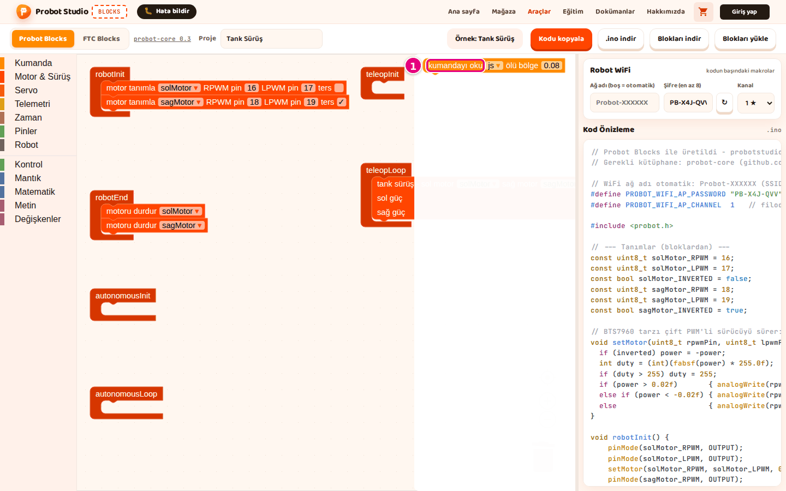
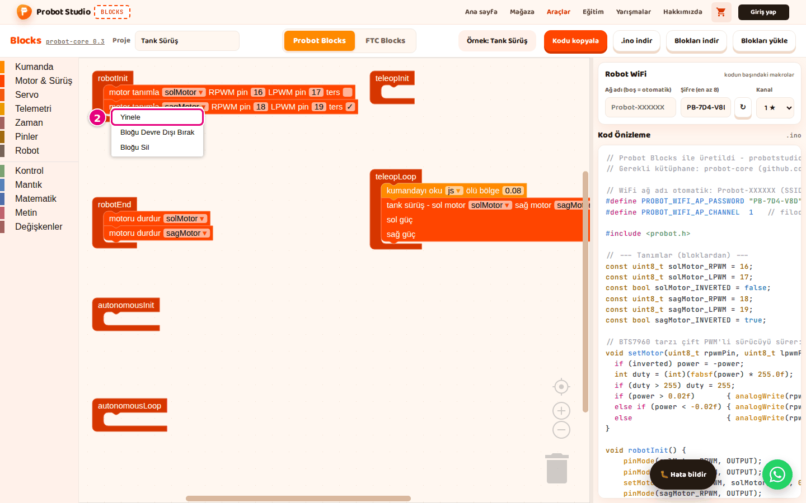
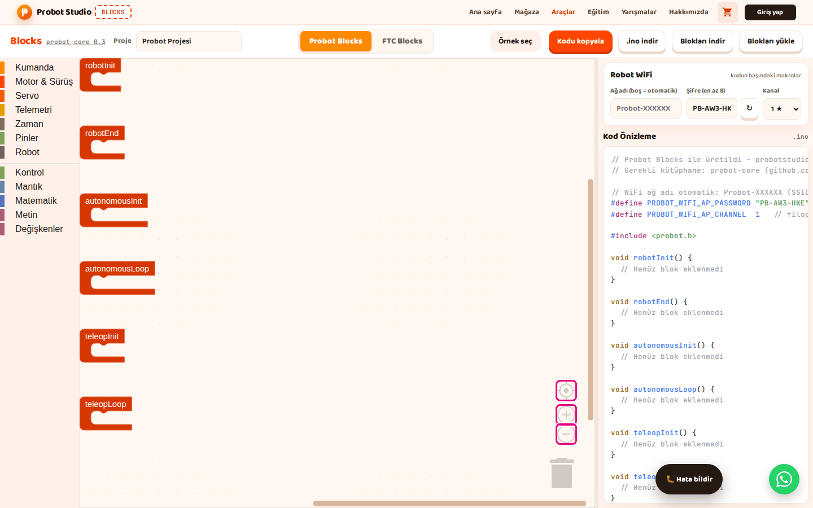

# Blok ekle, bağla ve düzenle

Bu sayfada Probot Blocks'ta blok eklemeyi, blokları birbirine bağlamayı, silmeyi, çoğaltmayı ve
çalışma alanında gezinmeyi öğreneceksin.

## Başlamadan önce

- Blocks açık ve **Probot Blocks** sekmesi seçili.
- Denemek için hazır bir örnek aç: **Örnek seç** > **Tank Sürüş**. Bkz. [Hazır örnekle başla](probot-ornekle-basla.md).

## Blok ekle

1. Blok listesinde **Telemetri** kategorisini seç. Blok paneli açılır.
2. **telemetriye yaz** bloğunu panelden **teleopLoop** bloğunun ağzına sürükle.
   
   <!-- CAPTURE: url=https://probotstudio.com/blocks/ | hazirla=Probot Blocks, boş proje, Telemetri paneli açık | hedef=text="Telemetri"; text="telemetriye yaz" | isaret=1,2 | bekle=text="telemetriyi temizle" -->
   <!-- SAY: Bir kategori seçip bloğu yaşam döngüsü bloğunun içine sürüklüyoruz. -->
3. Bloğu, **teleopLoop**'un ağzı vurgulanınca bırak.

Sonuç: Blok **teleopLoop**'un içinde durur. **Kod Önizleme**'de `void teleopLoop()` içinde
`probot::println("Merhaba Probot");` satırı görünür.

Bloğun üstünde bir süre beklersen ne yaptığını anlatan ipucu çıkar.

!!! note "Not"
    Yalnız altı yaşam döngüsü bloğunun içine bağlı bloklar koda girer. Çalışma alanında serbest duran
    blok koda yazılmaz.

Tek istisna değişkenlerdir. Serbest duran bir değişken bloğu (ör. "... ayarla", "... göre değiştir")
ya da **ile sayılır** döngüsü, Tanımlar bölümüne değişkenin `double <ad> = 0;` satırını yine ekler.
Bloğun kendisi (atama, döngü) koda girmez.

## Bloğu bir yuvaya tak

Bazı blokların değer yuvası vardır (ör. **motoru sür**'deki güç). Yuvaya sayı yazabilir ya da değer
bloğu takabilirsin.

1. Blok listesinde **Motor & Sürüş** kategorisini seç.
2. **motoru sür** bloğunu **teleopLoop**'un ağzına sürükle. Güç yuvasında `0.5` yazar.
3. Blok listesinde **Kumanda** kategorisini seç.
4. **js sol çubuk ↕ (ileri +)** bloğunu **motoru sür**'ün güç yuvasına sürükle.
5. Yuvadan çıkıp yanda serbest kalan `0.5` sayı bloğunu çöp kutusuna sürükle.

Sonuç: Güç yuvasında **js sol çubuk ↕ (ileri +)** durur. **Kod Önizleme**'deki `setMotor(...)`
satırında `0.5` yerine `js.getLeftY()` yazar.

<!-- SAY: Değer bloklarını başka blokların yuvalarına takarak program kuruyoruz. -->

## Bloktaki bir değeri değiştir

1. Bloktaki sayıya ya da metne bas.
2. Yeni değeri yaz.
3. <kbd>Enter</kbd>'a bas ya da çalışma alanında boş bir yere tıkla.

Sonuç: Blok yeni değeri gösterir, kod anında güncellenir.

Açılır listeli alanlarda (`▾`) listeden bir seçenek seç. Onay kutusunu (ör. **ters**) işaretlemek için
kutuya bas.

<!-- SAY: Bloktaki sayıya basıp yeni değeri yazıyoruz. -->

## Eğer bloğuna değilse kolu ekle {#degilse-kolu-ekle}

Blok listesindeki **eğer** bloğunun tek kolu vardır. **değilse eğer** ve **değilse** kollarını
bloğun dişli simgesinden eklersin.

1. Blok listesinde **Kontrol** kategorisini seç.
2. **eğer** bloğunu **teleopLoop**'un ağzına sürükle.
3. **eğer** bloğundaki dişli simgesine bas. Yanında küçük bir düzenleme alanı açılır.
4. Düzenleme alanının listesinden **değilse** parçasını alandaki **eğer** parçasının altına sürükle.
5. Dişli simgesine yine bas. Düzenleme alanı kapanır.

Sonuç: **eğer** bloğunda yeni bir **değilse** kolu görünür. **Kod Önizleme**'de `if (false) {`
satırından sonra `} else {` satırı gelir.

**değilse eğer** parçasını birden çok kez ekleyebilirsin. **değilse** parçası bir kez eklenir ve en
altta durur. **ile metin oluştur** bloğuna da aynı yolla parça eklersin: dişlide **öge** parçasını
**katıl** parçasının içine sürükle.

<!-- SAY: Dişli simgesine basıp eğer bloğuna değilse kolunu ekliyoruz. -->

## Bloğu sil

Yaşam döngüsü blokları silinemez. Diğer blokları şu yollardan biriyle silersin:

- Bloğu seç, <kbd>Delete</kbd>'e ya da <kbd>Backspace</kbd>'e bas.
- Bloğa sağ tıkla, **Bloğu Sil**'i seç. İçinde başka bloklar varsa menüde bu öğe, sayıyla birlikte
  **3 Bloğunu Sil** gibi yazar.
- Bloğu çöp kutusuna ya da blok listesinin üstüne sürükle.

<kbd>Delete</kbd>, <kbd>Backspace</kbd> ya da **Bloğu Sil** ile silince yalnız o blok ve içindeki
bloklar gider. Altına bağlı bloklar yukarıdaki bloğa bağlanıp yerinde kalır. Bloğu çöp kutusuna ya da
blok listesine sürükleyerek silersen altına bağlı bloklar da onunla birlikte gider.

<!-- SAY: Bloğu silmek için çöp kutusuna sürüklüyoruz ya da Delete tuşuna basıyoruz. -->

## Silinen bloğu geri getir

1. Çalışma alanında çöp kutusuna bas. Silinen bloklar bir panelde listelenir.
   
   <!-- CAPTURE: url=https://probotstudio.com/blocks/ | hazirla=ornek:Tank Sürüş, kumandayı oku silinmiş, çöp kutusuna basılmış | hedef=.blocklyFlyout >> text="kumandayı oku" | isaret=1 | bekle=.blocklyFlyout -->
   <!-- SAY: Yanlışlıkla sildiğimiz bloğu çöp kutusundan geri alabiliyoruz. -->
2. Geri istediğin bloğu panelden çalışma alanına sürükle.
3. Bloğu istediğin yaşam döngüsü bloğuna tak.

Sonuç: Blok çalışma alanına döner. Son işlemi geri almak daha kısa yoldur: <kbd>Ctrl</kbd>+<kbd>Z</kbd>.

## Geri al ve yinele

- Geri almak için boş alana sağ tıkla, **Geri al**'ı seç (<kbd>Ctrl</kbd>+<kbd>Z</kbd>).
- Geri aldığını yeniden yapmak için boş alana sağ tıkla, **Yinele**'yi seç
  (<kbd>Ctrl</kbd>+<kbd>Y</kbd> ya da <kbd>Ctrl</kbd>+<kbd>Shift</kbd>+<kbd>Z</kbd>).

Mac'te <kbd>Ctrl</kbd> yerine <kbd>Cmd</kbd> kullanılır. Yinele için Mac'te de <kbd>Ctrl</kbd>+<kbd>Y</kbd> çalışır.

<!-- SAY: Yaptığımız son işlemi geri alıp istersek yeniden yapabiliyoruz. -->

## Bloğu çoğalt

1. Çoğaltmak istediğin bloğa sağ tıkla.
2. Menüde **Yinele**'yi seç. Blok menüsündeki **Yinele** bloğun kopyasını çıkarır; geri al ve yinele ile
   ilgisi yoktur.
   
   <!-- CAPTURE: url=https://probotstudio.com/blocks/ | hazirla=ornek:Tank Sürüş | hedef=text="motor tanımla" (sağ tık); .blocklyContextMenu >> text="Yinele" | isaret=2 | bekle=.blocklyContextMenu -->
   <!-- SAY: Bloğun menüsündeki Yinele komutu aslında bloğu çoğaltıyor. -->
3. Kopyayı sürükleyip istediğin yere tak.

Sonuç: Bloğun içindekilerle birlikte bir kopyası oluşur.

Klavyeyle: bloğu seç, <kbd>Ctrl</kbd>+<kbd>C</kbd>, sonra <kbd>Ctrl</kbd>+<kbd>V</kbd>. Kesmek için
<kbd>Ctrl</kbd>+<kbd>X</kbd>.

!!! info "Yakında"
    Bu özellik şu an geliştirme sürümünde; yakında probotstudio.com'a gelecek.
    İkinci adımdaki menü öğesinin adı **Çoğalt** olur. Menüde **Çoğalt**'ı seçersin; kopya aynı şekilde oluşur.

<!-- CAPTURE: url=https://probotstudio.com/blocks/ | hazirla=ornek:Tank Sürüş | hedef=text="motor tanımla" (sağ tık); .blocklyContextMenu >> text="Çoğalt" | isaret=2 | bekle=.blocklyContextMenu | surum=dev -->
<!-- SAY: Yakında blok menüsündeki bu komutun adı Çoğalt olacak. -->

## Bloğu geçici olarak kapat

1. Bloğa sağ tıkla.
2. **Bloğu Devre Dışı Bırak**'ı seç. Blok soluk görünür, **Kod Önizleme**'de satırı kaybolur.
3. Bloğu yeniden açmak için ona yine sağ tıkla.
4. **Bloğu Etkinleştir**'i seç.

Sonuç: Blok eski görünümüne döner. Satırı **Kod Önizleme**'ye geri gelir.

<!-- SAY: Bir bloğu silmeden denemek için devre dışı bırakabiliyoruz. -->

## Girişleri yan yana ya da alt alta göster

Birden çok değer yuvası olan bloklarda (ör. **tank sürüş**) yuvaların dizilişini değiştirebilirsin.

- Bloğa sağ tıkla, **Satır içi Girişler**'i seç: yuvalar tek satırda yan yana durur.
- Geri almak için **Harici Girişler**'i seç: yuvalar alt alta durur.

<!-- SAY: Uzun blokları tek satıra ya da alt alta dizebiliyoruz. -->

## Blokları düzgün diz

1. Çalışma alanında boş bir yere sağ tıkla.
2. **Blokları Temizle**'yi seç. Bloklar alt alta dizilir.
3. Çalışma alanındaki merkez düğmesine (hedef simgesi) bas. Görünüm ortalanır, ölçek sıfırlanır.

Sonuç: Bloklar sola hizalı, üst üste binmeden dizilir. Hiçbir blok silinmez; ada rağmen bu komut
temizlemez, düzenler.

<!-- SAY: Blokları Temizle komutu blokları silmiyor, düzgünce diziyor. -->

## Çalışma alanında gezin

- **Kaydır:** Boş alanı tutup sürükle. Fare tekerleği dikey, <kbd>Shift</kbd>+tekerlek yatay kaydırır.
- **Yakınlaştır, uzaklaştır:** Çalışma alanındaki **+** ve **−** düğmelerine bas ya da <kbd>Ctrl</kbd>+tekerlek kullan.
- **Ortala:** Merkez düğmesine (hedef simgesi) bas. Görünüm ortalanır, ölçek sıfırlanır.

<!-- CAPTURE: url=https://probotstudio.com/blocks/ | hazirla=Probot Blocks, boş proje | hedef=.blocklyZoom | isaret=1,2,3 | bekle=text="robotInit" -->
<!-- SAY: Büyük programlarda yakınlaştırma düğmeleriyle çalışma alanında geziniyoruz. -->

## Yan paneli genişlet

1. Fareyi çalışma alanıyla yan panel arasındaki ince şeridin üstüne getir. İmleç çift oka döner.
2. Şeridi tut ve sürükle.
3. Bırak.

Sonuç: Yan panel genişler ya da daralır. Genişlik tarayıcıda hatırlanır. Bu şerit dokunmatik ekranda çalışmaz.

<!-- SAY: Kodu daha rahat okumak için yan paneli genişletebiliyoruz. -->

## Sonraki adım

[Sürüş programı yaz](probot-surus-programi-yaz.md)
