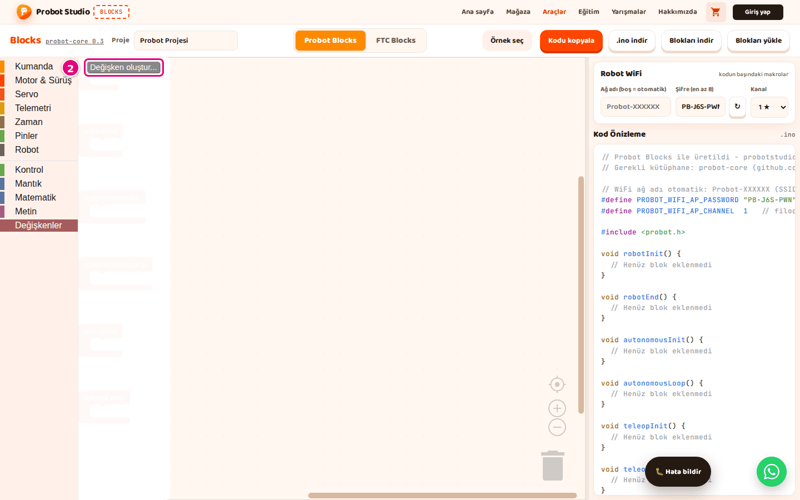

# Değişken oluştur ve kullan

Bu sayfada bir değeri saklamak için değişken oluşturacak, ona değer verecek ve değeri başka bir blokta
kullanacaksın. Örnek: otonom başladığı anı saklamak.

## Başlamadan önce

- Blocks açık ve **Probot Blocks** sekmesi seçili.
- Hazır kullanımı görmek için **Örnek seç** > **Otonom: İleri Git ve Dur**'u aç. Bu örnek
  **baslangic** adlı bir değişken kullanır.

## Değişken oluştur

1. Blok listesinde **Değişkenler** kategorisini seç.
2. Blok panelinde **Değişken oluştur...**'a bas.
   
   <!-- CAPTURE: url=https://probotstudio.com/blocks/ | hazirla=Probot Blocks, boş proje, Değişkenler paneli açık | hedef=text="Değişken oluştur..." | isaret=2 | bekle=text="Değişken oluştur..." -->
   <!-- SAY: Değişkenler kategorisinden yeni bir değişken oluşturuyoruz. -->
3. "Yeni değişken ismi:" kutusuna `baslangic` yaz.
4. **Tamam**'a bas.

Sonuç: Blok panelinde **baslangic ayarla**, **baslangic göre değiştir** ve **baslangic** blokları görünür.

Adı İngilizce harflerle yaz. Türkçe harf ve boşluk kullanma, adı rakamla başlatma. Aynı adla ikinci
bir değişken oluşturulamaz: "'baslangic' isimli değişken adı zaten var." uyarısı çıkar.

Kurala uymayan adlar koda değiştirilerek geçer: `hız` → `h_C4_B1z` olur, boşluk `_` olur, rakamla
başlayan adın önüne `my_` gelir. Kodda adı tanıyamazsın. `name`, `status` gibi bazı ayrılmış adların
da sonuna `2` eklenir.

## Değişkene değer ver

1. **Değişkenler**'den **ayarla** bloğunu **autonomousInit**'in içine sürükle.
2. Bloktaki listeden **baslangic**'i seç.
3. **Zaman**'dan **geçen süre (ms)** bloğunu **ayarla** bloğunun yuvasına tak.

Sonuç: Otonom başlarken o anki süre **baslangic**'e yazılır. **Kod Önizleme**'de
"// --- Tanımlar (bloklardan) ---" altında `double baslangic = 0;  // Blockly değişkeni` satırı,
`void autonomousInit()` içinde `baslangic = millis();` satırı görünür.

<!-- SAY: Otonom başladığı anı baslangic değişkenine kaydediyoruz. -->

## Değişkenin değerini kullan

Yalnız yaşam döngüsü bloklarının (**robotInit**, **autonomousLoop** gibi) içindeki bloklar koda
girer. Değişkeni okuyan bloğu bu yüzden bir yaşam döngüsü bloğundaki bloğa tak.

1. **Telemetri**'den **telemetriye değer yaz** bloğunu **autonomousLoop**'un içine sürükle. Bloğun
   **etiket** kutusunda `hız` yazar; istersen değiştir.
2. **Matematik**'ten **+** bloğunu **telemetriye değer yaz** bloğunun **değer** yuvasına tak. **+**
   bloğunun iki yuvasında da `1` yazar.
3. **Değişkenler**'den **baslangic** bloğunu **+** bloğunun ilk yuvasına tak. İkinci yuvada `1` kalır.
4. Değeri artırmak için **Değişkenler**'den **baslangic göre değiştir** bloğunu **autonomousInit**'in
   içine, **ayarla** bloğunun altına sürükle.
5. **göre değiştir** bloğunun yuvasına `5` yaz. Azaltmak için eksi sayı yaz, ör. `-5`.

Sonuç: **Kod Önizleme**'de `void autonomousLoop()` içinde
`probot::printf("hız: %.2f\n", (double)(baslangic + 1));` satırı görünür. `void autonomousInit()`
içinde `baslangic += 5;` satırı görünür.

<!-- SAY: Değişkeni okuyan bloğu başka blokların yuvalarına takıyoruz. -->

## Değişkenin adını değiştir

1. Değişkeni kullanan bir bloktaki `baslangic ▾` listesine bas.
2. **Değişkeni yeniden adlandır...**'ı seç.
   
   <!-- CAPTURE: url=https://probotstudio.com/blocks/ | hazirla=ornek:Otonom: İleri Git ve Dur | hedef=text="baslangic" (açılır liste); text="Değişkeni yeniden adlandır..." | isaret=2 | bekle=.blocklyDropDownDiv -->
   <!-- SAY: Değişkenin adını tek seferde bütün bloklarda değiştirebiliyoruz. -->
3. "Tüm 'baslangic' değişkenini yeniden adlandır:" kutusuna yeni adı yaz.
4. **Tamam**'a bas.

Sonuç: Değişkeni kullanan tüm bloklar yeni adı gösterir.

## Değişkeni sil

!!! warning "Dikkat"
    Değişkeni silmek, onu kullanan blokları da siler.

1. Değişkeni kullanan bir bloktaki listeye bas.
2. **'baslangic' değişkenini silmek istiyor musunuz?** öğesini seç. Menüde soru gibi görünür, sil komutudur.
3. Değişken birden çok yerde kullanılıyorsa "... kullanımını silmek istiyor musunuz?" sorusunda
   **Tamam**'a bas.

Sonuç: Değişken ve onu kullanan bloklar silinir. Geri almak için <kbd>Ctrl</kbd>+<kbd>Z</kbd>.

<!-- SAY: Kullanmadığımız değişkeni listeden silebiliyoruz. -->

## Motor, servo ve kumanda adları

**solMotor**, **sagMotor**, **kolServo** ve **js** gibi adlar da değişkendir. Bu yüzden **Değişkenler**
listesinde görünürler. Bunlarla **ayarla** ya da **göre değiştir** kullanma: kod anlamsız bir sayı
değişkeni üretir. Bu adları yalnız motor, servo ve kumanda bloklarındaki listelerden seç.

<!-- SAY: Motor ve kumanda adları da değişken listesinde görünüyor ama onlara sayı vermiyoruz. -->

## Sonraki adım

[Robot WiFi ayarlarını yap](probot-wifi-ayarla.md)
