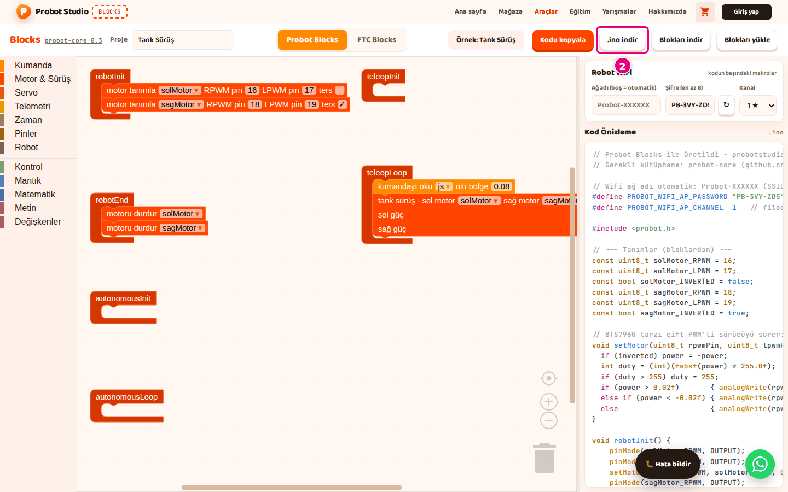

# Kodu kopyala ya da indir

Bu sayfada bloklardan üretilen Arduino kodunu panoya kopyalayacak ya da `.ino` dosyası olarak
indireceksin. Kodu karta Arduino IDE ile yüklersin.

<!-- CAPTURE: url=https://probotstudio.com/blocks/ | hazirla=ornek:Tank Sürüş, Probot Blocks sekmesi | hedef=body | isaret=yok | bekle=text="Örnek: Tank Sürüş" -->
<!-- SAY: Kod Önizleme'deki kodu bilgisayarımıza alıp Arduino IDE'ye taşıyoruz. -->

## Başlamadan önce

- Blocks açık ve **Probot Blocks** sekmesi seçili.
- Çalışma alanında bir program var. Yoksa **Örnek seç** > **Tank Sürüş**'ü aç.
- **Robot WiFi** şifresini elle yazdın ve şifre en az 8 karakter. Kısa şifreyle kod derlenmez.
  Bkz. [Robot WiFi ayarlarını yap](probot-wifi-ayarla.md).

## Kodu .ino dosyası olarak indir

1. Araç çubuğunda **Proje** kutusuna dosyanın adını yaz, ör. `Tank Sürüş`. Dosya adı bu addan gelir.
2. Araç çubuğunda **.ino indir**'e bas. ".ino dosyası indirildi." bildirimi çıkar.
   
   <!-- CAPTURE: url=https://probotstudio.com/blocks/ | hazirla=ornek:Tank Sürüş | hedef=role=button[name=".ino indir"] | isaret=2 | bekle=text=".ino indir" -->
   <!-- SAY: Kodu .ino dosyası olarak bilgisayarımıza indiriyoruz. -->
3. Tarayıcı dosyanın nereye kaydedileceğini sorarsa **Kaydet**'e bas.

Sonuç: İndirilenler klasöründe `<proje-adı>.ino` dosyası olur, ör. `tank-surus.ino`. Ad küçük harfe
çevrilir, Türkçe harfler ve boşluklar değişir. **Proje** kutusu boşsa dosya `probot-projesi.ino` olur.

## Kodu panoya kopyala

!!! tip "İpucu"
    Tarayıcı panoya erişime izin vermezse "Kopyalama başarısız oldu." yazar. Bu durumda **.ino indir**'i kullan.

1. Araç çubuğunda **Kodu kopyala**'ya bas. "Kod panoya kopyalandı." bildirimi çıkar.
2. Arduino IDE'de yeni bir sketch aç.
3. Sketch'teki hazır metni sil. İçinde `setup()` ve `loop()` kalmasın.
4. <kbd>Ctrl</kbd>+<kbd>V</kbd> ile kodu yapıştır. Mac'te <kbd>Cmd</kbd>+<kbd>V</kbd> kullan.

Sonuç: Sketch `// Probot Blocks ile üretildi - probotstudio.com/blocks` satırıyla başlar ve
`void teleopLoop()` fonksiyonuyla biter.

<!-- SAY: Arduino IDE açıksa kodu kopyalayıp doğrudan yapıştırabiliyoruz. -->

## Kodda ne var

**Kod Önizleme**'deki kod yukarıdan aşağı şu sırayla yazılır:

- Başlık yorumu ve gerekli kütüphanenin adı (probot-core).
- WiFi ayarları: `#define PROBOT_WIFI_AP_...` satırları. **Ağ adı** boşsa ad satırının yerinde bir
  yorum durur.
- `#include <probot.h>` satırı.
- Tanımlar: motor ve servo pinleri, değişkenler, yardımcı fonksiyonlar.
- Altı yaşam döngüsü fonksiyonu: `robotInit()`, `robotEnd()`, `autonomousInit()`, `autonomousLoop()`,
   `teleopInit()`, `teleopLoop()`.

Boş bir yaşam döngüsü bloğunun fonksiyonunda `// Henüz blok eklenmedi` yazar. `setup()` ve `loop()`
yazılmaz; onları kütüphane sağlar.

<!-- SAY: Üretilen kod WiFi ayarlarıyla başlıyor, altı yaşam döngüsü fonksiyonuyla bitiyor. -->

Araç çubuğundaki **probot-core 0.3** yazısı, kodun hangi kütüphane sürümü için üretildiğini gösterir.
Yazıya basınca Probot Core dokümanı açılır. O doküman daha yeni bir sürümü anlatır ve orada
`autonomousStop()` gibi Blocks'un üretmediği fonksiyonlar geçer.

## Sonraki adım

[Kodu Probot kartına yükle](probot-karta-yukle.md)
