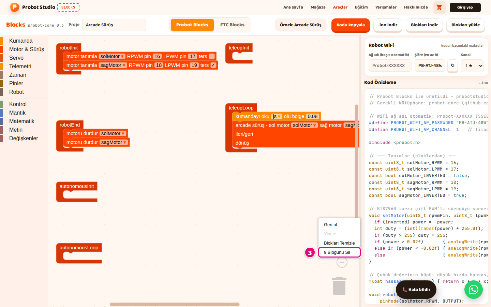

# Projeyi kaydet, aç ve yeniden başla

Bu sayfada Probot projeni bilgisayarına dosya olarak kaydedecek, kaydettiğin dosyayı açacak ve boş bir
projeyle yeniden başlayacaksın.

Blocks'ta hesap ve bulut kaydı yoktur. Projeni korumanın güvenilir yolu **Blokları indir** ile dosyaya
kaydetmektir.

## Başlamadan önce

- Blocks açık ve **Probot Blocks** sekmesi seçili.
- Denemek için bir örnek aç: **Örnek seç** > **Arcade Sürüş**.

## Projeye ad ver

1. Araç çubuğunda **Proje** kutusuna bas.
2. Kutudaki adı sil ve yeni adı yaz, ör. `Takım Robotu`. En çok 60 karakter.
3. Kutudan çık.

Sonuç: İndireceğin dosyalar bu adı taşır: `takim-robotu.probot.json`, `takim-robotu.ino`. Türkçe harfler
sadeleşir; boşluk, `_`, `.` gibi harf ve rakam dışındaki karakterler `-` olur. Büyük `İ` ise `i-` olur
(`İleri` → `i-leri`). Kutu boşsa dosya adı `probot-projesi` olur.

<!-- SAY: Önce projemize bir ad veriyoruz, indirilen dosyalar bu adı alıyor. -->

## Projeyi dosyaya kaydet

!!! warning "Dikkat"
    Blocks projeni yalnız bu tarayıcıda otomatik kaydeder. Başka bir tarayıcı ya da bilgisayar bu kaydı
    görmez; tarayıcı verisini temizleyince kayıt silinir. Kalıcı kopya için projeyi aşağıdaki adımlarla
    `.probot.json` dosyasına indir.

1. Araç çubuğunda **Blokları indir**'e bas. "Blok projesi indirildi." bildirimi çıkar.
   
   <!-- CAPTURE: url=https://probotstudio.com/blocks/ | hazirla=ornek:Arcade Sürüş | hedef=role=button[name="Blokları indir"]; role=button[name="Blokları yükle"] | isaret=1,2 | bekle=text="Blokları indir" -->
   <!-- SAY: Projeyi kaybetmemek için Blokları indir ile bilgisayarımıza kaydediyoruz. -->
2. Tarayıcının indirilenler klasörünü aç.
3. `<proje-adı>.probot.json` dosyasını güvenli bir yere taşı.

Sonuç: Dosyada bloklar, proje adı ve WiFi ayarları vardır. WiFi şifresi dosyada açık metin olarak durur.

## Kayıtlı projeyi aç

!!! warning "Dikkat"
    Dosya açmak çalışma alanındaki projenin yerine geçer ve onay sormaz. Hatalı bir dosya da mevcut
    projeni silebilir. Önce projeni **Blokları indir** ile kaydet.

1. Araç çubuğunda **Blokları yükle**'ye bas.
2. Açılan pencerede `.probot.json` dosyasını seç.
3. **Aç**'a bas.

Sonuç: "Blok projesi yüklendi." bildirimi çıkar. Bloklar, proje adı ve WiFi ayarları dosyadan gelir.
Bloklar, proje adı ve şifre otomatik kayda girer; dosyadan gelen ağ adı ve kanal girmez:
[Otomatik kayıt](#otomatik-kayit).

Dosya JSON değilse ya da Probot Blocks proje yapısında değilse "Blok projesi yüklenemedi." yazar ve
mevcut proje değişmez.

Dosya yapı olarak doğru ama içinde araçta olmayan bir blok türü varsa aynı uyarı çıkar. Bu, başka bir
Blockly uygulamasının dosyasında ya da elle değiştirilmiş bir `.probot.json`'da olur. Bu durumda mevcut
proje silinir, çalışma alanı boş ya da yarım kalır, proje adı ve WiFi ayarları da dosyadakilerle
değişmiş olabilir.

<!-- SAY: Kaydettiğimiz projeyi Blokları yükle ile geri açıyoruz. -->

## Yeniden başla {#yeniden-basla}

Probot Blocks'ta **Yeni** düğmesi yoktur. Boş projeye çalışma alanındaki blokları silerek dönersin.

!!! warning "Dikkat"
    Bu iş çalışma alanındaki tüm blokları siler. Projeni saklamak istiyorsan 1. adımı atlama.

1. Araç çubuğunda **Blokları indir**'e bas.
2. Çalışma alanında boş bir yere sağ tıkla.
3. **<n> Bloğunu Sil**'i seç (ör. "12 Bloğunu Sil").
   
   <!-- CAPTURE: url=https://probotstudio.com/blocks/ | hazirla=ornek:Arcade Sürüş | hedef=.blocklySvg (boş alan, sağ tık); .blocklyContextMenu >> text=/Bloğunu Sil/ | isaret=3 | bekle=.blocklyContextMenu -->
   <!-- SAY: Boş bir projeye dönmek için çalışma alanındaki tüm blokları siliyoruz. -->
4. "Tüm <n> blokları silinsin mi?" sorusunda **Tamam**'a bas.
5. **Proje** kutusuna yeni projenin adını yaz.

Sonuç: Yalnız altı yaşam döngüsü bloğu kalır. Bunlar silinmez.

## Otomatik kayıt nasıl çalışır {#otomatik-kayit}

Blocks projeni tarayıcıda kendiliğinden saklar. Aynı tarayıcıda sayfayı yeniden açınca proje geri gelir.

| Ne | Ne zaman saklanır | Ne kadar kalır |
|---|---|---|
| Bloklar | Her değişiklikte. Büyük proje de kaydedilir. | Süresi dolmaz. |
| Proje adı | Her değişince: elle yazınca, örnek seçince, dosya açınca. | Blocks'u bu tarayıcıda son açtığın günden 30 gün. |
| WiFi şifresi | Her değişince: Blocks ilk açılışta ürettiğinde, elle yazınca, **↻** ile, dosya açınca. | Blocks'u bu tarayıcıda son açtığın günden 30 gün. |
| Ağ adı ve kanal | Yalnız elle yazınca ya da listeden seçince. | Son elle değiştirdiğin günden 30 gün. |
| Yan panel genişliği, seçili sekme | Değiştirince. | Genişlik son değiştirdiğin günden 30 gün; sekmenin süresi dolmaz. |

Eski sürümün çereze kaydettiği proje ilk açılışta bir kez yeni kayda aktarılır.

!!! warning "Dikkat"
    Otomatik kayıt şu durumlarda uyarı vermeden eksik kalır:

    - Örnek yükleyip hiçbir bloğu değiştirmediysen bloklar kaydedilmez. Sayfa yenilenince önceki proje gelir.
    - **Blokları yükle** ile gelen ağ adı ve kanal, o kutuyu bir kez elle değiştirene kadar kaydedilmez:
      [Dosyadan gelen ayarları tarayıcıya kaydet](probot-wifi-ayarla.md#dosyadan-gelen-ayarlar).

    Başka bir tarayıcı ya da bilgisayar kaydı görmez; tarayıcı verisini temizleyince kayıt silinir. Önemli
    projeyi **Blokları indir** ile dosyaya kaydet.

<!-- SAY: Tarayıcı projeyi saklıyor ama asıl güvenli kayıt dosyaya indirmek. -->

## Sorun mu var?

- **"Blok projesi yüklenemedi." yazıyor:** Dosya `.probot.json` değil, bozuk ya da araçta olmayan bir
  blok içeriyor. **Blokları indir** ile alınmış bir dosya seç.
- **Yenileyince başka proje geldi:** Bkz. [Sorun giderme](sorunlar.md#yenileyince-proje-degisti).
- **Yenileyince ağ adı ya da kanal değişti:** Dosyadan gelen ağ adı ve kanal otomatik kayda girmez. İkisini
  bir kez elle değiştir ya da dosyayı yeniden yükle. Bkz. [Sorun giderme](sorunlar.md#yenileyince-ad-wifi-degisti).

## Sonraki adım

[Kodu kopyala ya da indir](probot-kodu-al.md)
