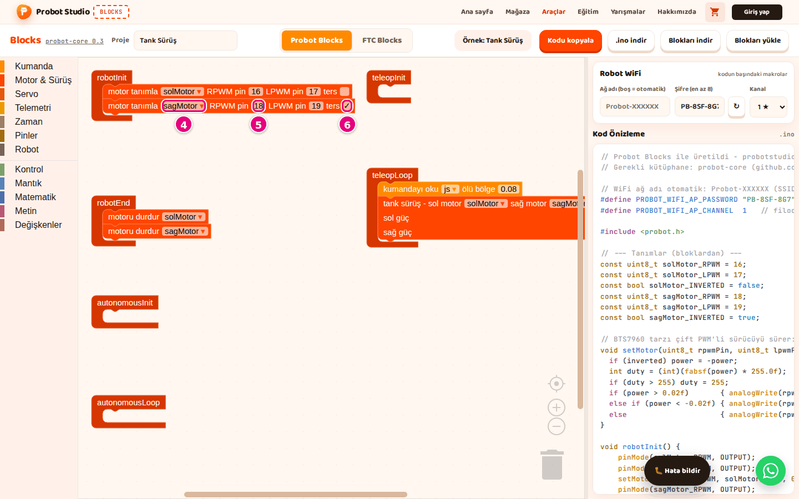
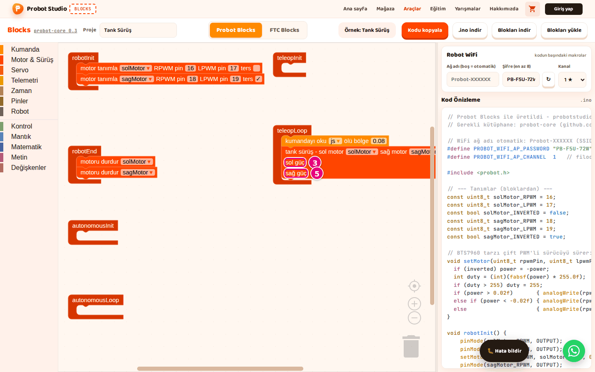

# Sürüş programı yaz

Bu sayfada boş bir projeden iki motorlu, kumandayla sürülen bir program yazacaksın. Sonunda
**Tank Sürüş** örneğindeki programı kendin kurmuş olacaksın. Örnekte sağ motorun **ters** kutusu da işaretlidir.

<!-- CAPTURE: url=https://probotstudio.com/blocks/ | hazirla=ornek:Tank Sürüş, Probot Blocks sekmesi | hedef=body | isaret=yok | bekle=text="Örnek: Tank Sürüş" -->
<!-- SAY: Bu sayfanın sonunda ekranımızda Tank Sürüş örneğindeki programın aynısı olacak. -->

## Başlamadan önce

- Blocks açık ve **Probot Blocks** sekmesi seçili.
- Çalışma alanında yalnız altı yaşam döngüsü bloğu var. Değilse bkz. [Yeniden başla](probot-projeyi-kaydet.md#yeniden-basla).
- Robotundaki motor sürücü pinlerini bil. Bu sayfa örneklerdeki pinleri kullanır: sol motor 16 ve 17, sağ motor 18 ve 19.

Hazır sonucu görmek istersen **Örnek seç** > **Tank Sürüş**'ü aç.

## Yaşam döngüsü bloklarını tanı

Program altı bloğa bölünür. Her blok robotun bir anında çalışır. Teleop (sürücü kontrolü), robotu
kumandayla sürdüğün bölümdür.

| Blok | Ne zaman çalışır | Buraya ne konur |
|---|---|---|
| **robotInit** | Driver Station'da **Init**'e basınca, bir kez | Motor ve pin tanımları |
| **robotEnd** | **Stop**'a basınca, bir kez | Motorları durdurma |
| **autonomousInit** | Otonom başlarken, bir kez | Otonom hazırlığı |
| **autonomousLoop** | Otonom boyunca, saniyede yaklaşık 50 kez | Otonom hareketler |
| **teleopInit** | Teleop başlarken, bir kez | Teleop hazırlığı |
| **teleopLoop** | Teleop boyunca, saniyede yaklaşık 50 kez | Kumanda okuma ve sürüş |

Döngü bloklarının içinde 2 saniyeden uzun bekleme yapma. Robot bunu süre aşımı (deadline miss) sayar.

<!-- SAY: Program altı bloğa bölünüyor ve her blok robotun farklı bir anında çalışıyor. -->

## Sağ motorun adını oluştur

Motor adları değişken olarak tutulur. **motor tanımla**, **motoru sür** ve **motoru durdur** bloklarında varsayılan ad **solMotor**'dur.

**sagMotor** yalnız **tank sürüş** ve **arcade sürüş** bloklarında hazır gelir. Motorları sürüş bloğundan önce tanımlayacağın için bu adı önce sen oluştur.

Değişken adında Türkçe harf ve boşluk kullanma. Blocks bu karakterleri kodda değiştirir: boşluk `_` olur, Türkçe harf `_C4_9F` gibi bir diziye dönüşür (ör. `sağMotor` → `sa_C4_9FMotor`). Kod yine derlenir ama ad okunmaz hâle gelir.

1. Blok listesinde **Değişkenler** kategorisini seç.
2. Blok panelinde **Değişken oluştur...**'a bas.
   
   <!-- CAPTURE: url=https://probotstudio.com/blocks/ | hazirla=Probot Blocks, boş proje, Değişkenler paneli açık | hedef=text="Değişken oluştur..." | isaret=2 | bekle=text="Değişken oluştur..." -->
3. "Yeni değişken ismi:" kutusuna `sagMotor` yaz.
4. **Tamam**'a bas.

Sonuç: Blok panelinde **sagMotor** adlı bloklar görünür.

<!-- SAY: Önce sağ motor için sagMotor adında bir değişken oluşturuyoruz. -->

## Motorları tanımla

!!! tip "İpucu"
    Her bloğu bir yaşam döngüsü bloğunun içine, çentiği oturacak şekilde bırak. Dışarıda kalan blok koda girmez.

1. Blok listesinde **Motor & Sürüş** kategorisini seç.
2. **motor tanımla** bloğunu **robotInit**'in içine sürükle. Ad **solMotor**, pinler 16 ve 17 gelir.
3. İkinci bir **motor tanımla** bloğunu ilkinin altına sürükle.
4. İkinci bloktaki `solMotor ▾` listesine bas, **sagMotor**'u seç.
5. İkinci blokta **RPWM pin** değerini `18`, **LPWM pin** değerini `19` yap.
6. Sağ motor ters dönüyorsa ikinci bloktaki **ters** kutusunu işaretle.
   
   <!-- CAPTURE: url=https://probotstudio.com/blocks/ | hazirla=ornek:Tank Sürüş | hedef=text="motor tanımla" (ikinci blok); text="sagMotor"; text="18"; text="ters" | isaret=4,5,6 | bekle=text="motor tanımla" -->
   <!-- SAY: Robot ilk açıldığında iki motoru pin numaralarıyla tanımlıyoruz. -->

Sonuç: **Kod Önizleme**'de `const uint8_t sagMotor_RPWM = 18;` satırı görünür.

## Motorları durdur

1. **Motor & Sürüş**'ten **motoru durdur** bloğunu **robotEnd**'in içine sürükle.
2. İkinci bir **motoru durdur** bloğunu altına sürükle.
3. İkinci bloktaki listeden **sagMotor**'u seç.

Sonuç: **Kod Önizleme**'de `void robotEnd()` içinde iki `setMotor(` satırı görünür. Driver Station'da **Stop**'a basınca iki motor da durur.

<!-- SAY: Stop'a basıldığında iki motorun da durması için robotEnd içine durdurma bloklarını koyuyoruz. -->

## Kumandayla sür

1. **Kumanda**'dan **kumandayı oku** bloğunu **teleopLoop**'un içine sürükle.
2. **Motor & Sürüş**'ten **tank sürüş** bloğunu **kumandayı oku**'nun altına sürükle.
3. **Kumanda**'dan **js sol çubuk ↕ (ileri +)** bloğunu **tank sürüş**'teki **sol güç** yuvasına tak.
4. Aynı bloktan birini daha **sağ güç** yuvasına tak.
5. **sağ güç**'teki bloğun `sol çubuk ↕ (ileri +) ▾` listesinden **sağ çubuk ↕ (ileri +)**'yı seç.
   
   <!-- CAPTURE: url=https://probotstudio.com/blocks/ | hazirla=ornek:Tank Sürüş | hedef=text="tank sürüş - sol motor"; text="sol güç"; text="sağ güç" | isaret=3,5 | bekle=text="kumandayı oku" -->
   <!-- SAY: Teleop döngüsünde kumandayı okuyup iki çubuğun değerini iki motora veriyoruz. -->
6. Yuvalarda hazır duran `0` blokları çalışma alanına düşer. Onları çöp kutusuna sürükle.

Sonuç: **sol güç** yuvasında sol çubuk, **sağ güç** yuvasında sağ çubuk takılı. Robotta sol çubuk sol motoru, sağ çubuk sağ motoru sürer. Çubuk tam ileri itilince değer +1 olur.

## Kodu kontrol et

1. Çalışma alanında yaşam döngüsü bloklarının dışında blok kaldıysa onu çöp kutusuna sürükle.
2. Fareyi yan panelde **Kod Önizleme**'nin üstüne getir.
3. Tekerlekle **Kod Önizleme**'yi `void teleopLoop()` satırına kadar aşağı kaydır.
   
   <!-- CAPTURE: url=https://probotstudio.com/blocks/ | hazirla=ornek:Tank Sürüş | hedef=.code-preview >> text="void teleopLoop()" | isaret=3 | bekle=text="void teleopLoop()" -->

Sonuç: `void teleopLoop()` içinde `auto js = ...` satırı ve iki `setMotor(` satırı görünür. Kod karta yüklenmeye hazır.

Kaydetmek için **Blokları indir**'e, karta yüklemek için **.ino indir**'e bas.

<!-- SAY: Son olarak kod önizlemesinde programımızın karşılığını kontrol ediyoruz. -->

## Sorun mu var?

- **Blok koda girmiyor:** Blok bir yaşam döngüsü bloğunun içine oturmamış. Bloğu sürükleyip yeniden tak. Bkz. [Sorun giderme](sorunlar.md#kod).
- **İki motor da aynı yöne dönmüyor:** Ters dönen motorun **motor tanımla** bloğunda **ters** kutusunu işaretle.
- **Robot hep biraz kayıyor:** **kumandayı oku** bloğundaki **ölü bölge** değerini büyüt (en çok 0,5).

## Sonraki adım

[Kodu Probot kartına yükle](probot-karta-yukle.md)
