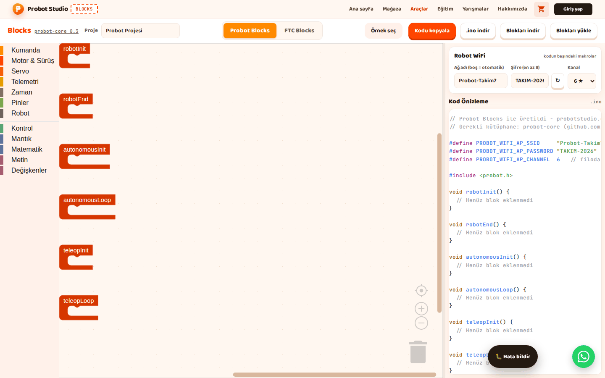

# Robot WiFi ayarlarını yap

Probot kartı kendi WiFi ağını yayınlar. Bilgisayarın ya da telefonun bu ağa bağlanıp robotu sürer. Bu
sayfada ağın adını, şifresini ve kanalını ayarlayacaksın. Ayarlar kodun başına yazılır ve kodu karta
yükleyince geçerli olur.


<!-- CAPTURE: url=https://probotstudio.com/blocks/ | hazirla=Probot Blocks; Ağ adı=Probot-Takim7; Şifre=TAKIM-2026; Kanal=6 ★ | hedef=body | isaret=yok | bekle=text="PROBOT_WIFI_AP_SSID" -->
<!-- SAY: Sayfanın sonunda robotun ağ adı, şifresi ve kanalı kodun başında yazılı olacak. -->

## Başlamadan önce

- Blocks açık ve **Probot Blocks** sekmesi seçili.
- Yan panelde **Robot WiFi** bölümü görünüyor.

!!! warning "Dikkat"
    Şifreyi elle yazmazsan Blocks her açılışta yeni bir şifre üretir. Aynı projeden farklı günlerde
    indirdiğin kodların şifresi farklı olur. Şifreyi bir kez elle yaz ya da **↻** ile üretip not et.

## Ağ adını ve şifreyi yaz

!!! warning "Dikkat"
    Şifre 8 karakterden kısaysa kod derlenmez. 1-7 karakterde kutunun çerçevesi koyu turuncu olur ve
    "Şifre en az 8 karakter olmalı; yoksa kod derlenmez." yazar; kutu boşken bu uyarı çıkmaz.

1. **Robot WiFi** bölümünde **Ağ adı (boş = otomatik)** kutusuna robotun ağ adını yaz, ör.
   `Probot-Takim7`. En çok 24 karakter.
   <!-- SAY: Robotun yayınlayacağı WiFi ağına bir ad veriyoruz. -->
2. **Şifre (en az 8)** kutusundaki metni silip 8-24 karakterlik bir şifre yaz, ör. `TAKIM-2026`.
3. Şifreyi not et. Robota bağlanırken gerekir.
   
   <!-- CAPTURE: url=https://probotstudio.com/blocks/ | hazirla=Probot Blocks; Ağ adı=Probot-Takim7; Şifre=TAKIM-2026 | hedef=role=textbox[name="Ağ adı (boş = otomatik)"]; role=textbox[name="Şifre (en az 8)"] | isaret=1,2 | bekle=text="Robot WiFi" -->
   <!-- SAY: Şifreyi kendimiz yazıyoruz ve bir kenara not ediyoruz. -->

Sonuç: **Kod Önizleme**'nin başında şu iki satır durur:

```cpp
#define PROBOT_WIFI_AP_SSID     "Probot-Takim7"
#define PROBOT_WIFI_AP_PASSWORD "TAKIM-2026"   // en az 8 karakter
```

Kodu karta yükleyince bilgisayarın WiFi listesinde `Probot-Takim7` ağı görünür.

Ağ adı kutusunu boş bırakırsan robot `Probot-XXXXXX` biçiminde kendi adını kullanır. Kodda o zaman
`#define PROBOT_WIFI_AP_SSID` yerine bir yorum satırı durur. Sınıfta birden çok robot varsa her robota
ayrı bir ad ver.

Ağ adında `"` ve `\` işaretleri kabul edilmez. Şifre yalnız büyük harf (A-Z), rakam ve `-` içerir.

Küçük harf yazarsan büyüğe çevrilir (ı da I olur). Ç, Ğ, İ, Ö, Ş, Ü ile ç, ğ, ö, ş, ü ve diğer işaretler
atılır.

## Yeni şifre üret

1. **Robot WiFi** bölümünde **Şifre (en az 8)** kutusunun yanındaki **↻**'ye bas. "Yeni WiFi şifresi
   oluşturuldu." bildirimi çıkar.
2. Kutudaki şifreyi not et.
3. Araç çubuğunda **.ino indir**'e bas.

Sonuç: Kutuda `PB-XXX-XXX` biçiminde yeni bir şifre durur ve tarayıcıda saklanır. İndirdiğin `.ino`
bu şifreyi taşır. Robot yeni şifreyi bu kodu karta yükleyince kullanır.

<!-- SAY: İstersek yenile düğmesiyle rastgele bir şifre ürettiriyoruz. -->

## Kanalı seç

1. **Robot WiFi** bölümünde **Kanal** listesine bas.
2. **1 ★**, **6 ★** ya da **11 ★**'ı seç.
3. Kodu karta yükle: [Kodu Probot kartına yükle](probot-karta-yukle.md).
4. Robotun ağına bağlanıp Driver Station'ı aç (aynı sayfa, "Robotun ağına bağlan" bölümü).
5. Driver Station'da **Logs**'a bas.

Sonuç: **Kod Önizleme**'de kanal satırı değişir, ör. **6 ★** için:

```cpp
#define PROBOT_WIFI_AP_CHANNEL  6   // filoda 1, 6 veya 11 kullan
```

**Logs** sayfasında "Channel" satırında "6 (macro)" yazar. Robot ağı bu kanalda yayınlar.

Parantezde "nvs" yazıyorsa robotun **Logs** sayfasında **Kanal Değiştir** ile daha önce bir kanal
kaydedilmiştir; kod yüklense bile o kayıtlı kanal geçerli olur. Koddaki kanala dönmek için orada
**Varsayılana dön (açılışta)**'yı seçip **Uygula**'ya bas, sonra robotu yeniden başlat.

Aynı odada birden çok robot varsa robotları 1, 6 ve 11 kanallarına dağıt. Bu üç kanal birbirini
bozmaz. Liste 1-13 arası tüm kanalları gösterir; bazı dizüstü ve tabletler 12 ve 13'ü görmez.

<!-- SAY: Aynı odadaki robotlar birbirini bozmasın diye yıldızlı kanallardan birini seçiyoruz. -->

## Ayarlar nerede saklanır

Ağ adı, şifre ve kanal tarayıcıda saklanır. **Blokları indir** ile indirdiğin `.probot.json` dosyasına
da yazılır.

**Blokları yükle** ile dosyayı açınca ayarlar dosyadan gelir, ama tarayıcıya kaydedilmez. Sayfayı
yenilersen tarayıcıdaki eski ayarlar geri gelir. Daha önce şifre kaydedilmemişse yeni bir şifre üretilir.

Neyin ne kadar saklandığı: [Otomatik kayıt nasıl çalışır](probot-projeyi-kaydet.md#otomatik-kayit).

!!! info "Yakında"
    Bu özellik şu an geliştirme sürümünde; yakında probotstudio.com'a gelecek.
    Blocks'un ilk açılışta ürettiği şifre kaydedilir; sayfayı yenileyince aynı şifre kalır. **Blokları yükle**
    ile dosyadan gelen şifre de kaydedilir. Dosyadan gelen ağ adı ve kanal kutuyu elle değiştirene kadar
    yine kaydedilmez.

!!! warning "Dikkat"
    `.probot.json` dosyası WiFi şifresini açık metin olarak taşır. Bu, robotun kendi ağının şifresidir, hesap
    şifresi değildir; yine de dosyayı paylaşırsan robotunun ağına bağlanılabilir.

<!-- SAY: WiFi ayarları proje dosyasına da kaydediliyor. -->

## Dosyadan gelen ayarları tarayıcıya kaydet {#dosyadan-gelen-ayarlar}

**Blokları yükle** ile açtığın dosyanın ayarlarını kalıcı yapmak için her ayarı bir kez elle değiştir.
Bunu yapmazsan sayfayı her açtığında dosyayı yeniden yükle.

1. **Robot WiFi** bölümünde **Ağ adı (boş = otomatik)** kutusundaki son karakteri silip yeniden yaz.
   Kutu boşsa bir harf yazıp sil.
2. **Şifre (en az 8)** kutusundaki son karakteri silip yeniden yaz.
3. **Kanal** listesinde başka bir kanal seç.
4. **Kanal** listesinde dosyadan gelen kanalı yeniden seç.

Sonuç: Sayfayı yenileyince ağ adı, şifre ve kanal dosyadaki değerlerle gelir.

<!-- SAY: Dosyadan gelen WiFi ayarlarını tarayıcıya da kaydettiriyoruz. -->

## Sonraki adım

[Kodu kopyala ya da indir](probot-kodu-al.md)
