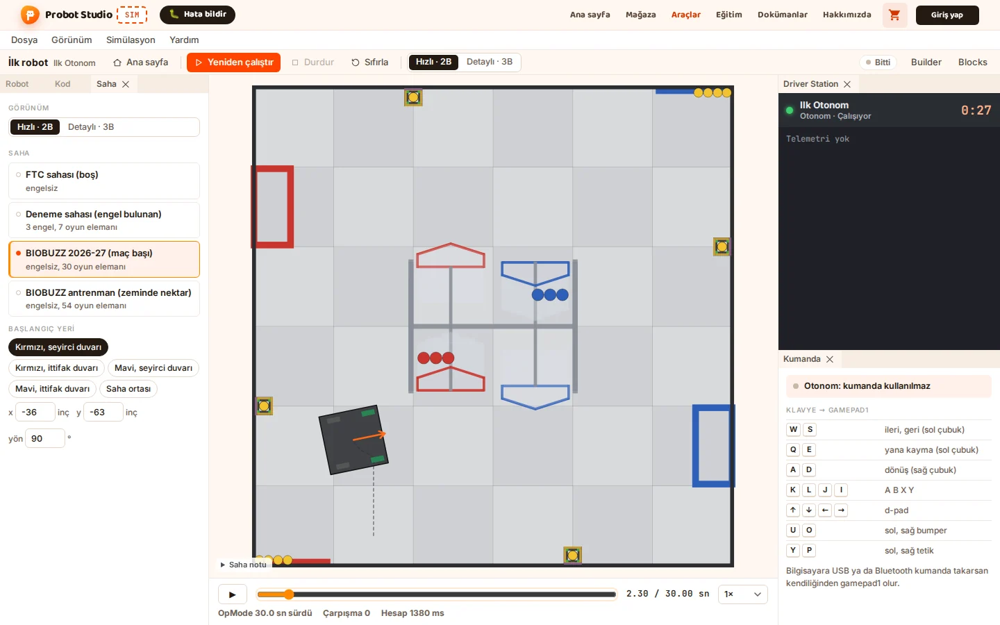
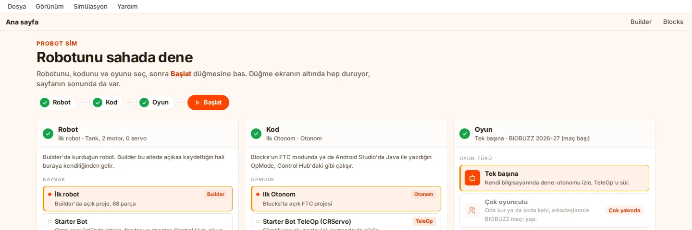
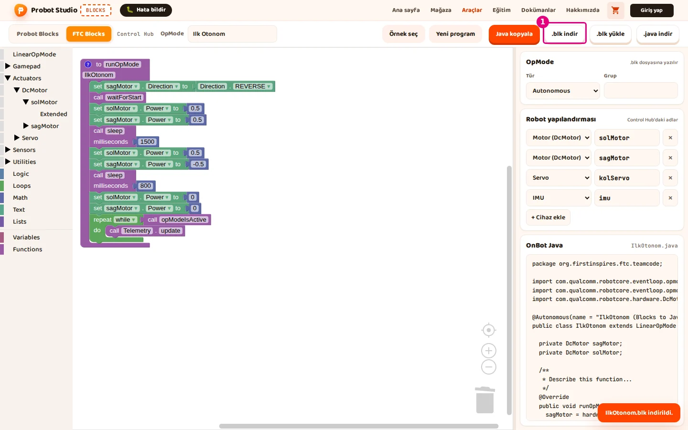
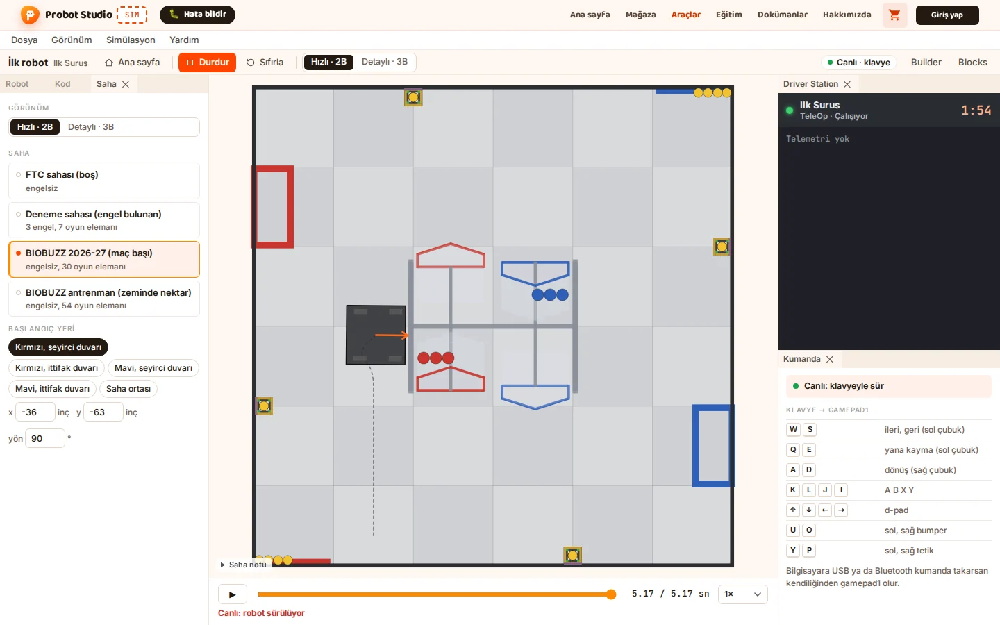
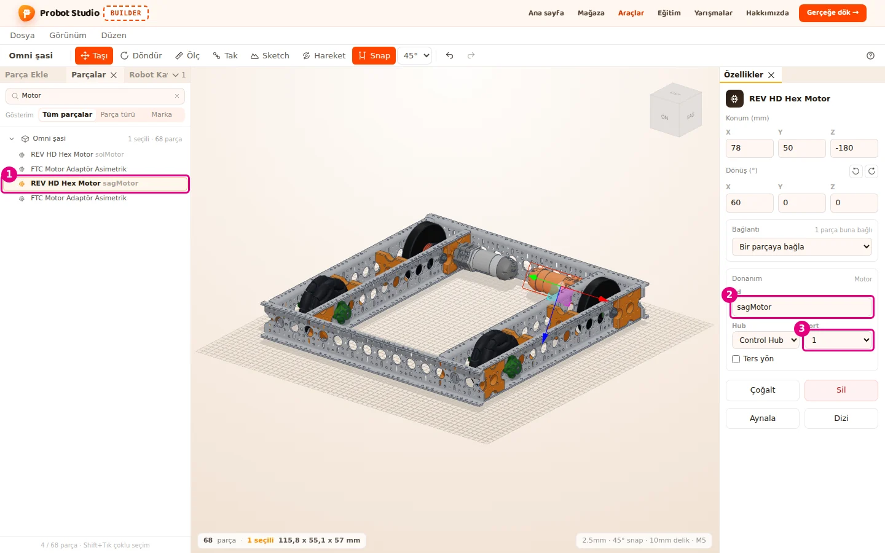

# Hoca hazırlığı

## Bu derste

Serinin tanıtımı. Önce sonucu gösteriyoruz, Omni şasi Sim sahasında kendi kendine ileri gidip sağa dönüyor. Sonra üç aracı, seçtiğimiz robotu ve araçları birbirine bağlayan motor adlarını anlatıyoruz. Bölüm dört bölümlük planla ve birinci bölüme geçişle bitiyor.

## Dersten önce

- Görseller serinin kendi robotundan alındı, bölümlerde aynı ekranlar yeniden geliyor.
- Seride geçen adlar hep aynı. Robot Omni şasi, proje adı İlk robot, motorlar solMotor ve sagMotor, programlar Ilk Otonom ve Ilk Surus.
- Seri hesap gerektirmiyor. Builder, Blocks ve Sim giriş yapmadan açılıyor.

## Zaman planı

| Dakika | Bölüm | Ne oluyor |
|---|---|---|
| 0-1 | Kapak, robot ne yapacak | Sonuç sahnesi, otonom ve TeleOp |
| 1-2,5 | Araçlar ve robot | Üç araç, Omni şasi, motor adları |
| 2,5-4 | Plan | Gerekenler, bölümler, sonraki bölüm |

# Sayfalar

## Probot ile bir robot yapalım {kapak sure=0.4}

::: hoca
**Söyle:** "Bu seride tek bir robotu baştan sona birlikte yapıyoruz ve her adımı ekranda birlikte izliyoruz. Ekranda gördüğünüz robot sanal bir sahada kimse dokunmadan ileri gidiyor, sağa dönüyor ve duruyor. Dört bölümün sonunda siz de bu robotu kendi bilgisayarınızda kurmuş, programlamış ve sahada çalıştırmış oluyorsunuz."
:::

## Robot ne yapacak {sure=0.4}

- Otonomda ileri gidiyor, sağa dönüyor ve duruyor
- TeleOp'ta klavyeyle sürülüyor
- İki program, aynı robot

::: hoca
**Söyle:** "Robotumuz bu seride iki farklı program çalıştırıyor. Otonom programında robot kimse dokunmadan ileri gidiyor, olduğu yerde sağa dönüyor ve duruyor. TeleOp programında ise aynı robotu klavyeyle biz sürüyoruz ve iki programda da robotun kendisi hiç değişmiyor."
:::

## Üç araç, bir robot {sure=0.5}

- Builder ile robotu parça parça kuruyoruz
- Blocks ile programı bloklarla yazıyoruz
- Sim robotla programı sanal sahada buluşturuyor

::: hoca
**Söyle:** "Seride Probot Studio'nun tarayıcıda açılan üç aracını kullanıyoruz. Builder'da robotu parçalarıyla kuruyoruz, Blocks'ta FTC bloklarıyla robotun programını yazıyoruz. Sim ise Builder'daki robotu Blocks'taki programla bir araya getiriyor ve ikisini ekrandaki gibi Robot, Kod ve Oyun kartlarından seçip sanal bir sahada çalıştırıyor."
:::

## Robotumuz Omni şasi {sure=0.5}

- Builder'da hazır gelen bir şasi
- 68 parça
- İki REV HD Hex motor, her yanda bir tane

::: hoca
Omni şasi Builder'ın boş sahnesindeki hazır robotlardan biri. İki motorlu olduğu için ilk programlar için uygun bir başlangıç.

**Söyle:** "Robot olarak Builder'da hazır gelen Omni şasiyi seçiyoruz, çünkü boş sahnede tek tıkla geliyor. Bu şaside iki REV HD Hex motor var, biri sol tarafı, diğeri sağ tarafı sürüyor. İki motorlu olduğu için ilk programlarımızı yazarken her bloğun robotta neyi değiştirdiğini rahatça görüyoruz."
:::

## Zinciri motor adları bağlıyor {sure=0.5}

- Builder'da motorlara ad, solMotor ve sagMotor
- Blocks'ta program aynı adları kullanıyor
- Sim adları eşleştirip doğru motoru döndürüyor
- Adlar büyük küçük harfiyle aynı yazılıyor

::: hoca
**Söyle:** "Serinin en önemli fikri motor adları ve bu fikir üç aracı birbirine bağlıyor. Builder'da verdiğimiz solMotor ve sagMotor adlarını Blocks'taki programda da büyük küçük harfiyle aynen yazıyoruz. Sim bu adlara bakarak programdaki her motoru robottaki doğru motorla ve doğru portla eşleştiriyor."
:::

## Neye ihtiyacımız var {sure=0.4}

- Bir bilgisayar ve tarayıcı
- probotstudio.com adresinde Builder, Blocks ve Sim
- Kurulum ve hesap gerekmiyor

::: hoca
**Söyle:** "Bu seri için bir bilgisayar ve güncel bir tarayıcı yetiyor. Builder, Blocks ve Sim probotstudio.com adresinde açılıyor ve bilgisayara bir şey kurmamız gerekmiyor. Serideki adımların hiçbiri hesap istemediği için giriş yapmadan da baştan sona ilerleyebiliyoruz."
:::

## Dört bölüm {sure=0.5}

- 1 Builder'da robotu topluyoruz
- 2 Blocks'ta otonom programı yazıyoruz
- 3 Sim'de otonomu çalıştırıyoruz
- 4 TeleOp yazıp robotu sürüyoruz

::: hoca
**Söyle:** "Seri bu tanıtımdan sonra dört bölümden oluşuyor. Birinci bölümde Builder'da robotu topluyoruz, ikinci bölümde Blocks'ta ekrandaki gibi bir otonom program yazıyoruz ve üçüncü bölümde bu programı Sim'de çalıştırıyoruz. Dördüncü ve son bölümde bir TeleOp programı yazıyoruz ve robotu klavyeyle kendimiz sürüyoruz."
:::

## Takılırsak örnek dosyalar {sure=0.4}

- ilk-robot.json, Builder projesi
- IlkOtonom.blk ve IlkSurus.blk, iki program
- Serinin örnek proje klasöründe

::: hoca
**Söyle:** "Her bölümün sonunda işimizi bir dosyaya kaydediyoruz. Builder projesi İlk robot.json, iki program da IlkOtonom.blk ve IlkSurus.blk adlarıyla iniyor. Bir adımda takılırsak serinin örnek proje klasöründeki aynı dosyaları açıp kaldığımız yerden devam edebiliyoruz ve Builder projesi orada ilk-robot.json adıyla duruyor."
:::

## Klavyeyle sürüş {sure=0.4}

- Son bölümün hedefi
- W ve S ileri geri, A ve D dönüş
- Aynı robot, aynı motor adları

::: hoca
**Söyle:** "Son bölümde robotu bu ekrandaki gibi klavyeyle sürüyoruz ve klavye kumandanın yerini tutuyor. W ve S tuşları robotu ileri ve geri götürüyor, A ve D tuşları ise robotu sola ve sağa döndürüyor. Robotun geçtiği yol sahada bir çizgi olarak kalıyor."
:::

## Bir sonraki bölümde {sure=0.4}

- Builder'ı açıyoruz
- Omni şasiyi sahneye alıyoruz
- Motorlara ad ve port veriyoruz

::: hoca
**Söyle:** "Artık serinin sonunda neye ulaşacağımızı biliyoruz. Bir sonraki bölümde Builder'ı açıyoruz ve Omni şasiyi boş sahneye alıyoruz. Sonra iki motoruna solMotor ve sagMotor adlarını ve Control Hub portlarını veriyoruz ve robotu Sim'e gönderiyoruz."
:::
