# Hoca hazırlığı

## Bu derste

Builder'da hazır Omni şasiyi açıyoruz. İki motora solMotor ve sagMotor adlarını, Control Hub'da 0 ve 1 numaralı portları veriyoruz. Projeye İlk robot adını verip JSON olarak kaydediyoruz ve Dosya menüsünden Sim'e gönderiyoruz. Bu adlar serinin geri kalanında hiç değişmiyor.

## Dersten önce

- probotstudio.com/builder adresini gizli pencerede ya da temiz bir tarayıcı profilinde açın. Böylece sahne boş gelir ve hazır robot kartları görünür.
- Builder'ın ilk açılışı birkaç saniye sürüyor, kayıttan önce sayfayı bir kez açıp bekleyin.
- Sim aynı tarayıcıda açılacak. Kayıt boyunca aynı pencerede kalın.
- Takılırsanız serinin örnek proje klasöründeki ilk-robot.json dosyası bu bölümün bitmiş hâli.

## Zaman planı

| Dakika | Bölüm | Ne oluyor |
|---|---|---|
| 0-0,5 | Kapak | Geçen bölüm, bu bölümün hedefi |
| 0,5-1,5 | Builder ve Omni şasi | Boş sahne, hazır şasi |
| 1,5-3 | Motorlar | Motorları bulma, ad, hub ve port |
| 3-4 | Proje | Proje adı, JSON kaydı |
| 4-5 | Sim | Sim'de dene, robot Sim'de, sonraki bölüm |

# Sayfalar

## Builder'da robotu topluyoruz {kapak sure=0.4}

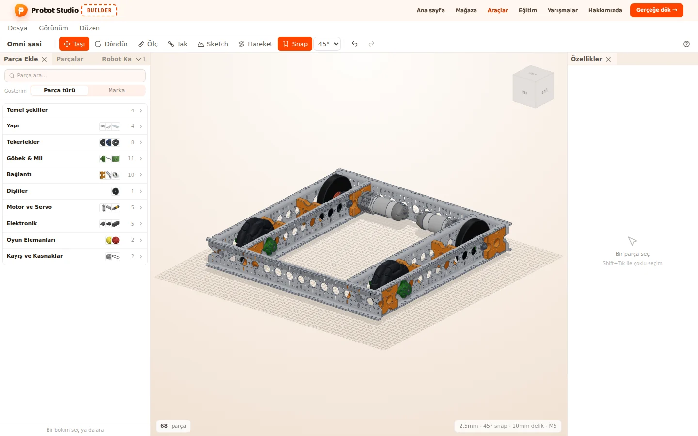

::: hoca
**Söyle:** "Geçen bölümde serinin sonunda robotumuzun sahada ne yaptığını gördük ve üç aracı tanıdık. Bu bölümde Builder'da Omni şasiyi açıyoruz, iki motoruna ad ve port veriyoruz. Sonra projeyi kaydediyoruz ve robotu Sim'e gönderiyoruz."
:::

## Builder'ı açıyoruz {sure=0.4}

- Adres probotstudio.com/builder
- Boş sahnede hazır robot kartları duruyor
- 1 Omni şasi kartı

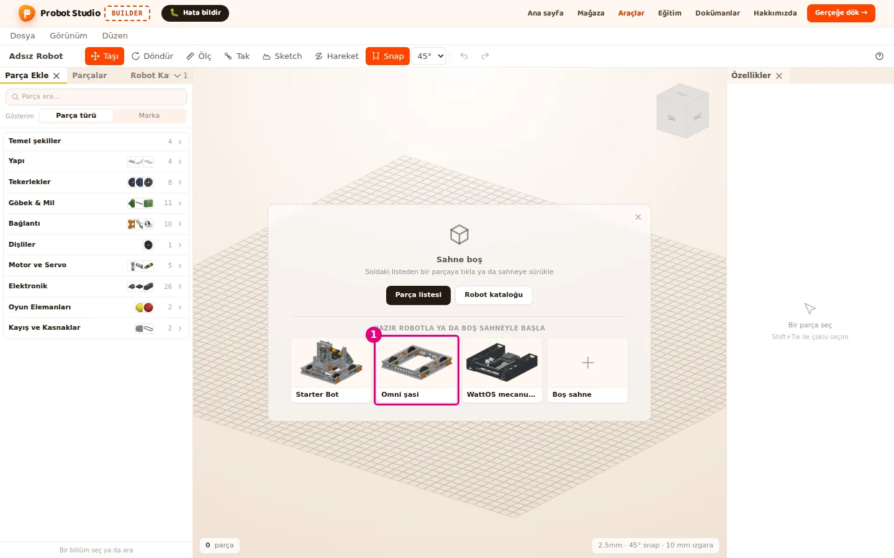

::: hoca
**Söyle:** "Tarayıcıda probotstudio.com/builder adresini açıyoruz ve Builder'ın yüklenmesini bekliyoruz. Sahne boşken ortada hazır robot kartları görünüyor. Bir numaralı Omni şasi kartına tıklayarak robotumuzu tek seferde sahneye alıyoruz."
:::

## Omni şasi sahnede {sure=0.4}

- 68 parçalı hazır bir şasi
- Ortada iki motor, her biri bir yanı sürüyor
- Sol alt köşede parça sayısı

::: hoca
**Söyle:** "Omni şasi 68 parçasıyla birlikte sahneye geliyor ve sol altta parça sayısı yazıyor. Ortadaki iki gri silindir robotun motorları, her biri bir yandaki tahrik tekerini döndürüyor. Bu iki motoru programda kullanabilmek için önce onlara birer ad ve birer port veriyoruz."
:::

## Motorları buluyoruz {sure=0.5}

- 1 Parçalar sekmesi
- 2 Arama kutusuna Motor yazıyoruz
- 3 İlk REV HD Hex Motor satırı

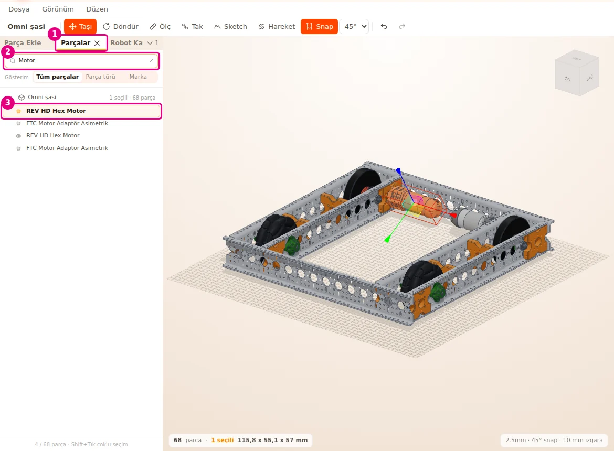

::: hoca
Listede iki REV HD Hex Motor ve iki FTC Motor Adaptör çıkıyor. Adaptörlere ad verilmiyor, yalnız motor satırları seçiliyor.

**Söyle:** "Sol paneldeki bir numaralı Parçalar sekmesini açıyoruz ve iki numaralı arama kutusuna Motor yazıyoruz. Listede iki REV HD Hex Motor çıkıyor. Üç numaralı ilk satıra tıklayınca sahnede robotun sol tarafındaki motor seçili görünüyor."
:::

## Sol motora ad veriyoruz {sure=0.5}

- Sağda Özellikler, altta Donanım alanı
- 1 Ad solMotor
- 2 Hub Control Hub
- 3 Port 0

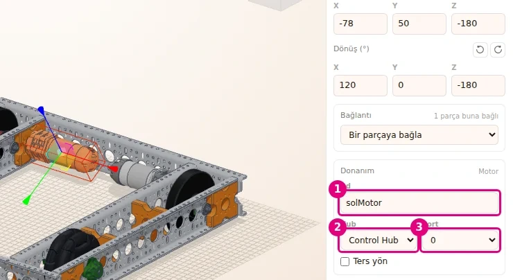

::: hoca
**Söyle:** "Motor seçiliyken sağdaki Özellikler panelinin altında Donanım alanı açılıyor. Bir numaralı Ad kutusuna solMotor yazıp Enter'a basıyoruz ve iki numaralı Hub listesinde Control Hub olduğu gibi kalıyor. Üç numaralı Port listesinden 0 seçiyoruz, böylece sol motor Control Hub'ın sıfır numaralı motor portuna bağlanmış oluyor."
:::

## Sağ motora ad veriyoruz {gorsel-alt sure=0.5}

- 1 İkinci REV HD Hex Motor satırı
- 2 Ad sagMotor
- 3 Port 1
- Listede iki motorun adı yanında görünüyor

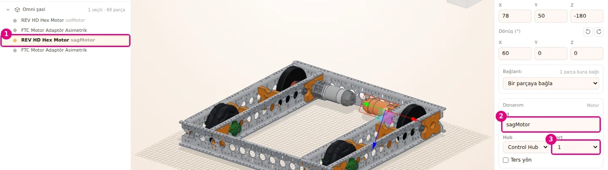

::: hoca
Adlarda Türkçe harf kullanılmıyor, sağ motorun adı sagMotor. Büyük ve küçük harfler Blocks'ta da aynen yazılıyor.

**Söyle:** "Şimdi aynı işi sağ motor için yapıyoruz ve listede bir numaralı ikinci REV HD Hex Motor satırını seçiyoruz. İki numaralı Ad kutusuna sagMotor yazıyoruz ve üç numaralı Port listesinden 1 seçiyoruz. Artık listede iki motorun adı da satırın yanında soluk yazıyla görünüyor."
:::

## Ters yön kutusu boş kalıyor {sure=0.4}

- 1 Ters yön kutusu işaretsiz
- Sağ motor şasiye sol motorun aynası gibi takılı
- Yönü bir kez, Blocks programında çeviriyoruz

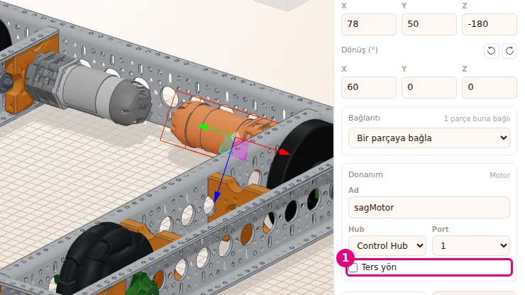

::: hoca
Builder'daki Ters yön kutusunun açıklaması "Kodda motorun yönü ters çevrilir". Bu seride yön çevirme ikinci bölümde Blocks'taki Direction bloğuyla yapılıyor, iki yerde birden işaretlenmiyor.

**Söyle:** "Sağ motor şasiye sol motorun aynası gibi takılı, bu yüzden ileri gitmek için ters yönde dönmesi gerekiyor. Bu ayarı bir sonraki bölümde Blocks programında yapıyoruz. Bu yüzden bir numaralı Ters yön kutusunu boş bırakıyoruz."
:::

## Projeye ad veriyoruz {sure=0.4}

- 1 Üst soldaki proje adı
- Tıklayıp İlk robot yazıyoruz
- Enter ile kaydediyoruz

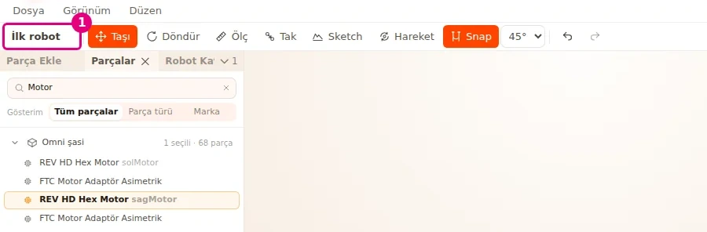

::: hoca
**Söyle:** "Üst soldaki bir numaralı alanda şimdilik Omni şasi yazıyor. Bu alana tıklayıp İlk robot yazıyoruz ve Enter'a basıyoruz. Bu ad hem kaydettiğimiz dosyada hem de Sim'de karşımıza çıkıyor."
:::

## Projeyi kaydediyoruz {sure=0.4}

- 1 Dosya menüsü
- 2 Kaydet (JSON indir)
- Bilgisayara İlk robot.json iniyor

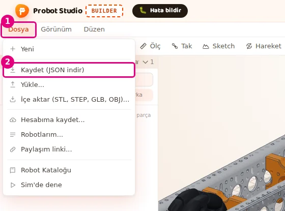

::: hoca
**Söyle:** "Robotu kaybetmemek için bir numaralı Dosya menüsünü açıyoruz ve iki numaralı Kaydet, JSON indir komutunu seçiyoruz. Bilgisayara İlk robot adında bir JSON dosyası iniyor. Bu dosyayı daha sonra Builder'da Dosya menüsündeki Yükle komutuyla yeniden açabiliyoruz."
:::

## Robotu Sim'e gönderiyoruz {sure=0.4}

- 1 Dosya menüsü
- 2 Sim'de dene
- Sim yeni bir sekmede açılıyor

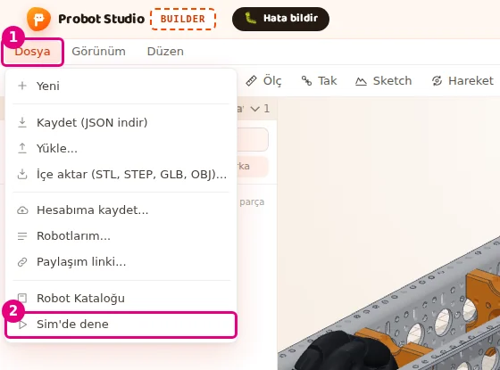

::: hoca
**Söyle:** "Robotu sahada görmek için bir numaralı Dosya menüsünü yeniden açıyoruz. Bu kez iki numaralı Sim'de dene komutunu seçiyoruz. Sim yeni bir sekmede açılıyor ve Builder'daki robotumuzu motor adları ve portlarıyla birlikte kendisi alıyor."
:::

## Robot Sim'de {sure=0.5}

- Robot kartında İlk robot seçili
- Builder'da açık proje, 68 parça
- Tank, 2 motor, 0 servo
- Kod kartında şimdilik Sim'in hazır programı

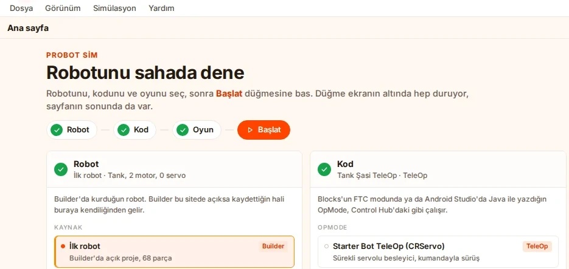

::: hoca
Sim, Builder'dan gelen robotla birlikte uygun bir hazır programı da seçiyor. Kendi programımızı ikinci bölümde yazıyoruz, burada hazır programı çalıştırmıyoruz.

**Söyle:** "Sim açıldığında Robot kartında İlk robot satırı seçili geliyor ve altında Builder'da açık proje, 68 parça yazıyor. Üstte de iki motorlu, servosuz bir tank robotu olduğu yazıyor. Kod kartında Sim şimdilik kendi hazır programlarından birini seçiyor."
:::

## Bir sonraki bölümde {sure=0.4}

- Blocks'u açıyoruz
- solMotor ve sagMotor adlarını kullanıyoruz
- İlk otonom programı yazıyoruz

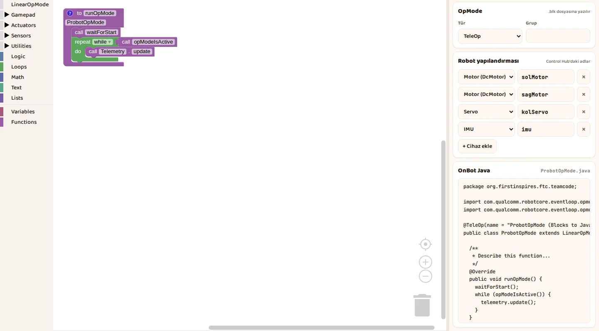

::: hoca
**Söyle:** "Robotumuz hazır, motorlarının adları ve portları da belli. Bir sonraki bölümde Blocks'u açıyoruz ve bu iki motoru kullanarak robotu ileri götürüp sağa döndüren ilk otonom programımızı yazıyoruz. Builder'da verdiğimiz adları orada da harfi harfine aynı kullanıyoruz."
:::
