# Hoca hazırlığı

## Bu derste

Blocks'un FTC sekmesinde Ilk Otonom adında bir otonom program yazıyoruz. Program sağ motorun yönünü çeviriyor, iki motora yarım güç verip 1500 milisaniye ileri gidiyor, 800 milisaniye sağa dönüyor ve duruyor. Motor adları birinci bölümde Builder'da verdiğimiz solMotor ve sagMotor ile aynı. Bölümün sonunda programı .blk dosyası olarak indiriyoruz.

## Dersten önce

- Birinci bölümdeki pencere açık kalsın. Builder, Blocks ve Sim aynı tarayıcıda açıldığında birbirini görüyor.
- Blocks'u ilk kez açıyorsanız FTC Blocks sekmesi varsayılan programla ve varsayılan robot yapılandırmasıyla gelir. Yapılandırmada solMotor ve sagMotor hazır durur.
- Yapılandırmada bu adlar yoksa + Cihaz ekle ile iki Motor (DcMotor) ekleyip adlarını harfi harfine aynı yazın.
- Takılırsanız örnek proje klasöründeki IlkOtonom.blk dosyasını .blk yükle ile açabilirsiniz.

## Zaman planı

| Dakika | Bölüm | Ne oluyor |
|---|---|---|
| 0-1 | Kapak, Blocks'a geçiş | Sim'den Blocks'a, FTC Blocks sekmesi |
| 1-2 | Hazırlık | Robot yapılandırması, OpMode adı ve türü, program iskeleti |
| 2-4,5 | Program | Yön, ileri, bekleme, dönüş, durma |
| 4,5-6 | Kayıt | .blk indir, sonraki bölüm |

# Sayfalar

## Blocks'ta otonom programı yazıyoruz {kapak sure=0.4}

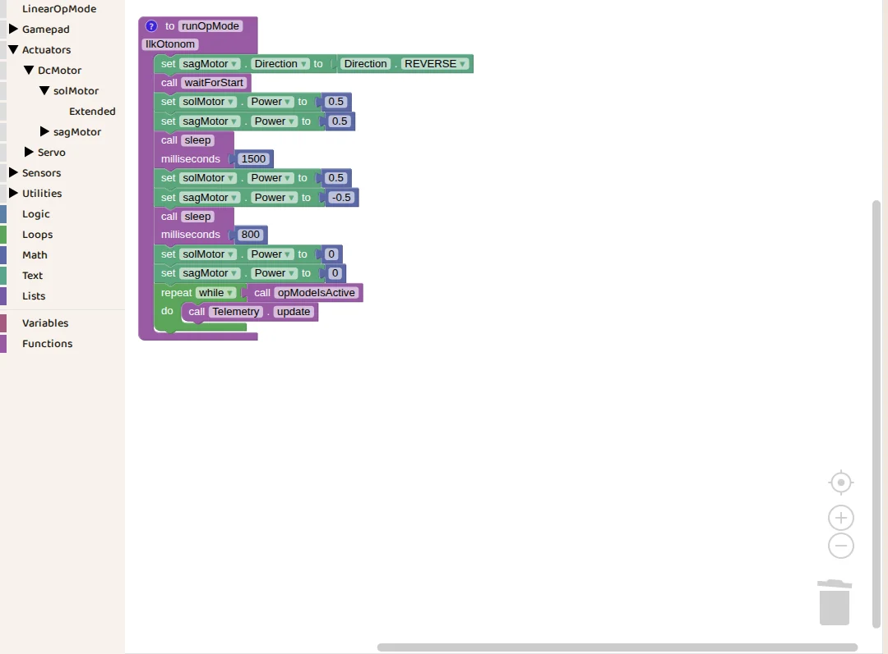

::: hoca
**Söyle:** "Geçen bölümde Builder'da Omni şasiyi kurduk, motorlarına solMotor ve sagMotor adlarını verdik ve robotu Sim'e gönderdik. Bu bölümde Blocks'ta robotu ileri götürüp sağa döndüren bir otonom program yazıyoruz."
:::

## Sim'den Blocks'a geçiyoruz {sure=0.4}

- 1 Sim'de Dosya menüsü
- 2 Blocks'u aç
- Blocks yeni bir sekmede açılıyor

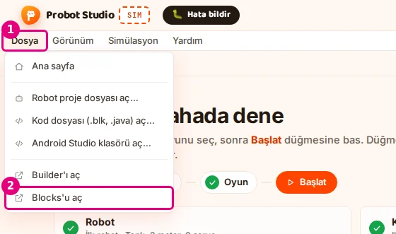

::: hoca
Sim ana sayfasında Kod kartındaki Blocks'ta yaz düğmesi de aynı işi görüyor.

**Söyle:** "Sim'deki bir numaralı Dosya menüsünü açıp iki numaralı Blocks'u aç komutunu seçiyoruz. Blocks yeni bir sekmede açılıyor. Aynı tarayıcıda kaldığımız için Blocks'ta yazdığımız program birazdan Sim'in listesine de geliyor."
:::

## FTC Blocks sekmesi {sure=0.4}

- 1 FTC Blocks sekmesi
- Control Hub'daki FTC Blocks editörünün aynısı
- Hazır bir program iskeletiyle açılıyor

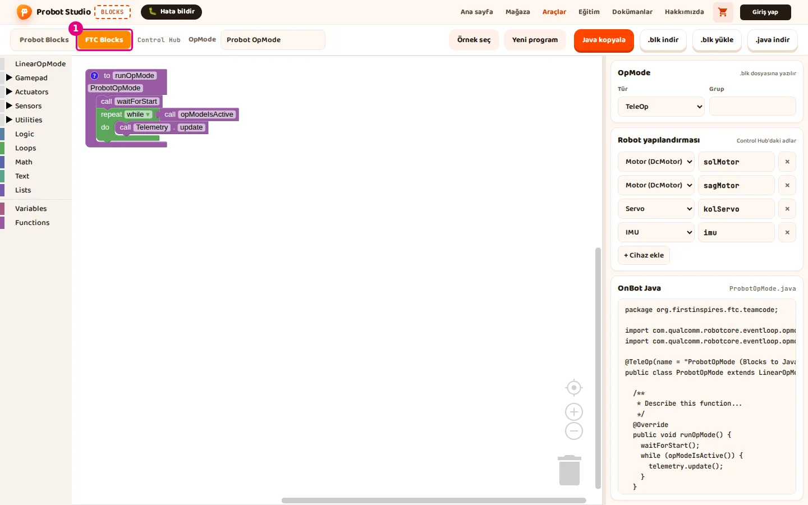

::: hoca
**Söyle:** "Blocks'ta üstte iki sekme var ve biz bir numaralı FTC Blocks sekmesini seçiyoruz. Bu sekme FTC robotlarındaki Control Hub'ın blok editörüyle aynı blokları kullanıyor. Çalışma alanında küçük bir hazır program bizi bekliyor."
:::

## Robot yapılandırması {sure=0.5}

- Control Hub'daki cihaz adları
- 1 Motor (DcMotor) solMotor
- 2 Motor (DcMotor) sagMotor
- Builder'daki adlarla birebir aynı

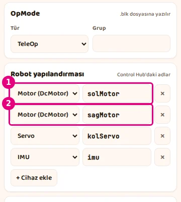

::: hoca
Blocks, Builder'daki adları kendiliğinden almıyor. Varsayılan yapılandırmada aynı adlar hazır olduğu için bu robotta bir şey yazmamız gerekmiyor. Başka adlar verilen bir robotta yapılandırmadaki adlar elle değiştirilir.

**Söyle:** "Sağdaki Robot yapılandırması bölümü Control Hub'da tanımlı cihazların adlarını tutuyor. Bir ve iki numarada solMotor ile sagMotor zaten hazır duruyor. Bu adlar Builder'da verdiğimiz adlarla harfi harfine aynı olduğu için Sim motorları birazdan doğru eşleştiriyor."
:::

## OpMode adı ve türü {sure=0.4}

- 1 OpMode kutusuna Ilk Otonom
- 2 Tür listesinden Autonomous
- Bu ad Sim'deki program listesinde görünüyor

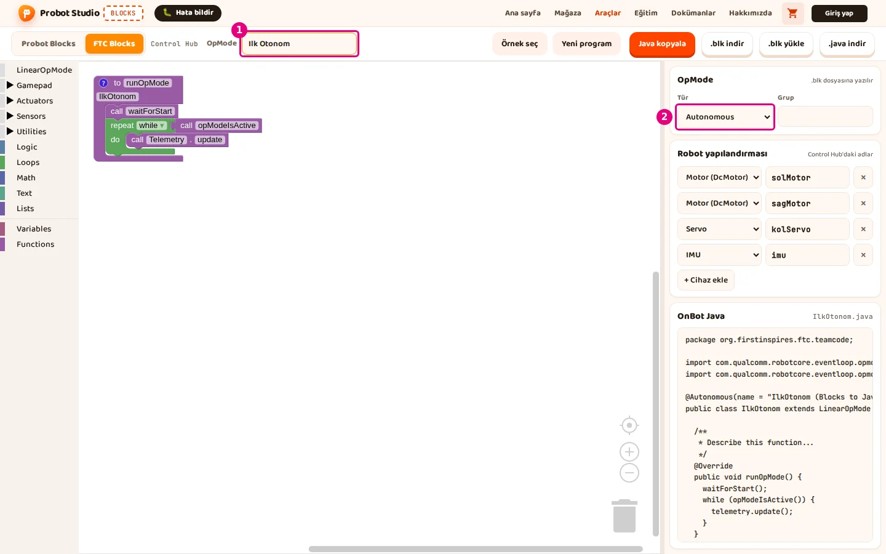

::: hoca
OpMode adında Türkçe harf kullanmıyoruz. Blocks addan bir sınıf adı türetiyor ve Ilk Otonom adı IlkOtonom oluyor.

**Söyle:** "Bir numaralı OpMode kutusuna Ilk Otonom yazıyoruz. İki numaralı Tür listesinden Autonomous seçiyoruz, böylece program kimse dokunmadan kendi kendine çalışan bir otonom program oluyor."
:::

## Programın iskeleti {sure=0.5}

- runOpMode bloğunun içi programın kendisi
- 1 waitForStart başlat komutunu bekliyor
- 2 repeat while opModeIsActive program durdurulana kadar dönüyor

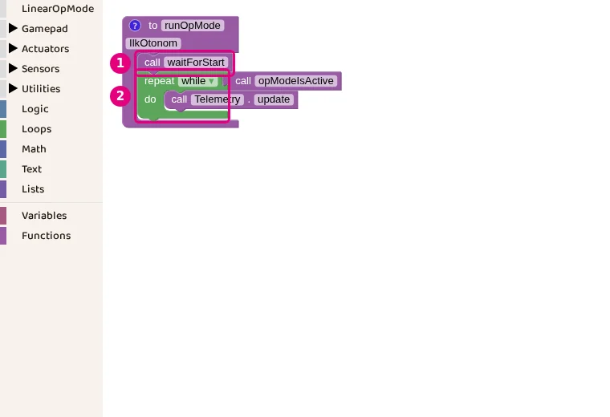

::: hoca
**Söyle:** "Mor runOpMode bloğunun içine yazdığımız her şey programın kendisi oluyor. Bir numaralı waitForStart bloğu başlat komutu gelene kadar bekliyor. İki numaralı repeat bloğu ise program durdurulana kadar dönüyor ve biz motor bloklarını bu ikisinin arasına yerleştiriyoruz."
:::

## Motor blokları nerede {sure=0.5}

- Actuators, DcMotor, 1 solMotor
- 2 Direction bloğu, motorun yönü
- 3 Power bloğu, motorun gücü

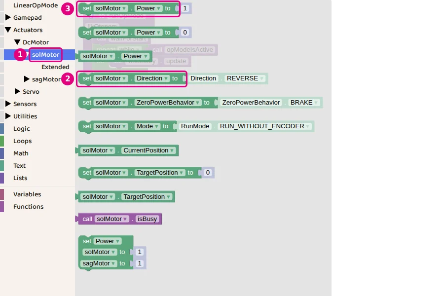

::: hoca
Menüde DcMotor altında yapılandırmadaki iki motorun kendi satırı var, solMotor ve sagMotor. Blok çalışma alanına geldikten sonra motor adı bloğun üstündeki listeden de değiştirilebiliyor.

**Söyle:** "Soldaki menüde Actuators ve DcMotor başlıklarını açıyoruz ve altındaki bir numaralı solMotor satırına tıklıyoruz. Açılan listede iki numaralı Direction bloğu motorun yönünü, üç numaralı Power bloğu motorun gücünü ayarlıyor. Bu blokları sürükleyip çalışma alanına bırakıyoruz."
:::

## Sağ motorun yönünü çeviriyoruz {sure=0.5}

- 1 set sagMotor Direction to REVERSE
- waitForStart'tan önce duruyor
- Builder'da boş bıraktığımız Ters yön ayarı burada

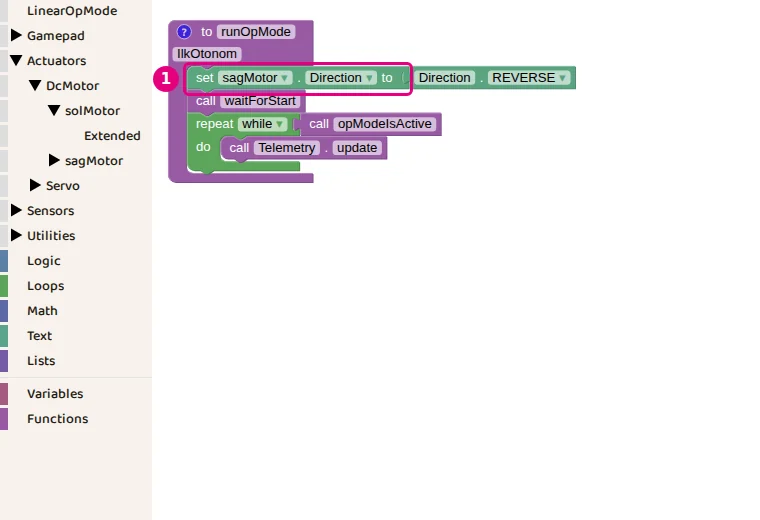

::: hoca
**Söyle:** "Direction bloğunu waitForStart'ın üstüne bırakıyoruz. Bloğun motor listesinden sagMotor, yön listesinden REVERSE seçiyoruz. Böylece Builder'da boş bıraktığımız Ters yön ayarını programın en başında bir kez yapıyoruz."
:::

## İki motora güç veriyoruz {sure=0.5}

- 1 set solMotor Power to 0.5
- 2 set sagMotor Power to 0.5
- Güç -1 ile 1 arasında, 0.5 yarım güç

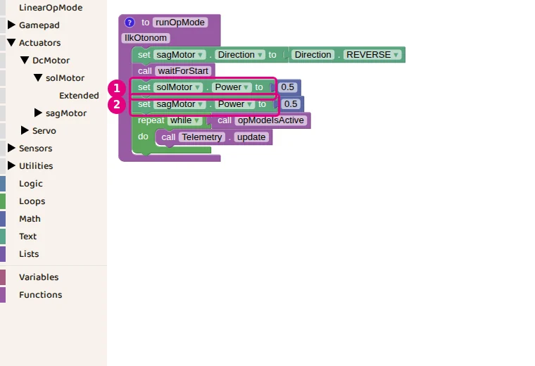

::: hoca
**Söyle:** "waitForStart'ın altına iki Power bloğu ekliyoruz. Birinde solMotor, diğerinde sagMotor seçip ikisine de sıfır virgül beş yazıyoruz. Güç eksi birle bir arasında bir sayı ve sıfır virgül beş yarım güçle ileri anlamına geliyor."
:::

## Bekleme bloğu {sure=0.4}

- LinearOpMode kategorisi
- 1 call sleep milliseconds
- Süre milisaniye cinsinden, 1000 milisaniye 1 saniye

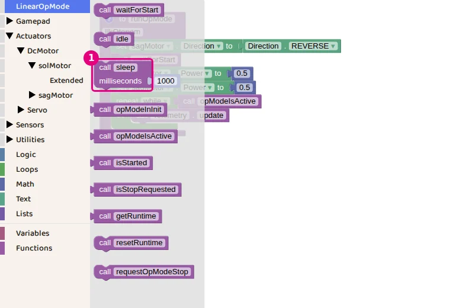

::: hoca
**Söyle:** "Motorlara güç verdikten sonra robotun bir süre o güçle gitmesini istiyoruz. Bunun için LinearOpMode kategorisindeki bir numaralı sleep bloğunu kullanıyoruz. Bu blok programı yazdığımız milisaniye kadar bekletiyor ve bu sırada motorlar dönmeye devam ediyor."
:::

## 1500 milisaniye ileri {sure=0.4}

- 1 call sleep milliseconds 1500
- Motorlar bu sürede yarım güçle dönüyor
- Robot ileri gidiyor

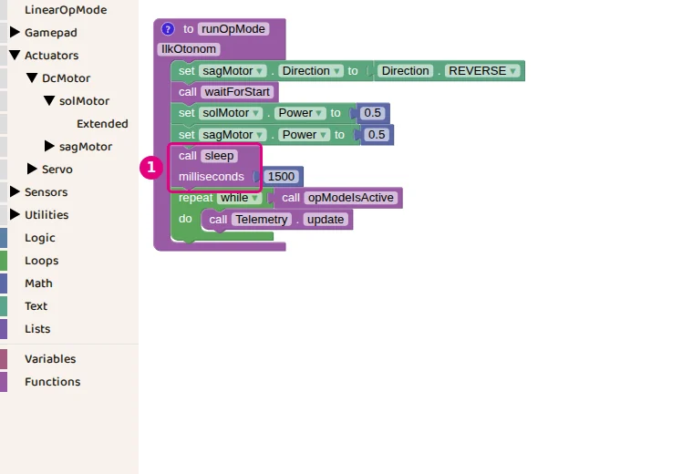

::: hoca
**Söyle:** "Sleep bloğunu iki Power bloğunun altına bırakıyoruz ve süreye 1500 yazıyoruz. Robot bir buçuk saniye boyunca yarım güçle ileri gidiyor. Süreyi uzatırsak robot daha uzağa gidiyor."
:::

## Sağa dönüyoruz {sure=0.5}

- 1 solMotor Power 0.5
- 2 sagMotor Power -0.5
- 3 sleep 800

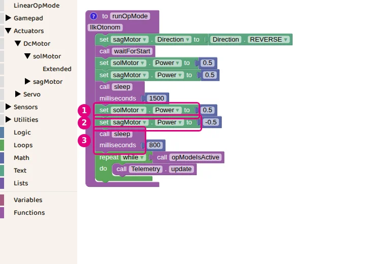

::: hoca
**Söyle:** "Sağa dönmek için sol motora yine sıfır virgül beş, sağ motora ise eksi sıfır virgül beş veriyoruz. Sol taraf ileri, sağ taraf geri döndüğü için robot olduğu yerde sağa dönüyor. Bunu da 800 milisaniyelik bir sleep bloğuyla bitiriyoruz."
:::

## Robotu durduruyoruz {sure=0.4}

- 1 solMotor Power 0
- 2 sagMotor Power 0
- repeat döngüsü program bitene kadar bekliyor

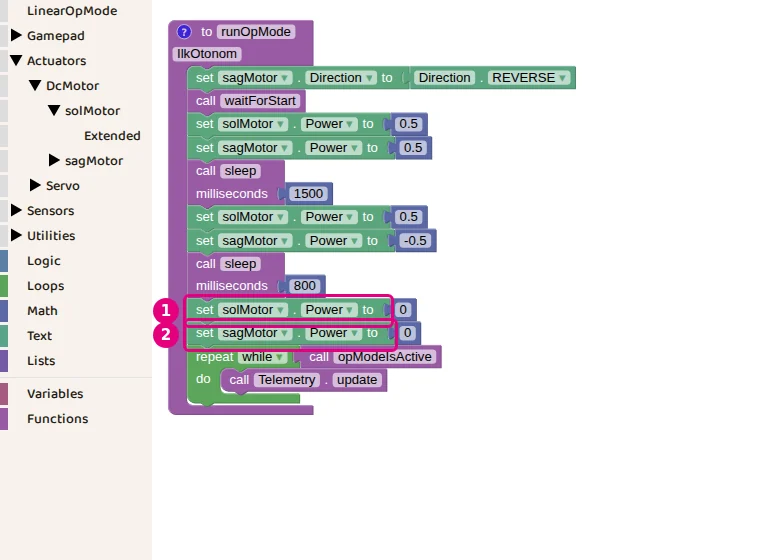

::: hoca
**Söyle:** "Son olarak iki motorun gücünü sıfıra çekiyoruz ve robot duruyor. Programın sonundaki repeat döngüsü olduğu gibi kalıyor ve otonom süre bitene kadar programı açık tutuyor."
:::

## Programı indiriyoruz {sure=0.4}

- 1 Üst çubukta .blk indir
- IlkOtonom.blk bilgisayara iniyor
- Sağ altta indirildi bildirimi

::: hoca
**Söyle:** "Programı saklamak için üst çubuktaki bir numaralı .blk indir düğmesine basıyoruz. Bilgisayara IlkOtonom.blk dosyası iniyor ve sağ altta bir bildirim çıkıyor. Bu dosyayı Sim'de ya da Blocks'ta yeniden açabiliyoruz."
:::

## Bir sonraki bölümde {sure=0.4}

- Sim'e dönüyoruz
- Programımızı Kod kartında seçiyoruz
- Robotu sahada çalıştırıyoruz

::: hoca
**Söyle:** "Programımız hazır ve Blocks'ta açık duruyor. Bir sonraki bölümde Sim'e dönüyoruz, Ilk Otonom programını seçiyoruz ve robotumuzun sahada ileri gidip sağa döndüğünü görüyoruz."
:::
