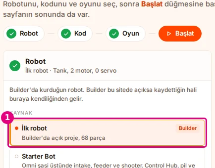
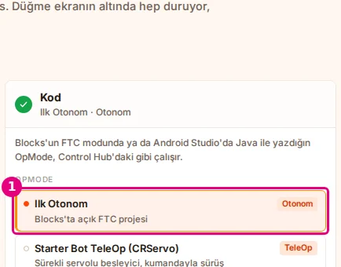
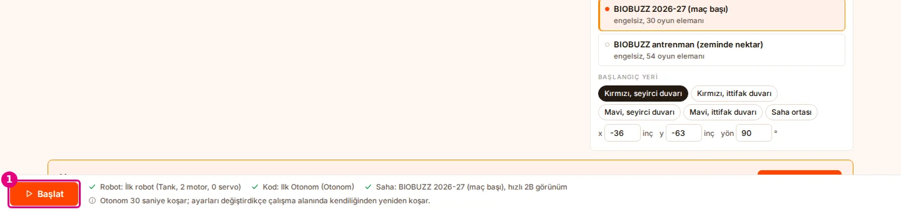
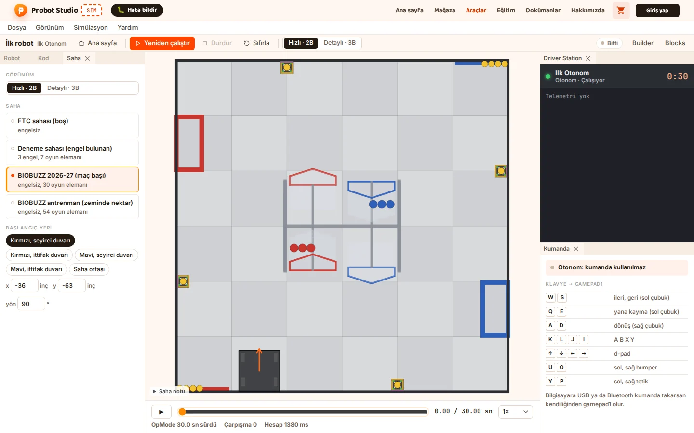
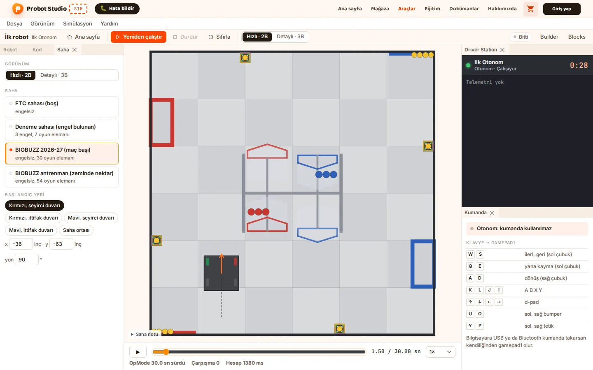
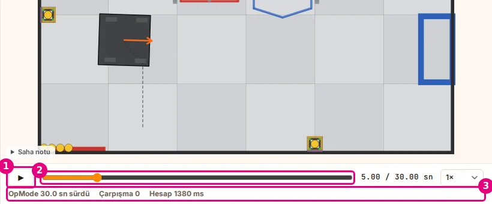
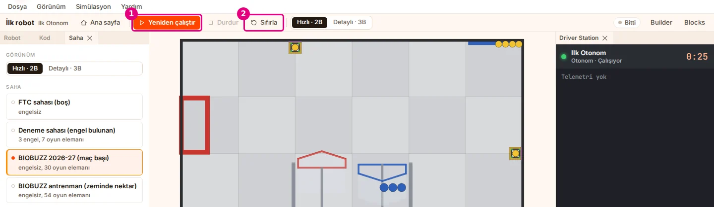
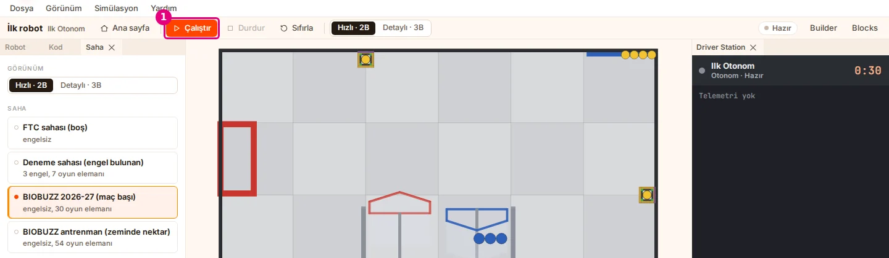

# Hoca hazırlığı

## Bu derste

Sim ana sayfasında Builder'dan gelen İlk robot'u ve Blocks'ta açık Ilk Otonom programını seçiyoruz. Yapılandırma bölümünde programdaki motor adlarının robottaki motorlarla eşleştiğini görüyoruz. Başlat ile otonomu koşturuyor, robotun ileri gidip sağa döndüğünü zaman çizelgesinde adım adım izliyoruz.

## Dersten önce

- Builder, Blocks ve Sim aynı tarayıcıda açık kalsın. Sim, Builder'da açık projeyi ve Blocks'ta açık FTC programını kendisi görüyor.
- Farklı bir bilgisayardaysanız Sim'de Proje dosyası aç ile ilk-robot.json, .blk dosyası aç ile IlkOtonom.blk açılır. Bu durumda listedeki satır adları değişir, adımlar aynı kalır.
- Saha olarak varsayılan BIOBUZZ 2026-27 sahası ve Hızlı 2B görünüm kalıyor.

## Zaman planı

| Dakika | Bölüm | Ne oluyor |
|---|---|---|
| 0-0,5 | Kapak | Geçen bölüm, bu bölümün hedefi |
| 0,5-2 | Ana sayfa | Robot, program, yapılandırma, Başlat |
| 2-3,5 | Koşu | Başlangıç, ileri, dönüş, duruş |
| 3,5-5 | Araçlar | Zaman çizelgesi, Sıfırla ve Çalıştır, sonraki bölüm |

# Sayfalar

## Sim'de otonomu çalıştırıyoruz {kapak sure=0.4}

::: hoca
**Söyle:** "Geçen bölümde Blocks'ta Ilk Otonom programını yazdık ve bilgisayarımıza indirdik. Bu bölümde Sim'de robotumuzu ve programımızı seçiyoruz, adların eşleştiğine bakıyoruz ve robotun sahada kendi kendine ilerleyip döndüğünü izliyoruz."
:::

## Robotu seçiyoruz {sure=0.4}

- Sim ana sayfasında Robot kartı
- 1 İlk robot, Builder'da açık proje
- Sağda Builder etiketi

::: hoca
**Söyle:** "Sim sekmesine dönüyoruz ve ana sayfada soldaki Robot kartına bakıyoruz. Bir numaralı İlk robot satırı Builder'da açık projemizi gösteriyor ve seçili duruyor. Satırın sağındaki Builder etiketi robotun Builder'dan geldiğini, alttaki yazı da 68 parçalı olduğunu söylüyor."
:::

## Programı seçiyoruz {sure=0.4}

- Kod kartında OpMode listesi
- 1 Ilk Otonom, Blocks'ta açık FTC projesi
- Sağda Otonom etiketi

::: hoca
**Söyle:** "Ortadaki Kod kartında OpMode listesinin başında bir numaralı satır duruyor. Satırın adı Blocks'ta yazdığımız Ilk Otonom, altında da Blocks'ta açık FTC projesi yazıyor ve sağında Otonom etiketi var. Bu satıra tıklayarak Sim'in hazır programı yerine kendi programımızı seçiyoruz."
:::

## Adlar eşleşiyor {sure=0.5}

- Solda programdaki ad, sağda robottaki motor
- 1 solMotor, Control 0
- 2 sagMotor, Control 1
- Builder'da verdiğimiz port ve adlar

::: hoca
Tabloda yalnız programın kullandığı cihazlar listeleniyor. kolServo ve imu programda geçmediği için burada yok.

**Söyle:** "Kod kartının altında Yapılandırma tablosu var. Solda programdaki motor adı, sağda Builder'daki robotun motoru ve portu yazıyor. Bir numarada solMotor Control 0 ile, iki numarada sagMotor Control 1 ile eşleşmiş görünüyor."
:::

## Başlat {sure=0.4}

- Alt şeritte Robot, Kod ve Saha onaylı
- Otonom 30 saniye koşuyor
- 1 Başlat

::: hoca
**Söyle:** "Sayfanın altındaki şeritte robot, kod ve saha satırlarının yanında onay işaretleri görünüyor. Otonomun 30 saniye koşacağı da bu şeritte yazıyor. Seçimlerin üçü de hazır olduğu için bir numaralı Başlat düğmesine basıyoruz ve çalışma alanına geçiyoruz."
:::

## Robot başlangıç yerinde {sure=0.4}

- Çalışma alanında saha ortada
- Sağda Driver Station, programın adı Ilk Otonom
- Sim koşuyu önce hesaplıyor, sonra oynatıyor

::: hoca
**Söyle:** "Başlat'a basınca çalışma alanı açılıyor ve robot sahanın altında başlangıç yerinde duruyor. Sağdaki Driver Station'da programımızın adı yazıyor. Sim otonom koşuyu önce baştan sona hesaplıyor, sonra bize oynatıyor."
:::

## Robot ileri gidiyor {sure=0.4}

- İlk 1500 milisaniye
- İki motor yarım güçte
- Arkada geçtiği yolun çizgisi

::: hoca
**Söyle:** "İlk bir buçuk saniyede iki motor da yarım güçle dönüyor ve robot dümdüz ileri gidiyor. Sağ motorun yönünü programda çevirdiğimiz için iki taraf aynı yöne itiyor. Arkasında kalan kesikli çizgi robotun geçtiği yolu gösteriyor."
:::

## Robot sağa dönüyor {sure=0.4}

- Sol motor ileri, sağ motor geri
- 800 milisaniye
- Robot olduğu yerde sağa dönüyor

::: hoca
**Söyle:** "Sonraki 800 milisaniyede sol motor ileri, sağ motor geri dönüyor. Robot ilerlemeden olduğu yerde sağa dönüyor ve önünü gösteren turuncu ok artık sağa bakıyor. Sağa değil de sola dönmesini isteseydik iki motorun işaretlerini yer değiştirirdik."
:::

## Robot duruyor {sure=0.4}

- İki motorun gücü 0
- Robot dönüşün bittiği yerde kalıyor
- Program otonom süre bitene kadar açık

::: hoca
**Söyle:** "Programın son iki bloğu motorların gücünü sıfıra çekiyor ve robot dönüşün bittiği yerde duruyor. Program ise repeat döngüsünde otonom süre bitene kadar açık kalıyor. Sahadaki çizgide önce düz bir yol, sonra dönüş görünüyor."
:::

## Zaman çizelgesi {sure=0.5}

- 1 Oynat ile kaydı yeniden izliyoruz
- 2 Zaman kaydırıcısıyla bir ana gidiyoruz
- 3 Bilgi satırı, OpMode süresi ve çarpışma sayısı

::: hoca
Çarpışma, robotun duvara, engele ya da yapıya değme sayısı. Çarpışma sıfırdan büyükse süreleri kısaltıp yeniden deniyoruz.

**Söyle:** "Sahnenin altındaki bir numaralı Oynat düğmesiyle koşuyu yeniden izliyoruz. İki numaralı Zaman kaydırıcısını sürükleyerek istediğimiz ana gidiyoruz. Üç numaralı bilgi satırında programın ne kadar sürdüğü ve robotun kaç kez bir yere çarptığı yazıyor."
:::

## Baştan çalıştırmak {sure=0.5}

- 1 Yeniden çalıştır
- 2 Sıfırla, kayıt siliniyor, robot başlangıca dönüyor
- Sıfırla'dan sonra Çalıştır

::: hoca
Blocks'ta programı değiştirdikçe Sim listedeki programı yeniden okuyor. Süreleri değiştirip bir numaralı Yeniden çalıştır ile sonucu görmek mümkün.

**Söyle:** "Araç çubuğundaki bir numaralı Yeniden çalıştır otonomu baştan hesaplıyor. İki numaralı Sıfırla ise kaydı siliyor ve robotu başlangıç yerine koyuyor. Sıfırla'dan sonra aynı yerde çıkan Çalıştır düğmesiyle otonomu yeniden başlatıyoruz."
:::

## Bir sonraki bölümde {sure=0.4}

- Blocks'ta yeni bir program
- Kumandayla sürüş, TeleOp
- Aynı robot, aynı motor adları

::: hoca
**Söyle:** "Otonom programımız sahada çalıştı ve robot yazdığımız sırayla ileri gidip sağa döndü. Bir sonraki bölümde Blocks'ta ikinci bir program yazıyoruz ve aynı robotu bu kez klavyeyle kendimiz sürüyoruz."
:::
