# Hoca hazırlığı

## Bu derste

Blocks'ta Ilk Surus adında bir TeleOp programı yazıyoruz. Sol çubuk robotu ileri ve geri, sağ çubuk sağa ve sola döndürüyor. Program Sim'de klavyeyle sürülüyor, W ve S ileri geri, A ve D dönüş. Bölüm serinin özeti ve sonraki adımlarla bitiyor.

## Dersten önce

- Üçüncü bölümdeki pencere açık kalsın. Blocks'ta Ilk Otonom programı açıksa önce .blk indir ile saklayın, Yeni program çalışma alanını temizliyor.
- Yeni program bir onay sorusu soruyor, soruyu onaylayın.
- Sim'de TeleOp 120 saniye koşuyor. Robot tuşlara tepki vermiyorsa sahneye bir kez tıklayın, bir kutuya yazarken tuşlar robota gitmiyor.
- Takılırsanız örnek proje klasöründeki IlkSurus.blk dosyasını .blk yükle ile açabilirsiniz.

## Zaman planı

| Dakika | Bölüm | Ne oluyor |
|---|---|---|
| 0-1 | Kapak, yeni program | Otonomu saklama, Yeni program, ad ve tür |
| 1-3 | Program | Yön, kumanda ve Math blokları, sol ve sağ motor gücü |
| 3-4,5 | Sim | Tuş tablosu, programı seçme, canlı sürüş, durdurma |
| 4,5-6 | Kapanış | Özet ve sonraki adımlar |

# Sayfalar

## Robotu kumandayla sürüyoruz {kapak sure=0.4}

::: hoca
**Söyle:** "Geçen bölümde otonom programımızı Sim'de çalıştırdık ve robotun kendi kendine ilerleyip döndüğünü izledik. Bu son bölümde aynı robot için bir TeleOp programı yazıyoruz ve robotu klavyeyle kendimiz sürüyoruz."
:::

## Yeni program açıyoruz {sure=0.4}

- 1 Önce .blk indir ile otonomu saklıyoruz
- 2 Yeni program
- Onay sorusunu kabul ediyoruz

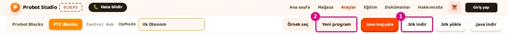

::: hoca
**Söyle:** "Yeni program çalışma alanındaki programı sildiği için önce bir numaralı .blk indir ile otonom programımızı saklıyoruz. Sonra iki numaralı Yeni program düğmesine basıyoruz ve çıkan onay sorusunu kabul ediyoruz."
:::

## Ad ve tür {sure=0.4}

- 1 OpMode kutusuna Ilk Surus
- 2 Tür listesinde TeleOp
- Sürücünün kumandayla yönettiği program

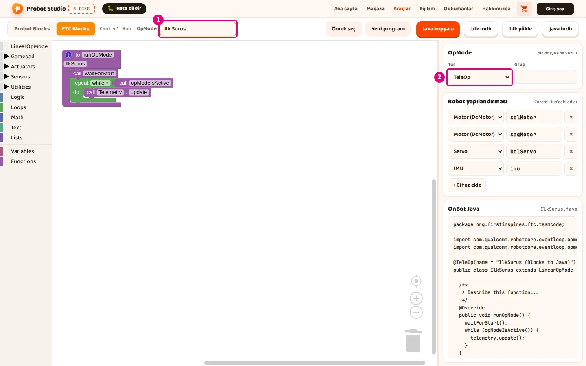

::: hoca
**Söyle:** "Bir numaralı OpMode kutusuna Ilk Surus yazıyoruz. İki numaralı Tür listesinde TeleOp seçili kalıyor. TeleOp, robotu sürücünün kumandayla yönettiği program türü anlamına geliyor."
:::

## Yön bloğu yine başta {sure=0.4}

- 1 set sagMotor Direction to REVERSE
- Otonomdaki gibi waitForStart'tan önce
- Robot aynı, ayar da aynı

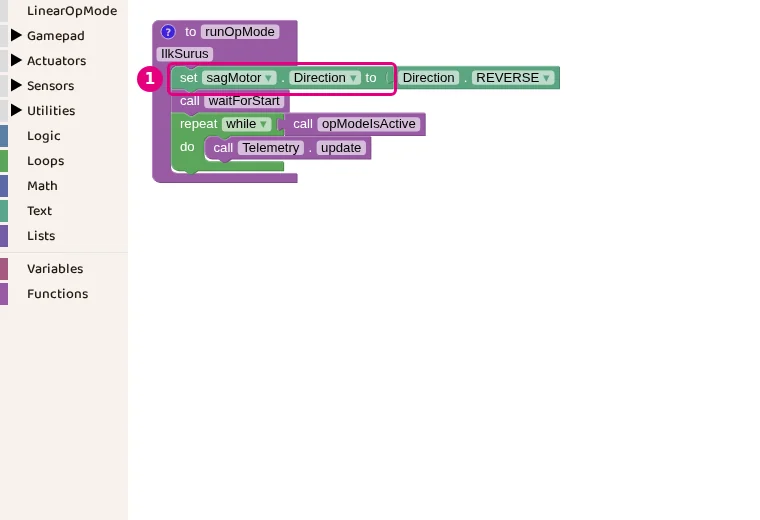

::: hoca
**Söyle:** "Robotumuz değişmediği için sağ motorun yönünü yine programın en başında çeviriyoruz. Bir numaralı Direction bloğu otonomdaki gibi waitForStart'ın üstünde duruyor ve sagMotor için REVERSE seçili."
:::

## Kumanda blokları {sure=0.5}

- Gamepad kategorisi
- 1 gamepad1 LeftStickY, sol çubuk ileri geri
- 2 gamepad1 RightStickX, sağ çubuk sağ sol
- Çubuk ileri itilince LeftStickY -1 oluyor

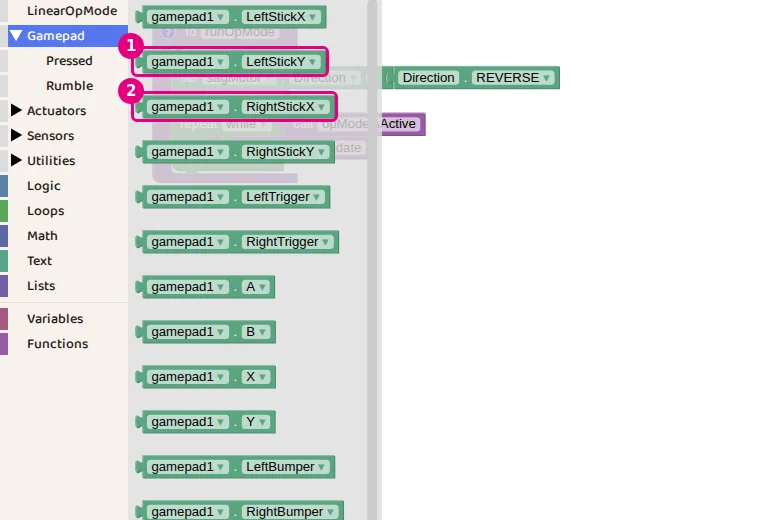

::: hoca
FTC kumandasında çubuk ileri itilince Y değeri eksiye gidiyor. Bu yüzden programda LeftStickY ters çevriliyor.

**Söyle:** "Gamepad kategorisinde kumandanın çubuklarını okuyan bloklar var. Bir numaralı LeftStickY sol çubuğun ileri geri konumunu, iki numaralı RightStickX sağ çubuğun sağ sol konumunu veriyor. Sol çubuk ileri itilince değer eksi bir oluyor, bunu birazdan ters çeviriyoruz."
:::

## Ters çevirme ve toplama {sure=0.4}

- Math kategorisi
- 1 Tek sayılık işlem bloğu, eksi işaretiyle ters çeviriyor
- 2 İki sayılık işlem bloğu, toplama ve çıkarma

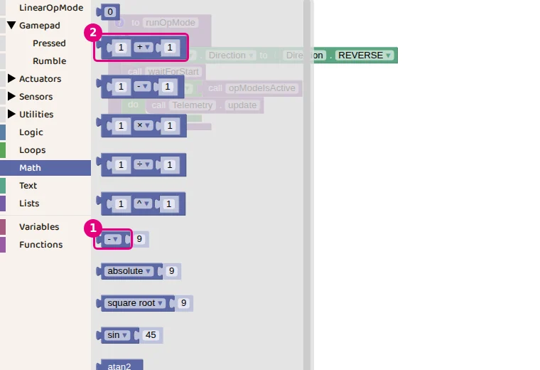

::: hoca
**Söyle:** "Math kategorisinde iki blok kullanıyoruz. Bir numaralı blokta listeden eksi işaretini seçince içindeki sayı ters çevriliyor. İki numaralı blokla iki sayıyı topluyor ya da birbirinden çıkarıyoruz."
:::

## Sol motorun gücü {sure=0.5}

- repeat döngüsünün içinde
- 1 solMotor Power to
- Sağında eksi LeftStickY, sonra artı
- En sağdaki gamepad1 bloğu RightStickX

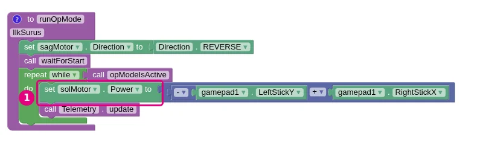

::: hoca
**Söyle:** "Sol motorun Power bloğunu repeat döngüsünün içine koyuyoruz, böylece program her turda çubukları yeniden okuyor. Güç olarak ters çevrilmiş LeftStickY ile RightStickX'in toplamını veriyoruz."
:::

## Sağ motorun gücü {sure=0.5}

- 1 sagMotor Power to
- Sağında eksi LeftStickY, sonra eksi
- En sağdaki gamepad1 bloğu yine RightStickX
- Telemetry update en altta kalıyor

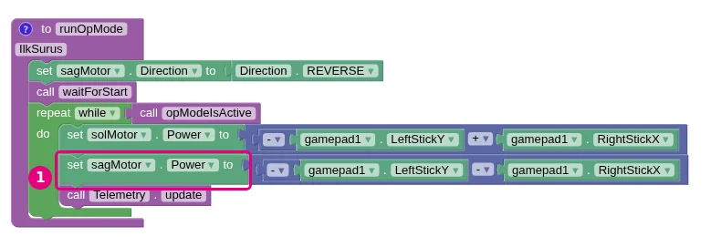

::: hoca
**Söyle:** "Sağ motor için aynı bloğu kopyalıyoruz ve motoru sagMotor yapıyoruz. Bu kez ters çevrilmiş LeftStickY'den RightStickX'i çıkarıyoruz. Sağ çubuk sağa itilince sol motor hızlanıyor, sağ motor yavaşlıyor ve robot sağa dönüyor."
:::

## Tuşlar ne yapıyor {sure=0.5}

| Tuş | Çubuk | solMotor | sagMotor | Robot |
|---|---|---|---|---|
| W | sol çubuk ileri | 1 | 1 | ileri |
| S | sol çubuk geri | -1 | -1 | geri |
| D | sağ çubuk sağa | 1 | -1 | sağa döner |
| A | sağ çubuk sola | -1 | 1 | sola döner |

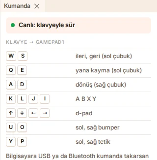

::: hoca
Sim'de klavye gamepad1 gibi davranıyor. Bilgisayara USB ya da Bluetooth kumanda takılırsa o kumanda gamepad1 oluyor.

**Söyle:** "Sim'de klavye kumandanın yerini tutuyor. W sol çubuğu ileri ittiği için iki motor da bir oluyor ve robot ileri gidiyor. D sağ çubuğu sağa ittiği için sol motor bir, sağ motor eksi bir oluyor ve robot sağa dönüyor."
:::

## Programı Sim'de seçiyoruz {sure=0.4}

- Kod kartında OpMode listesi
- 1 Ilk Surus, Blocks'ta açık FTC projesi
- Sağda TeleOp etiketi

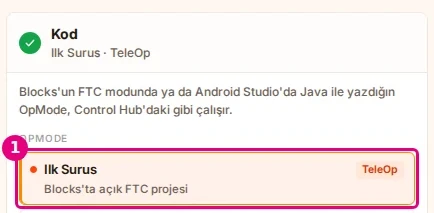

::: hoca
**Söyle:** "Sim sekmesine dönüyoruz ve Kod kartında listenin başında bir numaralı Ilk Surus satırını görüyoruz. Satırın sağında TeleOp yazıyor. Bu satırı seçip alt şeritteki Başlat düğmesine basıyoruz."
:::

## Klavyeyle sürüyoruz {sure=0.5}

- 1 Canlı, klavye rozeti
- 2 Kumanda panelinde tuşlar
- Sahneye bir kez tıklayıp W ve D ile sürüyoruz

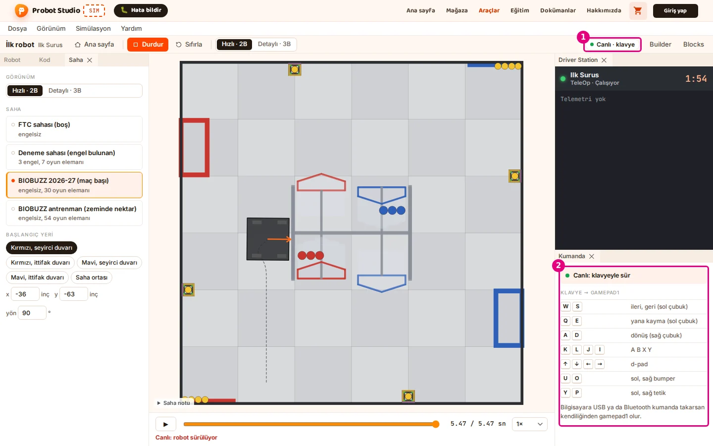

::: hoca
**Söyle:** "Başlat'tan sonra araç çubuğunun sağında bir numaralı Canlı, klavye rozeti çıkıyor. Sahneye bir kez tıklayıp W ile ileri gidiyoruz, D ile sağa dönüyoruz. İki numaralı Kumanda panelinde hangi tuşun hangi çubuğa karşılık geldiği yazıyor."
:::

## Durdur, Sıfırla, Başlat {sure=0.4}

- 1 Durdur sürüşü bitiriyor
- Ardından Sıfırla robotu başlangıca koyuyor
- Başlat ile baştan sürüyoruz

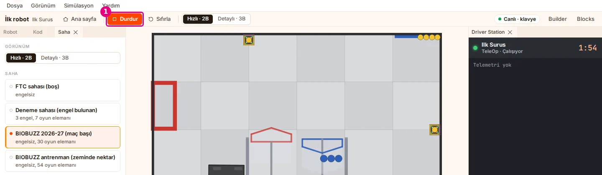

::: hoca
**Söyle:** "Sürüşü bitirmek için araç çubuğundaki bir numaralı Durdur düğmesine basıyoruz. Sonra Sıfırla ile robotu başlangıç yerine koyuyoruz ve Başlat ile sürüşü baştan başlatıyoruz."
:::

## Neler yaptık {sure=0.5}

- Builder'da Omni şasi, solMotor port 0, sagMotor port 1
- Blocks'ta Ilk Otonom ve Ilk Surus programları
- Sim'de aynı adlarla otonom koşu ve canlı sürüş

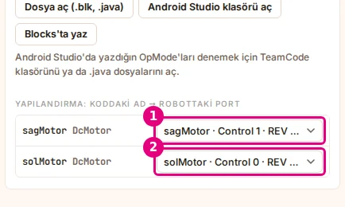

::: hoca
**Söyle:** "Bu seride tek bir robotu baştan sona götürdük. Builder'da Omni şasiyi kurup motorlarına ad verdik, Blocks'ta bir otonom ve bir TeleOp programı yazdık. Sim'de ikisini de aynı motor adlarıyla çalıştırdık."
:::

## Sırada ne var {sure=0.5}

- Otonomda güçleri ve süreleri değiştirip yolu değiştirmek
- Görünümü Detaylı 3B yapmak
- Dosyaları saklamak, ilk-robot.json ve .blk dosyaları

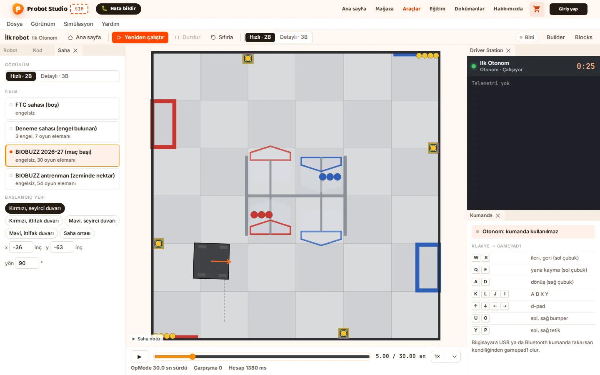

::: hoca
**Söyle:** "Bir sonraki adım sizin denemeleriniz. Otonomdaki güçleri ve süreleri değiştirip robotu sahada başka bir noktaya götürebiliyoruz ya da Sim'i Detaylı 3B görünüme alabiliyoruz. Kaydettiğimiz JSON ve .blk dosyalarıyla robotumuzu ve programlarımızı istediğimiz zaman yeniden açıyoruz."
:::
