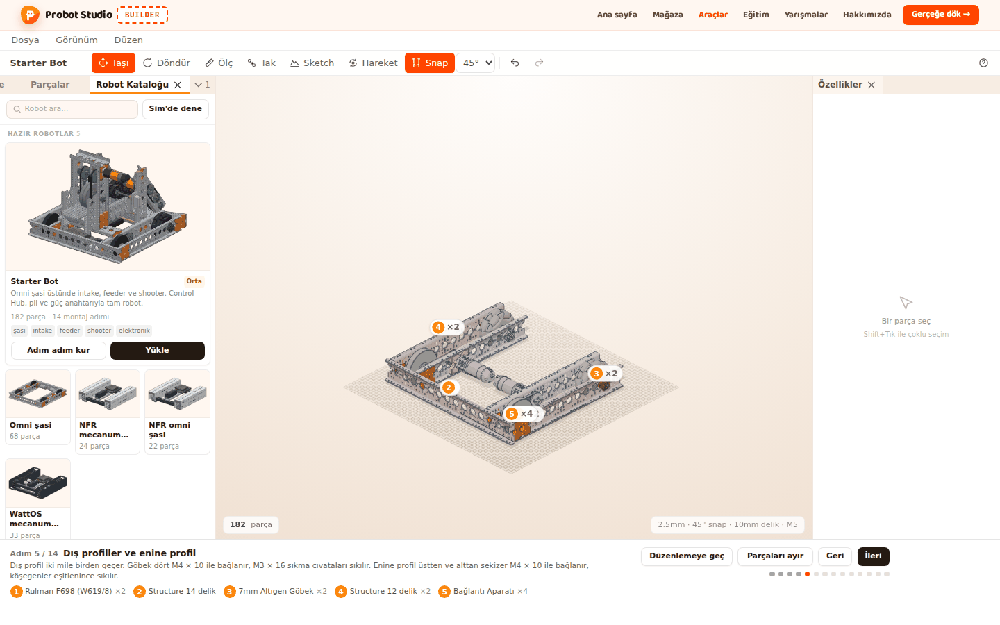
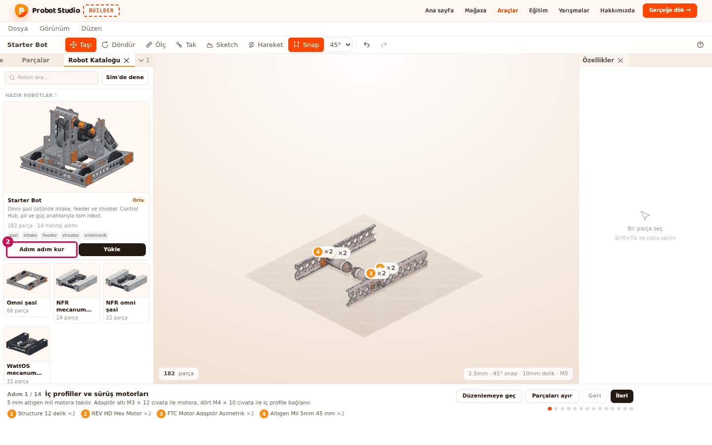
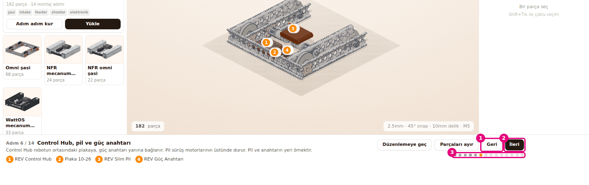
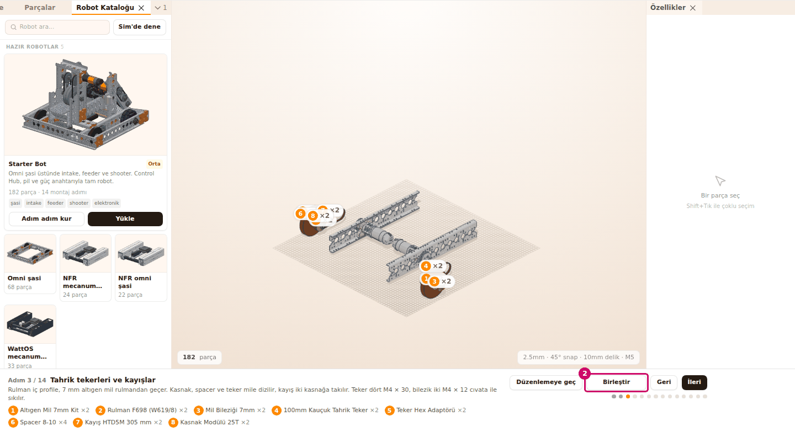
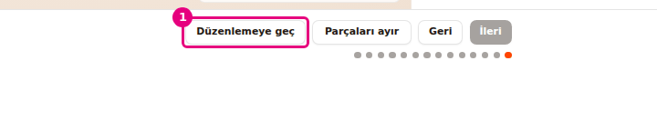

# Robotu adım adım kur

Bu sayfada Starter Bot'u montaj modunda, parça parça kurulurken izleyeceksin. Her adımda hangi
parçaların takıldığını görür, sonra robotu düzenlemeye açarsın.

<!-- CAPTURE: url=https://probotstudio.com/builder/ | hazirla=Starter Bot montaj modunda, Adım 5 açık | hedef=body | isaret=yok | bekle=[data-montaj-seridi] -->

## Başlamadan önce

- Montaj adımı olan tek robot **Starter Bot**'tur: 182 parça, 14 adım. Diğer hazır robotlarda
  **Adım adım kur** yoktur.
- Montaj modu sahnedeki her şeyi kaldırıp Starter Bot'u koyar. Sahnede kendi çalışman varsa önce
  **Dosya** > **Kaydet (JSON indir)**'i seç.
- Hazır robotlar hakkında bkz. [Hazır robotla başla](hazir-robotla-basla.md).

## Montaj modunu başlat

1. **Sol panel**de **Robot Kataloğu** sekmesini seç.
2. **Starter Bot** kartında **Adım adım kur**'a bas.
3. Sahne doluysa kartta çıkan onayda **Değiştir**'e bas.
   
   <!-- CAPTURE: url=https://probotstudio.com/builder/ | hazirla=sahne boş, Robot Kataloğu önde, Starter Bot kartında Adım adım kur'a basılmış | hedef=[data-adim-adim="starter-bot-rev"];text="Adım 1 / 14" | isaret=2 | bekle=text="Adım 1 / 14" -->
   <!-- SAY: Starter Bot kartından Adım adım kur ile montaj modunu açıyoruz. -->

Sonuç: **Sahne**nin altında **Montaj şeridi** açılır. Şeritte "Adım 1 / 14" ve adımın adı
"İç profiller ve sürüş motorları" yazar.

Şeritte, adım adının altında adımın kısa açıklaması ve o adımda takılan parçalar durur. Parçalar numaralıdır,
aynı parçadan birden çok varsa yanında "×adet" yazar (ör. ×4). Sahnede şunları görürsün:

- Bu adımda takılan parçalar turuncu parlar ve üstlerinde şeritteki numaralar durur.
- Önceki adımların parçaları açık renkte görünür.
- Sonraki adımların parçaları gizlidir.

Kamera robotu bir kez, çapraz açıdan kadraja alır. Adım değiştirince kamera yerinden oynamaz.
Kamerayı her zamanki gibi döndürür, yakınlaştırır ve kaydırırsın. Bkz. [Sahnede gezin](sahnede-gezin.md).

## Adımlar arasında gez

1. **Montaj şeridi**nde **İleri**'ye bas (<kbd>→</kbd>).
2. Önceki adıma dönmek için **Geri**'ye bas (<kbd>←</kbd>).
3. Bir adıma atlamak için **İleri**'nin altındaki adım noktalarından birine bas.
   
   <!-- CAPTURE: url=https://probotstudio.com/builder/ | hazirla=Starter Bot montaj modunda, Adım 6 açık | hedef=text="Geri";text="İleri";[aria-label="Adımlar"] | isaret=1-3 | bekle=text="Adım 6 / 14" -->
   <!-- SAY: İleri ve Geri ile ya da noktalarla adımlar arasında geziyoruz. -->

Sonuç: Şeritte yeni adımın numarası ve adı yazar. İleri gidince yeni adımın parçaları dışarıdan
gelip yerine oturur.

Farenin imlecini bir noktanın üstünde tutunca adımın numarası ve adı görünür (ör. "Adım 6, Control
Hub, pil ve güç anahtarı"). Geçerli adımın noktası turuncu, geçilen adımlarınki koyudur. İlk adımda
**Geri**, son adımda **İleri** soluktur.

Starter Bot'un 14 adımı:

| Adım | Ad |
|---|---|
| 1 | İç profiller ve sürüş motorları |
| 2 | Motor kasnakları |
| 3 | Tahrik tekerleri ve kayışlar |
| 4 | Omni tekerler |
| 5 | Dış profiller ve enine profil |
| 6 | Control Hub, pil ve güç anahtarı |
| 7 | Intake yan profilleri ve motoru |
| 8 | Intake milleri ve tekerleri |
| 9 | Intake kasnakları ve kayışları |
| 10 | Intake rampası ve şasiye bağlama |
| 11 | Feeder servo ve mili |
| 12 | Atıcı kulesi ve flywheel |
| 13 | Üst mil, dişliler ve atıcı motoru |
| 14 | Hood |

## Bir adımın parçalarını ayrı gör

Bir adımda çok parça iç içe takılıyorsa onları ayrılmış hâlde görebilirsin.

1. Parçalarını görmek istediğin adıma git (ör. Adım 3).
2. **Montaj şeridi**nde **Parçaları ayır**'a bas.
   
   <!-- CAPTURE: url=https://probotstudio.com/builder/ | hazirla=Starter Bot montaj modunda, Adım 3 açık, Parçaları ayır'a basılmış | hedef=text="Birleştir" | isaret=2 | bekle=text="Birleştir" -->
   <!-- SAY: Parçaları ayır ile bu adımın parçalarını aralıklı görüyoruz. -->
3. Parçaları yerine koymak için **Birleştir**'e bas.

Sonuç: **Parçaları ayır**'a basınca o adımın parçaları takıldıkları yerden dışarı doğru açılır.
Düğmenin adı **Birleştir** olur. **Birleştir** parçaları yerlerine geri koyar.

Ayrılmış görünüm sen kapatana kadar açık kalır. Adım değiştirince yeni adımın parçaları da ayrılmış
gelir.

## Montaj modundan çık ve robotu düzenle

1. **Montaj şeridi**nde **Düzenlemeye geç**'e bas.
   
   <!-- CAPTURE: url=https://probotstudio.com/builder/ | hazirla=Starter Bot montaj modunda, Adım 14 açık | hedef=[data-duzenlemeye-gec] | isaret=1 | bekle=[data-duzenlemeye-gec] -->
   <!-- SAY: Düzenlemeye geç ile montaj modundan çıkıp robotu kendimiz değiştiriyoruz. -->
2. **Sahne**de bir parçayı seç. **Özellikler** panelinde parçanın ayarları açılır.
3. **Araç çubuğu**nda **Taşı**'ya bas ve parçanın okunu sürükle.

Sonuç: **Montaj şeridi** kapanır. Robotun bütün parçaları kendi renginde görünür. Parçaları seçer,
taşır, siler ve yeni parça eklersin.

Geçişte bildirim çıkmaz. Hangi adımda olursan ol robotun tamamı sahnede kalır. Proje adı
"Starter Bot" olur, **Parçalar** sekmesinde robot tek satırda durur.

Montaj modundan bir başka yolla da çıkılır: **Robot Kataloğu**'nda başka bir robotu yükle. Sahne
dolu olduğu için önce **Vazgeç** / **Değiştir** onayı çıkar. Montaj modu açıkken **Adım adım kur**'a
yeniden basarsan Starter Bot onay sormadan baştan başlar.

## Montaj modunda neler kapalı

Montaj modunda robot yalnız izlenir. Şunlar çalışmaz:

- Sahnede parçaya tıklamak parçayı seçmez. Sağ tıklayınca bağlam menüsü açılmaz.
- Klavye kısayolları çalışmaz. Yalnız <kbd>←</kbd> ve <kbd>→</kbd> adım değiştirir.
- **Parçalar** sekmesindeki liste yalnız okunur.
- Sahneyi değiştiren her iş durur: **Parça Ekle**'de parçaya tıklamak, **Dosya** > **Yeni**,
  **Yükle...**, **İçe aktar (STL, STEP, GLB, OBJ)...** gibi. Bunları denersen "Montaj modunda
  düzenleme kapalı. Değiştirmek için Düzenlemeye geç" bildirimi çıkar. **Yeni**'de önce "Sahnedeki
  parçalar silinecek. Yeni proje açılsın mı?" onayı açılır. Onaylasan da sahne değişmez.
  **Parça Ekle**'den sahneye sürüklediğin parça ise bırakılmaz. Bu durumda bildirim çıkmaz.

Kamera ve **Görünüm** menüsü çalışır. Görünüm küpü montaj modunda gizlidir; **Düzenlemeye geç**'e
basınca geri gelir. **Dosya** > **Kaydet (JSON indir)** de çalışır
ve robotun tamamını indirir.

<!-- SAY: Montaj modunda robotu yalnız izliyoruz, değiştirmek için Düzenlemeye geçiyoruz. -->

## Sorun mu var?

- **"Montaj modunda düzenleme kapalı. Değiştirmek için Düzenlemeye geç" bildirimi çıkıyor:** Montaj
  modundasın. **Montaj şeridi**nde **Düzenlemeye geç**'e bas. Bkz. [Sorun giderme](sorunlar.md#montaj-modu).
- **Kartta Adım adım kur yok:** Montaj adımları yalnız Starter Bot'ta var. Diğer robotları yüklemek
  için kartlarına bas.
- **Parçaya tıklıyorum, seçilmiyor:** Montaj modunda seçim kapalıdır. **Düzenlemeye geç**'e bas.
  Bkz. [Sorun giderme](sorunlar.md#montaj-modu).
- **<kbd>←</kbd> / <kbd>→</kbd> adım değiştirmiyor:** İlk adımda <kbd>←</kbd>, son adımda <kbd>→</kbd>
  bir şey yapmaz. Şeritteki adım numarasına bak.
- **Robot ekrandan çıktı:** **Görünüm** > **Sığdır**'ı seç.

## Sonraki adım

- [Sahnede gezin](sahnede-gezin.md)
- [Parçaları seç, gizle ve sil](parcalari-sec-gizle-sil.md)
- [Eklem kur ve hareketi dene](eklem-kur-ve-oynat.md)
