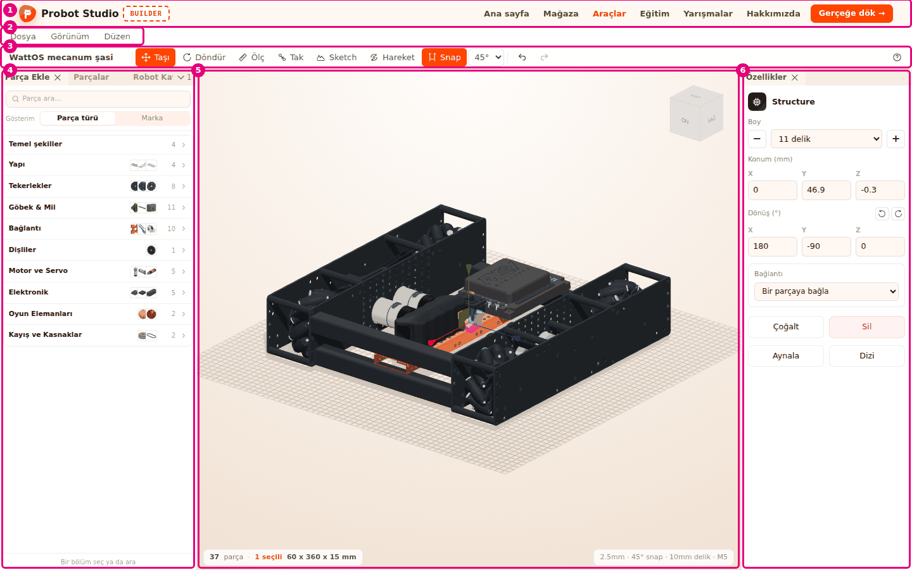
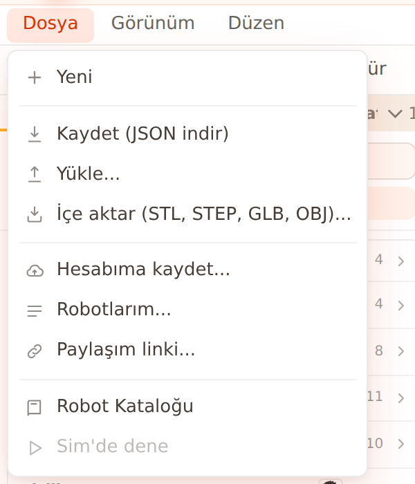
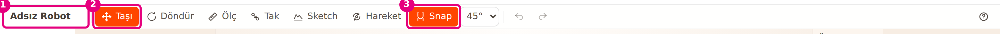
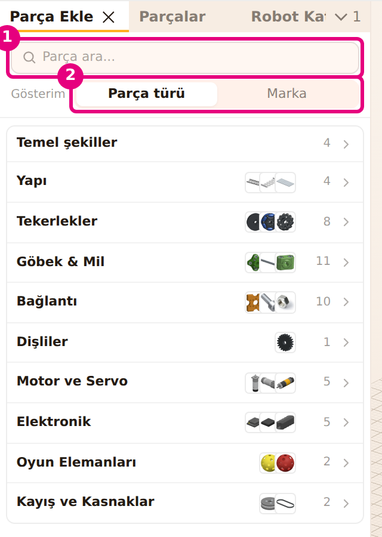
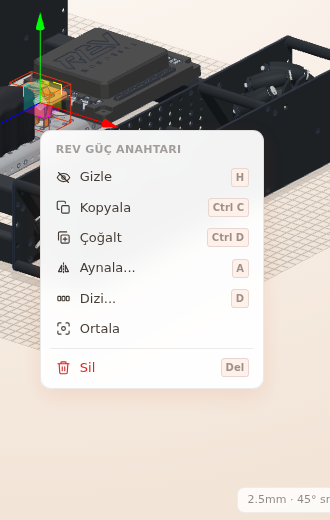
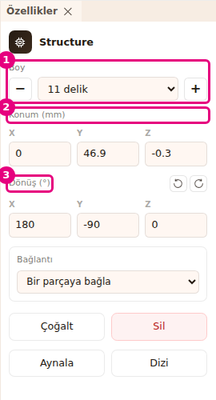

# Arayüz turu

Bu sayfa Builder ekranındaki her bölgeyi ve her düğmeyi tanıtır. Diğer sayfalar bölgeleri burada
verilen adlarla anar. Bir düğmenin ne yaptığını merak edersen bu sayfada ara.

<!-- CAPTURE: url=https://probotstudio.com/builder/ | hazirla=hazir:WattOS mecanum şasi, bir parça seçili | hedef=bolge:ust-serit,menu,arac-cubugu,sol-panel,sahne,ozellikler | isaret=1-6 | bekle=text="Özellikler" -->

| No | Bölge | Ne var |
|---|---|---|
| 1 | **Üst şerit** | Site başlığı ve **Gerçeğe dök →** düğmesi. |
| 2 | **Menü çubuğu** | **Dosya**, **Görünüm**, **Düzen** menüleri. |
| 3 | **Araç çubuğu** | Proje adı, araçlar, Snap, geri al, Yardım. |
| 4 | **Sol panel** | **Parça Ekle**, **Parçalar**, **Robot Kataloğu** sekmeleri. |
| 5 | **Sahne** | 3B alan, görünüm küpü, durum şeridi. **Ölç**, **Tak** ve **Hareket** panelleri sahnenin köşesinde açılır. |
| 6 | **Özellikler** paneli | Seçili parçanın ayarları. |
| 7 | **Montaj şeridi** | Yalnız **Adım adım kur** modunda, sahnenin altında görünür. |

Builder her açıldığında ekranın ortasında "Tasarım aracı geliştirme aşamasında" penceresi çıkar. **Anladım,
devam et**'e basınca kapanır. Sonra ekranın sağ altında **🐛 Hata bildir** düğmesi kalır. Düğme sayfadan
çıkmadan ekibe mesaj gönderme formunu açar (bkz. [Hata bildir](sorunlar.md#hata-bildir)).

## 1. Üst şerit

| Ad | Ne yapar | Kısayol | İlgili görev |
|---|---|---|---|
| **Gerçeğe dök →** | Tasarımdaki parçaların listesini, fiyatını ve robot kontrolünü gösteren pencereyi açar. | | [Gerçeğe dök](gercege-dok.md) |

Şeritteki diğer bağlantılar (Ana sayfa, Mağaza, Araçlar...) sitenin geri kalanına gider.

## 2. Menü çubuğu

Menüyü açmak için adına bas. Menü açıkken farenin imlecini komşu menüye götürmek onu açar.
<kbd>Esc</kbd> ya da menünün dışına tıklamak menüyü kapatır.

### Dosya menüsü

<!-- CAPTURE: url=https://probotstudio.com/builder/ | hazirla=boş sahne | hedef=role=button[name="Dosya"] | isaret=yok | bekle=text="Kaydet (JSON indir)" -->

| Ad | Ne yapar | Kısayol | İlgili görev |
|---|---|---|---|
| **Yeni** | Sahneyi boşaltır, adı "Adsız Robot" olan yeni proje açar. Sahnede parça varsa onay ister. | | [Dosyaya kaydet ve aç](dosyaya-kaydet-ve-ac.md) |
| **Kaydet (JSON indir)** | Projeyi `<proje adı>.json` dosyası olarak bilgisayara indirir. | | [Dosyaya kaydet ve aç](dosyaya-kaydet-ve-ac.md) |
| **Yükle...** | Bilgisayardaki `.json` proje dosyasını açar. | | [Dosyaya kaydet ve aç](dosyaya-kaydet-ve-ac.md) |
| **İçe aktar (STL, STEP, GLB, OBJ)...** | Bir 3B model dosyasını parça olarak sahneye ekler. | | [3B model içe aktar](model-ice-aktar.md) |
| **Hesabıma kaydet...** | Robotu Probot hesabına kaydeder. Giriş gerekir. | | [Hesabına kaydet ve paylaş](hesaba-kaydet-ve-paylas.md) |
| **Robotlarım...** | Hesabındaki robotları listeler: aç, yeniden adlandır, sil. | | [Hesabına kaydet ve paylaş](hesaba-kaydet-ve-paylas.md) |
| **Paylaşım linki...** | Hesaba kayıtlı robot için paylaşım linki açar ya da kapatır. | | [Hesabına kaydet ve paylaş](hesaba-kaydet-ve-paylas.md) |
| **Robot Kataloğu** | **Sol panel**de **Robot Kataloğu** sekmesini açar. | | [Hazır robotla başla](hazir-robotla-basla.md) |
| **Sim'de dene** | Sahnedeki robotu Sim'de yeni sekmede açar. Sahne boşken soluktur. | | [Robotu Sim'de dene](simde-dene.md) |

Hesap öğeleri sunucuya bağlanırken "Bağlanıyor", sunucuya ulaşılamazsa "Şu an kullanılamıyor"
notuyla soluk görünür.

### Görünüm menüsü

| Grup | Ad | Ne yapar | İlgili görev |
|---|---|---|---|
| KAMERA | **Perspektif** / **Ortografik** | Kamera türünü seçer. Varsayılan **Ortografik**. | [Sahnede gezin](sahnede-gezin.md) |
| FARE DÜZENİ | **Onshape** / **SolidWorks** / **Fusion 360** | Kamerayı hangi fare tuşlarıyla döndürüp kaydıracağını seçer. Varsayılan **Onshape**. | [Sahnede gezin](sahnede-gezin.md) |
| KONTUR | **Kapalı** / **Rim** / **Çizgi** | Parçaların çevresine çizilen çizginin türü. Varsayılan **Çizgi**. | [Sahnede gezin](sahnede-gezin.md) |
| | **Sığdır** | Robotun tamamını kadraja alır. | [Sahnede gezin](sahnede-gezin.md) |
| PANELLER | **Parça Ekle**, **Parçalar**, **Özellikler**, **Robot Kataloğu**, **Derleme** | İşaretli panel görünür. İşareti kaldırınca panel kapanır. **Derleme** varsayılan olarak kapalıdır. | [Panelleri düzenle](panelleri-duzenle.md), [Robotu derle](robotu-derle.md) |
| | **Yerleşimi sıfırla** | Panelleri ilk açılıştaki yerlerine döndürür. | [Panelleri düzenle](panelleri-duzenle.md) |

Seçimlerin hepsi bu tarayıcıda hatırlanır.

### Düzen menüsü

Öğeler yalnız işe yarayacakları zaman etkindir (ör. seçim yokken **Sil** soluktur).

| Ad | Ne yapar | Kısayol | İlgili görev |
|---|---|---|---|
| **Geri al** | Son değişikliği geri alır. En çok 59 adım geriye gider. | <kbd>Ctrl</kbd>+<kbd>Z</kbd> | [Parçaları seç, gizle ve sil](parcalari-sec-gizle-sil.md) |
| **Yinele** | Geri alınan değişikliği yeniden yapar. | <kbd>Ctrl</kbd>+<kbd>Y</kbd> | [Parçaları seç, gizle ve sil](parcalari-sec-gizle-sil.md) |
| **Çoğalt** | Seçimin bir kopyasını yanına koyar. | <kbd>Ctrl</kbd>+<kbd>D</kbd> | [Parçaları çoğalt, aynala ve diz](cogalt-aynala-dizi.md) |
| **Aynala...** | Seçimin sağ-sol ya da ön-arka ayna kopyasını yapar. | <kbd>A</kbd> | [Parçaları çoğalt, aynala ve diz](cogalt-aynala-dizi.md) |
| **Dizi...** | Seçimi bir yönde eşit aralıkla çoğaltır. | <kbd>D</kbd> | [Parçaları çoğalt, aynala ve diz](cogalt-aynala-dizi.md) |
| **Kayış ekle** | Seçili iki kasnağın arasına kayış koyar. | <kbd>K</kbd> | [İki kasnağa kayış ekle](kayis-ekle.md) |
| **Sil** | Seçili parçaları siler. | <kbd>Del</kbd> | [Parçaları seç, gizle ve sil](parcalari-sec-gizle-sil.md) |

## 3. Araç çubuğu

<!-- CAPTURE: url=https://probotstudio.com/builder/ | hazirla=boş sahne | hedef=title="Proje adını düzenle";title="Taşı (T / M)";title^="Snap" | isaret=1-3 | bekle=text="Adsız Robot" -->

| Ad | Ne yapar | Kısayol | İlgili görev |
|---|---|---|---|
| Proje adı (ör. **Adsız Robot**) | Adı değiştirmek için üstüne bas, yaz, <kbd>Enter</kbd>'a bas. <kbd>Esc</kbd> vazgeçer. Robot hesaba kayıtlıysa yanında "Kaydedildi" ya da "Kaydedilmedi" yazar. | | [Dosyaya kaydet ve aç](dosyaya-kaydet-ve-ac.md) |
| **Taşı** | Seçili parçanın üstüne üç eksenli taşıma oklarını getirir. Açılışta seçilidir. | <kbd>T</kbd> ya da <kbd>M</kbd> | [Parçayı taşı ve döndür](tasi-ve-dondur.md) |
| **Döndür** | Seçili parçanın üstüne döndürme halkalarını getirir. | <kbd>R</kbd> | [Parçayı taşı ve döndür](tasi-ve-dondur.md) |
| **Ölç** | İki nokta arasındaki mesafeyi ölçer. | <kbd>Ö</kbd> ya da <kbd>I</kbd> | [Mesafe ölç](mesafe-olc.md) |
| **Tak** | Bir parçanın deliğini başka parçanın deliğine oturtur. | <kbd>B</kbd> | [Parçaları deliklerinden tak](parcalari-tak.md) |
| **Sketch** | Bir yüzeye ya da düzleme 2B çizim açar. | <kbd>S</kbd> | [Sketch çiz ve Extrude ile katı yap](sketch-ve-extrude.md) |
| **Hareket** | Eklemleri oynatan **Hareket** panelini açar. | <kbd>E</kbd> | [Eklem kur ve hareketi dene](eklem-kur-ve-oynat.md) |
| **Snap** | Açıkken parça 2,5 mm adımla ilerler, deliklere mıknatıslanır ve seçili açı adımıyla döner. Turuncuysa açıktır. | Taşırken <kbd>Shift</kbd> basılı tutmak geçici kapatır | [Parçayı taşı ve döndür](tasi-ve-dondur.md) |
| Döndürme adımı (**45°**) | Döndürme adımını seçer: 5°, 15°, 30°, 45°, 90°. Snap kapalıyken soluktur. | | [Parçayı taşı ve döndür](tasi-ve-dondur.md) |
| Geri al simgesi | **Düzen** > **Geri al** ile aynı. | <kbd>Ctrl</kbd>+<kbd>Z</kbd> | [Parçaları seç, gizle ve sil](parcalari-sec-gizle-sil.md) |
| İleri al simgesi | **Düzen** > **Yinele** ile aynı. | <kbd>Ctrl</kbd>+<kbd>Shift</kbd>+<kbd>Z</kbd> | [Parçaları seç, gizle ve sil](parcalari-sec-gizle-sil.md) |
| Yardım simgesi (**?**) | "Klavye Kısayolları" penceresini açar. | <kbd>?</kbd> | [Kısayollar](kisayollar.md) |

**Taşı** ya da **Döndür**'ü seçmek açık olan **Ölç** ve **Tak** araçlarını kapatır.

## 4. Sol panel

Üç sekme vardır. Sekmenin adına basınca öne gelir. Sekmenin yanındaki çarpı (×) paneli kapatır;
geri açmak için **Görünüm** menüsündeki **PANELLER** grubunu kullan. Sığmayan sekmeler sekme
satırının sonundaki açılır oktan seçilir.

### Parça Ekle sekmesi

<!-- CAPTURE: url=https://probotstudio.com/builder/ | hazirla=boş sahne | hedef=placeholder="Parça ara...";[data-gorunum="tur"] | isaret=1-2 | bekle=text="Temel şekiller" -->

| Ad | Ne yapar | İlgili görev |
|---|---|---|
| **Parça ara...** kutusu | Parçayı adında, türünde, açıklamasında ve ürün kodunda (SKU) arar. Sonuç yoksa "Sonuç bulunamadı" yazar. | [Parça ekle](parca-ekle.md) |
| **Gösterim**: **Parça türü** / **Marka** | Bölümleri parça türüne ya da markaya göre listeler. | [Parça ekle](parca-ekle.md) |
| Bölüm satırı (ör. **Yapı**, **Tekerlekler**) | Bölümü açar. Satırda parça sayısı ve küçük resimler görünür. | [Parça ekle](parca-ekle.md) |
| Aile satırı | Aynı parçanın boy, ölçü gibi seçeneklerini açar (ör. "N boy seçeneği", "N ölçü seçeneği"). | [Parça ekle](parca-ekle.md) |
| Parça satırı | Basınca parça sahneye eklenir. Sahneye sürüklersen bıraktığın yere oturur. Satırda stok ("stokta", "stok N", "stok yok") ve fiyat yazar. | [Parça ekle](parca-ekle.md) |
| Geri düğmesi | Bir üst düzeye döner ("Bölümlere dön"). | [Parça ekle](parca-ekle.md) |
| **İçe aktar** satırı | 3B model dosyası seçtirir. **Temel şekiller** bölümünde görünür. Marka görünümünde **Genel** bölümünün sonundadır. | [3B model içe aktar](model-ice-aktar.md) |

Bölüm içindeyken <kbd>Esc</kbd> bir üst düzeye döner.

### Parçalar sekmesi

| Ad | Ne yapar | İlgili görev |
|---|---|---|
| **Parçalarda ara...** kutusu | Sahnedeki parçaları adında, türünde, ürün kodunda ve donanım adında arar. | [Parçaları seç, gizle ve sil](parcalari-sec-gizle-sil.md) |
| **Gösterim**: **Tüm parçalar** / **Parça türü** / **Marka** | Listeyi düz, türe göre ya da markaya göre gruplar. | [Parçaları seç, gizle ve sil](parcalari-sec-gizle-sil.md) |
| Parça satırı | Basınca parçayı seçer. <kbd>Shift</kbd> ile basınca seçime ekler. | [Parçaları seç, gizle ve sil](parcalari-sec-gizle-sil.md) |
| Hazır robot satırı | Hazır robotla gelen parçaları tek satırda toplar. Basınca hepsini seçer. Yanında "N parça" yazar. | [Hazır robotla başla](hazir-robotla-basla.md) |
| Hazır robot satırındaki ok | Satırın içindeki parçaları açar ("Parçalarını göster") ya da kapatır. | [Hazır robotla başla](hazir-robotla-basla.md) |
| **Grup (n)** satırı | **Sabitle** ile yapılmış grubu gösterir. | [Parçaları grupla ve birbirine bağla](grupla-ve-bagla.md) |
| Satırdaki **Gizle** / **Göster** simgesi | Parçayı sahnede gizler ya da gösterir. | [Parçaları seç, gizle ve sil](parcalari-sec-gizle-sil.md) |
| Satırdaki **Sil** simgesi | Parça satırında parçayı, grup ya da robot satırında içindeki bütün parçaları siler. <kbd>Ctrl</kbd>+<kbd>Z</kbd> ile geri alınır. | [Parçaları seç, gizle ve sil](parcalari-sec-gizle-sil.md) |

Sahne boşken "Henüz parça yok. Parça Ekle sekmesinden başla." yazar. Montaj modunda liste yalnız
okunur.

### Robot Kataloğu sekmesi

| Ad | Ne yapar | İlgili görev |
|---|---|---|
| **Robot ara...** kutusu | Hazır robotları ve topluluk robotlarını adına göre süzer. | [Hazır robotla başla](hazir-robotla-basla.md) |
| **Sim'de dene** | Sahnedeki robotu Sim'de yeni sekmede açar. Sahne boşken soluktur. | [Robotu Sim'de dene](simde-dene.md) |
| Büyük robot kartı (**Starter Bot**) | Zorluk, açıklama, parça ve montaj adımı sayısını gösterir. | [Hazır robotla başla](hazir-robotla-basla.md) |
| **Adım adım kur** | Robotu montaj modunda, adım adım kurarak gösterir. | [Robotu adım adım kur](adim-adim-kur.md) |
| **Yükle** | Robotun tamamını sahneye koyar. | [Hazır robotla başla](hazir-robotla-basla.md) |
| Küçük robot kartı | Basınca robotu sahneye yükler. | [Hazır robotla başla](hazir-robotla-basla.md) |
| **Vazgeç** / **Değiştir** | Sahne doluyken yükleme onayı. **Değiştir** sahnedekileri kaldırıp yeni robotu koyar. | [Hazır robotla başla](hazir-robotla-basla.md) |
| **TOPLULUK** bölümündeki kartlar | Tasarım örnekleri ve onaylanmış topluluk robotları. Basınca yükler. | [Hazır robotla başla](hazir-robotla-basla.md) |
| **Robotunu paylaş** | Robotunu topluluk kataloğuna inceleme için gönderme formunu açar. Giriş gerekir. | [Hesabına kaydet ve paylaş](hesaba-kaydet-ve-paylas.md) |
| **Robot adı**, **Paylaş**, **Vazgeç** | Paylaşım formunun alanı ve düğmeleri. Ad en çok 80 karakter. | [Hesabına kaydet ve paylaş](hesaba-kaydet-ve-paylas.md) |
| **Yeni sekmede giriş yap** | Giriş yapılmamışsa çıkar. Giriş sayfasını yeni sekmede açar. | [Hesabına kaydet ve paylaş](hesaba-kaydet-ve-paylas.md) |
| **Tekrar dene** | Topluluk listesi alınamadıysa yeniden ister. | [Sorun giderme](sorunlar.md) |
| **Daha fazla göster** | Topluluk listesinin devamını getirir. | [Hazır robotla başla](hazir-robotla-basla.md) |

## 5. Sahne

| Ad | Ne yapar | İlgili görev |
|---|---|---|
| 3B alan | Parçalar burada durur. Sol tıkla seçilir, fare tuşlarıyla kamera oynatılır. | [Sahnede gezin](sahnede-gezin.md) |
| Görünüm küpü | Sahnenin köşesindeki küp. Yüzüne basınca kamera o yöne bakar: **SAĞ**, **SOL**, **ÜST**, **ALT**, **ÖN**, **ARKA**. | [Sahnede gezin](sahnede-gezin.md) |
| Durum şeridi | Sahnenin altındaki satır. Parça sayısı, seçili sayısı, seçimin boyutu (genişlik x uzunluk x yükseklik, mm) ve gizli sayısı. Karşı uçta snap ayarı ("2.5mm · 45° snap · 10mm delik · M5"). | [Parçayı taşı ve döndür](tasi-ve-dondur.md) |

### Boş sahne kartı

Sahne boşken ortada "Sahne boş" kartı çıkar.

| Ad | Ne yapar | İlgili görev |
|---|---|---|
| **Parça listesi** | **Parça Ekle** sekmesini öne getirir. | [Parça ekle](parca-ekle.md) |
| **Robot kataloğu** | **Robot Kataloğu** sekmesini öne getirir. | [Hazır robotla başla](hazir-robotla-basla.md) |
| **Starter Bot**, **Omni şasi**, **WattOS mecanum şasi** | Robotu sahneye yükler. | [Hazır robotla başla](hazir-robotla-basla.md) |
| **Boş sahne** | Kartı kapatır ve **Parça Ekle** sekmesini öne getirir. | [Parça ekle](parca-ekle.md) |
| Çarpı (**Kapat**) | Kartı kapatır. | |

### Bağlam menüsü

Sahnede sağ tıklayınca açılır. Sağ tuşla sürüklersen kamera döner, menü açılmaz. Parçanın üstünde
açılan menünün başlığında parçanın adı ve seçili adet yazar. Montaj modunda ve **Ölç**, **Tak**,
**Sketch** açıkken menü açılmaz.

<!-- CAPTURE: url=https://probotstudio.com/builder/ | hazirla=hazir:WattOS mecanum şasi, tek parçaya sağ tık | hedef=koordinat | isaret=yok | bekle=text="Gizle" -->

| Ad | Ne yapar | Kısayol | İlgili görev |
|---|---|---|---|
| **Sketch'i düzenle** | Seçili sketch'i düzenlemeye açar. Yalnız tek sketch seçiliyken görünür. | Sketch'e çift tık | [Sketch ve Extrude](sketch-ve-extrude.md) |
| **Extrude** | Seçili sketch'ten katı parça yapar. Yalnız tek sketch seçiliyken görünür. | | [Sketch ve Extrude](sketch-ve-extrude.md) |
| **Gizle** / **Göster** | Seçimi gizler ya da gösterir. | <kbd>H</kbd> | [Parçaları seç, gizle ve sil](parcalari-sec-gizle-sil.md) |
| **Kopyala** | Seçimi panoya kopyalar. | <kbd>Ctrl</kbd>+<kbd>C</kbd> | [Parçaları çoğalt, aynala ve diz](cogalt-aynala-dizi.md) |
| **Çoğalt** | Seçimin kopyasını yanına koyar. | <kbd>Ctrl</kbd>+<kbd>D</kbd> | [Parçaları çoğalt, aynala ve diz](cogalt-aynala-dizi.md) |
| **Aynala...** | Aynala penceresini açar. | <kbd>A</kbd> | [Parçaları çoğalt, aynala ve diz](cogalt-aynala-dizi.md) |
| **Dizi...** | Dizi penceresini açar. | <kbd>D</kbd> | [Parçaları çoğalt, aynala ve diz](cogalt-aynala-dizi.md) |
| **Ortala** | Kamerayı seçimin üstüne odaklar. Parçalar yerinden oynamaz. | | [Sahnede gezin](sahnede-gezin.md) |
| **Kayış ekle** | İki kasnak seçiliyken aralarına kayış koyar. | <kbd>K</kbd> | [İki kasnağa kayış ekle](kayis-ekle.md) |
| **Sabitle** | Birden çok parçayı tek grup yapar. | | [Parçaları grupla ve birbirine bağla](grupla-ve-bagla.md) |
| **Grubu Çöz** | Seçili grubu ayrı parçalara döndürür. | | [Parçaları grupla ve birbirine bağla](grupla-ve-bagla.md) |
| **Bağı çöz (n)** | Seçimdeki parçaların başka parçaya olan bağını çözer. Birden çok parça varsa sayı yazar. | | [Parçaları grupla ve birbirine bağla](grupla-ve-bagla.md) |
| **Sil** / **Sil (n)** | Seçimi siler. Birden çok parça seçiliyse sayı yazar. | <kbd>Del</kbd> | [Parçaları seç, gizle ve sil](parcalari-sec-gizle-sil.md) |
| **Buraya yapıştır** | Boş alanda: panodaki parçaları tıkladığın noktaya yapıştırır. Pano boşsa soluktur. | <kbd>Ctrl</kbd>+<kbd>V</kbd> | [Parçaları çoğalt, aynala ve diz](cogalt-aynala-dizi.md) |
| **Tümünü seç** | Boş alanda: sahnedeki bütün parçaları seçer. | <kbd>Ctrl</kbd>+<kbd>A</kbd> | [Parçaları seç, gizle ve sil](parcalari-sec-gizle-sil.md) |
| **Tümünü göster (n)** | Boş alanda: gizli parçaların hepsini gösterir. | | [Parçaları seç, gizle ve sil](parcalari-sec-gizle-sil.md) |

### Sahnenin köşesinde açılan araç panelleri

| Panel | Ne zaman açılır | Düğmeler | İlgili görev |
|---|---|---|---|
| **Ölçüm** | **Ölç** seçilince | Kapat ("Ölçümü kapat (Esc)"), her ölçüm satırında **Bu ölçümü sil** | [Mesafe ölç](mesafe-olc.md) |
| **Tak** | **Tak** seçilince | Kapat ("Tak aracını kapat (Esc)"), son bağlantıyı döndüren **45°** (seçili adım), **Ters çevir** | [Parçaları deliklerinden tak](parcalari-tak.md) |
| **Hareket** | **Hareket** seçilince | Kapat, **Eklemleri otomatik kur**, eklem kaydırıcısı ve açı kutusu, **Parçayı seç**, **Oynat** / **Durdur**, **Hız**, **Sıfırla**, **Bu pozu kaydet**, **Otomatik kur** | [Eklem kur ve hareketi dene](eklem-kur-ve-oynat.md) |

## 6. Özellikler paneli

Parça seçmeden "Bir parça seç" yazar. Panel kapalıyken parça seçersen kendiliğinden açılır.
Panelin üstünde seçili parçanın adı durur. Görünen alanlar parçanın türüne göre değişir.

<!-- CAPTURE: url=https://probotstudio.com/builder/ | hazirla=hazir:WattOS mecanum şasi, bir Structure seçili | hedef=text="Boy";text="Konum (mm)";text="Dönüş (°)" | isaret=1-3 | bekle=text="Konum (mm)" -->

### Her parçada

| Ad | Ne yapar | İlgili görev |
|---|---|---|
| **Konum (mm)** X / Y / Z | Parçanın yerini sayıyla girer. <kbd>Enter</kbd> uygular, <kbd>Esc</kbd> vazgeçer. | [Parçayı taşı ve döndür](tasi-ve-dondur.md) |
| **Dönüş (°)** X / Y / Z | Parçanın açısını sayıyla girer. | [Parçayı taşı ve döndür](tasi-ve-dondur.md) |
| Y ekseninde -90° / +90° simgeleri | Parçayı dikey eksen etrafında 90° döndürür. **Dönüş (°)** başlığının yanındadır. | [Parçayı taşı ve döndür](tasi-ve-dondur.md) |
| **Çoğalt** | Parçanın kopyasını yanına koyar. | [Parçaları çoğalt, aynala ve diz](cogalt-aynala-dizi.md) |
| **Sil** | Parçayı siler. | [Parçaları seç, gizle ve sil](parcalari-sec-gizle-sil.md) |
| **Aynala** | Aynala penceresini açar. | [Parçaları çoğalt, aynala ve diz](cogalt-aynala-dizi.md) |
| **Dizi** | Dizi penceresini açar. | [Parçaları çoğalt, aynala ve diz](cogalt-aynala-dizi.md) |

### Parçanın türüne göre

| Ad | Ne zaman görünür | Ne yapar | İlgili görev |
|---|---|---|---|
| Seçenek seçici (ör. **Boy**, **Ölçü**, **Devir**) ve **−** / **+** | Parça bir aileden geliyorsa | Parçanın boyunu ya da ölçüsünü değiştirir. **−** önceki, **+** sonraki seçenek. | [Parça ekle](parca-ekle.md) |
| **Uzunluk** / **Genişlik** adım seçici | Yalnız eski proje dosyalarından gelen eski yerleşik parçalarda (U/C Profil, Plaka, Lama, Standoff). **Parça Ekle** listesindeki parçalarda çıkmaz. | 1 ile 40 arası, 10 mm adımla boy verir. | [Parça ekle](parca-ekle.md) |
| **Uzunluk** alanı, kısalt / uzat | Boyu kesilerek ayarlanan parçalar (ör. mil) | Boyu mm olarak ya da listeden seçer. Sınırlar alanın altında yazar. | [Parça ekle](parca-ekle.md) |
| Ölçü alanları (**En**, **Boy**, **Yükseklik**, **Çap**, **Dış çap**, **İç çap**) | Temel şekiller | Şeklin ölçüsünü mm olarak verir. | [Temel şekillerle parça yap](temel-sekillerle-parca-yap.md) |
| **Tür**: **Katı** / **Delik** | Temel şekiller | Delik türü şekil **Birleştir**'de katı şekilden çıkarılır. | [Temel şekillerle parça yap](temel-sekillerle-parca-yap.md) |
| **Renk** | Temel şekiller | Mavi, Yeşil, Sarı, Kırmızı, Mor, Siyah, Beyaz. | [Temel şekillerle parça yap](temel-sekillerle-parca-yap.md) |
| **Ayır** | Birleştirilmiş şekil | Şekli parçalarına ayırır. | [Temel şekillerle parça yap](temel-sekillerle-parca-yap.md) |
| **Dosyanın birimi**: mm / cm / m / inç | İçe aktarılan model | Modelin ölçeğini düzeltir. | [3B model içe aktar](model-ice-aktar.md) |
| **Yukarı eksen**: **Z yukarı** / **Y yukarı** | İçe aktarılan model | Modeli dik oturtur. | [3B model içe aktar](model-ice-aktar.md) |
| **Dosyayı yeniden seç** | Modelin verisi kayıtta yoksa | Model dosyasını yeniden seçtirir. | [3B model içe aktar](model-ice-aktar.md) |
| **Düzenle**, **Extrude (N bölge)** | Sketch | Sketch'i düzenler, katı yapar. | [Sketch ve Extrude](sketch-ve-extrude.md) |
| **Kalınlık (mm)**, **Yön** | Extrude ile yapılmış parça | Kalınlığı ve yönü sonradan değiştirir. | [Sketch ve Extrude](sketch-ve-extrude.md) |

### Bağlantı alanı

Delik türündeki temel şekiller ve Sketch dışında her parçada **Bağlantı** başlığı altında görünür.

| Ad | Ne yapar | İlgili görev |
|---|---|---|
| **Bir parçaya bağla** | Bu parçayı seçtiğin parçaya bağlar. Bağlı parça onunla birlikte taşınır. | [Parçaları grupla ve birbirine bağla](grupla-ve-bagla.md) |
| **Bağı çöz** | Parçanın bağını kaldırır. | [Parçaları grupla ve birbirine bağla](grupla-ve-bagla.md) |
| Eksen seçici ve **Eklem ekle** | Bağlı parçayla arasına dönme eklemi koyar. | [Eklem kur ve hareketi dene](eklem-kur-ve-oynat.md) |
| **Sürekli dönüş** / **Sınırlı dönüş** | Eklemin türü. Sınırlı dönüşte **En az °** ve **En çok °** girilir. | [Eklem kur ve hareketi dene](eklem-kur-ve-oynat.md) |
| **Eklemi kaldır** | Eklemi siler, bağ kalır. | [Eklem kur ve hareketi dene](eklem-kur-ve-oynat.md) |
| **Hareket panelinde dene** | **Hareket** panelini açar. | [Eklem kur ve hareketi dene](eklem-kur-ve-oynat.md) |
| **Süren dişliyi seç** / **Süren kasnağı seç**, **Kaldır** | Dişliyi ya da kasnağı onu döndüren parçayla eşleştirir, eşleşmeyi kaldırır. | [Eklem kur ve hareketi dene](eklem-kur-ve-oynat.md) |

### Donanım alanı

Yalnız motor ve servo seçiliyken görünür.

| Ad | Ne yapar | İlgili görev |
|---|---|---|
| **Ad** | Kodda kullanılacak ad (ör. `solOnMotor`). | [Motor ve servoya ad ve port ver](motor-ve-servo-ayarla.md) |
| **Hub**: **Control Hub** / **Expansion Hub** | Motorun bağlı olduğu kart. | [Motor ve servoya ad ve port ver](motor-ve-servo-ayarla.md) |
| **Port** | Kartın port numarası. İlk seçenek **Seçilmedi**. Aynı port iki parçada seçilirse "Port N başka motorda" uyarısı çıkar. | [Motor ve servoya ad ve port ver](motor-ve-servo-ayarla.md) |
| **Ters yön** | Kodda motorun yönünü ters çevirir. | [Motor ve servoya ad ve port ver](motor-ve-servo-ayarla.md) |

### Kayış seçiliyken

Başlıkta "Kayış HTD5M" yazar. **Gereken boy**, **Diş sayısı**, **Merkez mesafesi**, **Kasnaklar**
ve **Oran** satırları gösterilir.

| Ad | Ne yapar | İlgili görev |
|---|---|---|
| **Kasnakları seç** | Kayışın sardığı iki kasnağı seçer. | [İki kasnağa kayış ekle](kayis-ekle.md) |
| **Sil** | Kayışı siler. | [İki kasnağa kayış ekle](kayis-ekle.md) |

### Birden çok parça seçiliyken

Başlıkta "Çoklu Seçim" ve seçili parça sayısı yazar. Parçaların hepsi aynı türdense seçenek ve
uzunluk alanları da görünür.

| Ad | Ne yapar | İlgili görev |
|---|---|---|
| **Çoğalt**, **Sil**, **Aynala**, **Dizi** | Tek parçadakiyle aynı, bütün seçime uygulanır. | [Parçaları çoğalt, aynala ve diz](cogalt-aynala-dizi.md) |
| **Kayış ekle** | Tam iki kasnak seçiliyken görünür. Gereken boyu önceden yazar. | [İki kasnağa kayış ekle](kayis-ekle.md) |
| **Birleştir** | Seçimin hepsi temel şekilse görünür. Şekilleri tek parça yapar, delikleri çıkarır. | [Temel şekillerle parça yap](temel-sekillerle-parca-yap.md) |

## 7. Montaj şeridi

**Robot Kataloğu**'nda **Adım adım kur**'a basınca sahnenin altında açılır. Başlıkta "Adım N / M" ve
adımın adı, altında o adımda takılan parçalar yazar.

| Ad | Ne yapar | Kısayol | İlgili görev |
|---|---|---|---|
| **Düzenlemeye geç** | Montaj modundan çıkar, robotu düzenlenebilir hâle getirir. | | [Robotu adım adım kur](adim-adim-kur.md) |
| **Parçaları ayır** / **Birleştir** | O adımın parçalarını açılmış (patlatılmış) gösterir ya da yerine koyar. | | [Robotu adım adım kur](adim-adim-kur.md) |
| **Geri** | Önceki adım. | <kbd>←</kbd> | [Robotu adım adım kur](adim-adim-kur.md) |
| **İleri** | Sonraki adım. | <kbd>→</kbd> | [Robotu adım adım kur](adim-adim-kur.md) |
| Adım noktaları | Basınca o adıma atlar. | | [Robotu adım adım kur](adim-adim-kur.md) |

## Açılan pencereler ve paneller

| Pencere | Nasıl açılır | Düğmeler | İlgili görev |
|---|---|---|---|
| **Klavye Kısayolları** | Yardım simgesi ya da <kbd>?</kbd> | Kapatmak için <kbd>Esc</kbd> ya da <kbd>?</kbd> | [Kısayollar](kisayollar.md) |
| **Aynala** | <kbd>A</kbd> ya da **Düzen** > **Aynala...** | **Sağa-sola ayna** / **Öne-arkaya ayna**, **Robot merkezi** / **Seçimin ortası** / **Seçimin yanı**, **Vazgeç**, **Aynala** | [Parçaları çoğalt, aynala ve diz](cogalt-aynala-dizi.md) |
| **Dizi** | <kbd>D</kbd> ya da **Düzen** > **Dizi...** | Yön (X, Y, Z), **Toplam adet**, **Aralık (mm)**, **Vazgeç**, **Diz** | [Parçaları çoğalt, aynala ve diz](cogalt-aynala-dizi.md) |
| **Gerçeğe dök** | **Üst şerit**te **Gerçeğe dök →** | **göster**, **Eksik parçaları ekle**, **Sepete ekle ve mağazaya git**, kapat | [Gerçeğe dök](gercege-dok.md) |
| **Derleme** paneli | **Görünüm** > **Derleme** | **Derle**, **Yeniden derle**, **Fiyat teklifi al** | [Robotu derle](robotu-derle.md) |
| **Sketch** paneli | **Sketch** aracı. Sol panelde geçici sekme olarak açılır. | Düzlem, çizim araçları, kısıtlar, **Geri al**, **Sil**, **İptal**, **Bitir** | [Sketch ve Extrude](sketch-ve-extrude.md) |
| **Extrude** paneli | **Extrude**. Sol panelde geçici sekme olarak açılır. | **Kalınlık (mm)**, **Tür**, **Yön**, **İptal**, **Tamam** | [Sketch ve Extrude](sketch-ve-extrude.md) |
| Hesap pencereleri | **Dosya** > **Hesabıma kaydet...**, **Robotlarım...**, **Paylaşım linki...** | **Kaydet**, **Yeni robot olarak kaydet**, **Link oluştur**, **Kopyala**, **Linki kapat**, **Aç**, **Sil**, **Linki kopyala** | [Hesabına kaydet ve paylaş](hesaba-kaydet-ve-paylas.md) |

Ekranın köşesinde kısa bildirimler çıkar. Her biri 3,5 saniye kalır, üstüne basınca kapanır.
