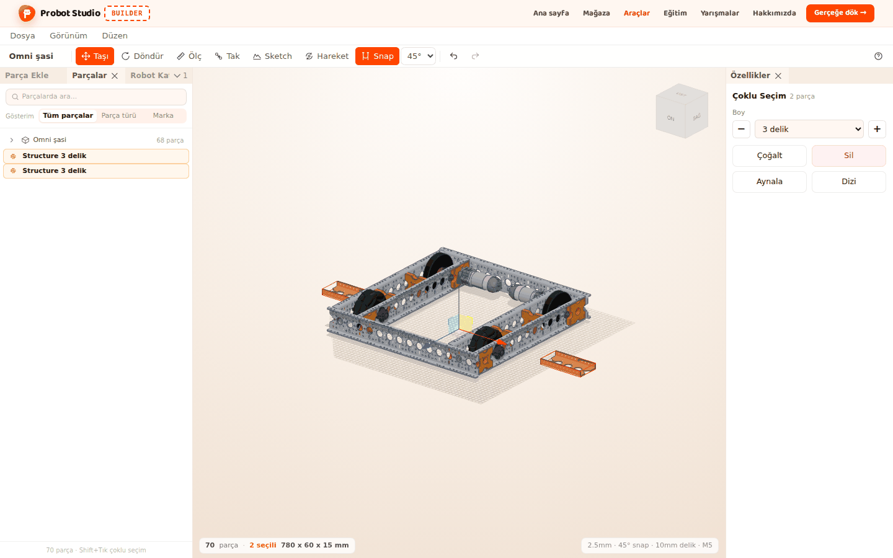
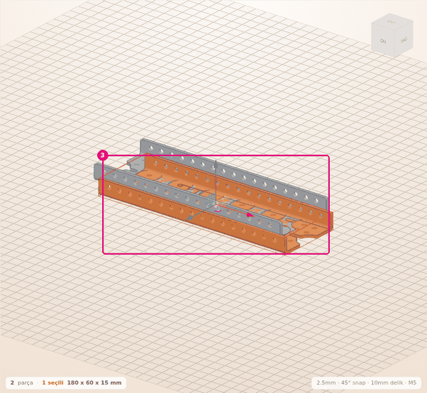
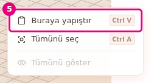
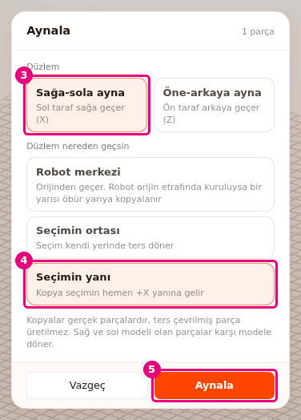
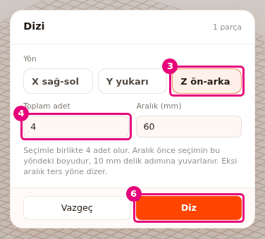

# Parçaları çoğalt, aynala ve diz

Bu sayfada seçili parçaların kopyasını yapacaksın. Kopyayı yanına koyacak, istediğin noktaya
yapıştıracak, ayna kopyasını alacak ve eşit aralıkla sıraya dizeceksin.

<!-- CAPTURE: url=https://probotstudio.com/builder/ | hazirla=hazir:Omni şasi + Structure ve ayna kopyası | hedef=body | isaret=yok | bekle=canvas -->

## Başlamadan önce

- Sahne boş. **Parça Ekle** > **Yapı** > **Structure** > **5 delik** eklendi ve seçili
  (bkz. [Parça ekle](parca-ekle.md)).
- Aynala bölümü için **Parça Ekle** > **Tekerlekler** > **Mecanum Teker** > **Sol** de eklenecek.
- **Ölç**, **Tak** ve **Sketch** kapalı. Bunlar açıkken <kbd>A</kbd> ve <kbd>D</kbd> pencere açmaz.

## Seçimi çoğalt

1. **Sahne**de Structure parçasını seç.
2. **Düzen** > **Çoğalt**'ı seç (<kbd>Ctrl</kbd>+<kbd>D</kbd>).
3. Yeni parçaya bak. Kopya aslından X ve Z yönünde 20 mm kayık durur.
   
   <!-- CAPTURE: url=https://probotstudio.com/builder/ | hazirla=boş sahne, Structure 5 delik eklendi, Ctrl+D ile çoğaltıldı | hedef=koordinat:kopya-parca | isaret=3 | bekle=text="2 parça" -->
   <!-- SAY: Seçili parçayı çoğaltıyoruz ve kopya aslının yanına konuyor. -->

Sonuç: Durum şeridinde "2 parça · 1 seçili" yazar. Seçili olan kopyadır.

- Çoğalt bağlam menüsünde (**Çoğalt**) ve **Özellikler** panelinde (**Çoğalt**) de vardır.
- Birden çok parça seçiliyse hepsi birlikte çoğalır. Gruplar kopyada da grup kalır.
- Çoğalt seçimi panoya da kopyalar. Önceki kopyalaman panodan silinir.

## Kopyala ve yapıştır

1. **Sahne**de Structure parçasını seç.
2. Parçaya sağ tıkla. Bağlam menüsü açılır.
3. Menüde **Kopyala**'yı seç (<kbd>Ctrl</kbd>+<kbd>C</kbd>). Köşede "1 parça kopyalandı" yazar.
4. **Sahne**de boş bir yere sağ tıkla.
5. Menüde **Buraya yapıştır**'ı seç.
   
   <!-- CAPTURE: url=https://probotstudio.com/builder/ | hazirla=boş sahne, Structure 5 delik kopyalandı, boş alana sağ tık | hedef=text="Buraya yapıştır" | isaret=5 | bekle=text="Buraya yapıştır" -->
   <!-- SAY: Kopyaladığımız parçayı sağ tıkladığımız noktaya yapıştırıyoruz. -->

Sonuç: Kopya sağ tıkladığın zemin noktasına konur ve seçili olur. Yüksekliği aslıyla aynıdır.

- <kbd>Ctrl</kbd>+<kbd>V</kbd> kopyayı aslından X ve Z yönünde 20 mm kayık koyar. Her
  <kbd>Ctrl</kbd>+<kbd>V</kbd> aynı yere koyar. Kopyaları ayırmak için taşı ya da **Buraya yapıştır**'ı kullan.
- Pano boşsa **Buraya yapıştır** soluktur.
- Pano sayfa yenilenince boşalır.

## Ayna kopyası al

**Aynala** penceresi seçimin sağ-sol ya da ön-arka ayna kopyasını yapar. Sağ ve sol modeli olan
parçalar karşı modele döner: **Mecanum Teker Sol**'un aynası **Mecanum Teker Sağ** olur.

1. **Parça Ekle** > **Tekerlekler** > **Mecanum Teker** > **Sol**'u seç. Teker eklenir ve seçili olur.
2. **Düzen** > **Aynala...**'yı seç (<kbd>A</kbd>). Pencerenin başında "Aynala" ve "1 parça" yazar.
3. **Düzlem** altında **Sağa-sola ayna**'yı seç.
4. **Düzlem nereden geçsin** altında **Seçimin yanı**'nı seç.
5. **Aynala**'ya bas.
   
   <!-- CAPTURE: url=https://probotstudio.com/builder/ | hazirla=boş sahne, Tekerlekler > Mecanum Teker > Sol eklendi ve seçili, A ile Aynala penceresi açık, Sağa-sola ayna ve Seçimin yanı seçili | hedef=[data-testid="ayna-eksen-x"];[data-testid="ayna-merkez-yan"];[data-testid="ayna-uygula"] | isaret=3,4,5 | bekle=[data-testid="ayna-penceresi"] -->
   <!-- SAY: Sol tekeri seçimin yanına aynalıyoruz ve kopya sağ teker olarak geliyor. -->

Sonuç: Tekerin sağına bir **Mecanum Teker Sağ** gelir ve seçili olur. Köşede "1 parça aynalandı, 1 parça sağ ve sol
modeli arasında değişti" bildirimi çıkar. Aynalama tek geri alma adımıdır.

### Aynala penceresindeki seçenekler

| Grup | Seçenek | Ne yapar |
|---|---|---|
| **Düzlem** | **Sağa-sola ayna** | Sol taraf sağa geçer (X ekseni). Varsayılan. |
| **Düzlem** | **Öne-arkaya ayna** | Ön taraf arkaya geçer (Z ekseni). |
| **Düzlem nereden geçsin** | **Robot merkezi** | Düzlem orijinden geçer. Robot orijin etrafında kuruluysa bir yarısı öbür yarıya kopyalanır. Varsayılan. |
| **Düzlem nereden geçsin** | **Seçimin ortası** | Kopya seçimin kendi yerinde, ters dönmüş olarak durur. |
| **Düzlem nereden geçsin** | **Seçimin yanı** | Kopya seçimin bitişiğine gelir. |

Penceredeki not şunu söyler: kopyalar gerçek parçalardır, ters çevrilmiş parça üretilmez. Bu yüzden
sağ-sol modeli olmayan parçanın kopyası en yakın duruşla konur. **Vazgeç** pencereyi kopya
yapmadan kapatır.

<!-- SAY: Ayna düzlemini robotun ortasından ya da seçimin yanından geçirebiliyoruz. -->

## Eşit aralıkla diz

**Dizi** penceresi seçimi bir yönde, eşit aralıkla sıraya dizer.

1. **Sahne**de Structure parçasını seç.
2. **Düzen** > **Dizi...**'yi seç (<kbd>D</kbd>).
3. **Yön** altında **Z ön-arka**'yı seç.
4. **Toplam adet** kutusuna `4` yaz. Sayıya seçimin kendisi de dahildir.
5. **Aralık (mm)** kutusuna `60` yaz.
6. **Diz**'e bas.
   
   <!-- CAPTURE: url=https://probotstudio.com/builder/ | hazirla=boş sahne, Structure 5 delik seçili, D ile Dizi penceresi açık, Z ön-arka seçili, adet 4, aralık 60 | hedef=[data-testid="dizi-eksen-z"];[data-testid="dizi-adet"];[data-testid="dizi-uygula"] | isaret=3,4,6 | bekle=[data-testid="dizi-penceresi"] -->
   <!-- SAY: Aynı parçadan dört tane olsun diye altmış milimetre aralıkla diziyoruz. -->

Sonuç: Ön-arka yönünde 60 mm aralıklı 4 Structure olur. Parçalar üst üste binmez. Dizinin hepsi seçili kalır.

- **Yön** seçenekleri: **X sağ-sol**, **Y yukarı**, **Z ön-arka**.
- **Toplam adet** 2 ile 50 arasıdır. Varsayılan 3'tür.
- **Aralık (mm)** önce seçimin o yöndeki boyudur, 10 mm delik adımına yukarı yuvarlanır. Aralığı
  elle yazmadıysan yön değişince aralık da o yöndeki boya göre değişir. Elle yazdığın aralık yön
  değişince korunur. Eksi aralık ters yöne dizer. Aralık en çok 2000 mm olur.
- Bir dizi en çok 1000 parça ekler.
- Değerler geçersizse kutuların altında kırmızı yazı çıkar ve **Diz** soluk kalır.

## Pencere açıkken

**Aynala** ve **Dizi** penceresi açıkken diğer kısayollar çalışmaz. <kbd>Esc</kbd> ya da pencerenin
dışına basmak pencereyi kapatır. Son uyguladığın düzlem, konum, yön ve adet
(**Aynala** ya da **Diz**'e bastığında) bu oturumda hatırlanır. **Vazgeç**, <kbd>Esc</kbd> ya da
dışarı tıklayarak kapatırsan değişiklikler saklanmaz.
Sayfayı yenileyince varsayılana döner. Aralık her açılışta seçime göre yeniden hesaplanır.

Pencereyi açmanın yolları: **Düzen** menüsü, parçaya sağ tık (**Aynala...**, **Dizi...**),
**Özellikler** panelindeki **Aynala** ve **Dizi**, <kbd>A</kbd> ve <kbd>D</kbd> tuşları.

<!-- SAY: Bir sonraki parçayı aynalarken son seçtiğimiz ayarlar hazır geliyor. -->

## Sorun mu var?

- **<kbd>A</kbd> ya da <kbd>D</kbd> pencere açmıyor:** Önce bir parça seç. **Ölç**, **Tak** ya da
  **Sketch** açıksa kapat.
- **"Adet 2 ile 50 arasında olmalı" yazıyor:** **Toplam adet** kutusuna 2 ile 50 arasında tam sayı yaz.
  Bkz. [Sorun giderme](sorunlar.md#dizi-deger-siniri).
- **"Aralık 0 olamaz" yazıyor:** **Aralık (mm)** kutusuna sıfırdan farklı bir sayı yaz.
  Bkz. [Sorun giderme](sorunlar.md#dizi-deger-siniri).
- **"Seçim ayna düzleminde ve kendi aynası, kopya gerekmedi" yazıyor:** Seçim zaten simetrik ve
  düzlemin üstünde. **Düzlem nereden geçsin** altında **Seçimin yanı**'nı seç.
  Bkz. [Sorun giderme](sorunlar.md#ayna-duzleminde).
- **"... için tam ayna parçası yok. En yakın duruşla kondu, kontrol et" yazıyor:** Parçanın karşı
  modeli yok. Kopyanın duruşuna bak, gerekirse döndür.
  Bkz. [Sorun giderme](sorunlar.md#tam-ayna-parcasi-yok).
- **"Parça modeli yüklenemedi, aynalanmadı" yazıyor:** Sayfanın internet bağlantısını kontrol et ve
  yeniden dene. Bkz. [Sorun giderme](sorunlar.md#aynalanmadi).
- **Yapıştırdığım kopyalar üst üste duruyor:** Her <kbd>Ctrl</kbd>+<kbd>V</kbd> aynı yere koyar.
  **Buraya yapıştır** ile yer seç.

## Sonraki adım

- [Parçaları grupla ve birbirine bağla](grupla-ve-bagla.md)
- [Parçaları deliklerinden tak](parcalari-tak.md)
