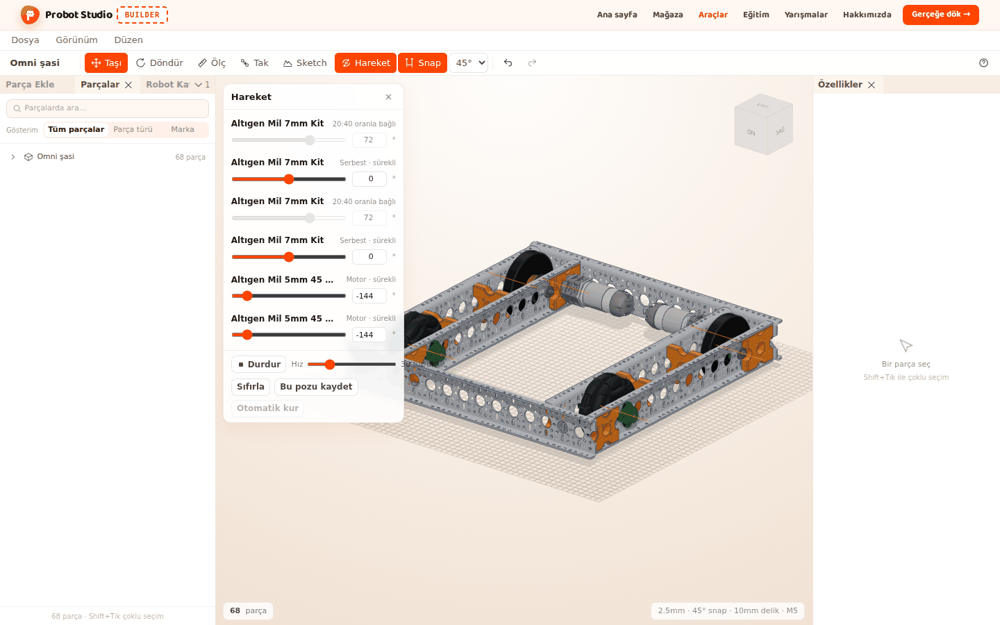
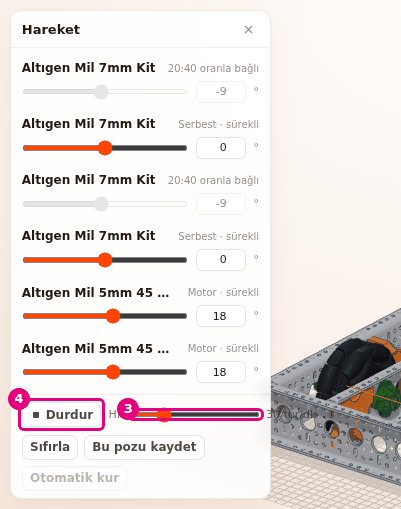
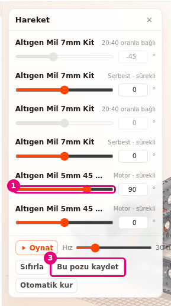
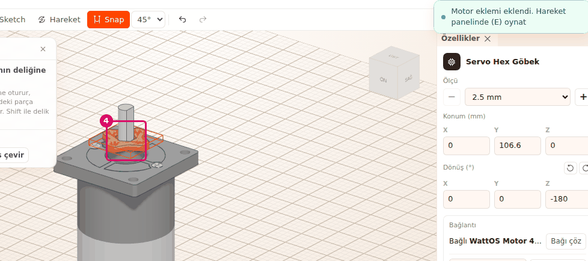
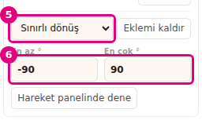

# Eklem kur ve hareketi dene

Bu sayfada **Hareket** paneliyle robotun motorlarını döndürecek, eklemleri elle oynatacak ve yeni
eklem kuracaksın. Eklem, bağlı iki parça arasındaki dönme hareketidir.

<!-- CAPTURE: url=https://probotstudio.com/builder/ | hazirla=hazir:Omni şasi, Hareket paneli açık, motorlar döndürülmüş | hedef=body | isaret=yok | bekle=canvas -->

## Başlamadan önce

- Sahnede Omni şasi açık (bkz. [Hazır robotla başla](hazir-robotla-basla.md)).
- Omni şasi yüklenirken 6 eklemi kendiliğinden kurulur: iki motor mili ve dört teker mili. Bir
  uçtaki iki kauçuk tahrik tekeri motorlara dişliyle (20:40) bağlıdır. Öbür uçtaki omni tekerler
  serbest döner.
- Eklem bir bağın üstüne kurulur. Bağı bilmiyorsan önce
  [Parçaları grupla ve birbirine bağla](grupla-ve-bagla.md) sayfasına bak.

## Motorları döndür

1. **Araç çubuğu**nda **Hareket**'e bas (<kbd>E</kbd>). **Sahne**nin köşesinde **Hareket** paneli
   açılır. Her eklem bir satırdır.
2. Panelde **Oynat**'a bas. Motorlar döner, tahrik tekerleri dişliyle birlikte döner.
3. **Hız** kaydırıcısını sürükle. Hız 5 ile 120 tur/dk arasında, 5'er adımla değişir. Başta 30
   tur/dk'dır.
4. **Durdur**'a bas.
   
   <!-- CAPTURE: url=https://probotstudio.com/builder/ | hazirla=hazir:Omni şasi; Hareket paneli açık; Oynat'a basılmış, oynuyor | hedef=[data-testid="hareket-hiz"];[data-testid="hareket-oynat"] | isaret=3-4 | bekle=[data-testid="hareket-paneli"] -->
   <!-- SAY: Oynat ile motorları döndürüyoruz, tekerler dişliler sayesinde onlarla birlikte dönüyor. -->

Sonuç: Hareket durur ve açılar oynatmadan önceki hâline döner.

Satırın sağında eklemin türü yazar:

| Yazı | Anlamı |
|---|---|
| "Motor · sürekli" | Motor miline takılı, sürekli döner. |
| "Servo · 300°" | Servo miline takılı, bu açı aralığında gidip gelir. |
| "20:40 oranla bağlı" | Başka bir eklemle dişli ya da kasnakla eşleşmiş, onunla döner. |
| "Serbest · sürekli" / "Serbest · sınırlı" | Motor sürmez, yalnız elle oynar. |

**Oynat**'ta motorlar seçtiğin hızla döner, servolar açı aralığının bir ucundan öbürüne gider.
<kbd>Esc</kbd> önce oynatmayı durdurur, ikinci basışta paneli kapatır. **Hız** kaydırıcısını, bir
satırın kaydırıcısını ya da açı kutusunu yeni kullandıysan önce boş bir yere tıkla: odak bunlardayken
<kbd>Esc</kbd> çalışmaz.

## Eklemi elle oynat ve pozu kaydet

1. **Hareket** panelinde bir satırın kaydırıcısını sürükle ya da yanındaki kutuya açıyı yaz (°).
2. Satırın başındaki parça adına bas (**Parçayı seç**). Parça **Sahne**de seçilir.
3. **Bu pozu kaydet**'e bas.
   
   <!-- CAPTURE: url=https://probotstudio.com/builder/ | hazirla=hazir:Omni şasi; Hareket paneli açık; ilk "Altıgen Mil 5mm 45 mm" satırının kaydırıcısı 90'a çekilmiş | hedef=[data-testid="hareket-kaydirici"];[data-testid="hareket-kaydet"] | isaret=1,3 | bekle=[data-testid="hareket-paneli"] -->
   <!-- SAY: Kaydırıcıyla eklemi istediğimiz açıya getiriyoruz ve bu pozu kalıcı olarak kaydediyoruz. -->

Sonuç: "Poz kaydedildi, Geri al ile dönebilirsin" bildirimi çıkar. Parçalar yeni yerinde kalır.

- Sürekli eklemin kaydırıcısı -180° ile 180° arasındadır. Sınırlı eklemde **En az °** ile **En çok °**
  arasındadır.
- Oranla bağlı satırın kaydırıcısı soluktur. O eklem, onu süren eklemle birlikte döner.
- **Sıfırla** bütün açıları 0'a döndürür.
- Paneli kapatınca kaydetmediğin poz silinir, parçalar kayıtlı yerine döner. Oynarken **Bu pozu
  kaydet**'e basarsan o anki poz kaydedilir.

## Tekeri motor miline takarak eklem kur

Teker, dişli, göbek ya da kasnağı **Tak** ile bir motorun ya da servonun miline takarsan eklem
kendiliğinden kurulur. Motorda sürekli dönüş, servoda sınırlı dönüş eklemi gelir.

1. **Sahne**de motoru ve takacağın parçayı yan yana getir.
2. **Araç çubuğu**nda **Tak**'a bas (<kbd>B</kbd>).
3. Takacağın parçanın düz yan yüzüne, ortasına yakın bir yere tıkla. Ortadaki boşluğa tıklama.
4. Motorun miline tıkla. Parça mile oturur.
   
   <!-- CAPTURE: url=https://probotstudio.com/builder/ | hazirla=boş sahne; Parça Ekle > Motor ve Servo > WattOS Motor 480 RPM; Parça Ekle > Göbek & Mil > Servo Hex Göbek; Tak ile göbek motor miline takılmış | hedef=koordinat:motor-mili | isaret=4 | bekle=text="Motor eklemi eklendi" -->
   <!-- SAY: Parçayı motorun miline takıyoruz ve Builder eklemi kendisi kuruyor. -->
5. Aracı kapatmak için <kbd>Esc</kbd>'e iki kez bas. İlk basış son bağlantının ince ayarını bitirir,
   ikincisi aracı kapatır. Tak panelindeki **×** de aracı tek basışta kapatır. **Araç çubuğu**nda
   **Tak**'a yeniden basmak ya da <kbd>B</kbd> de aracı kapatır.

Sonuç: "Motor eklemi eklendi. Hareket panelinde (E) oynat" bildirimi çıkar (servoda "Servo eklemi
eklendi..."). **Hareket** panelinde yeni bir satır görünür.

Eklem yalnız tıkladığın delik motorun çıkış ekseni üstündeyse kurulur. Kurulmadıysa parça yine de
motora bağlanır, eklemi **Özellikler**'den eklersin.

## Özellikler'den eklem ekle ve sınırla

Eklem eklemek için parça önce bir parçaya bağlı olmalı. Bu örnekte Omni şasinin motor milinin
eklemini kaldırıp yeniden kuracaksın.

1. **Hareket** panelinde "Altıgen Mil 5mm 45 mm" satırlarından birinin adına bas. **Özellikler** panelinde
   **Bağlantı** alanında "Bağlı REV HD Hex Motor" ve **Sürekli dönüş** yazar.
2. **Eklemi kaldır**'a bas. Bağ kalır, eksen seçici ve **Eklem ekle** gelir.
3. Eksen seçicide ekseni seç (bu milde "altıgen soket Ø9").
4. **Eklem ekle**'ye bas. "Eklem eklendi. Hareket panelinde (E) oynat" bildirimi çıkar.
5. Eklem türü listesinden **Sınırlı dönüş**'ü seç.
6. **En az °** kutusuna `-90`, **En çok °** kutusuna `90` yaz ve <kbd>Enter</kbd>'a bas.
   
   <!-- CAPTURE: url=https://probotstudio.com/builder/ | hazirla=hazir:Omni şasi; Hareket paneli açık; ilk "Altıgen Mil 5mm 45 mm" seçili; eklem Sınırlı dönüş, -90 / 90 | hedef=[data-testid="eklem-turu"];[data-testid="eklem-min"] | isaret=5-6 | bekle=[data-testid="eklem-alani"] -->
   <!-- SAY: Eklemin türünü sınırlı dönüş yapıyoruz ve en az ile en çok açıyı yazıyoruz. -->

Sonuç: **Hareket** panelinde bu milin kaydırıcısı -90° ile 90° arasında oynar.

!!! warning "Dikkat"
    Motor milinin eklemini kaldırınca bu mile bağlı 20:40 dişli eşleşmesi de silinir. Eklemi yeniden
    kursan da eşleşme geri gelmez, **Otomatik kur** da kurmaz ("Eklemler zaten kurulu"). Tahrik tekeri
    artık **Oynat** ile dönmez, satırında "Serbest · sürekli" yazar. Eşleşmeyi geri kurmak için
    **Parçalar** sekmesinde `40 diş` ara, bu motorun karşısındaki "Dişli 7mm Altıgen 40 diş"i seç ve
    **Bağlantı** alanında **Süren dişliyi seç** listesinden "Dişli 5mm Altıgen 20 diş · 20:40"yi seç
    (bkz. aşağıdaki bölüm). İstersen **Düzen** > **Geri al** ile adımları tek tek geri al.

- **En az °** -360 ile 0, **En çok °** 0 ile 360 arasında olabilir.
- Servo miline takılı parçada **Sınırlı dönüş** servonun açı aralığıyla başlar. Servonun açısı
  bilinmiyorsa "Bu servonun açısı veride yok, 180° varsayıldı" yazar.
- **Hareket panelinde dene** **Hareket** panelini açar.
- Eklem bir dişli eşleşmesiyle sürülüyorsa eklem türü listesi soluktur.

## Dişliyi ya da kasnağı süren parçayla eşleştir

Eşleşme, bir eklemi dişli ya da kasnak oranıyla başka bir eklemle birlikte döndürür. Omni şasideki
20:40 dişli bağı böyle bir eşleşmedir.

Kendi eklemi olan ya da eklemli bir parçaya bağlı dişli ya da kasnak seçince **Bağlantı** alanında **Süren dişliyi seç** (kasnakta
**Süren kasnağı seç**) listesi çıkar. Listede eşleşebilecek parçalar oranlarıyla yazar (ör.
"Dişli 5mm Altıgen 20 diş · 20:40"). Birini seçince "20:40 dişli eşleşmesi kuruldu" bildirimi çıkar.

Eşleşme kuruluysa alanda "20:40 oranla X ile döner" yazar. Eşleşmeyi silmek için yanındaki
**Kaldır**'a bas. Omni şaside bunu görmek için **Parçalar** sekmesinde `40 diş` ara ve dişliyi seç.
Dişlinin kendi eklemi yok, milin eklemiyle döner. Bu yüzden eşleşme satırının üstünde "Ortak eksen
bulunamadı..." yazısı da görünür. Bu bir hata değil.
<!-- SAY: Dişliyi onu döndüren dişliyle eşleştiriyoruz, böylece motor dönünce bu dişli de oranına göre dönüyor. -->

## Eklemleri otomatik kur

**Hareket** panelinde **Otomatik kur**'a bas. Eklem yoksa panelde **Eklemleri otomatik kur** görünür.
Builder mil ve delik verisine bakar, bağsız dönen parçalara bağ, eklem ve eşleşme kurar. Kurulu
bağlara dokunmaz, tek adımda geri alınır.

Bildirim sonucu söyler: "6 eklem, 2 eşleşme kuruldu", "Eklemler zaten kurulu" ya da "Kurulacak eklem
bulunamadı". Karar verilemeyen yerler varsa sonuna "N belirsiz durum atlandı" eklenir. Oynatma
sürerken **Otomatik kur** soluktur.
<!-- SAY: Otomatik kur parçaların mil ve delik bilgisinden eklemleri kendisi kuruyor. -->

## Sorun mu var?

- **Panelde "Henüz eklem yok..." yazıyor:** **Eklemleri otomatik kur**'a bas ya da tekeri **Tak** ile
  motor miline tak.
- **Oynat soluk, ipucunda "Motor ya da servo eklemi yok" yazıyor:** Hiçbir eklem bir motor ya da
  servo milinde değil. Tekeri motor miline **Tak** ile bağla.
  Bkz. [Sorun giderme](sorunlar.md#motor-eklemi-yok).
- **"Ortak eksen bulunamadı. Eklem için iki parçanın deliği aynı eksende olmalı ya da parça motor
  veya servo miline takılı olmalı" yazıyor:** Parça (ör. dişli ya da teker) eklemli bir mile
  eklemsiz bağlıysa ve mille birlikte dönüyorsa bu yazı normaldir, bir şey yapma. Parçanın kendi
  eklemi olması gerekiyorsa delikleri aynı eksende değildir. **Bağlantı** alanında **Bağı çöz**'e bas
  (ya da **Düzen** > **Geri al**'ı seç). Sonra parçayı **Tak** ile motor miline ya da deliğini öbür
  parçanın deliğiyle aynı eksene tak ve **Hareket** panelinde **Otomatik kur**'a bas. Bkz. [Sorun giderme](sorunlar.md#ortak-eksen-yok).
- **"Eşleşecek dişli yok. Diğer parçanın da eklemi olmalı ve eksenleri paralel olmalı" yazıyor:**
  Öbür dişlinin de eklemi olmalı. Önce ona eklem kur.
  Bkz. [Sorun giderme](sorunlar.md#eslesecek-disli-yok).
- **Bir satırın kaydırıcısı soluk:** Eklem oranla bağlı. Onu süren eklemi oynat.
- **Durdur'a ya da kapatmaya basınca poz geri döndü:** Panel kayıtlı pozu değiştirmez. Önce **Bu pozu
  kaydet**'e bas.
- **Hareket paneli kendiliğinden kapandı:** **Ölç**, **Tak**, **Sketch** ya da **Adım adım kur** açılınca
  (bir sketch'i düzenlemeye başlayınca da) panel kapanır.

## Sonraki adım

- Kasnakları kayışla bağla: [İki kasnağa kayış ekle](kayis-ekle.md)
- Motora port ver: [Motor ve servoya ad ve port ver](motor-ve-servo-ayarla.md)
- Robotu sürerek dene: [Robotu Sim'de dene](simde-dene.md)
