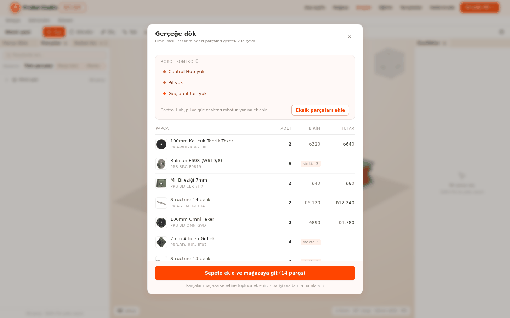
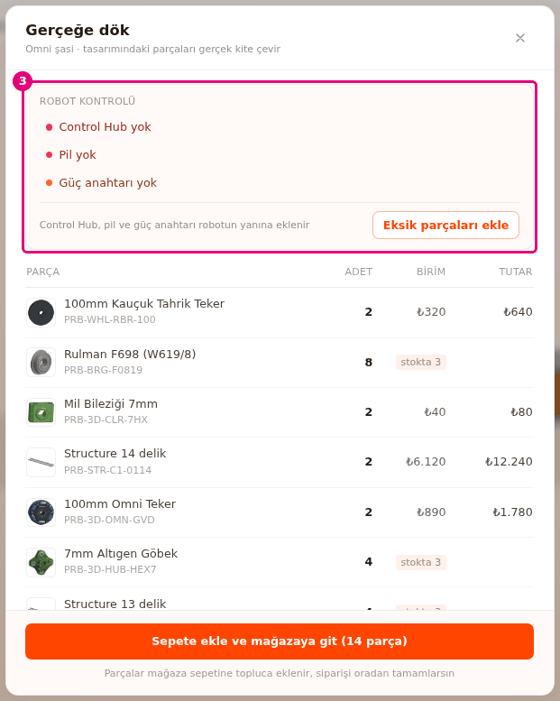
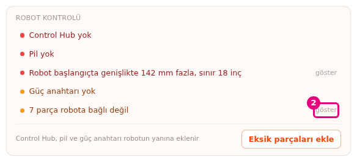
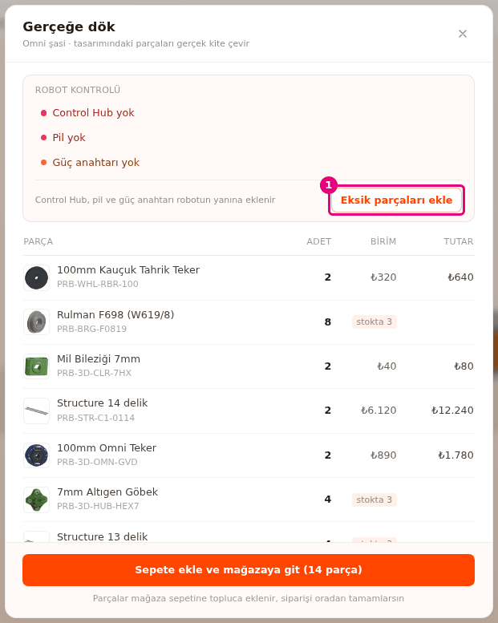
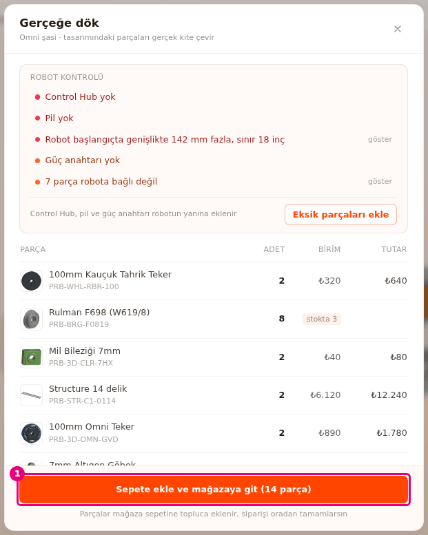

# Gerçeğe dök: parça listesini sepete aktar

Bu sayfada tasarımındaki parçaları listeleyip robot kontrolünden geçireceksin. Sonra listeyi tek
seferde mağaza sepetine aktaracaksın.

<!-- CAPTURE: url=https://probotstudio.com/builder/ | hazirla=hazir:Omni şasi, Gerçeğe dök penceresi açık, fiyatlar yüklenmiş | hedef=body | isaret=yok | bekle=text^="Sepete ekle ve mağazaya git" -->

## Başlamadan önce

- Sahnede bir robot var. Hazır örnekle başlamak için "Sahne boş" kartında **Omni şasi**'ye bas
  (bkz. [Hazır robotla başla](hazir-robotla-basla.md)). Bu şaside Control Hub, pil ve güç anahtarı
  yoktur, robot kontrolünü denemek için uygundur.
- İnternet bağlantın açık. Fiyat ve stok, pencere açılınca mağazadan alınır.
- Builder için hesap gerekmez. Siparişi mağazada tamamlarsın.

## Gerçeğe dök penceresini aç

1. **Üst şerit**te **Gerçeğe dök →**'e bas.
   Pencerenin başında "Robot kontrol ediliyor" yazar, kontrol birkaç saniyede biter.
2. Pencerenin başlığını kontrol et.
3. Fare tekerleğiyle pencerede aşağı in. Robot kontrolünün altında parça tablosu durur.
   
   <!-- CAPTURE: url=https://probotstudio.com/builder/ | hazirla=hazir:Omni şasi, Gerçeğe dök penceresi açık | hedef=[data-ftc-kontrol] | isaret=3 | bekle=text="Robot kontrolü" -->
   <!-- SAY: Gerçeğe dök düğmesiyle tasarımdaki parçaların listesini açıyoruz. -->

Sonuç: "Gerçeğe dök" penceresi açılır. Başlığın altında "<proje adı> · tasarımındaki parçaları gerçek
kite çevir" yazar. Altında robot kontrolü ve parça tablosu durur.

Aynı pencereyi **Derleme** panelindeki **Fiyat teklifi al** de açar (bkz. [Robotu derle](robotu-derle.md)).

## Robot kontrolünü oku

Robot kontrolü FTC yarışma kurallarının temel maddelerine bakar. Kontrol sepete eklemeyi engellemez.
Oyun elemanları kontrole girmez.

1. Pencerenin başındaki kontrol kutusunun başlığını oku.
2. "ROBOT KONTROLÜ" listesinde bir satırın sonundaki **göster**'e bas.
   
   <!-- CAPTURE: url=https://probotstudio.com/builder/ | hazirla=hazir:Omni şasi, Gerçeğe dök penceresi açık, bir şasi parçası robottan uzağa taşınmış | hedef=[data-ftc-sorun="floating"] >> text="göster" | isaret=2 | bekle=[data-ftc-sorun] -->
   <!-- SAY: Göster yazısına basınca pencere kapanıyor ve sorunlu parçalar sahnede seçiliyor. -->
3. **Sahne**de seçilen parçaları robota taşı ya da tak (bkz. [Parçaları deliklerinden tak](parcalari-tak.md)).
4. **Üst şerit**te **Gerçeğe dök →**'e yeniden bas.

Sonuç: Düzelttiğin satır kontrol listesinden kalkar. **göster** pencereyi kapatıp ilgili parçaları
seçer ve kamerayı onlara çevirir.

| Başlık | Ne zaman |
|---|---|
| "Robot kontrol ediliyor" | Parça modelleri yüklenirken. |
| "Robot kontrolden geçti" | Hiç sorun yok. |
| "ROBOT KONTROLÜ" | En az bir satır var. Satırlar hatayla başlar. |

| Satır | Tür | Ne demek |
|---|---|---|
| "Control Hub yok" | Hata | Robotta Control Hub yok. |
| "Pil yok" | Hata | Robotta pil yok. |
| "Güç anahtarı yok" | Uyarı | Robotta ana güç anahtarı yok. |
| "Robotta N motor var, sınır 8" | Hata | En çok 8 motor kullanılabilir. |
| "Robotta N servo var, sınır 8" | Hata | En çok 8 servo kullanılabilir. |
| "Robot başlangıçta genişlikte N mm fazla, sınır 18 inç" | Hata | Robot başlangıç boyutunu (18 inç, 457,2 mm) aşıyor. Uzunluk ve yükseklik için "uzunlukta", "yükseklikte" yazar. |
| "<parça adı> robota bağlı değil" / "N parça robota bağlı değil" | Uyarı | Bu parçalar robotun geri kalanına değmiyor. |
| "<parça> robotun yanında, yerlerini sen seç" | Bilgi | **Eksik parçaları ekle** ile gelen parçaları henüz taşımadın. |

Bazı parça modelleri yüklenemezse boyut satırının sonuna "(bazı modeller yüklenemedi, ölçü yaklaşık)"
eklenir. **göster** yalnız belirli parçalara bağlı satırlarda çıkar.

## Eksik parçaları ekle

Control Hub, pil ya da güç anahtarı yoksa kontrol listesinin altında **Eksik parçaları ekle** çıkar.
Yanında hangi parçaların ekleneceği yazar (ör. "Control Hub, pil ve güç anahtarı robotun yanına
eklenir").

1. "Gerçeğe dök" penceresinde **Eksik parçaları ekle**'ye bas. Ekranın köşesinde "... eklendi,
   yerlerini sen seç" bildirimi çıkar.
   
   <!-- CAPTURE: url=https://probotstudio.com/builder/ | hazirla=hazir:Omni şasi, Gerçeğe dök penceresi açık | hedef=text="Eksik parçaları ekle" | isaret=1 | bekle=text="Eksik parçaları ekle" -->
   <!-- SAY: Eksik parçaları tek düğmeyle robotun yanına ekliyoruz. -->
2. Pencerenin çarpısına (×) basarak pencereyi kapat.
3. **Sahne**de eklenen parçayı seç ve **Taşı** ile robotun üstüne yerleştir (bkz.
   [Parçayı taşı ve döndür](tasi-ve-dondur.md)).
4. **Üst şerit**te **Gerçeğe dök →**'e yeniden bas.

Sonuç: Eklenen parçalar tabloda görünür. Kontrol satırlarından "Control Hub yok", "Pil yok" ve
"Güç anahtarı yok" kalkar.

Parçayı taşımadıkça kontrolde "... robotun yanında, yerlerini sen seç" satırı kalır. Taşınmamış
parçalar boyut ve bağlantı kontrolüne girmez.

## Parça tablosunu oku

Tablonun sütunları **PARÇA**, **ADET**, **BİRİM** ve **TUTAR**'dır. Her parça türü bir satırdır.
Boyu ayarlanan parçalarda her boy ayrı satırdır, adın sonuna boy eklenir (ör. ", 25 mm").
<!-- SAY: Tabloda her parçanın adedini, birim fiyatını ve tutarını görüyoruz. -->

| Sütun | Ne yazar |
|---|---|
| **PARÇA** | Parçanın adı, altında ürün kodu. |
| **ADET** | Sahnedeki adet. Paketle satılan parçada altında "N paket" yazar. |
| **BİRİM** | Birim fiyat. Paketle satılan parçada altında "10'lu paket" gibi paket boyu yazar. |
| **TUTAR** | Birim fiyat ile sepete giden miktarın çarpımı. |

Fiyatlar mağazadan canlı gelir ve değişebilir.

**BİRİM** sütununda fiyat yerine şunlar çıkabilir:

| Metin | Ne demek |
|---|---|
| "…" | Fiyat mağazadan yükleniyor. |
| "fiyat yakında" | Mağazada bu parçanın fiyatı girilmemiş. Satır sepete gitmez. |
| "stokta yok" | Mağazada stok yok. Satır sepete gitmez. |
| "stokta N" | Stok, gereken miktardan az. Paketle satılan parçada "stokta N paket" yazar. Satır sepete gitmez. |
| "Çok yakında" | Fiyatlar gösterilmiyor. |

Hesaplama kuralları:

- **Paketle satılan parçalar** (cıvata, somun gibi): Paket sayısı = ⌈adet / paket boyu⌉, yani yukarı
  yuvarlanır. 10'lu pakette 23 cıvata 3 paket eder. Sepete paket sayısı gider.
- **Boyu kesilen mil:** Mağazada tam boy çubuk olarak satılan mili kısaltırsan, kestiğin parçaların
  toplam boyu çubuk sayısına yukarı yuvarlanır. Bir çubuktan çıkan dört kısa mil 1 adet sayılır.
- **Mağazada satılmayan parçalar** tablonun sonunda soluk görünür, fiyatsızdır. Altında "Probot
  üzerinden temin edilir", "Probot'ta yok, dışarıdan temin edilir" ya da "mağazada satılmıyor" yazar.

Tablonun altında iki ayrı bölüm çıkabilir:

| Bölüm | Açıklama | İçinde ne var |
|---|---|---|
| "ÖZEL PARÇALAR" | "Mağazada yok, kendin üretirsin. Toplama girmez" | Temel şekillerle ya da Sketch/Extrude ile yaptığın ve içe aktardığın parçalar. Ad, ölçü ve adet. İçe aktarılan parçada ölçünün önünde dosya adı da yazar. Tek başına duran Delik şekilleri ve sketch'ler listeye girmez. |
| "MAĞAZADA OLMAYAN KAYIŞLAR" | "Mağazada bu boyda kayış yok. Sepete ve toplama girmez" | "Kayış HTD5M N mm, AT ve BT kasnak" satırları. Altında öneri yazar. |

Kayış satırındaki öneri şu biçimlerden biridir: "Mağazadaki en yakın kayış N mm, X mm kısa.
Kasnakları Y mm yaklaştır" ("uzun" ise "uzaklaştır"), "... Bu kasnaklara yetmez" ya da "Mağazada
kayış yok". X kayış boyu farkıdır, Y kasnakların ne kadar taşınacağıdır. Y kabaca X'in yarısıdır. Kasnakları öneriye göre taşırsan kayış mağazadaki kayışla eşleşir ve tabloya geçer
(bkz. [İki kasnağa kayış ekle](kayis-ekle.md)).

Toplam satırında "Toplam" yazar. Hariç tutulan satır varsa parantez içinde nedeni yazar: "Toplam
(fiyatı girilmemiş parçalar hariç)", "Toplam (stokta olmayan parçalar hariç)" ya da ikisi birden
varsa "Toplam (fiyatı girilmemiş ya da stokta olmayan parçalar hariç)".

## Sepete ekle ve mağazaya git

Builder mağazaya aynı sekmede geçer. Çalışman tarayıcıda saklanır. Builder'a dönünce son oturum
açılır ("Son oturum geri yüklendi").

1. "Gerçeğe dök" penceresinin altında **Sepete ekle ve mağazaya git (N parça)**'ya bas. Düğmede
   kısa süre "Sepet hazırlanıyor…" yazar.
   
   <!-- CAPTURE: url=https://probotstudio.com/builder/ | hazirla=hazir:Omni şasi, Gerçeğe dök penceresi açık, fiyatlar yüklenmiş | hedef=text^="Sepete ekle ve mağazaya git" | isaret=1 | bekle=text^="Sepete ekle ve mağazaya git (" -->
   <!-- SAY: Fiyatı ve stoğu olan bütün parçaları tek seferde mağaza sepetine ekliyoruz. -->
2. Mağaza sepetinde parçaları ve adetleri kontrol et.
3. Siparişi mağazada tamamla.

Sonuç: Mağaza sepeti açılır. Fiyatı olan ve stoğu yeten satırlar sepete eklenmiştir. Sepetinde
önceden ürün varsa onlar da kalır.

Düğmedeki N, sepete giden satırların parça adedidir. Sepete gidecek satır yoksa düğme soluktur.
Düğmenin altında "Parçalar mağaza sepetine topluca eklenir, siparişi oradan tamamlarsın" yazar.

## Pencereyi kapat

Pencereyi kapatmanın üç yolu var: pencerenin çarpısına (×) bas, <kbd>Esc</kbd>'e bas ya da
pencerenin dışındaki karartılmış alana bas. Kapatmak tasarımı değiştirmez.
<!-- SAY: Pencereyi çarpıyla ya da Esc tuşuyla kapatıyoruz. -->

## Sorun mu var?

- **"Sahnede parça yok - önce robotunu tasarla" yazıyor:** Sahne boş. Hazır robot yükle ya da parça
  ekle. Düğme bu durumda soluktur. Bkz. [Sorun giderme](sorunlar.md#gercege-dok-sahne-bos).
- **"Mağaza fiyatlarına şu an ulaşılamıyor - liste görünür ama sepete ekleme kapalı. Birazdan tekrar
  dene." yazıyor:** Mağazaya ulaşılamadı. Pencereyi kapatıp bir süre sonra yeniden aç.
  Bkz. [Sorun giderme](sorunlar.md#magaza-fiyatlari).
- **"Sepete ekleme tamamlanamadı. Mevcut sepetin korunuyor; tekrar dene." bildirimi çıktı:** Sepete
  ekleme yarıda kaldı. Sepetinde önceden olan ürünler korunur, bu denemede bazı parçalar eklenmiş
  olabilir. Pencereyi kapatmadan **Sepete ekle ve mağazaya git**'e yeniden bas: eksik kalanlar
  tamamlanır, eklenenler ikinci kez eklenmez.
  Bkz. [Sorun giderme](sorunlar.md#sepete-ekleme-tamamlanamadi).
- **"Bazı parçaların modeli yüklenemedi" bildirimi çıktı:** **Eksik parçaları ekle** sırasında bir
  model gelmedi. Parça yine eklenir. Bağlantını kontrol et.
  Bkz. [Sorun giderme](sorunlar.md#bazi-parcalarin-modeli).
- **Açılışta "Mağaza stoğuna ulaşılamadı - statik katalog kullanılıyor" bildirimi çıktı:** Builder
  canlı stoğu alamadı. Sayfayı yenile. Bkz. [Sorun giderme](sorunlar.md#magaza-stoguna-ulasilamadi).
- **Bir satır sepete gitmiyor:** **BİRİM** sütununda "fiyat yakında", "stokta yok" ya da "stokta N"
  yazıyordur. Bu satırları mağazadan ayrıca takip et.
  Bkz. [Sorun giderme](sorunlar.md#sepete-gitmiyor).
- Diğer uyarılar için bkz. [Sorun giderme](sorunlar.md).

## Sonraki adım

- [Robotu derle](robotu-derle.md)
- [Robotu Sim'de dene](simde-dene.md)
