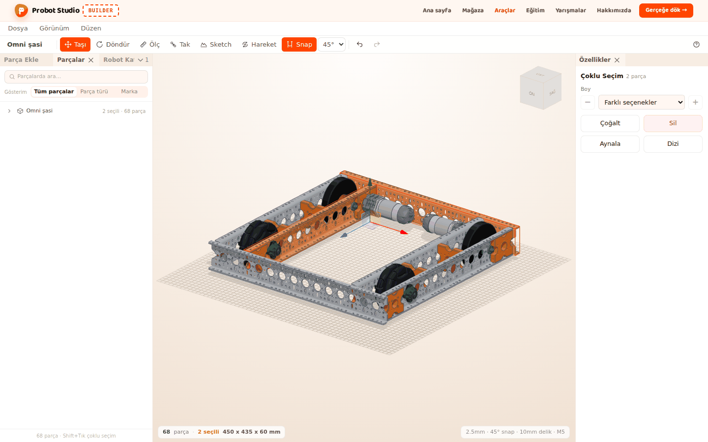
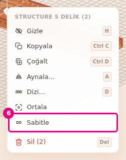
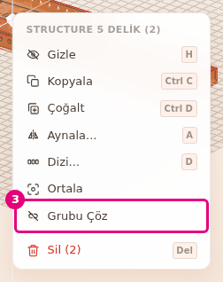
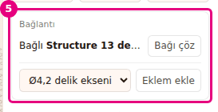
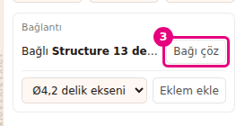

# Parçaları grupla ve birbirine bağla

Bu sayfada parçaları **Sabitle** ile tek grup yapacak ve bir parçayı başka bir parçaya bağlayacaksın.
Grup seçimi kolaylaştırır, bağ ise parçanın kiminle birlikte hareket edeceğini söyler.

<!-- CAPTURE: url=https://probotstudio.com/builder/ | hazirla=hazir:Omni şasi, iki parça Sabitle ile gruplanmış ve seçili | hedef=body | isaret=yok | bekle=canvas -->

## Başlamadan önce

- Sahnede Omni şasi açık (bkz. [Hazır robotla başla](hazir-robotla-basla.md)).
- <kbd>Shift</kbd> ile birden çok parça seçmeyi biliyorsun (bkz.
  [Parçaları seç, gizle ve sil](parcalari-sec-gizle-sil.md)).

## Grup ile bağ arasındaki farkı öğren

İkisi de parçaları bir arada tutar, ama farklı işler yapar.

| | Grup | Bağ |
|---|---|---|
| Nasıl kurulur | Bağlam menüsünde **Sabitle** | **Tak** ile takınca kendiliğinden ya da **Özellikler** > **Bağlantı** > **Bir parçaya bağla** |
| Seçim | Bir üyeye tıklayınca bütün grup seçilir. | Her parça tek başına seçilir. |
| Taşıma | Grup seçili olduğu için hep birlikte taşınır. | Tek yönlü: bağlı olduğu parça taşınınca bağlı parça da gelir. Bağlı parçayı taşımak öbürünü oynatmaz. |
| Silme | **Parçalar** sekmesinde **Grup (n)** satırındaki **Sil** bütün grubu siler. | Bağlı olduğu parça silinirse bağlı parça yerinde kalır, bağı kalkar. |
| Hareket | Eklem kurmaz. | Eklem bağın üstüne kurulur. Sim'e giden robot yapısı da bağlardan çıkar. |
| Nerede görünür | **Parçalar** sekmesinde **Grup (n)** satırı | **Özellikler** > **Bağlantı** alanında "Bağlı X" ya da "N parça buna bağlı" |

Hazır robotlarda dönen parçaların (mil, dişli, teker) bağları robot yüklenirken kurulur.
<!-- SAY: Grup parçaları birlikte seçmemizi sağlıyor, bağ ise bir parçanın hangi parçayla birlikte gideceğini belirliyor. -->

## Parçaları sabitle

**Sabitle** birden çok parçayı tek grup yapar. Menüde görünmesi için en az 2 parça seçili olmalı.

1. **Sol panel**de **Parçalar** sekmesine bas.
2. **Parçalarda ara...** kutusuna `Structure` yaz.
3. Listede ilk Structure satırını seç.
4. <kbd>Shift</kbd> basılı tutup ikinci Structure satırına bas.
5. **Sahne**de seçili parçalardan birine sağ tıkla.
6. Bağlam menüsünde **Sabitle**'yi seç.
   
   <!-- CAPTURE: url=https://probotstudio.com/builder/ | hazirla=hazir:Omni şasi; Parçalar sekmesinde arama "Structure"; ilk iki Structure satırı Shift ile seçili; seçili parçaya sağ tık | hedef=text="Sabitle" | isaret=6 | bekle=text="Sabitle" -->
   <!-- SAY: İki parçayı seçip sağ tık menüsünden sabitliyoruz, artık tek grup gibi davranıyorlar. -->

Sonuç: "Parçalar sabitlendi" bildirimi çıkar. **Parçalar** sekmesinde iki parçanın üstünde "Grup (2)"
satırı görünür.

Seçimde bir grubun yalnız bir kısmı varsa grubun tamamı yeni gruba katılır. Var olan grup yeni
grubun içinde alt grup olarak kalır. Seçim zaten tam bir grupsa **Sabitle** görünmez.

## Gruptaki tek parçayı seç

Gruplu bir parçaya **Sahne**de tıklayınca en dıştaki grubun tamamı seçilir. Aynı parçaya yeniden
tıklarsan bir alt düzeye inersin: önce iç grup, en sonda parçanın kendisi seçilir.

**Parçalar** sekmesinde **Grup (n)** satırına basmak grubu seçer. Grubun altındaki parça satırına
basmak yalnız o parçayı seçer. Satırdaki **Gizle** ve **Sil** simgeleri bütün gruba uygulanır.
<!-- SAY: Gruptaki bir parçaya tekrar tekrar tıklayarak grubun içine iniyoruz ve tek parçayı seçiyoruz. -->

## Grubu çöz

1. **Parçalar** sekmesinde **Grup (2)** satırına bas. Grubun bütün parçaları seçilir.
2. **Sahne**de seçili parçalardan birine sağ tıkla.
3. Bağlam menüsünde **Grubu Çöz**'ü seç.
   
   <!-- CAPTURE: url=https://probotstudio.com/builder/ | hazirla=hazir:Omni şasi; iki Structure Sabitle ile gruplanmış; Parçalar sekmesinde Grup (2) satırı seçili; seçili parçaya sağ tık | hedef=text="Grubu Çöz" | isaret=3 | bekle=text="Grubu Çöz" -->
   <!-- SAY: Grubu seçip sağ tık menüsünden çözüyoruz, parçalar yeniden tek tek seçiliyor. -->

Sonuç: "Grup çözüldü" bildirimi çıkar. **Grup (2)** satırı kalkar, parçalar yerinde durur.

**Grubu Çöz** yalnız seçim tam bir grupsa görünür ve yalnız en dış düzeyi çözer. İç gruplar kalır.

## Bir parçayı başka parçaya bağla

**Tak** ile taktığın parça hedef parçaya kendiliğinden bağlanır. Bağı elle de kurabilirsin.

1. **Sol panel**de **Parça Ekle** sekmesine bas.
2. **Yapı** bölümünü seç, sonra **Structure** satırını seç.
3. Boy listesindeki bir boyu **Sahne**ye sürükle ve şasinin üst yüzüne bırak. Parça seçili olur.
4. **Özellikler** panelinde **Bağlantı** alanındaki **Bir parçaya bağla** listesini aç.
5. Listeden şasinin parçasını seç (ör. **Structure 13 delik**).
   
   <!-- CAPTURE: url=https://probotstudio.com/builder/ | hazirla=hazir:Omni şasi; Parça Ekle > Yapı > Structure bir boy şasinin üst yüzüne bırakılmış ve seçili; Bir parçaya bağla listesinden ilk parça seçilmiş | hedef=[data-testid="baglanti-alani"] | isaret=5 | bekle=[data-testid="bagi-coz"] -->
   <!-- SAY: Yeni parçayı şasiye bağlıyoruz, şasi nereye giderse bu parça da onunla gidiyor. -->

Sonuç: "X hareket edince bu parça da onunla gelir" bildirimi çıkar. **Bağlantı** alanında "Bağlı X"
yazar. Bağlandığın parçayı seçersen onun **Bağlantı** alanında "N parça buna bağlı" yazar. N, o parçaya
doğrudan bağlı bütün parçaların sayısıdır ve senin bağın onu bir artırır. Omni şasi yüklenirken teker
milleri bazı Structure 13 delik profillerine kendiliğinden bağlanır, bu yüzden orada 2 ya da 3
görebilirsin.

Liste yalnız bu parçaya değen parçaları (3 mm payla) gösterir. Değen parça yoksa en yakın parçalar
gelir. Listede en çok 8 parça olur, en yakını en üstte.

## Bağı çöz

!!! warning "Dikkat"
    Bağı çözmek parçanın eklemini de kaldırır. Yanlışlıkla çözdüysen **Düzen** > **Geri al**'ı seç
    (<kbd>Ctrl</kbd>+<kbd>Z</kbd>).

1. **Sahne**de bağlı parçaya tıkla.
2. **Özellikler** panelinde **Bağlantı** alanına bak. "Bağlı X" yazısı görünür.
3. **Bağı çöz**'e bas.
   
   <!-- CAPTURE: url=https://probotstudio.com/builder/ | hazirla=hazir:Omni şasi; şasiye bağlanmış Structure seçili (önceki bölüm) | hedef=[data-testid="bagi-coz"] | isaret=3 | bekle=[data-testid="bagi-coz"] -->
   <!-- SAY: Bağı çözüyoruz, parça yerinde kalıyor ama artık şasiyle birlikte gitmiyor. -->

Sonuç: "Bağlı X" yazısının yerine **Bir parçaya bağla** listesi gelir. Parça yerinde durur.

Birden çok parçanın bağını birlikte çözmek için parçaları seç, birine sağ tıkla ve bağlam menüsünde
**Bağı çöz**'ü seç. Menü öğesi yalnız seçimde bağlı bir parça varsa görünür. Birden çok bağlı parça
varsa adının yanında sayısı yazar: **Bağı çöz (3)**. Bildirim "3 parçanın bağı çözüldü" ya da
"Bağ çözüldü" olur.

## Sorun mu var?

- **Sağ tık menüsünde Sabitle yok:** Tek parça seçili ya da seçim zaten tam bir grup. En az iki
  parça seç.
- **Gruptaki tek parçayı taşıyamıyorum:** Aynı parçaya yeniden tıklayıp alt düzeye in ya da
  **Parçalar** sekmesinde grubun altındaki satırı seç.
- **Bağlantı alanında "Bağlanacak başka parça yok" yazıyor:** Sahnede bağlanacak parça yok ya da
  öbür parçaların hepsi zaten bu parçaya bağlı.
- **Bağlamak istediğim parça listede yok:** Liste değen ya da en yakın 8 parçayı gösterir. Parçayı
  ona değecek şekilde taşı ya da **Tak** ile tak. Liste, bu parçaya doğrudan ya da dolaylı bağlı olan
  parçaları da göstermez. A parçası B'ye bağlıysa B'nin listesinde A çıkmaz. Önce A'nın bağını çöz.
- **Tak sırasında "Hedef parça taşınan parçaya bağlı. Önce Özelliklerden bağı çöz" yazıyor:** Hedef
  parça, taşıdığın parçaya bağlı. Hedefi seç ve **Bağlantı** alanında **Bağı çöz**'e bas.
  Bkz. [Sorun giderme](sorunlar.md#hedef-parca-bagli).

## Sonraki adım

- Bağlı parçayı döndür: [Eklem kur ve hareketi dene](eklem-kur-ve-oynat.md)
- Parçaları delikten tak: [Parçaları deliklerinden tak](parcalari-tak.md)
