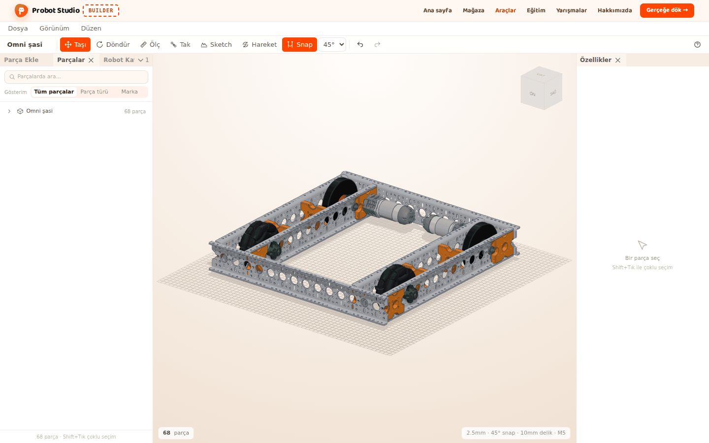
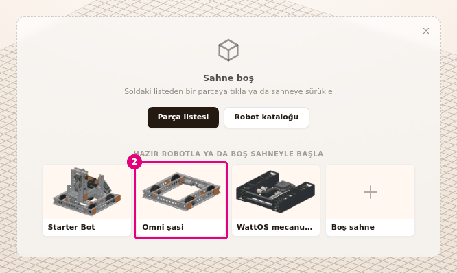
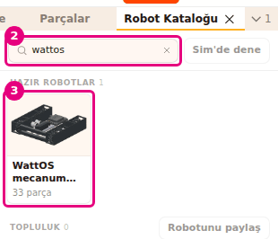
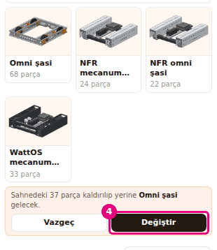
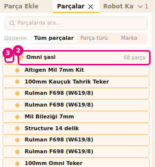

# Hazır robotla başla

Bu sayfada montajı bitmiş bir robotu sahneye yükleyeceksin. Sıfırdan kurmak yerine hazır robotu
açar, inceler ve üstünde değişiklik yaparsın.

<!-- CAPTURE: url=https://probotstudio.com/builder/ | hazirla=hazir:Omni şasi, seçim yok | hedef=body | isaret=yok | bekle=text="68 parça" -->

## Başlamadan önce

- Builder açık: `https://probotstudio.com/builder/`.
- Yükleme sahnedeki her şeyi kaldırır. Sahnede kendi çalışman varsa önce **Dosya** >
  **Kaydet (JSON indir)**'i seç. Bkz. [Dosyaya kaydet ve aç](dosyaya-kaydet-ve-ac.md).

## Hazır robotlar

Builder'da beş hazır robot ve bir tasarım örneği vardır. Adlar ekrandaki gibidir.

| Robot | Zorluk | Parça | Nerede |
|---|---|---|---|
| **Starter Bot** | Orta | 182 parça, 14 montaj adımı | **Robot Kataloğu** (büyük kart), "Sahne boş" kartı |
| **Omni şasi** | Başlangıç | 68 parça | **Robot Kataloğu**, "Sahne boş" kartı |
| **NFR mecanum şasi** | Orta | 24 parça | **Robot Kataloğu** |
| **NFR omni şasi** | Başlangıç | 22 parça | **Robot Kataloğu** |
| **WattOS mecanum şasi** | Orta | 33 parça | **Robot Kataloğu**, "Sahne boş" kartı |
| **Kollu omni robot** | Orta | 148 parça | **Robot Kataloğu** > **TOPLULUK**, "Tasarım örneği" |

Starter Bot omni şasi üstünde intake, feeder ve shooter taşır. Control Hub, pil ve güç anahtarı
da robotun içindedir. Montaj adımı olan tek robot Starter Bot'tur. Bkz.
[Robotu adım adım kur](adim-adim-kur.md).

<!-- SAY: Builder'da beş hazır robot ve bir tasarım örneği bulunuyor. -->

## Boş sahneden robot yükle

Sahne boşken ortada "Sahne boş" kartı durur. Kartın altında üç robot kartı vardır.

1. Tarayıcıda `https://probotstudio.com/builder/` adresini aç. Sahne boşsa ortada "Sahne boş" kartı
   ve altında "HAZIR ROBOTLA YA DA BOŞ SAHNEYLE BAŞLA" satırı durur.
2. **Omni şasi** kartına bas.
   
   <!-- CAPTURE: url=https://probotstudio.com/builder/ | hazirla=temiz tarayıcı, açılış penceresi kapalı, sahne boş | hedef=[data-bos-sahne-robot="omni-sasi"] | isaret=2 | bekle=text="Sahne boş" -->
   <!-- SAY: Boş sahnedeki karttan Omni şasiyi tek tıkla açıyoruz. -->
3. Robot birkaç saniyede sahneye gelir. Tamamını görmek için **Görünüm** > **Sığdır**'ı seç.

Sonuç: Sahnede Omni şasi durur ve kamera robotu kadraja alır. Ekranın köşesindeki bildirimde robotun adı ve
"yüklendi, Ctrl+Z ile geri alabilirsin" yazar. **Araç çubuğu**ndaki proje adı "Omni şasi" olur.

**Boş sahne** kartı robot yüklemez. Kartı kapatır ve **Parça Ekle** sekmesini öne getirir.

## Robot Kataloğu'ndan robot yükle

1. **Sol panel**de **Robot Kataloğu** sekmesini seç.
2. **Robot ara...** kutusuna `wattos` yaz. Liste robot adına ve açıklamasına göre süzülür.
3. **HAZIR ROBOTLAR** bölümünde **WattOS mecanum şasi** kartına bas. Robot sahneye gelir.
   Sahnede parça varsa robot yüklenmez, kartların altında onay çıkar. **Değiştir**'e bas. Bkz.
   aşağıdaki "Sahnedeki robotu başka robotla değiştir" bölümü.
   
   <!-- CAPTURE: url=https://probotstudio.com/builder/ | hazirla=sahne boş, Robot Kataloğu sekmesi önde, arama kutusunda wattos yazılı | hedef=placeholder="Robot ara...";[data-robot-yukle="wattos-mekanum-sasi"] | isaret=2-3 | bekle=[data-catalog-panel] -->
   <!-- SAY: Katalogda robotu adıyla arıyoruz ve kartına basıp yüklüyoruz. -->

Sonuç: Sahnede WattOS mecanum şasi durur. Durum şeridinde "37 parça" yazar: robotun 33 parçası
ve tekerleri süren 4 kayış.

Katalogdaki kartlar iki türlüdür:

- **Büyük kart (Starter Bot):** Zorluk, açıklama, "182 parça · 14 montaj adımı" ve alt sistem
  etiketleri (şasi, intake, feeder, shooter, elektronik) yazar. **Yükle** robotun tamamını sahneye
  koyar. **Adım adım kur** robotu montaj modunda açar.
- **Küçük kartlar:** Resim, ad ve parça sayısı yazar. Kartın tamamına basınca robot yüklenir.

**Robot Kataloğu** sekmesi kapalıysa **Dosya** > **Robot Kataloğu**'nu seç. "Sahne boş" kartındaki
**Robot kataloğu** da sekmeyi öne getirir.

## Sahnedeki robotu başka robotla değiştir

!!! warning "Dikkat"
    **Değiştir** sahnedeki bütün parçaları kaldırır. Kendi eklediğin parçalar da gider. Önce
    **Dosya** > **Kaydet (JSON indir)** ile çalışmanı indir.

1. **Robot ara...** kutusunda yazı kaldıysa (ör. `wattos`), kutunun yanındaki çarpıya
   (**Aramayı temizle**) bas. Liste yeniden bütün robotları gösterir.
2. **Robot Kataloğu** sekmesinde **Omni şasi** kartına bas.
3. Kartların altında çıkan onayı oku: "Sahnedeki N parça kaldırılıp yerine Omni şasi gelecek."
4. Yeni robotu istiyorsan **Değiştir**'e bas. Vazgeçmek için **Vazgeç**'e bas.
   
   <!-- CAPTURE: url=https://probotstudio.com/builder/ | hazirla=hazir:WattOS mecanum şasi yüklü, Robot Kataloğu önde, Omni şasi kartına basılmış | hedef=[data-robot-onay];[data-robot-onayla] | isaret=4 | bekle=[data-robot-onay] -->
   <!-- SAY: Sahne doluyken Builder önce soruyor, biz de Değiştir diyerek onaylıyoruz. -->

Sonuç: Eski parçalar kalkar, sahnede Omni şasi durur.

Starter Bot'ta onay büyük kartın içinde, **Yükle** ve **Adım adım kur**'un yerinde çıkar. Yanlış
hazır robotu yüklediysen **Düzen** > **Geri al**'ı seç (<kbd>Ctrl</kbd>+<kbd>Z</kbd>). Önceki sahne geri gelir.

## Topluluk robotlarını aç

**TOPLULUK** bölümü **HAZIR ROBOTLAR**'ın altındadır. Başlığın yanında robot sayısı yazar. İlk sırada
tasarım örnekleri, sonra incelemeden geçmiş topluluk robotları durur.

- **Tasarım örneği kartı:** **Kollu omni robot** kartının altında "Tasarım örneği · 148 parça" yazar.
  Starter Bot şasisi ve intake'i üstünde servoyla dönen bir kol ve tek servolu küçük bir tutucu taşır.
- **Topluluk robotu kartı:** Altında yazarın adı ve parça sayısı yazar ("{yazar} · N parça").
- Kartlar küçük kartlar gibi çalışır: Karta basınca robot yüklenir, sahne doluysa önce **Vazgeç** /
  **Değiştir** onayı çıkar. Topluluk robotu yüklenince bildirimde robotun adı ve "sahneye yüklendi" yazar.
- Liste uzunsa altta **Daha fazla göster** çıkar. Basınca sonraki robotlar gelir.
- **Robot ara...** topluluk robotlarını adına ve yazarına göre de süzer.

Kendi robotunu topluluğa göndermek için bkz. [Hesabına kaydet ve paylaş](hesaba-kaydet-ve-paylas.md).

<!-- SAY: Topluluk bölümünde şimdilik bir tasarım örneği var, Kollu omni robot. İncelemeden geçen topluluk robotları da bu listeye ekleniyor. -->

## Hazır robotun parçalarını bul

Hazır robotun parçaları **Parçalar** sekmesinde tek satırda toplanır.

1. **Sol panel**de **Parçalar** sekmesini seç.
2. Robotun adını taşıyan satıra bas (ör. **Omni şasi**). Satırın yanında "68 parça" yazar.
3. Satırın başındaki oka bas ("Parçalarını göster").
   
   <!-- CAPTURE: url=https://probotstudio.com/builder/ | hazirla=hazir:Omni şasi yüklü, Parçalar sekmesi önde, satır açık | hedef=[data-kit-row];[data-kit-ac] | isaret=2-3 | bekle=[data-kit-row] -->
   <!-- SAY: Robotun bütün parçaları Parçalar sekmesinde tek satırda duruyor, okla açıyoruz. -->

Sonuç: Robotun bütün parçaları sahnede seçilir. Satırın altında parçalar tek tek listelenir.

Oka yeniden basınca liste kapanır ("Kapat"). Farenin imleci satırın üstündeyken **Gizle** ve
**Sil** simgeleri çıkar. Bunlar robotun bütün parçalarına uygulanır. Robota sonradan eklediğin
parçalar bu satırın dışında, ayrı satırlarda durur.

## Sorun mu var?

- **"Sahne boş" kartı görünmüyor:** Sahnede parça vardır ya da kartı çarpıyla kapattın. **Robot
  Kataloğu** sekmesini kullan.
- **"Bu aramayla hazır robot yok" yazıyor:** **Robot ara...** kutusunu temizle.
- **Topluluk listesinde kırmızı hata kutusu var:** Kutudaki **Tekrar dene**'ye bas. Tasarım örnekleri
  bu hatadan etkilenmez. Bkz. [Sorun giderme](sorunlar.md#topluluk-robotlari-alinamadi).
- **"Topluluk robotları yükleniyor" yazısı kalıyor:** Bağlantını kontrol et ve sayfayı yenile.
- **Yanlış robotu yükledim:** Hazır robot ya da tasarım örneğiyse **Düzen** > **Geri al**'ı seç
  (<kbd>Ctrl</kbd>+<kbd>Z</kbd>). Topluluk robotu yüklemesi geri alınamaz. Sahnedeki çalışmanı
  korumak için topluluk robotunu yüklemeden önce **Dosya** > **Kaydet (JSON indir)** ile indir.
- **Robot Kataloğu sekmesi yok:** **Görünüm** menüsündeki **PANELLER** grubunda **Robot Kataloğu**'nu
  işaretle. Bkz. [Panelleri düzenle](panelleri-duzenle.md),
  [Sorun giderme](sorunlar.md#panel-kayboldu).

## Sonraki adım

- [Robotu adım adım kur](adim-adim-kur.md)
- [Sahnede gezin](sahnede-gezin.md)
- [Robotu Sim'de dene](simde-dene.md)
