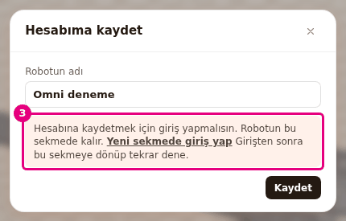
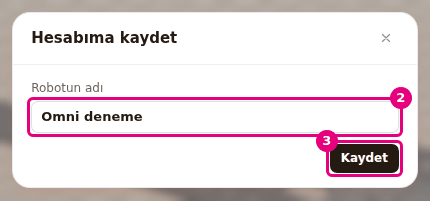
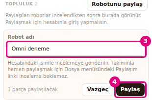

# Hesabına kaydet ve paylaş

Bu sayfada robotunu Probot hesabına kaydedecek, kayıtlı robotlarını yönetecek ve robotunu link
ya da topluluk kataloğuyla paylaşacaksın.

<!-- IMAGE-PENDING: img/builder-hesap-sonuc.png | alt=Robotlarım penceresi; kayıtlı robot satırı. -->
<!-- CAPTURE: url=https://probotstudio.com/builder/ | hazirla=girişli hesap, Robotlarım açık (kişisel veri görünmeyen test hesabı) | hedef=body | isaret=yok | bekle=text="Robotlarım" -->

## Başlamadan önce

- Sahnede bir robot var. Örnek: "Sahne boş" kartında **Omni şasi**'yi seç (bkz. [Hazır robotla başla](hazir-robotla-basla.md)).
- Bir Probot hesabın var ve e-posta adresini doğruladın. Hesap mağazadan açılır.
- Hesap öğeleri **Dosya** menüsündedir: **Hesabıma kaydet...**, **Robotlarım...**, **Paylaşım linki...**.
  Sunucuya bağlanırken "Bağlanıyor", ulaşılamazsa "Şu an kullanılamıyor" notuyla soluk görünürler.

| Sınır | Değer |
|---|---|
| Bir robotun boyutu (içe aktarılan modeller dahil) | 5 MB |
| Hesaptaki robot sayısı | 50 |
| Hesaptaki robotların toplam boyutu | 50 MB |
| Bir robottaki parça | 2000 |
| Robot adı | 80 karakter |

## Hesabına giriş yap

Builder'ın kendi giriş ekranı yoktur. Giriş gerektiren bir işte Builder seni yeni sekmeye yönlendirir.
Robotun bu sekmede kalır.

1. **Dosya** > **Hesabıma kaydet...**'i seç ve **Kaydet**'e bas.
2. Giriş yapmadıysan pencerede "Hesabına kaydetmek için giriş yapmalısın. Robotun bu sekmede kalır." yazar.
   
   <!-- CAPTURE: url=https://probotstudio.com/builder/ | hazirla=girişsiz tarayıcı, hazir:Omni şasi, Dosya > Hesabıma kaydet... açık, Kaydet'e basılmış | hedef=[data-hesap-giris] | isaret=3 | bekle=[data-hesap-giris] -->
   <!-- SAY: Giriş yapmadıysak Builder bizi yeni sekmede giriş sayfasına gönderiyor, robotumuz bu sekmede kalıyor. -->
3. **Yeni sekmede giriş yap** bağlantısına bas. Giriş sayfası yeni sekmede açılır.
4. Yeni sekmede hesabınla giriş yap.
5. Builder sekmesine dön ve **Kaydet**'e yeniden bas.

Sonuç: Pencere giriş istemi yerine kayıt sonucunu gösterir.

Hesabın e-posta adresi doğrulanmamışsa "Hesabına kaydetmeden önce e-posta adresini doğrulamalısın"
yazar. E-postandaki doğrulama bağlantısını aç, sonra yeniden dene.

## Robotu hesabına kaydet

1. **Dosya** > **Hesabıma kaydet...**'i seç.
2. **Robotun adı** alanına robotun adını yaz. Alanda proje adı hazır gelir.
   
   <!-- CAPTURE: url=https://probotstudio.com/builder/ | hazirla=girişsiz tarayıcı, boş sahnede bir Structure 5 delik, proje adı Omni deneme, Dosya > Hesabıma kaydet... açık (Kaydet'e basılmamış) | hedef=[data-hesap-ad];[data-hesap-kaydet-gonder] | isaret=2-3 | bekle=[data-hesap-kaydet] -->
   <!-- SAY: Robotumuza bir ad verip hesabımıza kaydediyoruz. -->
3. **Kaydet**'e bas (<kbd>Enter</kbd>). Kayıt sürerken düğmede "Kaydediliyor..." yazar.

Sonuç: "Robotun hesabına kaydedildi." yazar ve "<ad>" hesabına kaydedildi bildirimi çıkar. **Araç
çubuğu**nda proje adının yanında "Kaydedildi" yazar.

- Sahnede değişiklik yapınca yazı "Kaydedilmedi" olur. Yazıya basınca **Hesabıma kaydet** penceresi açılır.
- Sahne hesaptaki bir robota bağlıysa **Kaydet** o robotun üzerine yazar. Değişiklik varsa pencerede "Kaydet, hesabındaki
  "<ad>" robotunun üzerine yazar." yazar. Değişiklik yoksa "Bu sahne hesabındaki "<ad>" robotunun son hali." yazar.
- Ayrı bir kayıt istersen **Yeni robot olarak kaydet**'e bas.
- İçe aktarılan modeller robotla birlikte kaydedilir ve 5 MB sınırına sayılır.
- **Dosya** > **Yeni**, **Yükle...** ya da hazır robot yüklemek sahnenin hesaptaki robotla bağını keser.

## Paylaşım linki oluştur

Paylaşım linki robotunu inceleme beklemeden takımına göstermenin yoludur. Linki bilen herkes robotu
giriş yapmadan açar ve kendi kopyasını düzenler. Hesap bilgin görünmez. Link topluluk kataloğunda çıkmaz.

1. Robotu hesabına kaydet. **Hesabıma kaydet** penceresinde kayıttan sonra **Paylaşım linki**'ne bas.
   Ya da **Dosya** > **Paylaşım linki...**'ni seç.
2. **Link oluştur**'a bas. Link hazırlanırken düğmede "Oluşturuluyor..." yazar.
3. Link adresinin yanındaki **Kopyala**'ya bas. "Link kopyalandı" yazar.
4. Linki takımına gönder.

Sonuç: Pencerede `https://probotstudio.com/builder/?paylasim=...` biçiminde bir adres durur.

<!-- SAY: Robotu kaydettikten sonra bir link oluşturup takımımıza gönderiyoruz. -->

- Link son kaydedilen hâli gösterir. Değişiklik yaptıysan pencerede "Linkte son kaydedilen hali görünür.
  Değişikliklerini göstermek için tekrar kaydet." yazar. **Kaydet**'e yeniden bas.
- Robot hesaba kayıtlı değilse pencere önce kayıt ister: "Link oluşturmak için robotu önce hesabına kaydet."
- Linki kapatmak için **Linki kapat**'a bas. Kapalı linki açan kişi "Bu paylaşım linki kapalı ya da bulunamadı" görür.
- Tarayıcı panoya yazamazsa "Link seçildi, Ctrl+C ile kopyala" yazar. <kbd>Ctrl</kbd>+<kbd>C</kbd>'ye bas.

## Paylaşılan linki aç

Linki alan kişinin hesap açması gerekmez.

1. Linki tarayıcıda aç. Builder açılır.
2. Sahne boşsa robot doğrudan gelir.
3. Sahnede parça varsa "Paylaşılan robot "<ad>" (N parça) kopya olarak açılacak." yazar. **Değiştir**'e bas.
   Sahnedekini korumak için **Vazgeç**'e bas.

Sonuç: ""<ad>" kopyası açıldı. Değişikliklerin paylaşanı etkilemez" yazar. Kopya senin tarayıcında
saklanır, paylaşanın robotu değişmez.

<!-- SAY: Linki açan kişi robotun kendi kopyasını düzenliyor, paylaşanın robotu değişmiyor. -->

## Robotlarım'da aç, adlandır ve sil

1. **Dosya** > **Robotlarım...**'ı seç. Liste yüklenirken "Yükleniyor..." yazar.
2. Listede robotu bul. Her satırda tarih, parça sayısı ve gerekirse "Link açık", "Sahnede" yazar.
   Listenin altında "N / 50 robot" sayacı durur.
3. İşini seç:
    - **Aç**: robotu sahneye getirir. Sahnede parça varsa (o robot zaten sahnede ve kayıtlıysa hariç)
      "Sahnedeki N parça kaldırılıp yerine bu robot gelecek." yazar. **Değiştir**'e ya da **Vazgeç**'e bas.
    - Robotun adına bas (ipucu: **Adını değiştir**): ad düzenlenir. Yeni adı yaz, <kbd>Enter</kbd>'a bas. <kbd>Esc</kbd> adı değiştirmeden Robotlarım penceresinin tamamını kapatır.
    - **Linki kopyala** ve **Linki kapat**: yalnız linki açık robotta görünür.
    - **Sil**: onay ister.

Sonuç: Açtığın robot sahnede durur ve "<ad>" açıldı yazar. Proje adının yanında "Kaydedildi" görünür.

<!-- SAY: Robotlarım penceresinde kayıtlı robotlarımızı açıyor, adlandırıyor ve siliyoruz. -->

!!! warning "Dikkat"
    **Sil** robotu hesabından kalıcı olarak siler ve linkini kapatır. Onayda "Bu geri alınamaz." yazar.
    Onaylamadan önce gerekiyorsa robotu açıp **Dosya** > **Kaydet (JSON indir)** ile indir.

Silmek için satırda **Sil**'e bas, sonra onaydaki **Sil**'e bas. **Vazgeç** onayı kapatır. Hesabında
robot yoksa liste yerine "Hesabında kayıtlı robot yok." notu çıkar.

## Topluluğa paylaş

Topluluk kataloğu, onaylanan robotların herkese göründüğü yerdir. Gönderdiğin robot önce incelenir.

1. **Sol panel**de **Robot Kataloğu** sekmesini seç.
2. **Topluluk** başlığının yanında **Robotunu paylaş**'a bas. Sahne boşken soluktur.
3. **Robot adı** alanına adı yaz (en çok 80 karakter).
   
   <!-- CAPTURE: url=https://probotstudio.com/builder/ | hazirla=girişsiz tarayıcı, boş sahnede bir Structure 5 delik, Robot Kataloğu sekmesi, Robotunu paylaş'a basılmış | hedef=input[name="robotName"];[data-share-submit] | isaret=3-4 | bekle=[data-share-form] -->
   <!-- SAY: Robot kataloğundan robotumuzu adıyla incelemeye gönderiyoruz. -->
4. **Paylaş**'a bas. Gönderim sürerken düğmede "Paylaşılıyor" yazar. Vazgeçmek için **Vazgeç**'e bas.

Sonuç: "Robotun incelemeye gönderildi. Onaylandığında katalogda görünecek." yazar. Onaydan sonra robot
**Topluluk** bölümünde hesabındaki adınla görünür.

- Formda "N parça paylaşılacak" yazar. Topluluğa en çok 200 parçalı robot gönderilir.
- Aynı anda en çok 5 robotun incelemede bekleyebilir.
- İçe aktarılan parça içeren robot gönderilemez. Önce o parçaları sil. Linkle paylaşım bu sınırı taşımaz.
- Giriş yapmadıysan formda "Paylaşmak için giriş yapmalısın." notu ve **Yeni sekmede giriş yap** çıkar.
  Girişten sonra sekmeye dön ve yeniden **Paylaş**'a bas.

## Sorun mu var?

| Ekrandaki metin | Ne yapmalı |
|---|---|
| "Hesabına kaydetmek için giriş yapmalısın" | Bu sayfadaki "Hesabına giriş yap" bölümü. Bkz. [Sorun giderme](sorunlar.md#giris-yapmalisin). |
| "Hesabına kaydetmeden önce e-posta adresini doğrulamalısın" | E-postandaki doğrulama bağlantısını aç. |
| "Paylaşım linki için önce e-posta adresini doğrulamalısın" | Aynı. |
| "Sahnede parça yok. Önce robotunu kur, sonra kaydet." | Sahneye en az bir parça ekle. Bkz. [Sorun giderme](sorunlar.md#kaydetmek-icin-parca-yok). |
| "Robot X,X MB, en fazla 5,0 MB kaydedilebilir. İçe aktarılan modelleri azaltıp tekrar dene" | İçe aktarılan modelleri sil ya da sadeleştir. Bkz. [Sorun giderme](sorunlar.md#robot-cok-buyuk). |
| "Robot sunucuya göndermek için çok büyük. İçe aktarılan modelleri azaltıp tekrar dene" | Aynı. Bkz. [Sorun giderme](sorunlar.md#robot-cok-buyuk). |
| "Robot en fazla 5 MB olabilir" | Aynı. Bkz. [Sorun giderme](sorunlar.md#robot-cok-buyuk). |
| "Hesabına en fazla 50 robot kaydedebilirsin. Eski bir robotu sil" | **Robotlarım**'dan eski bir robotu sil. |
| "Hesabındaki robotlar için yer kalmadı. Eski bir robotu sil" | 50 MB doldu. Eski robotları sil. |
| "Robot 1 ile 2000 geçerli parça içermeli" | Parça sayısını 2000'in altına indir. |
| "Robot adı 1 ile 80 karakter arasında olmalı" | Adı kısalt ya da boş bırakma. |
| "Sunucuya ulaşılamadı. Bağlantını kontrol edip tekrar dene" | İnternet bağlantını kontrol et. Bkz. [Sorun giderme](sorunlar.md#sunucuya-ulasilamadi). |
| "Sunucu şu an cevap vermiyor. Biraz sonra tekrar dene" | Birkaç dakika sonra yeniden dene. Bkz. [Sorun giderme](sorunlar.md#sunucuya-ulasilamadi). |
| "Kayıt alanı şu an dolu. Biraz sonra tekrar dene." | Daha sonra yeniden dene. Robotu dosyaya da kaydet. |
| "Hesap doğrulanamadı. Biraz sonra tekrar dene." | Daha sonra yeniden dene. |
| "Çok hızlı istek yapıldı. Bir dakika sonra tekrar dene." | Bir dakika bekle. Bkz. [Sorun giderme](sorunlar.md#cok-hizli-istek). |
| "Bu hesap askıya alınmış" | Hesabınla ilgili Probot'a yaz. |
| "Bu paylaşım linki kapalı ya da bulunamadı" | Linki paylaşandan yeni link iste. Bkz. [Sorun giderme](sorunlar.md#paylasilan-robot-acilamadi). |
| "Paylaşılan robot açılamadı" | Sayfayı yenileyip linki yeniden aç. Bkz. [Sorun giderme](sorunlar.md#paylasilan-robot-acilamadi). |
| "İçe aktarılan parçalar katalogda paylaşılamaz. Önce onları kaldır" | İçe aktarılan parçaları sil ya da paylaşım linki kullan. Bkz. [Sorun giderme](sorunlar.md#katalogda-paylasilamaz). |
| "Paylaşmak için giriş yapmalısın." | Formdaki **Yeni sekmede giriş yap**'a bas. Bkz. [Sorun giderme](sorunlar.md#giris-yapmalisin). |
| "Paylaşmadan önce e-posta adresini doğrulamalısın" | E-postandaki doğrulama bağlantısını aç. |
| "İnceleme bekleyen paylaşım sınırına ulaştın" | 5 robotun incelemede. Onaylanmalarını bekle. |
| "Robot 1 ile 200 geçerli parça içermeli" | Topluluk sınırı 200 parça. Paylaşım linki kullan. |
| "Çok hızlı paylaşım yapıldı. Bir dakika sonra tekrar dene." | Bir dakika bekle. |
| "Katalog şu an yeni paylaşım alamıyor" | Daha sonra yeniden dene. |

- **Hesap öğeleri soluk, "Şu an kullanılamıyor" yazıyor:** Hesap sunucusuna ulaşılamıyor. Robotunu
  **Dosya** > **Kaydet (JSON indir)** ile dosyaya kaydet, sonra yeniden dene.
  Bkz. [Sorun giderme](sorunlar.md#hesap-ogeleri-soluk).
- **Proje adının yanında "Kaydedildi" yazısı yok:** Sahne hesaptaki bir robota bağlı değil. **Hesabıma kaydet**
  ya da **Robotlarım** > **Aç** bağı kurar.

## Sonraki adım

- [Dosyaya kaydet ve aç](dosyaya-kaydet-ve-ac.md)
- [Hazır robotla başla](hazir-robotla-basla.md)
- [Robotu Sim'de dene](simde-dene.md)
