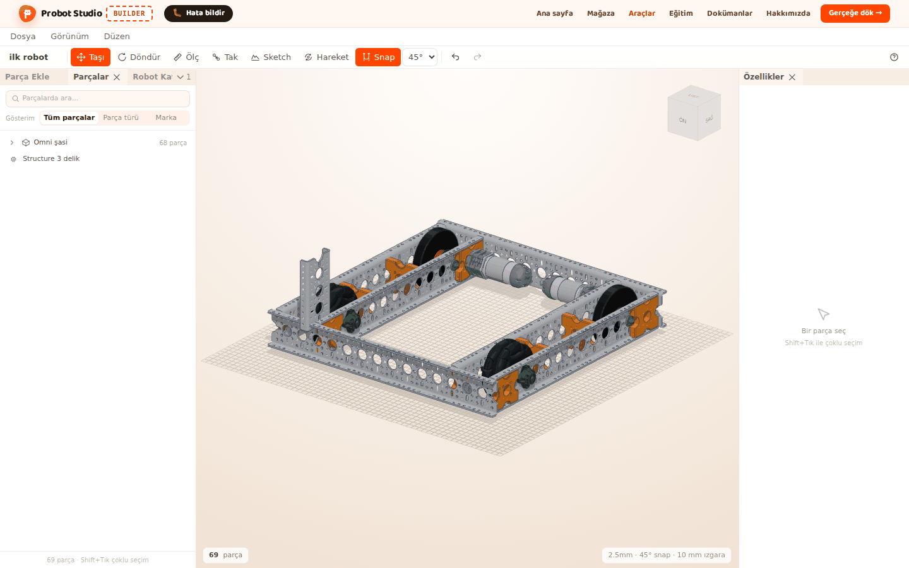
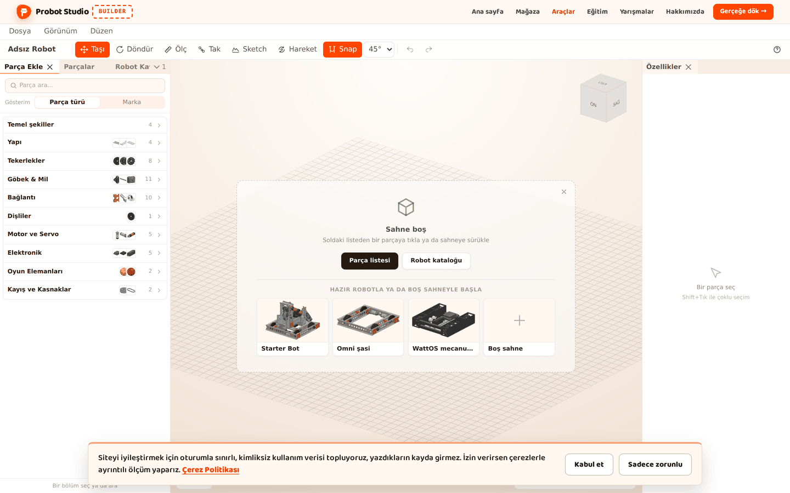
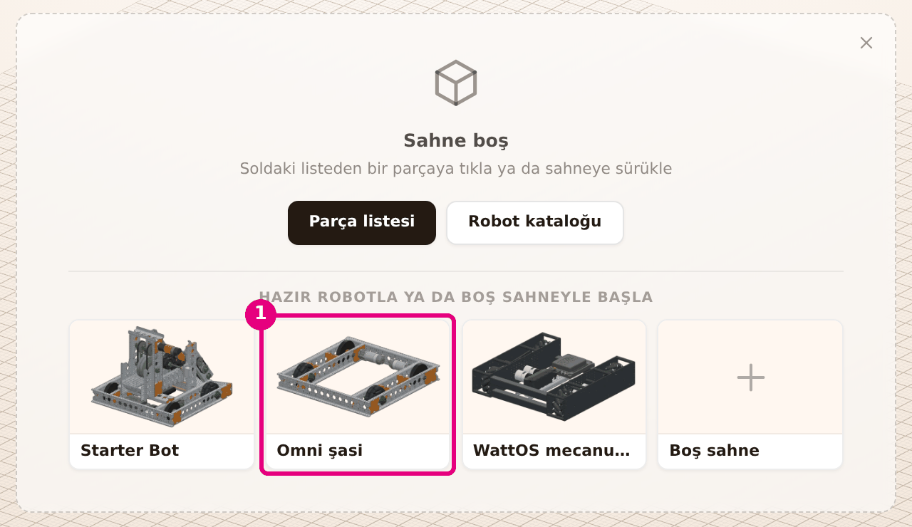
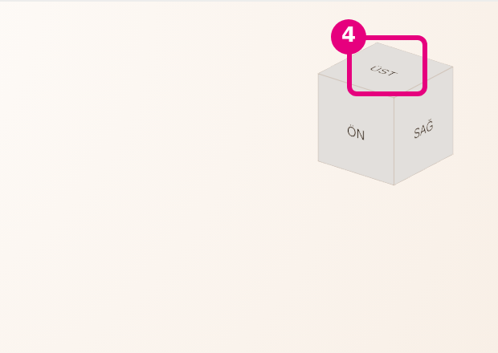
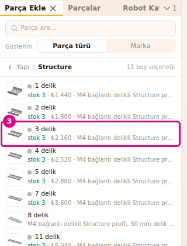
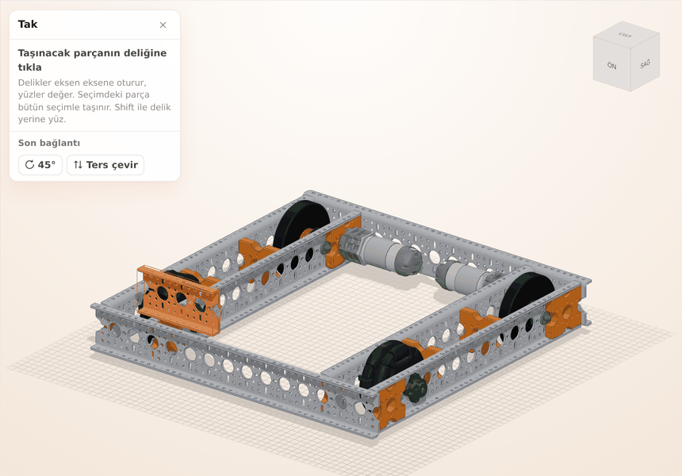
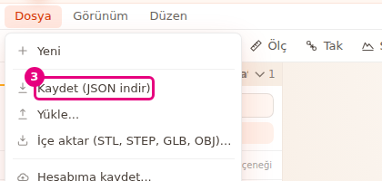

# İlk 10 dakika

Bu sayfada hazır bir robotu açacak, etrafında gezinecek, ona bir parça takacak ve projeni
kaydedeceksin. Her bölümün sonunda doğru yerde olup olmadığını kontrol edersin.

<!-- CAPTURE: url=https://probotstudio.com/builder/ | hazirla=hazir:Omni şasi + 3 delik Structure şasinin üstüne takılmış, proje adı ilk robot, seçim yok | hedef=body | isaret=yok | bekle=text="ilk robot" -->

## Başlamadan önce

- Bilgisayar, tarayıcı ve fare: [Ne gerekir](../index.md#ne-gerekir).
- Hesap gerekmez.

## Builder'ı aç

1. Tarayıcıda `https://probotstudio.com/builder/` adresini aç.
2. "Tasarım aracı geliştirme aşamasında" penceresinde **Anladım, devam et**'e bas.
3. Ekranın altında çerez bildirimi varsa **Kabul et** ya da **Sadece zorunlu**'ya bas.
   
   <!-- CAPTURE: url=https://probotstudio.com/builder/ | hazirla=temiz tarayıcı, uyarılar kapalı | hedef=text="Sahne boş" | isaret=yok | bekle=text="Sahne boş" -->
   <!-- SAY: Builder'ı tarayıcıda açıyoruz, kurulum gerekmiyor. -->

Kontrol et: Sahnenin ortasında "Sahne boş" kartı ve altında hazır robot kartları görünüyor.
Kart yoksa bu tarayıcıdaki önceki çalışman açılmıştır. Önce **Dosya** > **Kaydet (JSON indir)** ile
sakla, sonra **Dosya** > **Yeni**'yi seç.

## Hazır robotu sahneye yükle

1. "Sahne boş" kartında **Omni şasi** kartına bas.
   
   <!-- CAPTURE: url=https://probotstudio.com/builder/ | hazirla=temiz tarayıcı | hedef=[data-bos-sahne-robot="omni-sasi"] | isaret=1 | bekle=text="Sahne boş" -->
   <!-- SAY: Sıfırdan başlamak yerine hazır bir şasiyi açıyoruz. -->
2. Robot birkaç saniyede sahneye gelir. **Menü çubuğu**nda **Görünüm**'e bas.
3. Robotun tamamını görmek için **Sığdır**'ı seç.

Kontrol et: Sahnede dört tekerli şasi duruyor. **Sahne**nin altındaki durum şeridinde "68 parça"
yazıyor.

!!! tip "İpucu"
    Daha fazla hazır robot **Sol panel**deki **Robot Kataloğu** sekmesindedir. Bkz.
    [Hazır robotla başla](hazir-robotla-basla.md).

## Robotun etrafında gezin

Kamera fareyle oynar. Sol tuş yalnız seçim yapar.

1. **Sahne**de farenin sağ tuşunu basılı tutup sürükle. Kamera robotun etrafında döner.
2. Fare tekerleğini çevir. Kamera yaklaşır ya da uzaklaşır.
3. Orta tuşu (tekerleği) basılı tutup sürükle. Görüntü kayar.
4. **Sahne**nin köşesindeki görünüm küpünde **ÜST** yüzüne bas.
   
   <!-- CAPTURE: url=https://probotstudio.com/builder/ | hazirla=hazir:Omni şasi | hedef=koordinat:gorunum-kupu-ust | isaret=4 | bekle=canvas -->
   <!-- SAY: Sağ tuşla döndürüyoruz, tekerlekle yaklaşıyoruz, küpten üstten bakıyoruz. -->

Kontrol et: Robotu üstten görüyorsun. Robot kadrajdan çıktıysa yeniden **Görünüm** > **Sığdır**'ı seç.

Tuşlar sana uymuyorsa **Görünüm** menüsündeki **FARE DÜZENİ** grubundan **SolidWorks** ya da
**Fusion 360**'ı seç. Bkz. [Sahnede gezin](sahnede-gezin.md).

## Robota bir parça ekle

1. **Sol panel**de **Parça Ekle** sekmesini seç.
2. **Yapı** bölümünü seç, sonra **Structure** satırını seç.
3. Açılan boy listesinde bir boya bas. Parça sahneye eklenir ve seçili olur.
   
   <!-- CAPTURE: url=https://probotstudio.com/builder/ | hazirla=hazir:Omni şasi | hedef=[data-section="shop-yapi"] > text="Structure" | isaret=3 | bekle=text="11 boy seçeneği" -->
   <!-- SAY: Yapı bölümünden bir Structure parçası ekliyoruz. -->
4. **Özellikler** panelinde **Boy** seçicisinin yanındaki **+** düğmesine bas. Parça bir boy uzar.

Kontrol et: **Özellikler** panelinin başında "Structure" yazıyor. Durum şeridinde "69 parça · 1 seçili"
yazıyor.

Parçayı sahneye sürükleyip robotun üstüne de bırakabilirsin. Bkz. [Parça ekle](parca-ekle.md).

## Parçayı robota tak

**Tak** aracı bir parçanın deliğini başka bir parçanın deliğine eksen eksene oturtur.

1. **Araç çubuğu**nda **Tak**'a bas (<kbd>B</kbd>).
2. Eklediğin Structure parçasının bir deliğine tıkla. Delik vurgulanır.
3. Şasinin üst yüzündeki bir deliğe tıkla. Parça o deliğe oturur.
   
   <!-- CAPTURE: url=https://probotstudio.com/builder/ | hazirla=hazir:Omni şasi + Structure eklendi | hedef=koordinat:kaynak-delik,hedef-delik | isaret=2-3 | bekle=[data-testid="tak-paneli"] -->
   <!-- SAY: Önce parçanın deliğine, sonra şasideki deliğe tıklıyoruz, parça yerine oturuyor. -->
4. Parça istediğin gibi durmuyorsa <kbd>R</kbd> ile delik ekseni etrafında döndür, <kbd>F</kbd> ile
   ters çevir.
5. Aracı kapatmak için <kbd>Esc</kbd>'e iki kez bas. İlk basış son bağlantının ince ayarını bitirir,
   ikincisi aracı kapatır. Tak panelindeki **×** de aracı tek basışta kapatır.

Kontrol et: Structure şasinin yüzüne değiyor ve delikleri hizalı. Yanlış yere taktıysan
**Düzen** > **Geri al**'ı seç (<kbd>Ctrl</kbd>+<kbd>Z</kbd>).

## Projeni kaydet

Builder çalışmanı bu tarayıcıda kendiliğinden saklar. Başka yerde açmak için dosyaya kaydet.

1. **Araç çubuğu**nda proje adına bas. Hazır robotu yüklediğin için orada "Omni şasi" yazar.
2. `ilk robot` yaz ve <kbd>Enter</kbd>'a bas.
3. **Dosya** > **Kaydet (JSON indir)**'i seç.
   
   <!-- CAPTURE: url=https://probotstudio.com/builder/ | hazirla=hazir:Omni şasi, proje adı ilk robot | hedef=text="Kaydet (JSON indir)" | isaret=3 | bekle=text="Kaydet (JSON indir)" -->
   <!-- SAY: Projeye ad veriyoruz ve bilgisayarımıza dosya olarak indiriyoruz. -->

Kontrol et: Tarayıcı `ilk robot.json` dosyasını indirdi. Addaki harf, rakam ve boşluk dışındaki karakterler dosya adında `_` olur. Bu dosyayı sonra **Dosya** > **Yükle...** ile
açarsın.

## Sonraki adım

- Robotu parça parça kurmayı izle: [Robotu adım adım kur](adim-adim-kur.md)
- Tekerleri döndür: [Eklem kur ve hareketi dene](eklem-kur-ve-oynat.md)
- Parçaları sipariş et: [Gerçeğe dök: parça listesini sepete aktar](gercege-dok.md)
