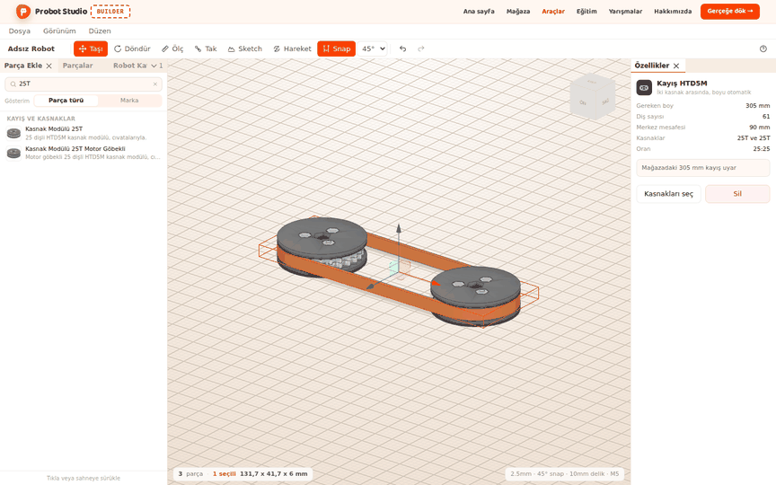
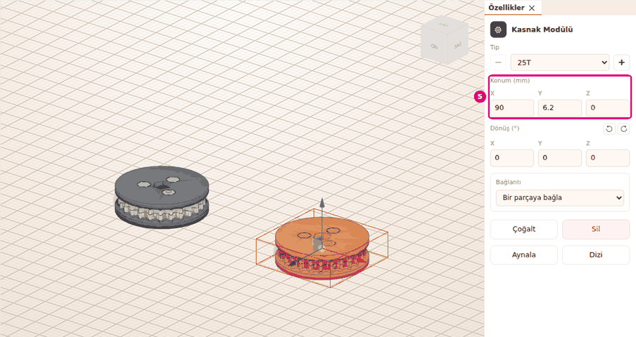
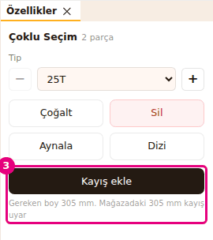
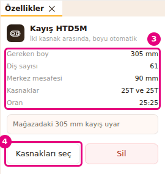
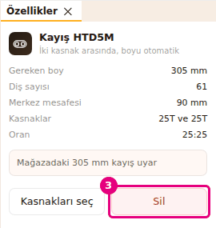

# İki kasnağa kayış ekle

Bu sayfada iki kasnağın arasına HTD5M kayış koyacaksın. Builder kayışın gereken boyunu hesaplar ve
mağazada uyan kayış olup olmadığını söyler.

<!-- CAPTURE: url=https://probotstudio.com/builder/ | hazirla=iki kasnak + kayış eklendi, kayış seçili | hedef=body | isaret=yok | bekle=canvas -->

## Başlamadan önce

- Sahne boş (**Dosya** > **Yeni**) ya da robotunda iki kasnak var.
- Kasnaklar **Parça Ekle** > **Kayış ve Kasnaklar** bölümünde, **Kasnak Modülü** klasöründedir:
  **25T**, **32T** ve **25T Motor Göbekli**. Mağazanın 245, 305 ve 340 mm HTD5M kayışları aynı
  bölümdeki **Kayış HTD5M** klasöründe durur. Aramada satırlar tam adıyla çıkar (ör. **Kasnak Modülü
  25T**).
- Kayış için iki kasnağın eksenleri paralel olmalı ve kasnaklar aynı düzlemde durmalı (en çok 1,5 mm
  kayık). Kasnaklar birbirine çok yakın olmamalı.

## Alıştırma için iki kasnak koy

1. **Sol panel**de **Parça Ekle** sekmesini seç.
2. **Parça ara...** kutusuna `25T` yaz ve **Kasnak Modülü 25T** satırına bas. Kasnak sahneye gelir
   ve seçili olur.
3. **Özellikler** panelinde **Konum (mm)** altında X kutusuna `0`, Z kutusuna `0` yaz. Her birinden
   sonra <kbd>Enter</kbd>'a bas.
4. **Kasnak Modülü 25T** satırına yeniden bas. İkinci kasnak gelir.
5. **Konum (mm)** altında X kutusuna `90`, Z kutusuna `0` yaz ve <kbd>Enter</kbd>'a bas.
   
   <!-- CAPTURE: url=https://probotstudio.com/builder/ | hazirla=boş sahne; iki Kasnak Modülü 25T, biri X 0 Z 0, öteki X 90 Z 0; ikincisi seçili | hedef=text="Konum (mm)" | isaret=5 | bekle=text="Konum (mm)" -->
   <!-- SAY: Aynı düzlemde, aralarında doksan milimetre olan iki kasnak koyuyoruz. -->

Sonuç: İki kasnak aynı yükseklikte, merkezleri 90 mm arayla duruyor.

## İki kasnağı seç ve kayış ekle

!!! tip "İpucu"
    Kasnakları aynı düzlemde, eksenleri paralel ve aralarında kayışa yer kalacak kadar uzak koy.
    Böylece **Kayış ekle** soluk kalmaz. Bkz. [Sorun giderme](sorunlar.md#kasnaklar-cok-yakin).

1. **Sahne**de ilk kasnağa tıkla.
2. <kbd>Shift</kbd> basılı tutup ikinci kasnağa tıkla. **Özellikler** panelinde "Çoklu Seçim 2
   parça" ve altında "Gereken boy 305 mm. Mağazadaki 305 mm kayış uyar" yazar.
3. **Özellikler** panelinde **Kayış ekle**'ye bas (<kbd>K</kbd>). Tam iki kasnak seçiliyken görünür.
   
   <!-- CAPTURE: url=https://probotstudio.com/builder/ | hazirla=boş sahne; iki Kasnak Modülü 25T (X 0 ve X 90, Z 0) Shift ile seçili | hedef=[data-testid="kayis-ekle"];[data-testid="kayis-onizleme"] | isaret=3 | bekle=[data-testid="kayis-ekle-alani"] -->
   <!-- SAY: İki kasnağı seçiyoruz ve kayış ekliyoruz, gereken boyu Builder kendisi hesaplıyor. -->

Sonuç: "Kayış eklendi, 305 mm" bildirimi çıkar. İki kasnağı saran kayış görünür ve seçili olur.

Aynı işi üç yoldan daha yaparsın:

- **Düzen** > **Kayış ekle**'yi seç.
- **Sahne**de seçili kasnaklardan birine sağ tıkla ve bağlam menüsünde **Kayış ekle**'yi seç.
- <kbd>K</kbd>'ye bas.

Kayış konamıyorsa **Özellikler**'deki **Kayış ekle** soluk olur ve altında nedeni yazar. Bağlam
menüsünde neden, öğenin ipucunda görünür.

İki kasnağın da eklemi varsa ve sürülen kasnağın eklemi boştaysa kayış kasnak eşleşmesi de kurar.
Bildirimin sonuna "25:25 kasnak eşleşmesi kuruldu" gibi oran eklenir (bkz.
[Eklem kur ve hareketi dene](eklem-kur-ve-oynat.md)).

## Kayışın ölçülerini oku

1. **Sol panel**de **Parçalar** sekmesini seç.
2. **Parçalarda ara...** kutusuna `Kayış` yaz.
3. Listede **Kayış HTD5M** satırını seç.
4. **Özellikler** panelinde **Kasnakları seç**'e bas. Kayışın sardığı iki kasnak seçilir.
   
   <!-- CAPTURE: url=https://probotstudio.com/builder/ | hazirla=boş sahne; iki Kasnak Modülü 25T arasına kayış eklenmiş; kayış seçili | hedef=[data-testid="kayis-bilgi"];[data-testid="kayis-kasnaklari-sec"] | isaret=3-4 | bekle=[data-testid="kayis-alani"] -->
   <!-- SAY: Kayışı seçince gereken boyu, diş sayısını ve oranı okuyoruz, kasnakları da tek tıkla buluyoruz. -->

Sonuç: Kayış seçiliyken başlıkta "Kayış HTD5M" ve "İki kasnak arasında, boyu otomatik" yazar.
**Kasnakları seç**'ten sonra iki kasnak seçili olur.

| Satır | Ne | Bu örnekte |
|---|---|---|
| **Gereken boy** | Kasnakları saran kayışın boyu | 305 mm |
| **Diş sayısı** | Bu boydaki kayışın diş sayısı (diş adımı 5 mm) | 61 |
| **Merkez mesafesi** | İki kasnak merkezi arası | 90 mm |
| **Kasnaklar** | İki kasnağın diş sayısı | 25T ve 25T |
| **Oran** | Diş sayılarının oranı | 25:25 |

Satırların altındaki kutu mağaza kayışını söyler. Uyan kayış varsa "Mağazadaki 305 mm kayış uyar"
yazar. Yoksa en yakın kayışı, ne kadar kısa ya da uzun olduğunu ve kasnakları kaç mm yaklaştırman ya
da uzaklaştırman gerektiğini yazar. O zaman "Gerçeğe dök listesinde ayrı yazılır" notu da çıkar.

## Kasnaklar oynarsa ne olur

Kasnaklardan birini taşıdığında kayış onu izler, boyu ve merkez mesafesi yeniden hesaplanır.
Örneğin ikinci kasnağın X değerini `100` yaparsan kutuda "Mağazadaki en yakın kayış 340 mm, 15 mm
uzun. Kasnakları 7,5 mm uzaklaştır" yazar.

Kasnaklar artık kayışa uymuyorsa (eksen döndü ya da düzlem kaydı) kayış son uyduğu yerde kalır.
Kayışı seçince sarı kutuda nedeni yazar. İkinci kasnağın Y değerini 5 mm artırırsan şunu görürsün:
"Kasnaklar kayışa artık uymuyor. Kasnaklar aynı düzlemde değil, 5 mm kayık. Kayış son uyduğu yerde
duruyor". Kasnağı geri hizala ya da **Düzen** > **Geri al**'ı seç. Kasnaklar yeniden uyunca uyarı
kalkar.
<!-- SAY: Kasnakları oynatınca kayış onları izliyor, uymadıkları anda nedenini yazıyor. -->

## Kayışı sil

1. **Parçalar** sekmesinde **Parçalarda ara...** kutusuna `Kayış` yaz.
2. Listede **Kayış HTD5M** satırını seç.
3. **Özellikler** panelinde **Sil**'e bas.
   
   <!-- CAPTURE: url=https://probotstudio.com/builder/ | hazirla=boş sahne; iki Kasnak Modülü 25T arasına kayış eklenmiş; kayış seçili | hedef=[data-testid="kayis-alani"] >> text="Sil" | isaret=3 | bekle=[data-testid="kayis-kasnaklari-sec"] -->
   <!-- SAY: Kayışı seçip siliyoruz, kasnaklar yerinde kalıyor. -->

Sonuç: Kayış kalkar, kasnaklar yerinde kalır. Geri getirmek için **Düzen** > **Geri al**'ı seç
(<kbd>Ctrl</kbd>+<kbd>Z</kbd>).

Kasnaklardan birini silersen kayış da onunla silinir. Kayış tek başına kopyalanmaz. Kayış ancak iki
kasnağıyla birlikte kopyalanır, çoğaltılır ya da aynalanır.

## Sorun mu var?

- **Düzen menüsünde Kayış ekle soluk:** Tam iki kasnak seçili değil. Seçimi yalnız iki kasnak yap.
  Bkz. [Sorun giderme](sorunlar.md#iki-kasnak-sec).
- **"Kayış için iki kasnak seç" bildirimi çıkıyor:** Seçimde iki parçadan fazlası ya da azı var.
  Bkz. [Sorun giderme](sorunlar.md#iki-kasnak-sec).
- **"İki parça da kasnak olmalı" yazıyor:** Seçtiğin parçalardan biri kasnak değil.
  Bkz. [Sorun giderme](sorunlar.md#iki-kasnak-sec).
- **"Kasnak eksenleri paralel değil" yazıyor:** Bir kasnak eğik duruyor. **Dönüş (°)** değerlerini
  öbür kasnakla aynı yap. Bkz. [Sorun giderme](sorunlar.md#kasnak-eksenleri-paralel-degil).
- **"Kasnaklar aynı düzlemde değil, N mm kayık" yazıyor:** Kasnaklar eksen boyunca 1,5 mm'den fazla
  kayık. Kasnağı eksen boyunca kaydır. Bkz. [Sorun giderme](sorunlar.md#kasnaklar-ayni-duzlemde-degil).
- **"Kasnaklar çok yakın" yazıyor:** Kasnakları birbirinden uzaklaştır.
  Bkz. [Sorun giderme](sorunlar.md#kasnaklar-cok-yakin).
- **"Bu kasnaklar arasında zaten kayış var" yazıyor:** Aynı iki kasnağa ikinci kayış konmaz.
  Bkz. [Sorun giderme](sorunlar.md#zaten-kayis-var).
- **"Mağazadaki en yakın kayış ..." yazıyor:** Gereken boyda mağaza kayışı yok. Yazan mm kadar
  kasnakları yaklaştır ya da uzaklaştır.

## Sonraki adım

- Kayışla dönen kasnağı oynat: [Eklem kur ve hareketi dene](eklem-kur-ve-oynat.md)
- Kayışı sepete ekle: [Gerçeğe dök: parça listesi ve sepet](gercege-dok.md)
