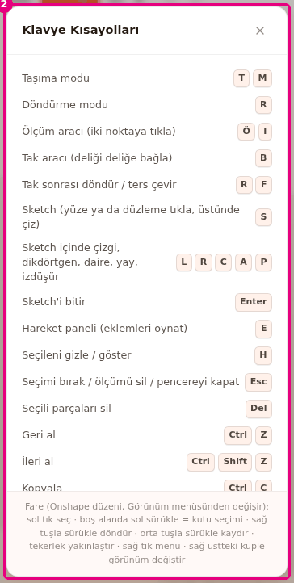

# Kısayollar

Bu sayfa Builder'daki bütün klavye tuşlarını ve fare hareketlerini listeler. Uygulamadaki Yardım
penceresinde yazmayan tuşlar da buradadır.

## Başlamadan önce

- Builder açık (bkz. [İlk 10 dakika](ilk-10-dakika.md)).
- Kısayolların hepsi ana yolun yanında ek bilgidir. Her işin düğmesi ya da menü öğesi de vardır
  (bkz. [Arayüz turu](arayuz.md)).

## Yardım penceresini aç

Builder'ın kendi kısayol listesi "Klavye Kısayolları" penceresindedir.

1. **Araç çubuğu**nda Yardım simgesine (**?**) bas (<kbd>?</kbd>).
2. "Klavye Kısayolları" penceresinin altındaki fare satırını oku. Tuş listesi kaydırılır, bu satır sabit durur.
   
   <!-- CAPTURE: url=https://probotstudio.com/builder/ | hazirla=boş sahne, Klavye Kısayolları penceresi açık | hedef=text^="Fare (Onshape düzeni" | isaret=2 | bekle=text="Klavye Kısayolları" -->
   <!-- SAY: Yardım simgesine basınca kısayolların listesi açılıyor. -->
3. Pencerenin çarpısına (×) basarak pencereyi kapat. <kbd>Esc</kbd> ya da <kbd>?</kbd> da kapatır (Sketch çizimi sürerken çalışmaz).

Sonuç: Pencere kapanır. Seçimin ve açık araçların değişmez.

Pencerenin dışındaki karartılmış alana basmak da pencereyi kapatır. Alttaki fare satırı seçili fare
düzenine göre değişir.

!!! note "Not"
    "Klavye Kısayolları" penceresi bazı tuşları göstermez: <kbd>Ctrl</kbd>+<kbd>Y</kbd>,
    <kbd>Shift</kbd> ile Snap'i geçici kapatma, <kbd>Shift</kbd>+<kbd>R</kbd>, <kbd>Backspace</kbd>,
    <kbd>Ctrl</kbd>+tık ve montajda <kbd>←</kbd>/<kbd>→</kbd>. Bu sayfadaki tablolar çalışan tüm tuşları
    verir.

## Kısayollar ne zaman çalışmaz

- Bir metin kutusuna yazarken (proje adı, **Konum (mm)**, **Parça ara...** gibi) tuşlar kutuya
  gider, kısayol çalışmaz.
- **Adım adım kur** ile açılan montaj modunda kısayollar kapalıdır. Yalnız <kbd>←</kbd> ve
  <kbd>→</kbd> çalışır.
- **Aynala** ya da **Dizi** penceresi açıkken yalnız <kbd>Esc</kbd> çalışır ve pencereyi kapatır.
- Mac'te <kbd>Cmd</kbd>, aşağıdaki bütün <kbd>Ctrl</kbd> kısayollarında <kbd>Ctrl</kbd> yerine geçer.

## Araçlar

| Tuş | Ne yapar | Nerede çalışır |
|---|---|---|
| <kbd>T</kbd> ya da <kbd>M</kbd> | **Taşı** aracını seçer. | Her yerde |
| <kbd>R</kbd> | **Döndür** aracını seçer. | Her yerde. **Tak** ile bağlantı yaptıktan sonra başka iş yapar (bkz. Tak aracı). |
| <kbd>Ö</kbd> ya da <kbd>I</kbd> | **Ölç** aracını açar ya da kapatır. Açarken **Tak** ve **Sketch** kapanır. | Her yerde. Türkçe klavyede <kbd>ı</kbd> ve <kbd>İ</kbd> de çalışır. |
| <kbd>B</kbd> | **Tak** aracını açar ya da kapatır. Açarken **Sketch** kapanır. | Her yerde |
| <kbd>S</kbd> | **Sketch** aracını açar ya da kapatır. | Sketch çizimi dışında |
| <kbd>E</kbd> | **Hareket** panelini açar ya da kapatır. | Her yerde |
| <kbd>?</kbd> | "Klavye Kısayolları" penceresini açar ya da kapatır. | Sketch çizimi dışında |

## Seçim ve düzenleme

| Tuş | Ne yapar | Nerede çalışır |
|---|---|---|
| Sol tık | Parçayı seçer. Boş alana tık seçimi bırakır. | **Sahne** |
| <kbd>Shift</kbd>+tık | Parçayı seçime ekler ya da seçimden çıkarır. | **Sahne**, **Parçalar** sekmesi |
| <kbd>Ctrl</kbd>+tık | <kbd>Shift</kbd>+tık ile aynı. | **Sahne**, **Parçalar** sekmesi |
| Boş alanda sol tuşla sürükle | Kutu seçimi. Kutuya değen her parça seçilir. <kbd>Shift</kbd> ya da <kbd>Ctrl</kbd> ile seçime ekler. | **Sahne**, **Ölç**, **Tak**, **Sketch** kapalıyken |
| Sağ tık | Bağlam menüsünü açar. Sağ tuşla sürüklersen menü açılmaz. Varsayılan Onshape fare düzeninde bu sürükleme kamerayı döndürür. | **Sahne**. Montaj modunda ve **Ölç**, **Tak**, **Sketch** açıkken açılmaz. |
| <kbd>Ctrl</kbd>+<kbd>A</kbd> | Bütün parçaları seçer. | Her yerde |
| <kbd>H</kbd> | Seçili parçaları gizler ya da gösterir. | Seçim varken |
| <kbd>Del</kbd> | Seçili parçaları siler. | Seçim varken. **Ölç** açıkken son ölçümü siler. |
| <kbd>Backspace</kbd> | <kbd>Del</kbd> ile aynı. | <kbd>Del</kbd> ile aynı |
| <kbd>Ctrl</kbd>+<kbd>Z</kbd> | Son değişikliği geri alır. En çok 60 adım. | Her yerde |
| <kbd>Ctrl</kbd>+<kbd>Shift</kbd>+<kbd>Z</kbd> | Geri alınanı yineler. | Her yerde |
| <kbd>Ctrl</kbd>+<kbd>Y</kbd> | <kbd>Ctrl</kbd>+<kbd>Shift</kbd>+<kbd>Z</kbd> ile aynı. **Düzen** menüsünde bu tuş yazar. | Her yerde |
| <kbd>Ctrl</kbd>+<kbd>C</kbd> | Seçimi kopyalar. "N parça kopyalandı" bildirimi çıkar. | Seçim varken |
| <kbd>Ctrl</kbd>+<kbd>V</kbd> | Kopyalananı yapıştırır. Kopya 20 mm kayık konur. | Her yerde |
| <kbd>Ctrl</kbd>+<kbd>D</kbd> | Seçimi çoğaltır. | Seçim varken |
| <kbd>A</kbd> | **Aynala** penceresini açar. | Seçim varken, **Ölç**, **Tak**, **Sketch** kapalıyken |
| <kbd>D</kbd> | **Dizi** penceresini açar. | Seçim varken, **Ölç**, **Tak**, **Sketch** kapalıyken |
| <kbd>K</kbd> | Seçili iki kasnağın arasına kayış koyar. | İki kasnak seçiliyken, **Ölç**, **Tak**, **Sketch** kapalıyken |
| <kbd>Shift</kbd> basılı tut | Snap'i geçici kapatır. Parça 2,5 mm adıma ve deliğe oturmaz. | **Taşı** ya da **Döndür** ile sürüklerken |

## Tak ve Ölç araçları

| Tuş | Ne yapar | Nerede çalışır |
|---|---|---|
| <kbd>R</kbd> | Son bağlantıyı delik ekseni etrafında seçili adım kadar döndürür. | **Tak** açık, bağlantıdan sonra |
| <kbd>Shift</kbd>+<kbd>R</kbd> | Son bağlantıyı ters yöne döndürür. | **Tak** açık, bağlantıdan sonra |
| <kbd>F</kbd> | Son bağlanan parçayı ters çevirir. | **Tak** açık, bağlantıdan sonra |
| <kbd>Shift</kbd>+tık | Delik yerine yüz seçer. | **Tak** açık |
| <kbd>Shift</kbd>+tık | Noktayı delik merkezine oturtmadan serbest koyar. | **Ölç** açık |
| <kbd>Del</kbd> | Son ölçümü siler. | **Ölç** açık |

!!! warning "Dikkat"
    **Ölç** açıkken <kbd>Esc</kbd> tek ölçümü değil, **bütün** ölçümleri siler. Tek bir ölçümü silmek
    için **Ölçüm** panelindeki **Bu ölçümü sil**'i kullan. Bkz. [Esc'nin sırası](#escnin-sras).

## Sketch ve Extrude

| Tuş | Ne yapar | Nerede çalışır |
|---|---|---|
| <kbd>L</kbd> | Çizgi aracı. | Sketch çiziminde |
| <kbd>R</kbd> | Dikdörtgen aracı. | Sketch çiziminde |
| <kbd>C</kbd> | Daire aracı. | Sketch çiziminde |
| <kbd>A</kbd> | Yay aracı. | Sketch çiziminde |
| <kbd>P</kbd> | İzdüşür aracı. | Sketch çiziminde |
| <kbd>S</kbd> | Seç aracı. | Sketch çiziminde |
| <kbd>Enter</kbd> | Sketch'i bitirir. | Sketch çiziminde |
| <kbd>Esc</kbd> | Önce yarım çizimi, sonra seçimi bırakır. Sketch'i kapatmaz. | Sketch çiziminde |
| <kbd>Del</kbd> ya da <kbd>Backspace</kbd> | Seçili öğeyi siler. | Sketch çiziminde |
| <kbd>Ctrl</kbd>+<kbd>Z</kbd> | Sketch içinde son adımı geri alır. | Sketch çiziminde |
| <kbd>Ctrl</kbd>+<kbd>Y</kbd> ya da <kbd>Ctrl</kbd>+<kbd>Shift</kbd>+<kbd>Z</kbd> | Sketch içinde yineler. | Sketch çiziminde |
| <kbd>Shift</kbd> basılı tut | Noktayı uçlara, hizaya ve 1 mm ızgaraya oturtmadan serbest bırakır. | Sketch çiziminde |
| Sağ tık | Yarım çizimi bırakır. | Sketch çiziminde |
| Çift tık (sketch üstünde) | Sketch'i düzenlemeye açar. | **Sahne** |
| <kbd>Enter</kbd> | **Tamam** ile aynı, katı parçayı yapar. | **Extrude** paneli açıkken |
| <kbd>Esc</kbd> | **Extrude** panelini kapatır. | **Extrude** paneli açıkken |

Sketch çizimi sürerken diğer kısayollar çalışmaz. Bkz. [Sketch çiz ve Extrude ile katı yap](sketch-ve-extrude.md).

## Montaj modu, paneller ve kutular

| Tuş | Ne yapar | Nerede çalışır |
|---|---|---|
| <kbd>←</kbd> | Önceki montaj adımı. | **Montaj şeridi** açıkken |
| <kbd>→</kbd> | Sonraki montaj adımı. | **Montaj şeridi** açıkken |
| <kbd>Esc</kbd> | Bir üst düzeye döner. | **Parça Ekle** sekmesinde bir bölümün içindeyken |
| <kbd>Enter</kbd> | Yazdığın değeri uygular. | Sayı ve ad kutularında (**Konum (mm)**, proje adı...) |
| <kbd>Esc</kbd> | Yazdığını bırakır, eski değere döner. | Sayı ve ad kutularında |
| <kbd>Esc</kbd> | Açık menüyü kapatır. | **Menü çubuğu** menüsü açıkken |
| Çift tık (panel ayırıcısı) | Panelin genişliğini varsayılana döndürür. | Paneller arasındaki dikey çizgi |

## Fare ile kamera

Sol tuş her düzende yalnız seçim yapar. Düzeni **Görünüm** menüsündeki **FARE DÜZENİ** grubundan
seçersin (bkz. [Sahnede gezin](sahnede-gezin.md)).

| Fare düzeni | Döndür | Kaydır | Yakınlaştır |
|---|---|---|---|
| **Onshape** (varsayılan) | Sağ tuşla sürükle | Orta tuşla sürükle | Tekerlek |
| **SolidWorks** | Orta tuşla sürükle | <kbd>Ctrl</kbd>+orta tuşla sürükle | Tekerlek |
| **Fusion 360** | <kbd>Shift</kbd>+orta tuşla sürükle | Orta tuşla sürükle | Tekerlek |

**Sahne**nin köşesindeki görünüm küpünün bir yüzüne basınca kamera o yöne bakar.

## Esc'nin sırası

<kbd>Esc</kbd> her basışta aşağıdaki listeden ilk uyan işi yapar. İstediğin sonuca ulaşana kadar
yeniden bas.

| Sıra | Durum | <kbd>Esc</kbd> ne yapar |
|---|---|---|
| 1 | Bağlam menüsü açık | Menüyü kapatır. |
| 2 | "Klavye Kısayolları" penceresi açık | Pencereyi kapatır. |
| 3 | "Gerçeğe dök" penceresi açık | Pencereyi kapatır. |
| 4 | **Ölç** açık | Önce yarım ölçümü, sonra **bütün** ölçümleri siler, sonra aracı kapatır. |
| 5 | **Tak** açık | Önce seçtiğin ilk deliği bırakır, sonra son bağlantının ince ayarını bitirir, sonra aracı kapatır. |
| 6 | **Sketch** açık | Önce yarım çizimi, sonra seçimi bırakır. Düzlem henüz seçilmediyse aracı kapatır. Sketch açıldıktan sonra kapatmaz; **Bitir** ya da **İptal** kullan. |
| 7 | **Hareket** oynuyor | Oynatmayı durdurur, sonraki basışta paneli kapatır. |
| 8 | Hiçbiri | Seçimi bırakır. |

**Aynala**, **Dizi** ve **Extrude** açıkken <kbd>Esc</kbd> önce onları kapatır.

Sketch açıkken <kbd>Esc</kbd> ve <kbd>?</kbd> yalnız Sketch'e gider. Çizim sürerken <kbd>Esc</kbd> yalnız
6. satırdaki işi yapar, aracı ya da açık pencereleri kapatmaz. Bu sırada açtığın pencereyi çarpısıyla
(×) ya da dışındaki karartılmış alana basarak kapat.

## Sonraki adım

- [Sahnede gezin](sahnede-gezin.md)
- [Sorun giderme](sorunlar.md)
