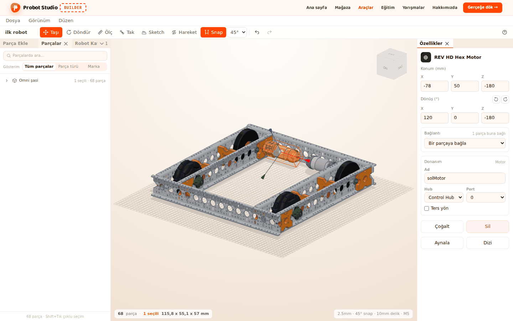
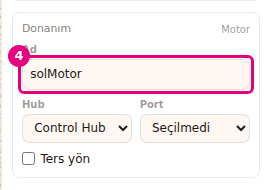
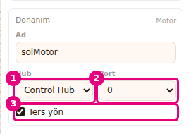
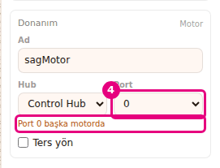

# Motor ve servoya ad ve port ver

Bu sayfada robotundaki motora ve servoya kodda kullanılacak bir ad, bağlı olduğu hub'ı ve portu
vereceksin. Bu bilgiler projeyle kaydedilir ve robot Sim'e geçerken onunla gider.

<!-- CAPTURE: url=https://probotstudio.com/builder/ | hazirla=hazir:Omni şasi, bir motor seçili, ad ve port verilmiş | hedef=body | isaret=yok | bekle=text="Port" -->

## Başlamadan önce

- Sahnede Omni şasi açık (bkz. [Hazır robotla başla](hazir-robotla-basla.md)). Bu robotta iki
  **REV HD Hex Motor** var.
- **Özellikler** panelindeki **Donanım** alanı yalnız motor ya da servo seçiliyken görünür.

## Motora ad ver

1. **Sol panel**de **Parçalar** sekmesine bas.
2. **Parçalarda ara...** kutusuna `Motor` yaz.
3. Listede ilk **REV HD Hex Motor** satırını seç.
4. **Özellikler** panelinde **Donanım** alanındaki **Ad** kutusuna `solMotor` yaz.
5. <kbd>Enter</kbd>'a bas.
   
   <!-- CAPTURE: url=https://probotstudio.com/builder/ | hazirla=hazir:Omni şasi; Parçalar sekmesinde arama "Motor"; ilk REV HD Hex Motor seçili; Ad "solMotor" yazılmış | hedef=[data-testid="donanim-ad"] | isaret=4 | bekle=[data-testid="donanim-alani"] -->
   <!-- SAY: Motoru seçip ona kodda kullanacağımız adı veriyoruz. -->

Sonuç: **Parçalar** listesinde motorun satırında adın yanında "solMotor" yazar.

- Ad en çok 40 karakter olur. Boş kutuda örnek yazı görünür: motorda "ör. solOnMotor", servoda
  "ör. kolServo".
- <kbd>Esc</kbd> yazdığından vazgeçer. Kutuyu boşaltıp <kbd>Enter</kbd>'a basarsan ad silinir.
- Aynı adı iki parçaya verirsen kutunun altında "Bu ad başka parçada da var" yazar.
- **Parçalarda ara...** kutusu donanım adında da arar. `solMotor` yazınca motor bulunur.

## Hub, port ve yön seç

1. **Donanım** alanındaki **Hub** listesinden **Control Hub** ya da **Expansion Hub**'ı seç. Başta
   **Control Hub** görünür.
2. **Port** listesinden `0`'ı seç. İlk seçenek **Seçilmedi**'dir.
3. Motor ters yöne dönüyorsa **Ters yön** kutusunu işaretle.
   
   <!-- CAPTURE: url=https://probotstudio.com/builder/ | hazirla=hazir:Omni şasi; ilk REV HD Hex Motor seçili; Ad solMotor, Hub Control Hub, Port 0, Ters yön işaretli | hedef=[data-testid="donanim-hub"];[data-testid="donanim-port"];[data-testid="donanim-ters"] | isaret=1-3 | bekle=[data-testid="donanim-alani"] -->
   <!-- SAY: Motorun hangi hub'ın hangi portuna takılı olduğunu seçiyoruz, gerekirse yönünü ters çeviriyoruz. -->

Sonuç: **Donanım** alanında seçtiğin hub, port ve **Ters yön** işareti görünür.

- Motorda port 0 ile 3, servoda 0 ile 5 arasındadır.
- **Ters yön** yalnız motorda vardır. Kodda motorun yönünü ters çevirir.
- Alanın başlığının yanında parçanın türü yazar: "Motor" ya da "Servo".
- Her değişiklik bir geri alma adımıdır.

## Port çakışmasını gider

Aynı hub'da iki motor aynı portu kullanamaz. Motor ve servo portları ayrı sayılır: motor 0 ile
servo 0 aynı hub'da olabilir.

1. **Parçalar** listesinde ikinci **REV HD Hex Motor** satırını seç.
2. **Ad** kutusuna `sagMotor` yaz ve <kbd>Enter</kbd>'a bas.
3. **Hub** listesinden ilk motorla aynı hub'ı seç.
4. **Port** listesinden `0`'ı seç. Alanın altında "Port 0 başka motorda" uyarısı çıkar.
5. **Port** listesinden `1`'i seç.
   
   <!-- CAPTURE: url=https://probotstudio.com/builder/ | hazirla=hazir:Omni şasi; ilk motor solMotor Control Hub Port 0; ikinci motor seçili, Ad sagMotor, Control Hub, Port 0 | hedef=[data-testid="donanim-uyari-port"];[data-testid="donanim-port"] | isaret=4 | bekle=[data-testid="donanim-uyari-port"] -->
   <!-- SAY: İki motora aynı portu verince Builder uyarıyor, ikinci motoru başka porta alıyoruz. -->

Sonuç: Uyarı kalkar. İki motorun da kendi adı ve kendi portu olur.

## Bu bilgilerin nereye gittiğini öğren

- **Proje dosyası:** Ad, hub, port ve yön projeyle birlikte saklanır. **Dosya** > **Kaydet (JSON
  indir)** ile indirdiğin dosyada da bulunur.
- **Kopyalar:** Bir motoru kopyalar, çoğaltır, aynalar ya da dizi yaparsan kopyaya yalnız hub
  geçer. Ad, port ve **Ters yön** kopyada boş kalır, çünkü iki parça aynı adı ya da portu
  kullanamaz.
- **Sim:** **Dosya** > **Sim'de dene** robotu bu ad, hub, port ve yönle Sim'e gönderir. Boş bıraktığın
  ad Sim'de sırayla verilir (motor0, motor1, servo0). Port seçmediysen sıradaki numara, hub seçmediysen
  Control Hub kullanılır.
<!-- SAY: Verdiğimiz adlar ve portlar projeyle kaydediliyor ve robot Sim'e geçerken onunla birlikte gidiyor. -->

## Sorun mu var?

- **Donanım alanı görünmüyor:** Seçili parça motor ya da servo değil ya da birden çok parça seçili.
  Tek bir motor ya da servo seç.
- **"Port N başka motorda" yazıyor:** Aynı hub'da başka bir motor bu portu kullanıyor. Başka port ya
  da başka hub seç. Servoda uyarı "Port N başka servoda" olur.
- **"Bu ad başka parçada da var" yazıyor:** Ad tek olmalı, motor ve servo için ortak sayılır. Başka
  bir ad yaz.
- **Ters yön kutusu yok:** Servo seçili. **Ters yön** yalnız motorda vardır.
- **Kopyadaki motorun adı ve portu boş:** Kopyaya yalnız hub geçer. Ad ve portu yeniden ver.

## Sonraki adım

- Motoru teker miline bağla: [Eklem kur ve hareketi dene](eklem-kur-ve-oynat.md)
- Robotu sür: [Robotu Sim'de dene](simde-dene.md)
