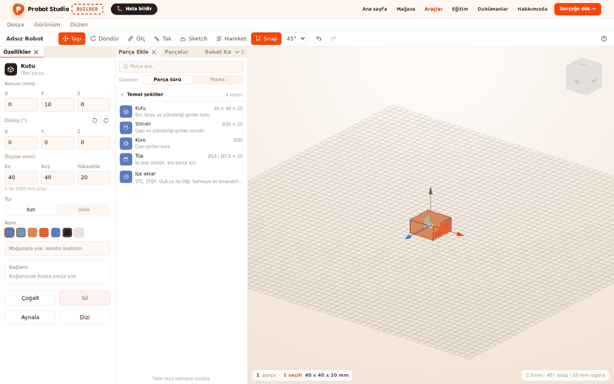
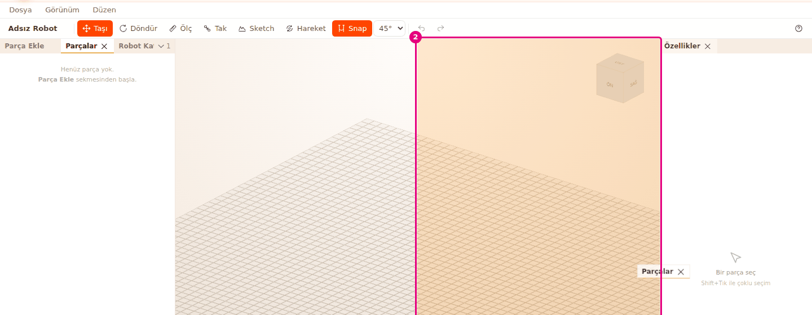
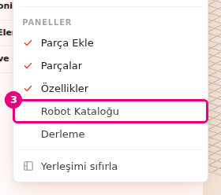
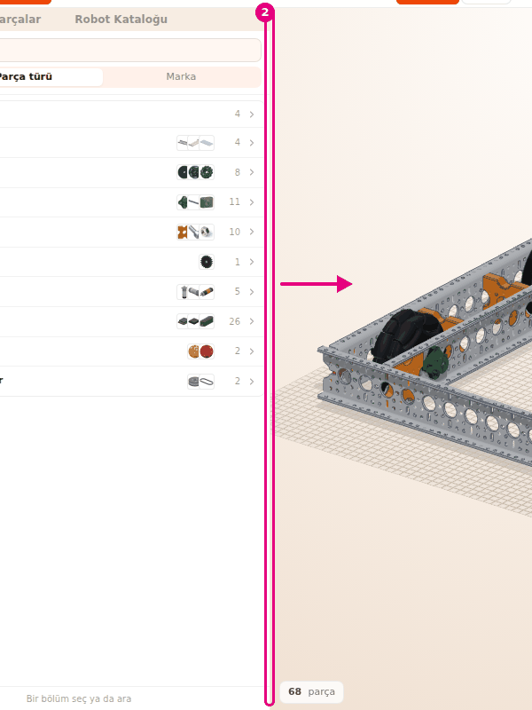
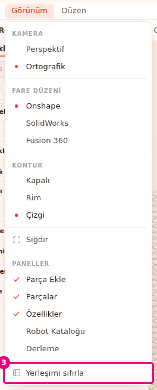

# Panelleri düzenle

Bu sayfada Builder'ın panellerini istediğin yere taşıyacak, kapatıp açacak ve genişliklerini
ayarlayacaksın. Yerleşim karışırsa onu ilk hâline döndürürsün.

<!-- CAPTURE: url=https://probotstudio.com/builder/ | hazirla=boş sahne, Özellikler paneli sola taşınmış | hedef=body | isaret=yok | bekle=text="Özellikler" -->

## Başlamadan önce

- Builder açık. Sahnede robot olması gerekmez.
- İlk açılışta yerleşim şöyledir: **Sol panel**de **Parça Ekle** (önde), **Parçalar** ve **Robot
  Kataloğu** sekmeleri, ortada **Sahne**, onun yanında **Özellikler** paneli. **Derleme** paneli
  kapalıdır.

## Sekmeyi başka yere taşı

Her panel bir sekmedir. Sekmeyi adından tutup sürükleyerek yerini değiştirirsin.

1. **Sol panel**de **Parçalar** sekmesini adından tut.
2. Sekmeyi **Sahne**nin **Özellikler** tarafındaki kenarına sürükle. Bırakacağın yer renkli alanla
   gösterilir.
3. Fare tuşunu bırak.
   
   <!-- CAPTURE: url=https://probotstudio.com/builder/ | hazirla=hazir:Omni şasi, varsayılan yerleşim, Parçalar sekmesi Sahne ile Özellikler arasına sürükleniyor (bırakmadan önce) | hedef=text="Parçalar";koordinat:sahne-sag-kenar | isaret=2 | bekle=text="Parçalar" -->
   <!-- SAY: Parçalar sekmesini sürükleyip sahnenin yanına ayrı bir sütun olarak bırakıyoruz. -->

Sonuç: **Parçalar** sahnenin yanında kendi sütununda durur. **Sol panel**de **Parça Ekle** ve
**Robot Kataloğu** kalır.

Sekmeyi nereye bırakırsan orada durur:

- **Başka bir panelin sekme satırına:** O panelle aynı grupta sekme olur.
- **Bir panelin kenarına:** Panelin yanına ya da altına ayrı panel olarak yerleşir. Alt kenara
  bırakırsan iki panel alt alta durur.
- **Sahnenin kenarına:** Sahnenin dört kenarından birine yeni sütun ya da satır olarak yerleşir.
  **Sahne**nin ortasına sekme bırakılmaz.

Sekme satırının boş yerinden tutup sürüklersen gruptaki bütün sekmeler birlikte taşınır. Sekme
satırına sığmayan sekmeler satırın sonundaki açılır listede durur.

## Paneli kapat ve yeniden aç

1. Fareyi **Robot Kataloğu** sekmesinin üstüne getir (ya da sekmeye basıp öne al). Sekmenin
   yanında çarpı (×) belirir, ona bas. Panel kapanır.
2. **Menü çubuğu**nda **Görünüm**'e bas.
3. **PANELLER** grubunda **Robot Kataloğu**'nu işaretle.
   
   <!-- CAPTURE: url=https://probotstudio.com/builder/ | hazirla=varsayılan yerleşim, Robot Kataloğu kapatılmış, Görünüm menüsü açık | hedef=role=menuitemcheckbox[name="Robot Kataloğu"] | isaret=3 | bekle=text="Yerleşimi sıfırla" -->
   <!-- SAY: Kapattığımız paneli Görünüm menüsündeki Paneller grubundan geri açıyoruz. -->

Sonuç: **Robot Kataloğu** yeniden açılır ve öne gelir.

**PANELLER** grubunda beş panel vardır: **Parça Ekle**, **Parçalar**, **Özellikler**, **Robot
Kataloğu** ve **Derleme**. Açık panellerin yanında işaret durur. İşaretli bir panele basınca panel
kapanır. Yeniden açılan panel şu yere gelir:

- **Parça Ekle**, **Parçalar**, **Robot Kataloğu:** Bu üçünden açık olan birinin grubuna sekme
  olarak katılır. Hiçbiri açık değilse sahnenin yanında yeni sütun açılır.
- **Özellikler:** Sahnenin yanında kendi sütununda açılır.
- **Derleme:** **Özellikler** açıksa onun altına, değilse sahnenin yanına yerleşir.

**Sahne** kapatılamaz. Sekmesi ve çarpısı yoktur.

## Panelin genişliğini değiştir

1. Farenin imlecini **Sol panel** ile **Sahne** arasındaki ayırıcı çizginin üstüne getir.
2. Ayırıcıyı sola ya da sağa sürükle.
3. Paneli rahat genişliğine döndürmek için ayırıcıya çift tıkla.
   
   <!-- CAPTURE: url=https://probotstudio.com/builder/ | hazirla=hazir:Omni şasi, varsayılan yerleşim, Sol panel geniş çekilmiş | hedef=koordinat:sol-panel-sahne-ayiricisi | isaret=2 | bekle=text="Parça Ekle" -->
   <!-- SAY: Ayırıcıyı sürükleyip paneli genişletiyoruz, çift tıklayınca eski genişliğine dönüyor. -->

Sonuç: Panel genişler ya da daralır. Aradaki fark **Sahne**ye geçer, diğer paneller yerinde kalır.

Paneller belli bir genişliğin altına inmez. **Sahne** de en az 320 px kalır.

| Panel | En dar | Çift tıkla döndüğü genişlik |
|---|---|---|
| **Parça Ekle** | 280 px | 310 px |
| **Parçalar** | 210 px | 240 px |
| **Özellikler** | 250 px | 270 px |
| **Robot Kataloğu** | 300 px | 330 px |
| **Derleme** | 300 px | 330 px |

Bir grupta birden çok sekme varsa grup, sekmelerinden en genişinin değerini alır. Varsayılan **Sol
panel** bu yüzden çift tıklayınca 330 px olur.

## Yerleşimi sıfırla

1. **Menü çubuğu**nda **Görünüm**'e bas.
2. Menünün sonuna yakın **PANELLER** grubuna in.
3. Grubun altındaki **Yerleşimi sıfırla**'yı seç.
   
   <!-- CAPTURE: url=https://probotstudio.com/builder/ | hazirla=Parçalar sekmesi ayrı sütuna taşınmış, Robot Kataloğu kapalı, Görünüm menüsü açık | hedef=role=menuitem[name="Yerleşimi sıfırla"] | isaret=3 | bekle=text="Yerleşimi sıfırla" -->
   <!-- SAY: Paneller karıştıysa Yerleşimi sıfırla ile ilk hâline dönüyoruz. -->

Sonuç: Paneller ilk açılıştaki yerlerine ve genişliklerine döner. **Parça Ekle** öne gelir,
**Derleme** kapanır.

Sıfırlama yalnız panellerin yerini değiştirir. Sahnedeki robota ve **Görünüm** menüsündeki kamera,
fare düzeni ve kontur seçimlerine dokunmaz.

## Panellerin kendiliğinden yaptıkları

- **Özellikler kendiliğinden açılır:** **Özellikler** panelini kapattıysan, seçim boşken bir parça
  seçtiğinde panel yeniden açılır. Böylece seçili parçanın ayarlarını
  düzenleyeceğin bir yer olur. **Özellikler** açık ama başka bir grupta arkadaki bir sekmeyse parça
  seçmek onu öne getirmez. Ayarları görmek için sekmesini seç.
- **Yerleşim hatırlanır:** Panellerin yeri ve genişliği bu tarayıcıda saklanır. Builder'ı yeniden
  açınca aynı yerleşimle gelir. Başka bir tarayıcıda ya da bilgisayarda ilk açılıştaki yerleşim gelir.
- **Sekmeye basınca panel kısa süre çerçevelenir:** Önde olan sekmeye bassan da hangi panel olduğunu
  görürsün. "Sahne boş" kartındaki **Parça listesi** ve **Robot kataloğu** da paneli böyle gösterir.
- **Sketch sekmesi geçicidir:** **Sketch** ya da **Extrude** açıkken **Sol panel**e geçici bir sekme
  katılır. Kapanınca önceki sekme geri gelir. Bu sekme yerleşime kaydedilmez.

<!-- SAY: Builder panellerin yerini bu tarayıcıda hatırlıyor ve seçim yapınca Özellikleri açıyor. -->

## Sorun mu var?

- **Bir panel kayboldu:** **Görünüm** menüsündeki **PANELLER** grubunda o paneli işaretle.
  Bkz. [Sorun giderme](sorunlar.md#panel-kayboldu).
- **Özellikler'i kapattım, kendiliğinden açıldı:** Panel kapalıyken bir parça seçince açılır. Bu
  davranışın ayarı yoktur. Paneli yer kaplamasın diye başka bir grubun sekmesi yapabilirsin. O zaman ayarları görmek için
  **Özellikler** sekmesini seç.
- **Panel daha fazla daralmıyor:** Panel en dar genişliğinde. Tablodaki değerlere bak.
- **Yerleşim karıştı:** **Görünüm** > **Yerleşimi sıfırla**'yı seç.
- **Sekmeyi sahnenin ortasına bırakamıyorum:** Sahnenin ortası kapalıdır. Sahnenin bir kenarına bırak.

## Sonraki adım

- [Arayüz turu](arayuz.md)
- [Sahnede gezin](sahnede-gezin.md)
- [Robotu derle](robotu-derle.md)
