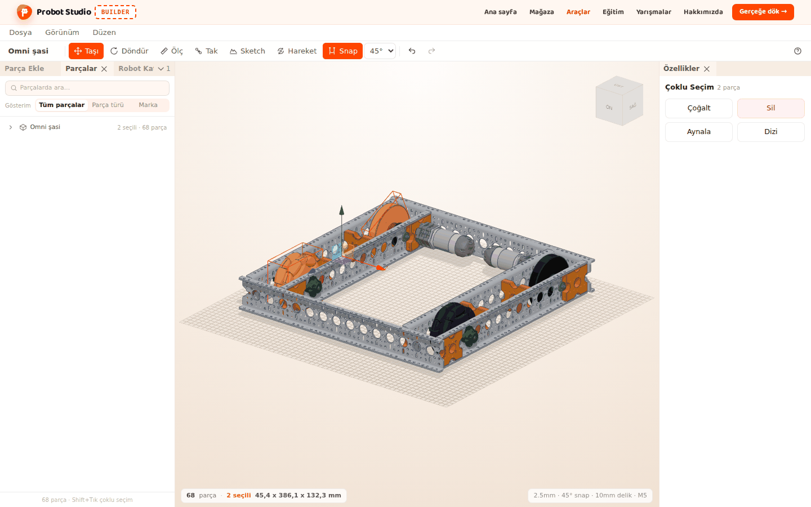
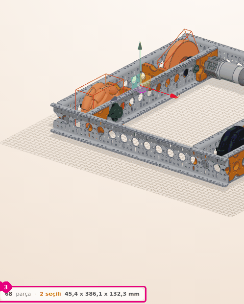
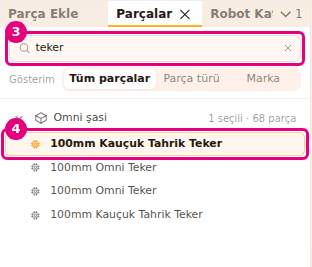
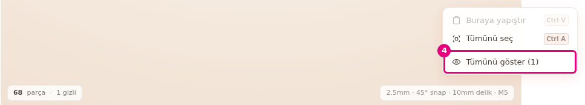
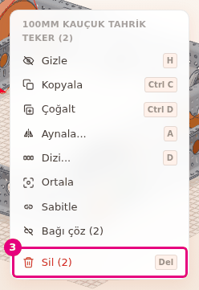

# Parçaları seç, gizle ve sil

Bu sayfada sahnedeki parçaları tek tek ya da toplu seçeceksin. Arkada kalan parçayı görmek için
öndekini gizleyecek, istemediğin parçayı silecek ve yanlış adımı geri alacaksın.

<!-- CAPTURE: url=https://probotstudio.com/builder/ | hazirla=hazir:Omni şasi, iki teker Shift ile seçili | hedef=body | isaret=yok | bekle=text="2 seçili" -->

## Başlamadan önce

- Sahnede **Omni şasi** açık (bkz. [Hazır robotla başla](hazir-robotla-basla.md)). Durum şeridinde
  "68 parça" yazıyor.
- **Araç çubuğu**nda **Taşı** seçili. **Ölç**, **Tak** ve **Sketch** açıkken sahnede parça seçilmez.

## Sahnede parça seç

Sol tuş her fare düzeninde yalnız seçim yapar. Seçili parçanın çevresinde çerçeve çizilir.

1. Robotun tamamını görmek için **Görünüm** > **Sığdır**'ı seç.
2. **Sahne**de şasinin bir tekerine sol tıkla. Teker seçilir.
3. <kbd>Shift</kbd>'i basılı tutup diğer bir tekere tıkla. İkinci teker seçime eklenir.
   
   <!-- CAPTURE: url=https://probotstudio.com/builder/ | hazirla=hazir:Omni şasi, iki teker Shift ile seçili | hedef=koordinat:durum-seridi-sol | isaret=3 | bekle=text="2 seçili" -->
   <!-- SAY: Shift tuşuyla ikinci tekeri de seçime ekliyoruz, alttaki şeritte iki seçili yazıyor. -->

Sonuç: Durum şeridinde "68 parça · 2 seçili" ve seçimin boyutu yazar. Boyut genişlik x uzunluk x
yükseklik sırasıyla mm cinsindendir.

- <kbd>Ctrl</kbd> ya da Mac'te <kbd>Cmd</kbd> ile tıklamak da <kbd>Shift</kbd> gibi çalışır.
  Seçili bir parçaya böyle tıklarsan seçimden çıkar.
- Boş bir yere tıklamak seçimi bırakır. <kbd>Esc</kbd> de seçimi bırakır.
- Bütün parçaları seçmek için <kbd>Ctrl</kbd>+<kbd>A</kbd>'ya bas. Boş alanda sağ tıklayıp **Tümünü
  seç**'i seçmek de aynı işi yapar.
- Durum şeridinde gizli parça varsa sayısı da yazar (ör. "3 gizli").

### Kutu çizerek seç

Sahnede boş bir noktadan sol tuşla sürükle. Bir kutu çizilir. Bıraktığında kutuya değen bütün
görünür parçalar seçilir. Parçanın kutunun içinde kalması gerekmez, kenarına değmesi yeter.

Sürüklemeye <kbd>Shift</kbd> ya da <kbd>Ctrl</kbd> basılıyken başlarsan kutudakiler eski seçime
eklenir. Sürüklemeye bir parçanın üstünden başlarsan kutu çizilmez.

<!-- SAY: Boş alandan sürükleyerek bir kutu çiziyoruz ve değdiği bütün parçaları seçiyoruz. -->

### Gruplanmış parçayı seç

**Sabitle** ile gruplanmış parçaya ilk tıklama bütün grubu seçer. Aynı parçaya yeniden tıklarsan
seçim bir alt düzeye iner. Son tıklamada yalnız o parça seçilir. Grup yapmak için bkz.
[Parçaları grupla ve birbirine bağla](grupla-ve-bagla.md).

<!-- SAY: Gruplu parçada her tıklamayla bir düzey içeri iniyoruz. -->

## Parçalar sekmesinden seç

Sahnede görmesi zor parçaları listeden seçersin. Hazır robotla gelen parçalar tek satırda toplanır.

1. **Sol panel**de **Parçalar** sekmesine bas. Listenin başında "Omni şasi" satırı ve yanında "68
   parça" yazar.
2. "Omni şasi" satırındaki oka bas ("Parçalarını göster"). Robotun parçaları açılır.
3. **Parçalarda ara...** kutusuna `teker` yaz. Liste adında, türünde, ürün kodunda ya da donanım
   adında "teker" geçen parçalara iner.
4. Listede bir teker satırına bas. Parça sahnede seçilir.
   
   <!-- CAPTURE: url=https://probotstudio.com/builder/ | hazirla=hazir:Omni şasi, Parçalar sekmesi açık, aramada teker yazılı, bir teker satırı seçili | hedef=placeholder="Parçalarda ara...";[data-part-id] | isaret=3,4 | bekle=[data-kit-row] -->
   <!-- SAY: Listede teker diye arıyoruz ve bulduğumuz satıra basınca parça sahnede seçiliyor. -->

Sonuç: Satır vurgulanır ve sahnedeki teker seçili olur. Panelin altında "N / 68 parça · Shift+Tık
çoklu seçim" yazar.

- Satıra <kbd>Shift</kbd>, <kbd>Ctrl</kbd> ya da <kbd>Cmd</kbd> ile basmak seçime ekler ya da çıkarır.
- "Omni şasi" satırının kendisine basmak robotun bütün parçalarını seçer. Bir kısmı seçiliyse satırda
  "N seçili · 68 parça" yazar.
- **Gösterim** seçicisi listeyi düzenler: **Tüm parçalar** eklenme sırasıyla ve gruplarıyla,
  **Parça türü** ve **Marka** başlıklar altında gösterir. Başlığa basınca kapanır ya da açılır.
- **Gösterim** seçimin bu tarayıcıda hatırlanır.

## Parçayı gizle ve göster

Gizlenen parça sahneden kalkar ama silinmez. Öndeki parçayı gizleyip arkasındakine ulaşırsın.

1. **Sahne**de şasinin bir Structure parçasına sağ tıkla. Bağlam menüsü açılır.
2. Menüde **Gizle**'yi seç (<kbd>H</kbd>). Parça sahneden kalkar.
3. Gizli parçaları geri getirmek için **Sahne**de boş bir yere sağ tıkla.
4. Menüde **Tümünü göster (1)**'i seç.
   
   <!-- CAPTURE: url=https://probotstudio.com/builder/ | hazirla=hazir:Omni şasi, bir Structure gizli, boş alana sağ tık | hedef=text="Tümünü göster (1)" | isaret=4 | bekle=text="Buraya yapıştır" -->
   <!-- SAY: Öndeki parçayı gizliyoruz, işimiz bitince boş alandan tümünü geri getiriyoruz. -->

Sonuç: Köşede "1 parça gösterildi" bildirimi çıkar ve parça yerine döner.

- <kbd>H</kbd> seçili parçaları gizler. Gizlenen parça seçimden çıkar.
- **Parçalar** sekmesinde satırın üstüne gelince göz simgesi çıkar ("Gizle" / "Göster"). Gizli
  parçanın satırı soluk görünür ve üstü çizili göz taşır.
- Gizli parça sahnede tıklanmaz. Geri getirmek için satırdaki **Göster** simgesini ya da **Tümünü
  göster (n)**'i kullan.
- Gizleme ve gösterme de geri alınabilir bir adımdır.

## Parçayı sil

!!! warning "Dikkat"
    **Parçalar** sekmesinde hazır robot satırının **Sil** simgesi robotun bütün parçalarını siler.
    Yanlışlıkla sildiysen başka bir şey yapmadan **Düzen** > **Geri al**'ı seç.

1. **Sahne**de silmek istediğin parçayı seç. Birden çok parçayı <kbd>Shift</kbd> ile seçebilirsin.
2. Seçili parçalardan birine sağ tıkla. Menünün başında parçanın adı ve seçili adet yazar.
3. Menüde **Sil (2)**'yi seç. Tek parça seçiliyse öğenin adı **Sil**'dir.
   
   <!-- CAPTURE: url=https://probotstudio.com/builder/ | hazirla=hazir:Omni şasi, iki teker Shift ile seçili, birinin üstüne sağ tık | hedef=text="Sil (2)" | isaret=3 | bekle=text="Sil (2)" -->
   <!-- SAY: İki tekeri seçip sağ tık menüsünden birlikte siliyoruz. -->

Sonuç: Parçalar sahneden ve **Parçalar** listesinden kalkar. Durum şeridinde "66 parça" yazar.

Aynı işi yapan başka yollar:

- <kbd>Del</kbd> ya da <kbd>Backspace</kbd> tuşu. **Ölç** açıkken bu tuşlar parça yerine son ölçümü siler.
- **Düzen** > **Sil**.
- **Özellikler** panelindeki **Sil**.
- **Parçalar** sekmesinde satırın üstüne gelince çıkan **Sil** simgesi (×).

Silinen parçaya bağlı parçalar yerinde kalır, bağları çözülür. Bir kasnağı silersen ona takılı kayış
da silinir.

## Yanlış adımı geri al

**Düzen** > **Geri al**'ı seç (<kbd>Ctrl</kbd>+<kbd>Z</kbd>). Son değişiklik geri alınır. Builder
en çok 59 adım geriye gider. Geri aldığın adımı yeniden yapmak için **Düzen** > **Yinele**'yi seç
(<kbd>Ctrl</kbd>+<kbd>Y</kbd> ya da <kbd>Ctrl</kbd>+<kbd>Shift</kbd>+<kbd>Z</kbd>).

**Araç çubuğu**ndaki geri al ve ileri al simgeleri de aynı işi yapar. Geri alınacak adım yoksa
simge soluktur. Geri alma ve yineleme seçimi bırakır.

Bir metin ya da sayı kutusuna yazarken kısayollar çalışmaz. Önce kutudan çık.

<!-- SAY: Yanlış bir adım attığımızda Ctrl Z ile elli dokuz adıma kadar geri dönebiliyoruz. -->

## Sorun mu var?

- **Parçaya tıklıyorum, seçilmiyor:** **Ölç**, **Tak** ya da **Sketch** açık olabilir. **Ölç** ve
  **Tak**'ı kapatmak için **Araç çubuğu**nda **Taşı**'ya bas ya da <kbd>Esc</kbd>'ye araç kapanana
  kadar birkaç kez bas. Her basış bir adım geri gider. **Ölç**'te önce bekleyen nokta, sonra bütün
  ölçümler silinir. **Sketch**'ten çıkmak için **Araç çubuğu**ndaki **Sketch** düğmesine ya da
  **Bitir**'e (<kbd>Enter</kbd>) bas. <kbd>Esc</kbd> Sketch'i yalnız düzlem seçerken kapatır.
- **Tıkladığım parça yerine bütün grup seçiliyor:** Parça gruplanmış. Aynı parçaya yeniden tıkla.
- **Kutu çizilmiyor, kamera dönüyor:** Sürüklemeye sol tuşla ve boş bir noktadan başla.
- **Sağ tıklayınca menü açılmıyor:** Sağ tuşu basılıyken fare oynarsa menü açılmaz
  (Onshape düzeninde kamera da döner). Fareyi oynatmadan tıkla.
  Montaj modunda ve **Ölç**, **Tak**, **Sketch** açıkken menü açılmaz.
- **Köşede "Montaj modunda düzenleme kapalı" yazıyor:** Montaj şeridinde **Düzenlemeye geç**'e bas.
  Bkz. [Sorun giderme](sorunlar.md#montaj-modu).
- **Gizli parçayı bulamıyorum:** Boş alanda sağ tıkla ve **Tümünü göster (n)**'i seç.

## Sonraki adım

- [Parçayı taşı ve döndür](tasi-ve-dondur.md)
- [Parçaları çoğalt, aynala ve diz](cogalt-aynala-dizi.md)
