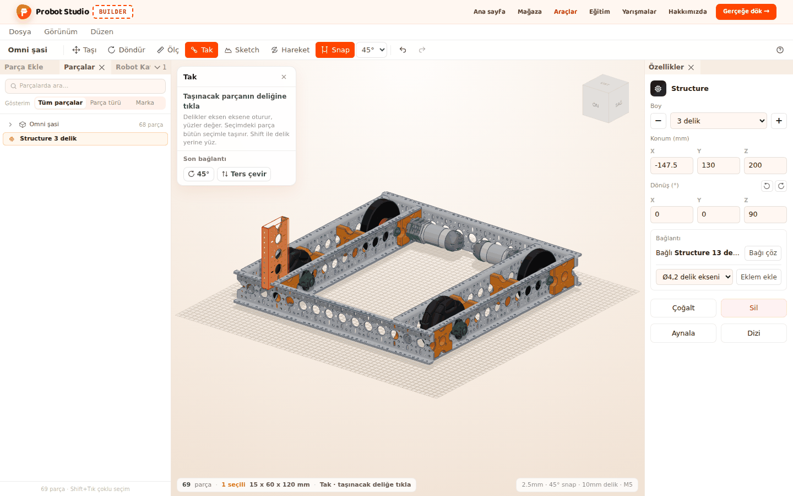
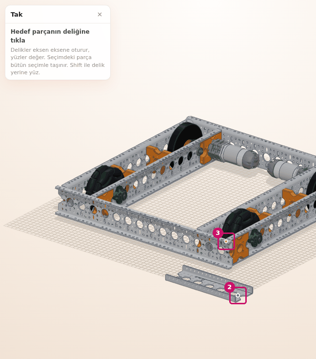
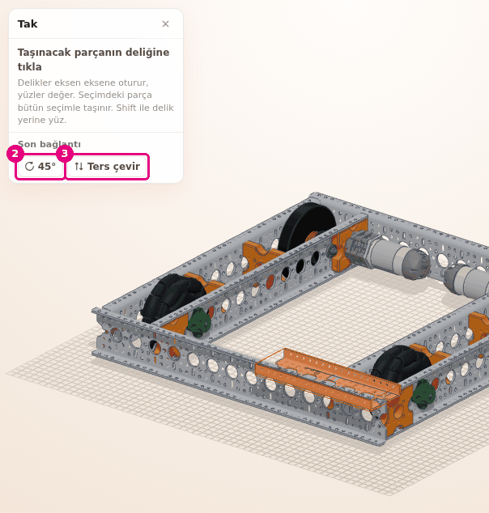
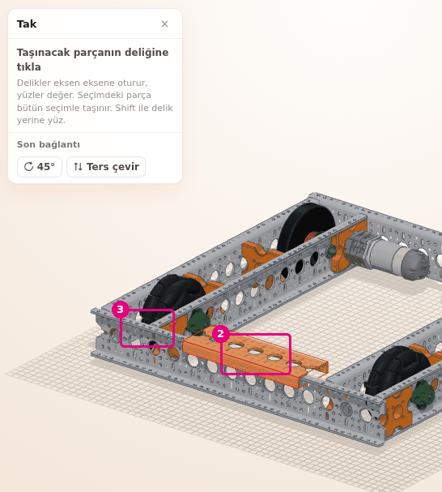
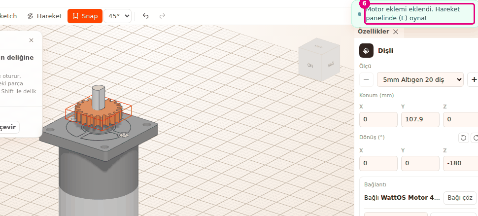

# Parçaları deliklerinden tak

Bu sayfada **Tak** aracıyla bir parçanın deliğini başka bir parçanın deliğine oturtacaksın. Delikler
eksen eksene hizalanır, yüzler birbirine değer. Takılan parça hedef parçaya bağlanır.

<!-- CAPTURE: url=https://probotstudio.com/builder/ | hazirla=hazir:Omni şasi + Structure takılmış, Tak açık | hedef=body | isaret=yok | bekle=[data-testid="tak-paneli"] -->

## Başlamadan önce

- Sahnede **Omni şasi** açık (bkz. [Hazır robotla başla](hazir-robotla-basla.md)).
- **Parça Ekle** > **Yapı** > **Structure** > **5 delik** eklendi. Parça şasinin ortasında zeminde
  duruyor (bkz. [Parça ekle](parca-ekle.md)).
- Motor mili bölümü için boş bir sahne gerekir. O bölümün başında anlatılır.

## Deliği deliğe tak

1. **Araç çubuğu**nda **Tak**'a bas (<kbd>B</kbd>). **Sahne**nin köşesinde **Tak** paneli açılır.
   Panelde "Taşınacak parçanın deliğine tıkla" yazar.
2. Structure parçasının bir deliğine tıkla. İmlecin altındaki delik turuncu işaretlenir. Tıkladığın
   delik mavi kalır.
3. Paneldeki yazı "Hedef parçanın deliğine tıkla" olur. Şasinin üst yüzündeki bir deliğe tıkla.
   
   <!-- CAPTURE: url=https://probotstudio.com/builder/ | hazirla=hazir:Omni şasi + Structure 5 delik zeminde, Tak açık, kaynak deliğe tıklandı, imleç şasideki hedef delikte | hedef=[data-testid="tak-paneli"];koordinat:kaynak-delik,hedef-delik | isaret=2,3 | bekle=text="Hedef parçanın deliğine tıkla" -->
   <!-- SAY: Önce taşıyacağımız parçanın deliğine sonra şasideki deliğe tıklıyoruz ve parça yerine oturuyor. -->
4. **Tak** panelinin kapat simgesine bas ("Tak aracını kapat (Esc)").

Sonuç: Structure şasinin üst yüzüne oturur ve seçili olur. Bağlama tek geri alma adımıdır
(<kbd>Ctrl</kbd>+<kbd>Z</kbd>).

- **Tak** açıkken durum şeridinde "Tak · taşınacak deliğe tıkla" ya da "Tak · hedef deliğe tıkla" yazar.
- Aynı parçada başka bir deliğe tıklarsan kaynak delik değişir.
- Tıklarken fareyi oynatırsan tıklama sayılmaz, kamera döner.
- **Tak** açıkken parça seçilmez, tutamaç çıkmaz ve bağlam menüsü açılmaz.

### Takılan parça hedefe bağlanır

Taşınan parça hedef parçaya bağlanır. Hedef parçayı sonra taşırsan takılan parça da onunla gelir.
Bağı **Özellikler** panelinin **Bağlantı** alanında görür ve çözersin (bkz.
[Parçaları grupla ve birbirine bağla](grupla-ve-bagla.md)).

<!-- SAY: Taktığımız parça artık şasiye bağlı, şasiyi taşıyınca o da geliyor. -->

### Seçimi birlikte tak

Kaynak deliğe tıkladığın parça seçimin içindeyse bütün seçim birlikte taşınır. Gruplanmış bir parça
da grubuyla taşınır. Birkaç parçayı önce birbirine takıp seçer, sonra hepsini tek seferde
robota takarsın.

<!-- SAY: Birden çok parçayı seçip birinin deliğinden tuttuğumuzda hepsi birlikte yerine oturuyor. -->

## Son bağlantıyı döndür ya da ters çevir

Takma bitince **Tak** panelinde "Son bağlantı" grubu çıkar. Parça yanlış yöne bakıyorsa buradan
düzeltirsin. Düzeltmeler takmayla aynı geri alma adımına yazılır.

1. Structure'ı şasiye tak (bkz. yukarıdaki bölüm). **Tak** panelini kapatma.
2. **Tak** panelinde "Son bağlantı" altındaki **45°**'ye bas. Parça delik ekseni etrafında 45° döner.
3. Parçanın öbür yüzü değsin istiyorsan **Ters çevir**'e bas (<kbd>F</kbd>).
   
   <!-- CAPTURE: url=https://probotstudio.com/builder/ | hazirla=hazir:Omni şasi + Structure şasiye takılmış, Tak paneli açık, döndürme adımı 45° | hedef=[data-testid="tak-dondur"];[data-testid="tak-cevir"] | isaret=2,3 | bekle=text="Son bağlantı" -->
   <!-- SAY: Parça ters durduysa son bağlantıyı döndürüp ters çeviriyoruz. -->

Sonuç: Parça deliğinden ayrılmadan döner ya da ters yüzüyle oturur. Ters çevrilen parça başka bir
parçanın içine girebilir. Öyleyse <kbd>Ctrl</kbd>+<kbd>Z</kbd> ile geri al.

- Düğmedeki açı **Araç çubuğu**ndaki döndürme adımıdır (5°, 15°, 30°, 45°, 90°).
- <kbd>R</kbd> aynı adımla döndürür, <kbd>Shift</kbd>+<kbd>R</kbd> ters yöne döndürür.
- Takmadan sonra sahnede başka bir değişiklik yaparsan "Son bağlantı" grubu kalkar. Bu durumda
  <kbd>R</kbd> **Döndür** aracına geçer ve **Tak**'ı kapatır.

## Deliği değil yüzü tak

Deliği olmayan bir parçayı ya da bir yüzü başka bir yüze oturtmak için <kbd>Shift</kbd> kullanılır.

1. **Araç çubuğu**nda **Tak**'a bas (<kbd>B</kbd>).
2. <kbd>Shift</kbd>'i basılı tutarak Structure'ın şasiye değecek yüzüne tıkla. Yüz
   görünmüyorsa önce kamerayı çevir.
3. <kbd>Shift</kbd>'i basılı tutarak şasinin üst yüzüne tıkla.
   
   <!-- CAPTURE: url=https://probotstudio.com/builder/ | hazirla=hazir:Omni şasi + Structure 5 delik zeminde, Tak açık, Shift ile yüzden yüze takıldı | hedef=koordinat:kaynak-yuz,hedef-yuz | isaret=2,3 | bekle=[data-testid="tak-paneli"] -->
   <!-- SAY: Shift basılıyken delik yerine yüzü seçiyoruz ve iki yüz birbirine değiyor. -->

Sonuç: İki yüz birbirine değer. <kbd>Shift</kbd> basılıyken hizalama yapılmaz.

Parçanın yakındaki deliklere kayarak hizalanmasını istiyorsan **Snap** açıkken 3. adımda
<kbd>Shift</kbd>'i bırak ve şasinin üst yüzünde deliklerden uzak düz bir yere tıkla. Bir deliğin
yakınına tıklarsan o delik hedef olarak seçilir.

Yüzle takmada **Ters çevir** parçanın arka yüzünü değdirir. Arka yüz bulunamazsa "Bu yüzün arkası
bulunamadı" yazar.

## Dişliyi motor miline tak

Teker, dişli, göbek ya da kasnağı motorun ya da servonun miline takarsan aralarına dönme eklemi
kendiliğinden kurulur. Sonra **Hareket** panelinde parçayı döndürürsün.

!!! warning "Dikkat"
    **Dosya** > **Yeni** sahnedeki parçaları kaldırır. Çalışmanı saklamak istiyorsan önce **Dosya** >
    **Kaydet (JSON indir)**'i seç.

1. **Dosya** > **Yeni**'yi seç. "Sahnedeki parçalar silinecek. Yeni proje açılsın mı?" sorusunu onayla.
2. **Parça Ekle** > **Motor ve Servo** > **WattOS Motor** > **480 RPM**'yi seç.
3. **Parça Ekle** > **Dişliler** > **Dişli** > **5mm Altıgen 20 diş**'i seç. Dişli motorun arkasına
   gelirse **Özellikler** > **Konum** X kutusuna `60` yazarak yanına al.
4. **Araç çubuğu**nda **Tak**'a bas (<kbd>B</kbd>).
5. Dişlinin düz yan yüzüne, ortasına yakın bir yere tıkla. Ortadaki boşluğa tıklama. Dişlide delik
   işareti çıkmaz, yüz seçilir. Mile takarken dişli kendiliğinden mile ortalanır.
6. Motorun miline tıkla. Dişli mile oturur.
   
   <!-- CAPTURE: url=https://probotstudio.com/builder/ | hazirla=boş sahne, WattOS Motor 480 RPM ve Dişli 5mm Altıgen 20 diş eklendi, Tak ile dişli yüzü motor miline takıldı | hedef=text="Motor eklemi eklendi. Hareket panelinde (E) oynat";koordinat:motor-mili | isaret=6 | bekle=text="Motor eklemi eklendi. Hareket panelinde (E) oynat" -->
   <!-- SAY: Dişliyi motorun miline takıyoruz ve aralarındaki eklem kendiliğinden kuruluyor. -->

Sonuç: Köşede "Motor eklemi eklendi. Hareket panelinde (E) oynat" bildirimi çıkar. Servoya
takarsan "Servo eklemi eklendi. Hareket panelinde (E) oynat" yazar. Yanında "Eşleşecek dişli yok"
bildirimi de çıkabilir. Dişli henüz başka bir dişliyle eşleşmediği için bu normaldir.

Eklem, motorun ya da servonun miline <kbd>Shift</kbd>'e basmadan tıklayınca kurulur. Mile
<kbd>Shift</kbd> ile tıklarsan mil yerine yüz seçilir ve eklem kurulmaz. Dişliye tıklarken
<kbd>Shift</kbd>'in bir etkisi yoktur. Eklemi oynatmak için bkz. [Eklem kur ve hareketi dene](eklem-kur-ve-oynat.md).

## Tak aracını kapat

<kbd>Esc</kbd> her basışta bir adım geri gider:

- Kaynak deliğe tıkladıysan önce onu bırakır. Panelde yeniden "Taşınacak parçanın deliğine tıkla" yazar.
- Sonra "Son bağlantı" grubunu kaldırır. Takılan parça yerinde kalır.
- Bunlar yoksa aracı kapatır.

**Araç çubuğu**nda **Tak**'a yeniden basmak, <kbd>B</kbd>, **Taşı** ya da **Döndür**'e geçmek de
aracı kapatır.

<!-- SAY: Esc tuşu önce bekleyen tıklamayı sonra son bağlantıyı bırakıyor ve en sonda aracı kapatıyor. -->

## Sorun mu var?

- **"Bu parça da taşınıyor. Seçim dışındaki bir parçaya tıkla" yazıyor:** Hedef parça da seçimin
  içinde. Önce **Tak**'ı kapat, seçimi bırak (<kbd>Esc</kbd>) ve yeniden dene.
  Bkz. [Sorun giderme](sorunlar.md#bu-parca-da-tasiniyor).
- **"Hedef parça taşınan parçaya bağlı. Önce Özelliklerden bağı çöz" yazıyor:** Hedef parça
  taşıdığın parçaya bağlı. **Özellikler** panelinin **Bağlantı** alanında **Bağı çöz**'e bas.
  Bkz. [Sorun giderme](sorunlar.md#hedef-parca-bagli).
- **"Bu yüzün arkası bulunamadı" yazıyor:** Yüzle taktığın parçanın arka yüzü bulunamadı. Parçayı
  **45°** ile döndür ya da başka bir yüzden tak. Bkz. [Sorun giderme](sorunlar.md#yuzun-arkasi-yok).
- **Parça yanlış yöne oturdu:** "Son bağlantı" altındaki açı düğmesini ya da **Ters çevir**'i kullan.
  Grup kalktıysa <kbd>Ctrl</kbd>+<kbd>Z</kbd> ile geri al ve yeniden tak.
- **Delik işaretlenmiyor:** İmleci deliğin ağzına yaklaştır. Yine olmazsa <kbd>Shift</kbd> ile yüzden tak.
- **Motora taktım ama eklem kurulmadı:** Hedef olarak motorun miline delikten tıkla. Taşınan parça
  teker, dişli, göbek ya da kasnak olmalı.

## Sonraki adım

- [Eklem kur ve hareketi dene](eklem-kur-ve-oynat.md)
- [Parçaları grupla ve birbirine bağla](grupla-ve-bagla.md)
