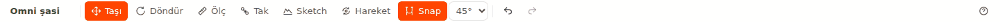
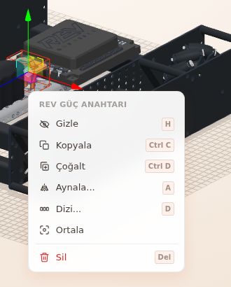

# Hoca hazırlığı

## Bu derste

Builder ekranını bölge bölge tanıtıyoruz. Diğer sunumlar bölgeleri burada verilen adlarla anıyor. Sonra Klavye Kısayolları penceresini, en sık kullanılan tuşları ve takılınca bakılacak yerleri gösteriyoruz.

## Dersten önce hazırla

- Builder'da Omni şasiyi açın ve bir Structure parçasını seçili bırakın.
- Görünüm > Yerleşimi sıfırla ile panelleri ilk yerlerine alın.

## Zaman planı

| Dakika | Bölüm |
|---|---|
| 0-2 | Kapak, bölgeler |
| 2-5 | Menüler, araç çubuğu |
| 5-8 | Sol panel, sahne, Özellikler |
| 8-11 | Kısayollar |
| 11-12 | Sorun olunca, özet |

# Sayfalar

## Builder arayüz turu ve kısayollar {kapak}

::: hoca
**Söyle:** "Bu sunumda Builder ekranını bölge bölge tanıyoruz. Menüleri, panelleri ve araç çubuğunu görüyoruz, ardından işimizi hızlandıran kısayol tuşlarına geçiyoruz. Sonraki sunumlar bu bölgeleri burada öğrendiğimiz adlarla anıyor."
:::

## Ekranın bölgeleri {sure=1}

- **Üst şerit**, **Menü çubuğu**, **Araç çubuğu**
- **Sol panel** ve ortada **Sahne**
- Sağda **Özellikler** paneli
- **Montaj şeridi** yalnız montaj modunda çıkar

::: hoca
**Söyle:** "Ekranın en üstünde Üst şerit, altında Menü çubuğu ve Araç çubuğu duruyor. Solda parça eklediğimiz panel, ortada robotun durduğu Sahne, sağda seçili parçanın ayarlarını gösteren Özellikler paneli var. Robotu adım adım kurarken sahnenin altında bir de Montaj şeridi açılıyor."
:::

## Dosya menüsü {sure=1}

- **Yeni**, **Kaydet (JSON indir)**, **Yükle...**
- **İçe aktar** ile 3B model dosyası
- Hesap öğeleri giriş ister
- **Sim'de dene** robotu Sim'de açar

::: hoca
**Söyle:** "Dosya menüsünde yeni proje açıyoruz, projeyi bilgisayara indiriyoruz ya da indirdiğimiz dosyayı yeniden yüklüyoruz. Aynı menüden 3B model içe aktarıyoruz, robotu hesabımıza kaydediyoruz ve Sim'de deniyoruz. Hesap öğeleri için giriş yapmış olmamız gerekiyor."
:::

## Görünüm menüsü {sure=1}

- **2** **FARE DÜZENİ** Onshape, SolidWorks, Fusion 360
- **3** **KAMERA** Perspektif ya da Ortografik
- **4** **KONTUR** Kapalı, Rim ya da Çizgi
- Altta **Sığdır** ve **PANELLER** grubu

::: hoca
**Söyle:** "Görünüm menüsünde fare düzenini, kamera türünü ve parçaların kontur çizgisini seçiyoruz. Altındaki Sığdır robotun tamamını kadraja alıyor, PANELLER grubu da hangi panellerin açık olacağını belirliyor."
:::

::: hoca
Düzen menüsü geri al, yinele, çoğalt, aynala, dizi, kayış ekle ve sil öğelerini topluyor. Seçim yokken Sil gibi öğeler soluk kalıyor. Geri al ve yinele dördüncü sunumda ayrıca anlatılıyor.
:::

## Araç çubuğu {sure=1}

- Solda proje adı, üstüne basınca değişir
- **Taşı**, **Döndür**, **Ölç**, **Tak**, **Sketch**, **Hareket**
- **Snap** turuncuysa açık
- Geri al, ileri al ve Yardım simgesi

::: hoca
**Söyle:** "Araç çubuğunun solunda proje adı duruyor, üstüne basıp yeni adı yazıyoruz. Ardından parçayı taşıma, döndürme, ölçme, takma, çizim ve hareket araçları geliyor. Snap turuncu olduğunda parça küçük adımlarla ilerliyor ve deliklere oturuyor."
:::

## Sol panel {sure=1}

- **Parça Ekle** mağaza parçaları ve temel şekiller
- **Parçalar** sahnedeki parçaların listesi
- **Robot Kataloğu** hazır robotlar
- Kapanan sekme **Görünüm** > **PANELLER** ile döner

::: hoca
**Söyle:** "Sol panelde üç sekme var. Parça Ekle sekmesinden yeni parça alıyoruz, Parçalar sekmesinde sahnedeki parçaları listeliyoruz, Robot Kataloğu sekmesinden hazır robot açıyoruz. Bir sekmeyi yanlışlıkla kapatırsak Görünüm menüsündeki PANELLER grubundan geri getiriyoruz."
:::

## Sahnede bağlam menüsü {sure=1}

- **Sahne**de bir parçaya sağ tıklayın
- Menünün başında parçanın adı
- **Gizle**, **Kopyala**, **Çoğalt**, **Ortala**, **Sil**
- Öğenin yanında kısayol tuşu

::: hoca
**Söyle:** "Sahnede bir parçaya sağ tıkladığımızda bağlam menüsü açılıyor. Menünün başında parçanın adı yazıyor, altında gizleme, kopyalama, çoğaltma, ortalama ve silme gibi sık yaptığımız işler duruyor. Her öğenin yanında kısayol tuşu da görünüyor."
:::

::: hoca
Sahnenin köşesinde görünüm küpü, altında durum şeridi duruyor. Durum şeridi parça sayısını, seçili parça sayısını ve seçimin boyutunu yazıyor.
:::

## Özellikler paneli {sure=1}

- Seçili parçanın adı en üstte
- Boy ya da ölçü seçici
- **Konum (mm)** ve **Dönüş (°)**
- **Çoğalt**, **Sil**, **Aynala**, **Dizi**

::: hoca
**Söyle:** "Bir parça seçtiğimizde Özellikler panelinin başında parçanın adı çıkıyor. Buradan parçanın boyunu değiştiriyoruz, yerini ve açısını sayıyla giriyoruz. Görünen alanlar parçanın türüne göre değişiyor, motor seçtiğimizde örneğin donanım alanı da geliyor."
:::

## Klavye Kısayolları penceresi {sure=1}

- **Araç çubuğu**nda **?** simgesi
- Ya da klavyede **?** tuşu
- Altta fare satırı sabit durur
- **Esc**, **?** ya da **×** kapatır

::: hoca
**Söyle:** "Araç çubuğunun sağındaki soru işaretine bastığımızda Klavye Kısayolları penceresi açılıyor. Listenin altında fare tuşlarının görevleri yazıyor. Pencereyi kapattığımızda seçimimiz ve açık araçlarımız olduğu gibi kalıyor."
:::

## Sık kullanılan tuşlar {sure=1}

- **T** taşı, **R** döndür
- **Ö** ölç, **B** tak
- **H** gizle ya da göster
- **Del** seçili parçaları siler

::: hoca
**Söyle:** "En çok kullandığımız tuşlar araçları seçiyor. T taşıma, R döndürme, Ö ölçme, B takma aracını açıyor. H seçili parçayı gizliyor ya da gösteriyor, Del siliyor. Kısayol penceresinde her işin tuşu satırın sağında yazıyor."
:::

::: hoca
Ctrl+Z son değişikliği geri alıyor, Ctrl+D seçimi çoğaltıyor. Mac'te Ctrl yerine Cmd kullanılıyor.
:::

## Kısayol çalışmıyorsa {sure=1}

- İmleç bir yazı kutusunda olabilir
- Montaj modunda yalnız ok tuşları çalışır
- **Aynala** ya da **Dizi** penceresi açık olabilir
- **Esc** her basışta bir adım geri çıkar

::: hoca
**Söyle:** "Bir yazı kutusuna yazarken tuşlar kutuya gidiyor ve kısayol çalışmıyor. Sahnede boş bir yere tıkladığımızda kısayollar geri geliyor. Esc tuşu her basışta açık olan menüyü, pencereyi ya da aracı sırayla kapatıyor."
:::

::: hoca
Ölç açıkken Esc tek ölçümü değil bütün ölçümleri siliyor. Tek ölçüm için Ölçüm panelindeki Bu ölçümü sil kullanılıyor.
:::

## Takılınca nereye bakılır {sure=1}

- Ekrandaki uyarı yazısını okuyun
- **Sorun giderme** sayfasında o yazıyı arayın
- Bulamazsanız **🐛 Hata bildir**
- Düğme üst şeritte, **BUILDER** rozetinin yanında

::: hoca
**Söyle:** "Bir şey beklediğimiz gibi gitmediğinde önce ekrandaki uyarıyı okuyoruz ve o yazıyı Sorun giderme sayfasında arıyoruz. Orada da bulamazsak üst şeritte BUILDER rozetinin yanındaki Hata bildir düğmesiyle ekibe ekrandaki yazıyı birebir gönderiyoruz."
:::

::: hoca
Durum göstergelerine de bakılıyor. Hesaba kayıtlı robotta proje adının yanında Kaydedildi ya da Kaydedilmedi yazıyor, durum şeridi parça, seçili ve gizli sayısını, Snap ayarını gösteriyor.
:::

::: hoca
Hata bildir mesajına açık robotun adı, son basılan düğme ya da tuş, ekrandaki yazı ve tarayıcı yazılıyor.
:::

## Özet {sure=1}

- Altı bölge, bölge adları her sunumda aynı
- Menüler ve araç çubuğu işleri toplar
- **?** kısayol listesini açar
- Takılınca durum şeridi ve Sorun giderme

::: hoca
**Söyle:** "Builder ekranının bölgelerini, menülerini ve en sık kullanılan tuşları tanıdık. Takıldığımızda nereye bakacağımızı da gördük. Sonraki sunumda hazır bir robotu açıyoruz, onu adım adım kuruyoruz ve sahnede rahatça geziniyoruz."
:::

# Ödevler

## Bölgeleri bul {#bld-arayuz-odev tur=builder}

Builder'da Omni şasiyi açın. Bir parçayı seçip Özellikler panelinde adını bulun, sonra Klavye Kısayolları penceresini açıp kapatın. Son olarak Görünüm > Sığdır ile robotu kadraja alın.

::: hoca
Tamam: öğrenci altı bölgeyi adıyla gösterebiliyor, ? tuşuyla pencereyi açıp kapatabiliyor.
Tekrar: Özellikler paneli kapalıysa Görünüm > PANELLER ile açılıyor.
:::
