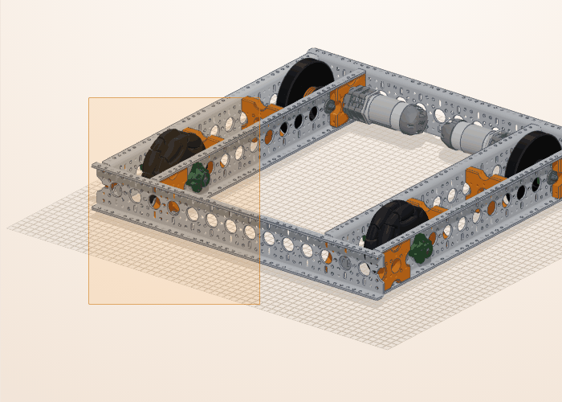

# Hoca hazırlığı

## Bu derste

Sahneye katalogdan parça ekliyoruz. Parçayı bölümden seçiyor, adıyla arıyor ya da sahneye sürüklüyoruz, sonra boyunu Özellikler panelinden değiştiriyoruz. İkinci yarıda parçaları sahnede ve listede seçiyor, gizliyor, siliyor ve geri alıyoruz.

## Dersten önce hazırla

- Builder'da Omni şasiyi açın, durum şeridinde 68 parça yazsın.
- Araç çubuğunda Taşı seçili olsun. Ölç, Tak ve Sketch açıkken sahnede parça seçilmiyor.

## Zaman planı

| Dakika | Bölüm |
|---|---|
| 0-6 | Kapak, parça ekleme, boy ve uzunluk |
| 6-11 | Seçme, gizleme, silme, geri alma |
| 11-12 | Özet |

# Sayfalar

## Parça ekle, seç, gizle ve sil {kapak}

::: hoca
**Söyle:** "Bu sunumda sahneye kendi parçalarımızı ekliyoruz ve boylarını ayarlıyoruz. Ardından parçaları tek tek ya da toplu seçmeyi, arkada kalanı görmek için öndekini gizlemeyi, istemediğimizi silmeyi ve yanlış adımı geri almayı görüyoruz."
:::

## Bölümden parça ekle {sure=1}

- **Sol panel** > **Parça Ekle**
- **Yapı** > **Structure**, boy seçenekleri açılır
- **5 delik**'e basınca parça sahneye gelir
- Geri satırı ya da **Esc** bir üst düzeye döner

::: hoca
**Söyle:** "Parça Ekle sekmesi parçaları Yapı, Tekerlekler, Motor ve Servo gibi bölümlere ayırıyor. Yapı bölümünden Structure satırını açıyoruz ve istediğimiz boya basıyoruz. Parça görünen alanın ortasına yakın bir yere konuyor ve seçili oluyor."
:::

## Ara ya da markaya göre listele {sure=1}

- **Parça ara...** ad, açıklama ve ürün kodunda arar
- Her sonuç tek basışla eklenir
- **Gösterim** > **Marka** markaya göre gruplar
- Satırda stok ve fiyat yazar

::: hoca
**Söyle:** "Parçanın adını biliyorsak bölümleri gezmiyoruz, arama kutusuna adın bir kısmını yazıyoruz. Sonuçlar bölüm başlıkları altında listeleniyor ve her biri tek basışla sahneye geliyor. Gösterim seçicisinden Marka'yı seçtiğimizde liste markaya göre gruplanıyor."
:::

::: hoca
Satırda stokta, stok N ya da kırmızı stok yok yazıyor. Stokta olmayan parça da tasarıma ekleniyor. Mağazaya bağlanılamazsa fiyat görünmüyor, parça yine ekleniyor.
:::

::: hoca
Marka görünümünde 21 kartlık Boardoza bölümü de var. İçinde kontrol kartı, motor sürücüler, IMU, sensörler ve regülatörler duruyor. Bu kartların mağazada karşılığı yok, satırlarında stok ve fiyat yazmıyor.
:::

## Parçayı sahneye sürükle {sure=1}

- Satırı sol tuşla tutun
- **Sahne**ye sürükleyip bırakın
- Parça bırakılan yüzeye oturur
- **Snap** açıksa deliklere hizalanır

::: hoca
**Söyle:** "Parçayı listeden tutup sahneye sürüklediğimizde bıraktığımız yere oturuyor. Bir parçanın üstüne bıraktığımızda onun yüzeyine konuyor. Snap açıksa yeni parça yakındaki deliklere hizalanıyor."
:::

## Parçanın boyunu değiştir {sure=1}

- Parçayı seçin
- **Özellikler** > **Boy** listesi
- **+** sonraki, **−** önceki seçenek
- Yeri ve açısı aynı kalır

::: hoca
**Söyle:** "Bir aileden gelen parçanın boyunu sonradan değiştiriyoruz. Özellikler panelindeki Boy listesinden yeni boyu seçiyoruz ya da artı düğmesiyle bir sonrakine geçiyoruz. Seçicinin adı parçaya göre Ölçü, Devir ya da Renk olarak da çıkıyor."
:::

## Mil uzunluğunu ayarla {sure=1}

- Mil ve spacer gibi kesilen parçalar
- **3** alana mm yazın, **Enter**
- **4** **+** yarım milimetre uzatır, **−** kısaltır
- Altta hazır boylar ve izin verilen aralık

::: hoca
**Söyle:** "Mil ve spacer gibi kesilerek kullanılan parçalarda Uzunluk alanı çıkıyor. Göbek ve Mil bölümünden bir mil ekleyip alana 150 yazıyoruz, mil yazarken sahnede canlı uzuyor. Artı ve eksi boyu yarım milimetre değiştiriyor, alttaki düğmeler sık kullanılan boyları veriyor."
:::

## Sahnede parça seç {sure=1}

- Sol tık parçayı seçer
- **Shift** ile tık seçime ekler
- **Ctrl+A** bütün parçaları seçer
- Durum şeridi seçili sayıyı ve boyutu yazar

::: hoca
**Söyle:** "Bir tekere sol tıklayıp seçiyoruz, Shift tuşuyla ikinci tekeri de seçime ekliyoruz. Alttaki şeritte 68 parça ve 2 seçili yazıyor, yanında seçimin milimetre cinsinden boyutu duruyor. Boş bir yere tıkladığımızda ya da Esc tuşuna bastığımızda seçim bırakılıyor."
:::

## Kutu çizerek seç {sure=1}

- Boş noktadan sol tuşla sürükleyin
- Sürüklerken bir kutu çizilir
- Bırakınca kutuya değen her görünür parça seçilir
- Gruplu parçada her tık bir düzey içeri iner

::: hoca
**Söyle:** "Boş alandan sürükleyerek bir kutu çiziyoruz ve değdiği bütün parçaları seçiyoruz. Parçanın kutunun içinde kalması gerekmiyor, kenarına değmesi yetiyor. Gruplanmış bir parçaya ilk tıklama bütün grubu seçiyor, sonraki tıklamalar bir alt düzeye iniyor."
:::

## Parçalar sekmesinden seç {sure=1}

- **Sol panel** > **Parçalar**
- **Parçalarda ara...** ile süzün
- Satıra basınca parça sahnede seçilir
- Robot satırı robotun tamamını seçer

::: hoca
**Söyle:** "Sahnede görmesi zor parçaları listeden seçiyoruz. Arama kutusuna teker yazdığımızda liste tekerlere iniyor. Bir satıra bastığımızda parça sahnede de seçiliyor, Shift ile bastığımızda seçime ekleniyor."
:::

## Gizle ve göster {sure=1}

- Parçaya sağ tık > **Gizle** (H)
- Gizli parça silinmez, tıklanmaz
- Boş alana sağ tık > **Tümünü göster**
- Durum şeridi gizli sayısını yazar

::: hoca
**Söyle:** "Arkadaki parçaya ulaşmak için öndekini gizliyoruz. Gizlenen parça silinmiyor, yalnız sahneden kalkıyor. İşimiz bitince boş bir alana sağ tıklayıp Tümünü göster ile hepsini geri getiriyoruz."
:::

## Parçayı sil {sure=1}

- Parçaları seçip sağ tıklayın
- **Sil (2)** seçili adedi gösterir
- **Del** tuşu ve **Düzen** > **Sil** de siler
- Robot satırındaki **Sil** robotun tamamını siler

::: hoca
**Söyle:** "İki tekeri seçip sağ tık menüsünden birlikte siliyoruz. Menüdeki öğe seçili adedi yazıyor, durum şeridinde 66 parça kalıyor. Silinen parçaya bağlı parçalar yerinde duruyor, bir kasnağı sildiğimizde ona takılı kayış da gidiyor."
:::

## Yanlış adımı geri al {sure=1}

- **1** **Düzen** > **Geri al** ya da **Ctrl+Z**
- **2** **Düzen** > **Yinele** ya da **Ctrl+Y**
- **3** Araç çubuğunda geri ve ileri simgeleri
- Yazı kutusundayken kısayol çalışmaz

::: hoca
**Söyle:** "Yanlış bir adım attığımızda Ctrl Z ile geri dönüyoruz, geri aldığımızı Ctrl Y ile yeniden yapıyoruz. Araç çubuğundaki ok simgeleri de aynı işi görüyor. Geri alınacak adım kalmadığında simge soluk görünüyor."
:::

## Özet {sure=1}

- Parça bölümden, aramadan ya da sürükleyerek gelir
- Boy ve uzunluk **Özellikler** panelinde
- Seçim sahnede, kutuyla ya da **Parçalar** sekmesinde
- **H** gizler, **Del** siler, **Ctrl+Z** geri alır

::: hoca
**Söyle:** "Sahneye parça ekledik, boyunu ayarladık ve parçaları seçip gizledik, sildik, geri aldık. Sonraki sunumda parçaları fareyle ve sayıyla taşıyıp döndürüyoruz, ardından Tak aracıyla deliklerinden birbirine takıyoruz."
:::

# Ödevler

## Şasiye mil ekle {#bld-parca-odev tur=builder}

Omni şasiyi açın. Göbek ve Mil bölümünden bir altıgen mil ekleyip uzunluğunu 150 mm yapın. Sonra iki tekeri gizleyin ve Tümünü göster ile geri getirin.

::: hoca
Tamam: sahnede 150 mm mil var, gizlenen tekerler yerine dönmüş.
Tekrar: teker gizlemek yerine silinmiş, Ctrl+Z ile geri alınıyor.
:::
