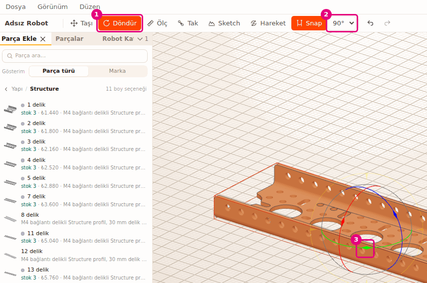
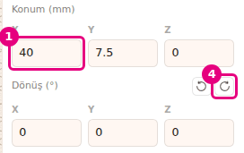
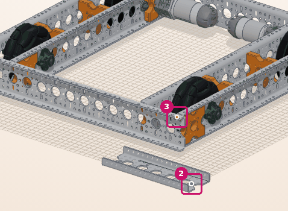
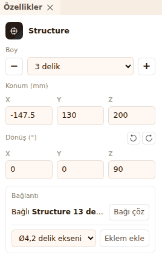
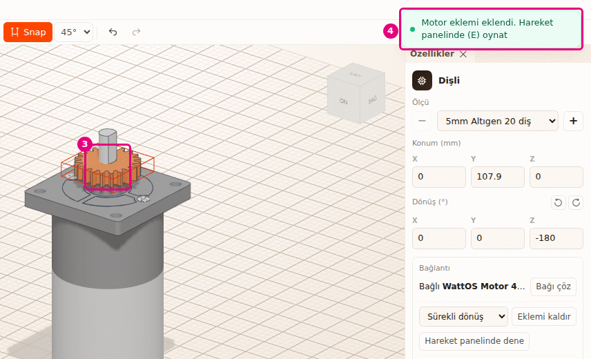

# Hoca hazırlığı

## Bu derste

Parçayı fareyle ve sayıyla taşıyıp döndürüyoruz, Snap'in parçayı ızgaraya ve deliklere nasıl oturttuğunu görüyoruz. İkinci yarıda Tak aracıyla bir parçanın deliğini başka bir parçanın deliğine oturtuyoruz, yüzü yüze takıyoruz ve dişliyi motor miline takıp eklem kuruyoruz.

## Dersten önce hazırla

- Builder'da Omni şasiyi açın ve Parça Ekle > Yapı > Structure > 5 delik ekleyin.
- Ölç, Tak, Sketch ve Hareket kapalı olsun. Bunlar açıkken taşıma tutamacı görünmüyor.
- Motor mili gösterimi için Dosya > Yeni ile boş sahne gerekiyor, şasiyi önce kaydedin.

## Zaman planı

| Dakika | Bölüm |
|---|---|
| 0-6 | Kapak, Snap, taşı, döndür, sayıyla, toplu taşıma |
| 6-11 | Tak, son bağlantı, yüz, motor mili, kapatma |
| 11-12 | Özet |

# Sayfalar

## Taşı, döndür ve deliklerinden tak {kapak}

::: hoca
**Söyle:** "Bu sunumda parçaları fareyle ve sayıyla taşıyıp döndürüyoruz. Ardından Tak aracıyla bir parçanın deliğini başka bir parçanın deliğine oturtuyoruz ve dişliyi motor miline takıp dönmeye hazır hâle getiriyoruz."
:::

## Snap ve ızgara {sure=1}

- **Snap** turuncuysa açık
- Parça 2,5 mm adımla ilerler, deliğe oturur
- Döndürme yandaki **45°** gibi açı adımına kilitlenir
- **Shift** basılıyken Snap o an kapanır

::: hoca
**Söyle:** "Snap açıkken parça iki buçuk milimetre adımla ilerliyor ve taşıdığımız parçanın deliği yakındaki bir deliğe gelince ona ortalanıyor. Döndürme de varsayılan olarak kırk beş derecelik adımlarla ilerliyor. Serbest hareket için sürüklerken Shift tuşunu basılı tutuyoruz."
:::

## Tutamaçla taşı {sure=1}

- **Taşı** (T ya da M) üç renkli ok getirir
- Oku sol tuşla tutup sürükleyin
- Ortadaki kareler iki eksende kaydırır
- Her bırakış tek geri alma adımı

::: hoca
**Söyle:** "Taşı aracını seçtiğimizde parçanın üstünde üç renkli ok çıkıyor. Kırmızı oku tutup sürüklediğimizde parça o eksen boyunca adım adım ilerliyor. Oklar parçanın kendi eksenlerini gösteriyor, döndürülmüş parçada oklar da dönüyor."
:::

## Parçayı döndür {sure=1}

- **1** **Döndür** (R) üç renkli halka getirir
- **2** Adım listesi 5°, 15°, 30°, 45°, 90°
- **3** Halkayı tutup sürükleyin
- Snap kapalıyken adım listesi soluk

::: hoca
**Söyle:** "Döndür aracında parçanın çevresinde üç halka çıkıyor. Snap'in yanındaki listeden 90 dereceyi seçip yeşil halkayı çevirdiğimizde parça çeyrek tur adımlarla dönüyor. Seçtiğimiz adım bu tarayıcıda hatırlanıyor."
:::

## Yeri ve açıyı sayıyla gir {sure=1}

- **Özellikler** > **Konum (mm)** X, Y, Z
- Y yükseklik
- **Enter** uygular, **Esc** vazgeçer
- **Y ekseninde +90°** simgesi çeyrek tur döndürür

::: hoca
**Söyle:** "Kesin yer için Konum alanına milimetre olarak yazıyoruz, X kutusuna 40 yazdığımızda parça yazarken yer değiştiriyor. Dönüş başlığının yanındaki simge parçayı dikey eksen etrafında 90 derece çeviriyor. Bu simgeler Snap ayarından bağımsız çalışıyor."
:::

## Birden çok parçayı birlikte taşı {sure=1}

- **Parçalar** > robot satırı, hepsi seçilir
- Tutamaç seçimin ortasında tek tane
- Seçim tek katı gibi taşınır
- Gizli parça varsa tutamaç çıkmaz

::: hoca
**Söyle:** "Parçalar sekmesinde robotun satırına bastığımızda bütün parçaları seçiliyor. Tutamaç seçimin ortasında tek bir tane olarak çıkıyor ve robot aradaki mesafeleri koruyarak birlikte kayıyor. Birden çok parça seçiliyken konum kutuları görünmüyor."
:::

## Deliği deliğe tak {sure=1}

- **Tak** (B) aracını seçin
- Önce taşınacak parçanın deliği
- Sonra hedef parçanın deliği
- Delikler eksen eksene hizalanır

::: hoca
**Söyle:** "Tak aracında önce taşınacak parçanın, sonra hedef parçanın deliğine tıklıyoruz. Structure'ın deliği şasideki deliğe eksen eksene oturuyor. Tıklarken fareyi oynatırsak tıklama sayılmıyor, kamera dönüyor."
:::

::: hoca
Tak aracı açılınca sahnenin köşesinde Tak paneli çıkıyor ve sıradaki tıklamayı yazıyor.
:::

## Takılan parça hedefe bağlanır {sure=1}

- Takılan parça hedef parçaya bağlanır
- Hedef taşınınca takılan da gelir
- Seçimin içindeki parça seçimle birlikte takılır
- **Özellikler** > **Bağlantı** alanında **Bağlı** yazar

::: hoca
**Söyle:** "Taktığımız parça artık şasiye bağlı, şasiyi taşıdığımızda o da onunla geliyor. Birkaç parçayı önce birbirine takıp seçtiğimizde hepsini tek seferde robota takıyoruz. Bağı Özellikler panelinin Bağlantı alanında görüyoruz."
:::

## Son bağlantıyı düzelt {sure=1}

- Panelde **Son bağlantı** grubu
- **45°** delik ekseninde döndürür (R)
- **Ters çevir** öbür yüzü değdirir (F)
- Takmayla aynı geri alma adımına yazılır

::: hoca
**Söyle:** "Parça yanlış yöne baktığında son bağlantıyı panelden düzeltiyoruz. Açı düğmesi parçayı deliğinden ayırmadan döndürüyor, Ters çevir parçanın öbür yüzünü değdiriyor. Ters çevrilen parça başka bir parçanın içine girerse Ctrl Z ile geri alıyoruz."
:::

## Yüzü yüze tak {sure=1}

- **Shift** basılıyken delik yerine yüz seçilir
- Önce parçanın yüzü, sonra hedef yüz
- İki yüz birbirine değer
- **Shift** bırakılırsa yakındaki deliğe hizalanır

::: hoca
**Söyle:** "Deliği olmayan bir parçayı ya da bir yüzü başka bir yüze oturtmak için Shift tuşunu kullanıyoruz. Shift basılıyken Structure'ın şasiye değecek yüzüne, sonra şasinin üst yüzüne tıklıyoruz ve iki yüz birbirine değiyor."
:::

## Dişliyi motor miline tak {sure=1}

- Motor ve dişliyi ekleyin
- **Tak** ile dişlinin yan yüzüne, sonra mile tıklayın
- **3** Dişli mile ortalanır
- **4** **Motor eklemi eklendi** bildirimi çıkar

::: hoca
**Söyle:** "Teker, dişli, göbek ya da kasnağı motorun miline taktığımızda aralarına dönme eklemi kendiliğinden kuruluyor. Dişlinin düz yüzüne, sonra motorun miline tıklıyoruz. Köşedeki bildirim eklemin kurulduğunu ve Hareket panelinde oynatabileceğimizi yazıyor."
:::

::: hoca
Yanında Eşleşecek dişli yok bildirimi de çıkabiliyor. Dişli henüz başka dişliyle eşleşmediği için bu normal. Mile Shift ile tıklanırsa yüz seçiliyor ve eklem kurulmuyor.
:::

## Tak aracını kapat {sure=1}

- **Esc** önce bekleyen deliği bırakır
- Sonra son bağlantı grubunu kaldırır
- En sonda aracı kapatır
- **Taşı** ya da **Döndür** de kapatır

::: hoca
**Söyle:** "Esc tuşu her basışta bir adım geri gidiyor. Önce seçtiğimiz ilk deliği, sonra son bağlantının ince ayarını bırakıyor, en sonda aracı kapatıyor. Taşı ya da Döndür aracına geçtiğimizde de Tak kapanıyor."
:::

## Özet {sure=1}

- Snap adımı ve delik mıknatısı, **Shift** ile serbest
- **Taşı** okları, **Döndür** halkaları, sayıyla konum
- **Tak** deliği deliğe, **Shift** ile yüzü yüze
- Motor miline takınca eklem kurulur

::: hoca
**Söyle:** "Parçaları taşıdık, döndürdük ve sayıyla yerleştirdik. Tak aracıyla parçaları deliklerinden ve yüzlerinden birleştirdik, dişliyi motor miline taktık. Sonraki sunumda parçaları çoğaltıyor, aynalıyor, diziyoruz, gruplayıp bağlıyoruz ve mesafe ölçüyoruz."
:::

# Ödevler

## Şasiye iki Structure tak {#bld-tak-odev tur=builder}

Omni şasiyi açın. İki adet 5 delik Structure ekleyin ve ikisini de Tak aracıyla şasinin üst yüzüne, karşılıklı iki yere takın. Birini Son bağlantı ile 90° döndürün.

::: hoca
Tamam: iki Structure da şasinin üst yüzüne değiyor, delikleri hizalı, biri diğerine göre dik duruyor.
Tekrar: parça Taşı ile sürüklenip havada bırakılmış, Tak kullanılmamış.
:::
