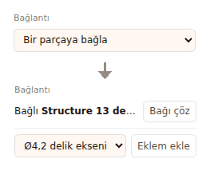
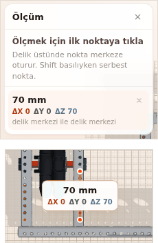
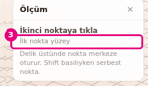

# Hoca hazırlığı

## Bu derste

Robotu kur grubunun son sunumu. Parçaların kopyasını yapıyoruz, sağ ve sol modeli olan parçayı aynalıyoruz, eşit aralıkla diziyoruz. Sonra grup ile bağ arasındaki farkı görüyoruz ve Ölç aracıyla iki nokta arasındaki mesafeyi okuyoruz.

## Dersten önce hazırla

- Çoğaltma ve dizi için boş sahnede bir Structure 5 delik hazır olsun.
- Aynala için Parça Ekle > Tekerlekler bölümünden sol modeli olan teker kullanılıyor.
- Grup, bağ ve ölçüm için Omni şasiyi açık tutun.
- Ölç, Tak ve Sketch kapalı olsun. Bunlar açıkken A ve D tuşları pencere açmıyor.

## Zaman planı

| Dakika | Bölüm |
|---|---|
| 0-5 | Kapak, çoğalt, yapıştır, aynala, dizi |
| 5-10 | Grup ve bağ |
| 10-14 | Ölç, özet |

# Sayfalar

## Çoğalt, aynala, grupla ve ölç {kapak}

::: hoca
**Söyle:** "Bu sunumda seçili parçaların kopyasını yapıyoruz, ayna kopyasını alıyoruz ve eşit aralıkla sıraya diziyoruz. Ardından parçaları gruplamayı ve birbirine bağlamayı, en sonda da iki nokta arasındaki mesafeyi ölçmeyi öğreniyoruz."
:::

## Seçimi çoğalt {sure=1}

- **Düzen** > **Çoğalt** (Ctrl+D)
- Kopya aslından 20 mm kayık durur
- Seçili olan kopyadır
- Gruplar kopyada da grup kalır

::: hoca
**Söyle:** "Seçili parçayı çoğalttığımızda kopya aslının çaprazına konuyor ve seçili kalıyor. Birden çok parça seçiliyse hepsi birlikte çoğalıyor. Çoğalt aynı zamanda seçimi panoya da kopyalıyor."
:::

## Kopyala ve buraya yapıştır {sure=1}

- Parçaya sağ tık > **Kopyala** (Ctrl+C)
- Boş alana sağ tık > **Buraya yapıştır**
- Kopya tıklanan zemin noktasına gelir
- Pano sayfa yenilenince boşalır

::: hoca
**Söyle:** "Kopyaladığımız parçayı sağ tıkladığımız noktaya yapıştırıyoruz. Kopyanın yüksekliği aslıyla aynı kalıyor. Ctrl V ise her seferinde aynı kayık yere koyduğu için kopyaları ayırmak için Buraya yapıştır işimize yarıyor."
:::

## Ayna kopyası al {sure=1}

- **Düzen** > **Aynala...** (A)
- **Sağa-sola ayna** ya da **Öne-arkaya ayna**
- **Robot merkezi**, **Seçimin ortası**, **Seçimin yanı**
- Sol modelin aynası sağ model olur

::: hoca
**Söyle:** "Sol modeli olan bir tekeri seçip seçimin yanına aynalıyoruz ve kopya sağ teker olarak geliyor. Kopyalar gerçek parçalar oluyor, ters çevrilmiş parça üretilmiyor. Sağ ve sol modeli olmayan parçanın kopyası en yakın duruşla konuyor."
:::

## Eşit aralıkla diz {sure=1}

- **Düzen** > **Dizi...** (D)
- **Yön** X, Y ya da Z
- **Toplam adet** seçimin kendisini de sayar
- **Aralık (mm)** ve **Diz**

::: hoca
**Söyle:** "Aynı parçadan dört tane olsun diye Z ön arka yönünü seçiyoruz, toplam adede dört, aralığa altmış milimetre yazıyoruz. Diz düğmesine bastığımızda parçalar üst üste binmeden sıraya diziliyor. Adet iki ile elli arasında olabiliyor."
:::

## Grup ile bağ {sure=1}

- **Sabitle** grup kurar, üyeler birlikte seçilir
- **Tak** ya da **Bir parçaya bağla** bağ kurar
- Bağ tek yönlü, hedef taşınınca bağlı parça gelir
- Eklemler bağın üstüne kurulur

::: hoca
**Söyle:** "Grup parçaları birlikte seçmemizi sağlıyor, bağ ise bir parçanın hangi parçayla birlikte gideceğini belirliyor. Bağlı parçayı taşımak öbür parçayı oynatmıyor. Eklemler ve Sim'e giden robot yapısı bağlardan çıkıyor."
:::

## Parçaları sabitle {sure=1}

- En az iki parça seçin
- Seçili parçaya sağ tık > **Sabitle**
- **Parçalar** sekmesinde **Grup (2)** satırı
- Gruplu parçaya her tık bir düzey içeri iner

::: hoca
**Söyle:** "İki parçayı seçip sağ tık menüsünden sabitliyoruz, artık tek grup gibi davranıyorlar. Parçalar sekmesinde ikisinin üstünde Grup satırı çıkıyor. Gruptaki tek bir parçayı seçmek için o parçaya tekrar tekrar tıklayarak grubun içine iniyoruz."
:::

## Grubu çöz {sure=1}

- **Grup (2)** satırına basın
- Sağ tık > **Grubu Çöz**
- Parçalar yerinde kalır
- Yalnız en dış düzey çözülür

::: hoca
**Söyle:** "Grubu seçip sağ tık menüsünden çözüyoruz, parçalar yeniden tek tek seçiliyor ve yerlerinde duruyor. İç içe grup varsa yalnız en dıştaki düzey çözülüyor, içteki gruplar kalıyor."
:::

## Bir parçaya bağla {sure=1}

- Parçayı seçin
- **Özellikler** > **Bağlantı** > **Bir parçaya bağla**
- Listeden bağlanacak parçayı seçin
- Alanda **Bağlı** ve parçanın adı yazar

::: hoca
**Söyle:** "Şasinin üstüne bıraktığımız yeni parçayı Bir parçaya bağla listesinden şasinin bir parçasına bağlıyoruz. Listede bu parçaya değen ya da ona en yakın parçalar sıralanıyor. Bağladığımızda alanda Bağlı yazısı ve parçanın adı çıkıyor."
:::

## Bağı çöz {sure=1}

- Bağlı parçayı seçin
- **Bağlantı** alanında **Bağı çöz**
- Parça yerinde kalır
- Bağ çözülünce eklem de kalkar

::: hoca
**Söyle:** "Bağı çözdüğümüzde parça yerinde kalıyor ama artık şasiyle birlikte gitmiyor. Bağı çözmek parçanın eklemini de kaldırıyor. Yanlışlıkla çözdüysek Ctrl Z ile geri alıyoruz."
:::

## Deliklerin arasını ölç {sure=1}

- **Ölç** (Ö ya da I), köşede **Ölçüm** paneli
- İlk tık bir deliğe, ikinci tık başka deliğe
- Panelde mesafe, ΔX, ΔY, ΔZ
- Ölçümler projeye kaydedilmez

::: hoca
**Söyle:** "Ölç aracında iki deliğe tıklıyoruz ve aralarındaki mesafeyi milimetre olarak okuyoruz. Nokta önce delik merkezine, yoksa yüzeye, o da yoksa zemine oturuyor. Ölç açıkken parça seçilmiyor ve taşınmıyor."
:::

## Delik merkezine oturmadan ölç {sure=1}

- İmleci deliğin kenarına getirin
- **Shift** basılıyken tıklayın
- Nokta tıklanan yerde kalır
- Panelde **İlk nokta yüzey** yazar

::: hoca
**Söyle:** "Shift tuşunu basılı tuttuğumuzda nokta deliğin merkezine kaymıyor, tıkladığımız yerde kalıyor. Böylece deliğin kenarını ya da deliğe yakın bir yüzey noktasını ölçüyoruz."
:::

## Birden çok ölçüm {sure=1}

- Her iki tık yeni ölçüm açar
- Aynı anda en çok 5 ölçüm
- Satırdaki **Bu ölçümü sil** tek ölçümü siler
- **Del** son ölçümü siler, parçayı silmez

::: hoca
**Söyle:** "Birkaç ölçümü yan yana tutuyoruz, en yenisi listenin en üstünde duruyor. Altıncı ölçüm en eskisini siliyor. İşimize yaramayan ölçümü satırındaki çarpıyla tek tek siliyoruz."
:::

## Ölçümleri temizle ve kapat {sure=1}

- **Esc** önce bekleyen noktayı siler
- İkinci **Esc** bütün ölçümleri siler
- Üçüncü **Esc** paneli kapatır
- **Taşı** ya da **Tak** seçmek de kapatır

::: hoca
**Söyle:** "Esc tuşu önce bekleyen noktayı, sonra bütün ölçümleri siliyor, en sonunda aracı kapatıyor. Tek bir ölçümü silmek istiyorsak Esc yerine satırdaki çarpıyı kullanıyoruz. Aracı kapatmak da bütün ölçümleri siliyor."
:::

## Özet {sure=1}

- **Çoğalt**, **Kopyala** ve **Buraya yapıştır**
- **Aynala** sağ ve sol modeli değiştirir, **Dizi** sıraya dizer
- Grup birlikte seçer, bağ birlikte taşır
- **Ölç** delik merkezleri arasını mm olarak verir

::: hoca
**Söyle:** "Parçaları çoğalttık, aynaladık ve dizdik. Grup ile bağ arasındaki farkı gördük, iki nokta arasını ölçtük. Böylece robotu kurmak için gereken araçları tamamladık. Sonraki sunumda robotu hareket ettiriyoruz, eklem kuruyoruz, kayış ekliyoruz ve motorlara ad ve port veriyoruz."
:::

# Ödevler

## Dört Structure diz ve ölç {#bld-dizi-odev tur=builder}

Boş sahneye bir Structure 5 delik ekleyin. Dizi ile ön arka yönünde 60 mm aralıklı dört tane yapın. Sonra Ölç ile ilk ve son Structure'ın aynı sıradaki iki deliği arasını ölçün.

::: hoca
Tamam: dört Structure eşit aralıklı, ölçüm 180 mm civarında çıkıyor.
Tekrar: Toplam adet 3 bırakılmış, üç parça var.
:::
