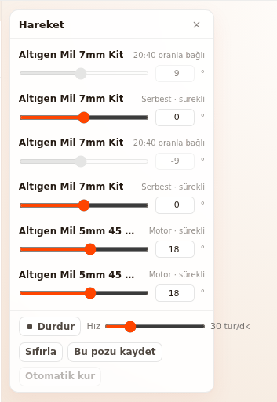
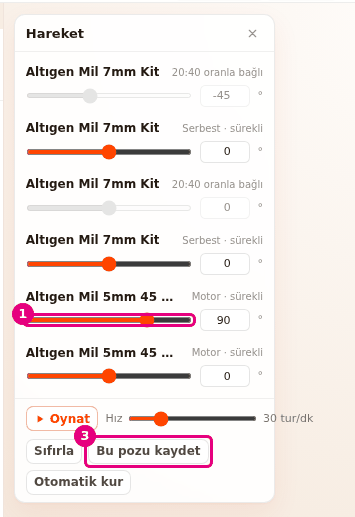
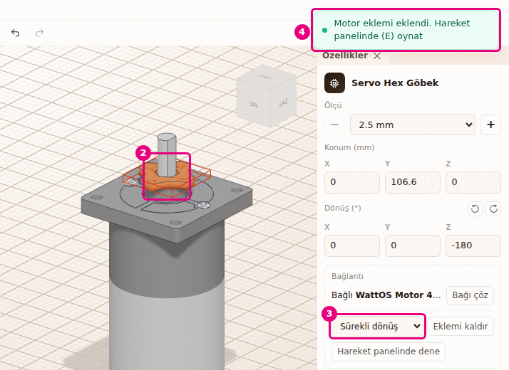
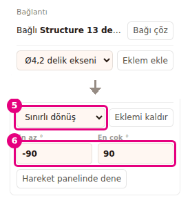
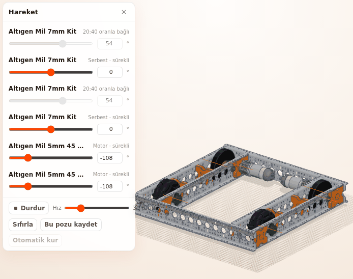
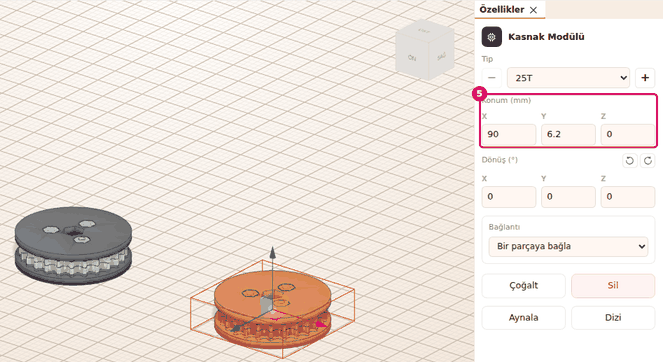

# Hoca hazırlığı

## Bu derste

Robotun parçalarını oynatıyoruz. Hareket paneliyle motorları döndürüyor, eklemi elle oynatıp pozu kaydediyor ve yeni eklem kuruyoruz. Sonra iki kasnağa kayış ekliyoruz ve motorlara kodda kullanılacak adı, hub'ı ve portu veriyoruz.

## Dersten önce hazırla

- Builder'da Omni şasiyi açın. Yüklenirken 6 eklemi kendiliğinden kuruluyor.
- Kayış gösterimi için ikinci bir sekmede boş sahne hazırlayın ya da şasiyi kaydedip Dosya > Yeni seçin.
- Özellikler'den eklem kaldırma gösterimi dişli eşleşmesini siliyor. Gösterimden sonra Ctrl+Z ile geri alın.

## Zaman planı

| Dakika | Bölüm |
|---|---|
| 0-6 | Kapak, Hareket paneli, poz, eklem kurma, eşleşme |
| 6-10 | Kayış |
| 10-14 | Motor ve servo ayarı, özet |

# Sayfalar

## Robotu hareket ettir {kapak}

::: hoca
**Söyle:** "Bu sunumda robotumuzu hareket ettiriyoruz. Motorları döndürüyor, eklemleri elle oynatıyor ve yeni eklem kuruyoruz. Ardından iki kasnağa kayış ekliyoruz ve motorlarımıza kodda kullanacağımız adı ve portu veriyoruz."
:::

## Hareket paneli {sure=1}

- **Araç çubuğu** > **Hareket** (E)
- Her eklem paneldeki bir satır
- **Oynat** döndürür, **Durdur** durdurur
- **Hız** kaydırıcısı dönüş hızını değiştirir

::: hoca
**Söyle:** "Hareket panelini açıp Oynat düğmesine bastığımızda motorlar dönüyor, tahrik tekerleri de dişliler sayesinde onlarla birlikte dönüyor. Hız kaydırıcısıyla dönüş hızını değiştiriyoruz. Durdur düğmesi açıları oynatmadan önceki hâline döndürüyor."
:::

::: hoca
Satırın sağında eklemin türü yazıyor. Motor sürekli dönüyor, servo açı aralığında gidip geliyor, oranla bağlı eklem başka eklemle dönüyor, serbest eklem yalnız elle oynuyor.
:::

## Eklemi elle oynat ve pozu kaydet {sure=1}

- Satırın kaydırıcısını sürükleyin
- Ya da kutuya açıyı yazın
- **Bu pozu kaydet** pozu kalıcı yapar
- **Sıfırla** bütün açıları sıfıra döndürür

::: hoca
**Söyle:** "Kaydırıcıyla eklemi istediğimiz açıya getiriyoruz ve Bu pozu kaydet ile kalıcı hâle getiriyoruz. Kaydetmeden paneli kapatırsak parçalar kayıtlı yerlerine dönüyor. Satırın başındaki parça adına bastığımızda o parça sahnede seçiliyor."
:::

## Tekeri motor miline tak {sure=1}

- **Tak** (B) ile parçanın düz yan yüzü
- Sonra motorun mili
- Motorda sürekli, servoda sınırlı dönüş eklemi
- **Hareket** panelinde yeni satır çıkar

::: hoca
**Söyle:** "Teker, dişli, göbek ya da kasnağı Tak ile motorun miline taktığımızda Builder eklemi kendisi kuruyor. Motor milinde sürekli, servo milinde sınırlı dönüş eklemi geliyor. Eklem kurulmadıysa parça yine motora bağlanıyor ve eklemi Özellikler panelinden ekliyoruz."
:::

## Özellikler'den eklem ekle ve sınırla {sure=1}

- Parça önce bir parçaya bağlı olmalı
- Eksen seçin, **Eklem ekle**
- **Sürekli dönüş** ya da **Sınırlı dönüş**
- **En az °** ve **En çok °** kutuları

::: hoca
**Söyle:** "Bağlı bir parçanın Bağlantı alanında ekseni seçip Eklem ekle düğmesine basıyoruz. Eklemin türünü sınırlı dönüş yaptığımızda en az ve en çok açıyı yazıyoruz. Bu örnekte eksi doksan ile doksan derece arasında oynayan bir eklem elde ediyoruz."
:::

::: hoca
Motor milinin eklemi kaldırılınca bu mile bağlı dişli eşleşmesi de siliniyor ve yeniden kurulmuyor. Gösterimden sonra Düzen > Geri al ile dönülüyor.
:::

## Dişli eşleşmesi ve otomatik kur {sure=1}

- Eşleşen eklemde **20:40 oranla bağlı** yazar
- Kaydırıcısı soluk, süren eklemle döner
- **Otomatik kur** bağ, eklem ve eşleşme kurar
- Oynatma sürerken **Otomatik kur** soluk

::: hoca
**Söyle:** "Eşleşen eklemin satırında yirmiye kırk oranla bağlı yazıyor, motor dönünce bu eklem de oranına göre dönüyor. Otomatik kur parçaların mil ve delik bilgisinden eklemleri ve eşleşmeleri kendisi kuruyor. Kurulu bağlara dokunmuyor ve tek adımda geri alınıyor."
:::

::: hoca
Eşleşme elle de kuruluyor. Dişliyi seçip Özellikler panelinin Bağlantı alanında Süren dişliyi seç listesinden onu döndüren dişliyi seçiyoruz.
:::

## İki kasnak koy {sure=1}

- **Parça Ekle** > **Kayış ve Kasnaklar**
- **Kasnak Modülü 25T** iki kez
- Konum X 0 ve 90, Z ikisinde 0
- Eksenler paralel, düzlem aynı

::: hoca
**Söyle:** "Aynı düzlemde, merkezleri arasında doksan milimetre olan iki kasnak koyuyoruz. Kayış için kasnakların eksenleri paralel olmalı ve kasnaklar aynı düzlemde durmalı. Birbirine çok yakın kasnaklara kayış konmuyor."
:::

## Kayış ekle {sure=1}

- İki kasnağı **Shift** ile seçin
- **Özellikler** gereken boyu önceden yazar
- **Düzen** > **Kayış ekle** (K)
- **Kayış eklendi, 305 mm** bildirimi

::: hoca
**Söyle:** "İki kasnağı seçtiğimizde Özellikler paneli gereken boyu ve mağazadaki uyan kayışı yazıyor. Kayış ekle ile iki kasnağı saran kayış geliyor. Kayış konamıyorsa düğme soluk kalıyor ve altında nedeni yazıyor."
:::

## Kayışın ölçülerini oku {sure=1}

- **Gereken boy**, **Diş sayısı**
- **Merkez mesafesi**, **Kasnaklar**, **Oran**
- Altta mağaza kayışı uyuyor mu
- **Kasnakları seç** iki kasnağı seçer

::: hoca
**Söyle:** "Kayışı seçtiğimizde gereken boyu, diş sayısını ve oranı okuyoruz. Altındaki kutu mağazadaki kayışın uyup uymadığını söylüyor. Uymuyorsa en yakın kayışı ve kasnakları ne kadar yaklaştırmamız ya da uzaklaştırmamız gerektiğini yazıyor."
:::

## Kasnaklar oynarsa ve kayışı silmek {sure=1}

- Kasnak taşınınca kayış onu izler
- Kasnak kayınca sarı kutuda neden yazar
- Kayışı seçip **Sil**, kasnaklar kalır
- Kasnak silinirse kayış da gider

::: hoca
**Söyle:** "Kasnakları oynattığımızda kayış onları izliyor ve boyu yeniden hesaplanıyor. Kasnaklar artık uymadığında kayış son uyduğu yerde kalıyor ve nedenini yazıyor. Kayışı seçip sildiğimizde kasnaklar yerinde duruyor."
:::

## Motora ad ver {sure=1}

- **Parçalar** sekmesinde motoru seçin
- **Donanım** > **Ad** kutusu
- Örneğin **solMotor**, Enter
- Ad en çok 40 karakter

::: hoca
**Söyle:** "Motoru seçip ona kodda kullanacağımız adı veriyoruz. Donanım alanı yalnız motor ya da servo seçiliyken görünüyor. Aynı adı iki parçaya verdiğimizde kutunun altında uyarı çıkıyor."
:::

## Hub, port ve yön {sure=1}

- **Hub** Control Hub ya da Expansion Hub
- **Port** motorda 0 ile 3, servoda 0 ile 5
- **Ters yön** motorun yönünü çevirir
- Her değişiklik bir geri alma adımı

::: hoca
**Söyle:** "Motorun hangi hub'ın hangi portuna takılı olduğunu seçiyoruz. Port listesinin ilk seçeneği Seçilmedi oluyor. Motor ters yöne dönüyorsa Ters yön kutusunu işaretliyoruz, bu seçenek yalnız motorda bulunuyor."
:::

## Port çakışmasını gider {sure=1}

- Aynı hub'da iki motor aynı portu kullanamaz
- **Port 0 başka motorda** uyarısı
- İkinci motoru başka porta alın
- Motor ve servo portları ayrı sayılır

::: hoca
**Söyle:** "İki motora aynı portu verdiğimizde Builder uyarıyor, ikinci motoru başka porta alıyoruz ve uyarı kalkıyor. Verdiğimiz ad, hub, port ve yön projeyle kaydediliyor ve robot Sim'e geçerken onunla birlikte gidiyor."
:::

::: hoca
Kopyalanan motora yalnız hub geçiyor, ad, port ve Ters yön boş kalıyor. Sim'de boş ad sırayla veriliyor (motor0, motor1, servo0).
:::

## Özet {sure=1}

- **Hareket** paneli eklemleri oynatır ve pozu kaydeder
- Motor miline takınca eklem kendiliğinden kurulur
- **Kayış ekle** gereken boyu hesaplar
- **Donanım** alanında ad, hub, port ve yön

::: hoca
**Söyle:** "Robotun motorlarını döndürdük, eklem kurduk, iki kasnağa kayış ekledik ve motorlara ad ve port verdik. Sonraki sunumda katalogda olmayan parçaları kendimiz yapıyoruz. Temel şekillerden parça kuruyor, 3B model içe aktarıyor ve çizimden katı parça çıkarıyoruz."
:::

# Ödevler

## Motorları adlandır ve döndür {#bld-hareket-odev tur=builder}

Omni şasiyi açın. İki motora solMotor ve sagMotor adlarını verin, aynı hub'da farklı portlara takın. Sonra Hareket panelinde Oynat ile tekerleri döndürün.

::: hoca
Tamam: iki motorun adı ve farklı portu var, Port başka motorda uyarısı yok, Oynat'ta tahrik tekerleri dönüyor.
Tekrar: iki motor da aynı porta takılmış.
:::
