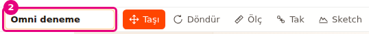
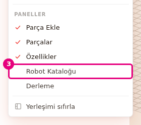

# Hoca hazırlığı

## Bu derste

Robotu kaybetmemek ve başkalarına göstermek için gereken yolları gösteriyoruz. Projeye ad verip dosyaya indiriyor, dosyadan yeniden açıyoruz. Sonra robotu hesaba kaydediyor, paylaşım linki oluşturuyor ve topluluğa gönderiyoruz. Son bölümde panellerin yerini ve genişliğini değiştiriyoruz.

## Dersten önce hazırla

- Builder'da Omni şasiyi açın.
- Hesap bölümü için e-postası doğrulanmış bir Probot hesabıyla ayrı sekmede giriş yapın.
- Gösterimde Robotlarım'dan robot silmeyin, silinen robot geri gelmiyor.
- Sondan önce Görünüm > Yerleşimi sıfırla ile panelleri ilk yerlerine alın.

## Zaman planı

| Dakika | Bölüm |
|---|---|
| 0-6 | Kapak, ad, otomatik kayıt, dosyaya kaydet, aç, yeni |
| 6-9 | Hesaba kayıt, link, topluluk |
| 9-14 | Paneller, özet |

# Sayfalar

## Kaydet, paylaş ve panelleri düzenle {kapak}

::: hoca
**Söyle:** "Bu sunumda robotumuzu bilgisayarımıza ve hesabımıza kaydediyoruz. Takımımıza bir linkle gösteriyor, istersek topluluk kataloğuna gönderiyoruz. Son olarak Builder'ın panellerini kendi çalışma düzenimize göre yerleştiriyoruz."
:::

## Projeye ad ver {sure=1}

- **Araç çubuğu**nda proje adına basın
- Yeni adı yazıp **Enter**
- **Esc** vazgeçer
- Boş ad **Adsız Robot** olur

::: hoca
**Söyle:** "Önce projemize bir ad veriyoruz, indirdiğimiz dosyanın adı da bu oluyor. Araç çubuğundaki ada basıp yeni adı yazıyoruz ve Enter tuşuna basıyoruz. Yeni bir projede ad Adsız Robot olarak geliyor."
:::

## Otomatik kayıt {sure=1}

- Her değişiklikten 1 saniye sonra yazılır
- Yeniden açınca son oturum gelir
- Geri alma geçmişi saklanmaz
- Kayıt yalnız bu tarayıcıda

::: hoca
**Söyle:** "Builder çalışmamızı tarayıcıda kendiliğinden saklıyor ve yeniden açtığımızda son oturumu geri getiriyor. Bu kopya yalnız o tarayıcıda kalıyor. Tarayıcı verisini sildiğimizde, gizli pencerede çalıştığımızda ya da başka bilgisayara geçtiğimizde kayboluyor."
:::

## Projeyi dosyaya kaydet {sure=1}

- **Dosya** > **Kaydet (JSON indir)**
- Dosyanın adı proje adı
- İçe aktarılan modeller dosyaya gömülür
- Dosyada geri alma geçmişi yok

::: hoca
**Söyle:** "Kalıcı bir kopya için Dosya menüsünden projeyi JSON dosyası olarak indiriyoruz. Addaki tire ve nokta gibi işaretler dosya adında alt çizgi oluyor. İçe aktardığımız modeller dosyanın içine girdiği için başka bilgisayarda açtığımızda modeller de geliyor."
:::

## Dosyadan proje aç {sure=1}

- **Dosya** > **Yükle...**
- **.json** proje dosyasını seçin
- Sahne onay sorulmadan değişir
- Bozuk parçalar atlanır, diğerleri açılır

::: hoca
**Söyle:** "Kaydettiğimiz dosyayı Yükle ile yeniden açıyoruz. Yükle sahnedeki projeyi onay sormadan değiştiriyor ve bu işlem geri alınmıyor. Sahnedeki çalışmayı korumak istiyorsak önce onu da dosyaya indiriyoruz."
:::

## Yeni proje aç {sure=1}

- **Dosya** > **Yeni**
- Tarayıcı onay ister, **Tamam**
- Sahne boşalır, ad **Adsız Robot**
- Bu işlem geri alınamaz

::: hoca
**Söyle:** "Yeni ile sahneyi boşaltıyoruz, Builder önce onay istiyor. Yeni proje sahnedeki bütün parçaları siliyor ve geri alınamıyor. Yeni, Yükle ve hazır robot yüklemek sahnenin hesaptaki robotla bağını da kesiyor."
:::

## Hesabına kaydet {sure=1}

- **Dosya** > **Hesabıma kaydet...**
- Giriş yoksa **Yeni sekmede giriş yap**
- **Robotun adı**, sonra **Kaydet**
- Proje adının yanında **Kaydedildi**

::: hoca
**Söyle:** "Giriş yapmadıysak Builder bizi yeni sekmede giriş sayfasına gönderiyor, robotumuz bu sekmede kalıyor. Giriş yapıp geri döndüğümüzde robota bir ad verip hesabımıza kaydediyoruz. Sahnede değişiklik yaptığımızda proje adının yanındaki yazı Kaydedilmedi oluyor."
:::

::: hoca
Bir robot 5 MB, hesap 50 robot ile sınırlı. Dosya > Robotlarım... kayıtlı robotları açmayı, yeniden adlandırmayı ve silmeyi sağlıyor. Sil kalıcı.
:::

## Paylaşım linki {sure=1}

- Robot önce **Hesabıma kaydet...** ile kaydedilir
- **Dosya** > **Paylaşım linki...**
- Açılan pencerede link oluşturup kopyalayın
- Link son kaydedilen hâli gösterir

::: hoca
**Söyle:** "Robotu hesabımıza kaydettikten sonra bir link oluşturup takımımıza gönderiyoruz. Linki açan kişi robotun kendi kopyasını düzenliyor, bizim robotumuz değişmiyor. Değişikliklerimizi linkte göstermek için robotu yeniden kaydediyoruz."
:::

## Topluluğa paylaş {sure=1}

- **Robot Kataloğu** > **Robotunu paylaş**
- **Robot adı**, sonra **Paylaş**
- Robot önce incelenir
- İçe aktarılan parçalı robot gönderilemez

::: hoca
**Söyle:** "Robot kataloğundan robotumuzu adıyla incelemeye gönderiyoruz. Onaylandıktan sonra robot Topluluk bölümünde herkese görünüyor. Topluluğa en çok iki yüz parçalı robot gönderiliyor ve içe aktarılan parçaları önce kaldırıyoruz."
:::

## Sekmeyi başka yere taşı {sure=1}

- Her panel bir sekme
- Sekmeyi adından tutup sürükleyin
- Bırakılacak yer renkli görünür
- **Sahne**nin ortasına sekme bırakılmaz

::: hoca
**Söyle:** "Parçalar sekmesini adından tutup sahnenin kenarına sürüklüyoruz ve ayrı bir sütun olarak bırakıyoruz. Başka bir panelin sekme satırına bıraktığımızda o panelle aynı grupta sekme oluyor. Bir panelin kenarına bıraktığımızda yanına ya da altına yerleşiyor."
:::

## Paneli kapat ve yeniden aç {sure=1}

- Sekmenin çarpısı paneli kapatır
- **Görünüm** > **PANELLER**
- İşaretli paneller açık
- **Sahne** kapatılamaz

::: hoca
**Söyle:** "Bir paneli sekmesinin yanındaki çarpıyla kapatıyoruz. Kapattığımız paneli Görünüm menüsündeki PANELLER grubundan işaretleyerek geri açıyoruz. Derleme paneli de bu gruptan açılıyor, başta kapalı geliyor."
:::

## Panelin genişliğini değiştir {sure=1}

- Paneller arasındaki ayırıcıyı sürükleyin
- Fark **Sahne**ye geçer
- Çift tık varsayılan genişliğe döndürür
- Panellerin en dar sınırı var

::: hoca
**Söyle:** "Ayırıcıyı sürükleyip paneli genişletiyoruz, çift tıkladığımızda varsayılan genişliğine dönüyor. Aradaki fark sahneye geçiyor, diğer paneller yerinde kalıyor. Paneller belli bir genişliğin altına inmiyor."
:::

## Yerleşimi sıfırla {sure=1}

- **Görünüm** > **Yerleşimi sıfırla**
- Paneller ilk yerine döner
- **Derleme** kapanır
- Robota ve kamera ayarlarına dokunmaz

::: hoca
**Söyle:** "Paneller karıştıysa Yerleşimi sıfırla ile ilk hâline dönüyoruz. Sıfırlama yalnız panellerin yerini ve genişliğini değiştiriyor. Yerleşim bu tarayıcıda hatırlanıyor, başka bir bilgisayarda ilk açılıştaki yerleşim geliyor."
:::

## Özet {sure=1}

- Otomatik kayıt tarayıcıda, kalıcı kopya **Kaydet (JSON indir)**
- **Hesabıma kaydet** ve **Paylaşım linki**
- **Robotunu paylaş** topluluğa inceleme için gönderir
- Paneller taşınır, kapanır, sıfırlanır

::: hoca
**Söyle:** "Projemizi dosyaya ve hesabımıza kaydettik, linkle ve toplulukla paylaştık, panelleri düzenledik. Sonraki sunumda robotu derliyoruz, parça listesini ve fiyatını görüp sepete aktarıyoruz ve robotu Sim'de deniyoruz."
:::

# Ödevler

## Robotunu dosyaya kaydet ve geri aç {#bld-kaydet-odev tur=builder}

Omni şasiye bir parça ekleyin ve projeye kendi adınızı verin. Projeyi Dosya > Kaydet (JSON indir) ile indirin, Dosya > Yeni ile sahneyi boşaltın, sonra Dosya > Yükle... ile dosyayı geri açın.

::: hoca
Tamam: yüklenen projede eklenen parça ve verilen ad duruyor.
Tekrar: Yeni'den önce kaydedilmemiş, parça kaybolmuş.
:::
