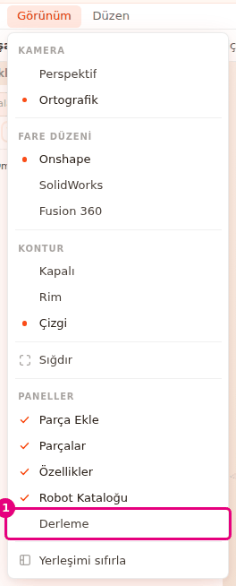
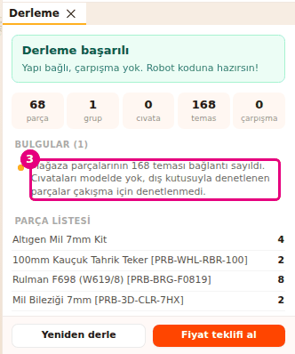
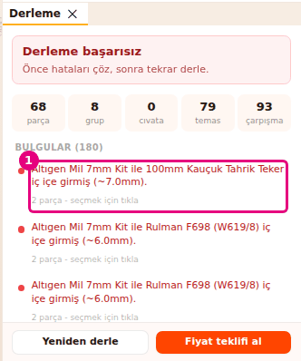
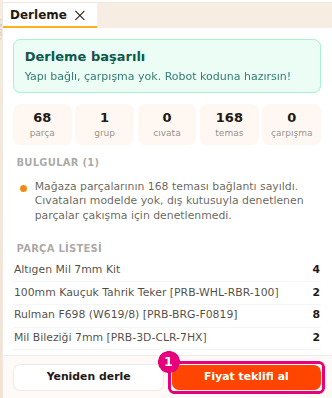

# Robotu derle

Bu sayfada **Derleme** panelini açıp robotunu derleyeceksin. Derleme parçaların birbirine bağlı
olup olmadığını, çarpışmaları ve parça listesini gösterir.

<!-- IMAGE-PENDING: img/builder-derle-sonuc-ac.png | alt=Derleme paneli; sonuç başlığı ve sayaçlar. -->
<!-- CAPTURE: url=https://probotstudio.com/builder/ | hazirla=hazir:Omni şasi, Derleme paneli açık, Derle'ye basıldı (Faz eki kırpılmış) | hedef=body | isaret=yok | bekle=text="Yeniden derle" -->

## Başlamadan önce

- Sahnede bir robot var. Hazır örnekle başlamak için "Sahne boş" kartında **Omni şasi**'ye bas
  (bkz. [Hazır robotla başla](hazir-robotla-basla.md)).
- **Derleme** paneli varsayılan olarak kapalıdır. Önce onu açarsın.

## Derleme panelini aç

**Menü çubuğu**nda **Görünüm** > **Derleme**'yi seç. Menü kendiliğinden kapanır.

<!-- CAPTURE: url=https://probotstudio.com/builder/ | hazirla=hazir:Omni şasi, Görünüm menüsü açık | hedef=role=menuitemcheckbox[name="Derleme"] | isaret=1 | bekle=text="PANELLER" -->
<!-- SAY: Derleme paneli ilk açılışta kapalı, onu Görünüm menüsünden açıyoruz. -->

Sonuç: **Özellikler** panelinin altında **Derleme** paneli açılır. Panelde "Henüz derleme yok"
yazısı ve **Derle** görünür. **Özellikler** kapalıysa panel **Sahne**nin yanında açılır.

Paneli kapatmak için **Görünüm** > **Derleme**'nin işaretini kaldır. Bu seçim tarayıcıda hatırlanır.

## Robotu derle ve sonucu oku

1. **Derleme** panelinde **Derle**'ye bas.
2. Panelin başındaki sonuç başlığını oku.
   <!-- IMAGE-PENDING: img/builder-derle-sonuc.png | alt=Derleme paneli; sonuç başlığı 2, sayaç satırı 3 numarayla işaretli. -->
   <!-- CAPTURE: url=https://probotstudio.com/builder/ | hazirla=hazir:Omni şasi, Derleme paneli açık, Derle'ye basıldı | hedef=text="parça";text="çarpışma" | isaret=2,3 | bekle=text="Yeniden derle" -->
   <!-- SAY: Derle düğmesine basıyoruz ve en üstteki başlıktan robotun durumunu okuyoruz. -->
3. Başlığın altındaki beş sayacı kontrol et.

Sonuç: Panelin başında üç başlıktan biri, altında sayaçlar görünür.

| Başlık | Açıklama | Ne zaman |
|---|---|---|
| "Derleme başarılı" | "Yapı bağlı, çarpışma yok. Robot koduna hazırsın!" | Hiç hata ve uyarı yok. Bilgi satırları olabilir. |
| "Uyarılarla derlendi" | "Yapı çalışır ama aşağıdaki noktalara bak." | Hata yok, en az bir uyarı var. |
| "Derleme başarısız" | "Önce hataları çöz, sonra tekrar derle." | En az bir hata var. |

| Sayaç | Ne sayar |
|---|---|
| **parça** | Sahnedeki malzeme parçaları. Delik türü şekiller ve sketch'ler sayılmaz. |
| **grup** | Birbirine bağlı parça kümeleri. Robotun tamamı bağlıysa 1 olur. |
| **cıvata** | Parçalar arasında hizalı her delik çifti (iki delik hizalıysa 2 sayılır) ile başka bir parçaya değen ya da içine giren her cıvata veya somun. |
| **temas** | Yüzeyleri değen ama deliği hizalı olmayan parça çiftleri. Birbirine değen ya da giren mağaza parçaları da burada sayılır. |
| **çarpışma** | Birbirinin içine 2 mm'den fazla giren parça çiftleri. Mağaza parçalarının çoğu burada sayılmaz (bkz. [Hazır robotu derle](#hazir-robotu-derle)). |

Derleme sonucu kendiliğinden yenilenmez. Robotu değiştirdikten sonra **Yeniden derle**'ye bas.

!!! note "Not"
    Tekerlek ve motor kontrolleri hazır robot parçalarında çalışmaz. Hazır robotu kontrol etmek için
    **Gerçeğe dök** penceresindeki "Robot kontrolü"ne de bak (bkz. [Gerçeğe dök](gercege-dok.md#robot-kontrolunu-oku)).

## Hazır robotu derle {#hazir-robotu-derle}

Derleme mağaza parçalarını model kutusuyla denetler. Bu kutu milin geçtiği deliği görmez. Bu yüzden
mağaza parçalarının değmesi ya da birbirine girmesi bağlantı sayılır, çarpışma sayılmaz.

1. "Sahne boş" kartında **Omni şasi**'ye bas.
2. **Derleme** panelinde **Derle**'ye bas.
3. **Bulgular** listesindeki "Mağaza parçalarının N teması bağlantı sayıldı." satırını oku.
   
   <!-- CAPTURE: url=https://probotstudio.com/builder/ | hazirla=hazir:Omni şasi, Derleme paneli açık, Derle'ye basıldı | hedef=text^="Mağaza parçalarının" | isaret=3 | bekle=text="Yeniden derle" -->
   <!-- SAY: Hazır robotu derleyince mağaza parçalarının temasları bağlantı olarak sayılıyor ve robot başarılı çıkıyor. -->

Sonuç: Başlıkta "Derleme başarılı" yazar. Omni şasi için sayaçlar 68 parça, 1 grup, 0 cıvata,
168 temas ve 0 çarpışmadır.

Mağaza parçalarında sayaçlar ve bulgular şöyle çalışır:

- **temas** mağaza parçalarının temaslarını da sayar. Mağaza parçalarında **cıvata** 0 kalır, çünkü
  cıvataları modelde yoktur.
- Profil gibi C kesitli parçalar ve bükülmüş sac parçalar gerçek şekilleriyle denetlenir. Bunlar
  çarpışabilir.
- Döndürülmüş parçalar (ör. 45° açılı tekerler) gerçek yönleriyle denetlenir. Yakın duran ama
  birbirine girmeyen döndürülmüş parçalar çarpışma sayılmaz.
- Mağaza parçaları birbirine değiyorsa "Hiç cıvata bağlantısı yok" uyarısı çıkmaz.
- Motor var ama sahnede Control Hub yoksa "N motor var ama Control Hub yok. Motorlar Control Hub'a
  bağlanır." bilgisi çıkar.

## Bulguları incele

Sayaçların altında "Bulgular (N)" listesi çıkar. Kırmızı nokta hata, sarı nokta uyarı, diğerleri
bilgidir. Liste hatalarla başlar.

1. **Derleme** panelinde "Bulgular" listesinden bir satır seç. Satırın altında "N parça - seçmek
   için tıkla" yazar.
   
   <!-- CAPTURE: url=https://probotstudio.com/builder/ | hazirla=hazir:Omni şasi, bir parça robottan uzağa taşındı (Ayrık grup), Derleme paneli açık, Derle'ye basıldı | hedef=text="seçmek için tıkla" | isaret=1 | bekle=text="Bulgular" -->
   <!-- SAY: Bir bulguya basınca ilgili parçalar sahnede seçiliyor. -->
2. **Sahne**de seçili parçaya sağ tıkla ve **Ortala**'yı seç. Kamera parçaya odaklanır.
3. **Araç çubuğu**nda **Tak**'a bas ve parçayı doğru deliğine oturt (bkz. [Parçaları deliklerinden tak](parcalari-tak.md)).
4. **Derleme** panelinde **Yeniden derle**'ye bas.

Sonuç: Düzelttiğin bulgu listeden çıkar. Sayaçlar güncellenir.

Altında "seçmek için tıkla" yazmayan satırlar ("Sahne boş - derlenecek parça yok.", "Hiç cıvata
bağlantısı yok" ve "Mağaza parçalarının N teması bağlantı sayıldı.") seçilemez.

| Bulgu | Tür | Ne demek | Ne yaparsın |
|---|---|---|---|
| "Sahne boş - derlenecek parça yok." | Hata | Sahnede parça yok. | Parça ekle ya da hazır robot yükle. |
| "A ile B iç içe girmiş (~N.Nmm)." | Hata | İki parça birbirinin içine giriyor. | Parçalardan birini taşı ya da **Tak** ile deliğinden tak. |
| "A ile B temas ediyor ama cıvata hizası yok." | Bilgi | Parçalar değiyor ama delikleri üst üste değil. | **Tak** ile delikleri hizala. |
| "Ayrık grup: A, B - ana yapıya bağlı değil." | Uyarı | Bu parçalar robotun geri kalanına değmiyor. | Parçaları robota taşı ya da tak. |
| "Hiç cıvata bağlantısı yok - parçalar sadece üst üste duruyor." | Uyarı | Hiçbir parçanın deliği başka bir parçanınkiyle hizalı değil. | Parçaları **Tak** ile deliklerinden birleştir. |
| "N tekerleğin ekseninde motor mili yok." | Uyarı | Tekerleği döndüren motor yok. | Tekerleği motor miline tak. |
| "Tekerlek var ama motor yok - robot hareket edemez." | Uyarı | Robotta tekerlek var, motor yok. | Motor ekle ve tekerleği miline tak. |
| "N motor var ama Control Hub yok. Motorlar Control Hub'a bağlanır." | Bilgi | Sahnede motor var, Control Hub yok. | Control Hub ekle (bkz. [Gerçeğe dök](gercege-dok.md)). |
| "Mağaza parçalarının N teması bağlantı sayıldı. ..." | Bilgi | Değen ya da iç içe giren mağaza parçaları bağlı sayıldı. | Bir şey yapma. Bkz. [Hazır robotu derle](#hazir-robotu-derle). |

## Parça listesini oku

Bulguların altında "Parça Listesi" tablosu durur. Her satırda parçanın adı ve sahnedeki adedi
yazar. Aynı parçanın farklı boyları ayrı satırdır. Mağazada boyu olmayan kayış "Kayış HTD5M N mm,
mağazada yok" satırıyla görünür.

Bu liste fiyat ve stok göstermez. Fiyat, stok ve sepet için **Fiyat teklifi al**'ı kullan.
<!-- SAY: Parça listesinde robotta hangi parçadan kaç tane olduğunu görüyoruz. -->

## Fiyat teklifi al

Panelde "Henüz derleme yok" yazıyorsa önce **Derle**'ye bas. **Fiyat teklifi al** derleme sonucunun
altında çıkar.

1. **Derleme** panelinin altında **Fiyat teklifi al**'a bas.
   
   <!-- CAPTURE: url=https://probotstudio.com/builder/ | hazirla=hazir:Omni şasi, Derleme paneli açık, Derle'ye basıldı | hedef=role=button[name="Fiyat teklifi al"] | isaret=1 | bekle=text="Yeniden derle" -->
   <!-- SAY: Derleme panelinden doğrudan fiyat ve sepet penceresine geçiyoruz. -->
2. Açılan "Gerçeğe dök" penceresinde parça listesini ve robot kontrolünü incele.
3. Pencerenin çarpısına (×) basarak **Derleme** paneline dön.

Sonuç: **Derleme** paneli yeniden görünür. **Fiyat teklifi al**'ın açtığı pencere **Üst şerit**teki
**Gerçeğe dök →** ile açılanla aynıdır. Sepete aktarmak için bkz. [Gerçeğe dök](gercege-dok.md).

Son derleme boş sahnede yapıldıysa **Fiyat teklifi al** soluktur. Parça ekledikten sonra **Yeniden
derle**'ye bas.

## Sorun mu var?

- **Panelde Derle yok, menüde Derleme işaretsiz:** Panel kapalı. **Görünüm** > **Derleme**'yi seç.
  Bkz. [Sorun giderme](sorunlar.md#panel-kayboldu).
- **Robotu düzelttim ama bulgu duruyor:** Sonuç kendiliğinden yenilenmez. **Yeniden derle**'ye bas.
  Bkz. [Sorun giderme](sorunlar.md#sonuc-degismedi).
- **"Sahne boş - derlenecek parça yok." yazıyor:** Sahnede parça yok ya da hepsi Delik türü şekil
  veya sketch. Malzeme parçası ekle. Bkz. [Sorun giderme](sorunlar.md#derlenecek-parca-yok).
- **Bulgu satırına basınca bir şey seçilmiyor:** O bulgu hiçbir parçaya bağlı değil. Satırda "seçmek
  için tıkla" yazmaz.
- Diğer uyarılar için bkz. [Sorun giderme](sorunlar.md).

## Sonraki adım

- [Gerçeğe dök: parça listesini sepete aktar](gercege-dok.md)
- [Parçaları deliklerinden tak](parcalari-tak.md)
