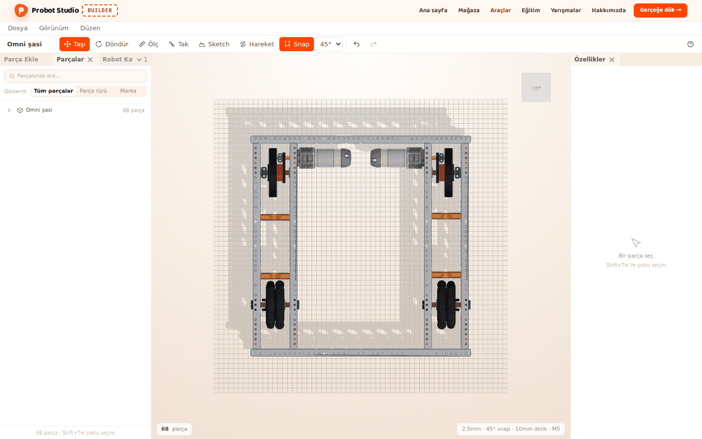
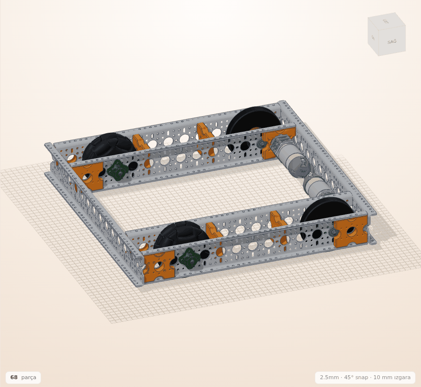
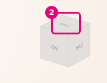
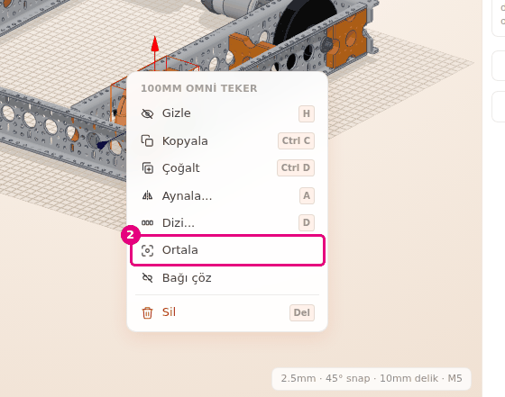
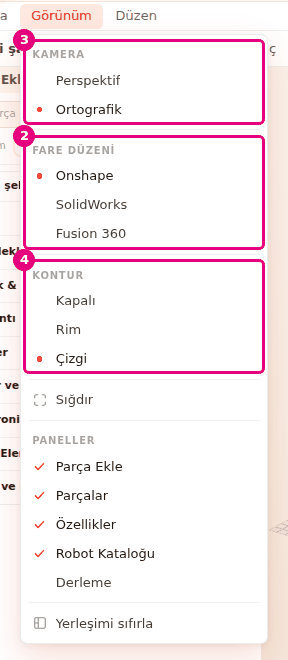

# Sahnede gezin

Bu sayfada kamerayı robotun etrafında döndürecek, yakınlaştıracak ve kaydıracaksın. Standart
görünümlere geçer, robotu ya da bir parçayı kadraja alır, görünüm ayarlarını seçersin.

<!-- CAPTURE: url=https://probotstudio.com/builder/ | hazirla=hazir:Omni şasi, görünüm küpünden ÜST seçilmiş | hedef=body | isaret=yok | bekle=canvas -->

## Başlamadan önce

- Sahnede **Omni şasi** açık. Bkz. [Hazır robotla başla](hazir-robotla-basla.md).
- Üç tuşlu fare önerilir. Kamera sağ ve orta tuşla oynar.

## Kamerayı fareyle oynat

Varsayılan fare düzeni **Onshape**'tir. Sol tuş kamerayı oynatmaz, yalnız seçim yapar.

1. **Sahne**de farenin sağ tuşunu basılı tutup sürükle. Kamera robotun etrafında döner.
2. Fare tekerleğini çevir. Kamera yaklaşır ya da uzaklaşır.
3. Orta tuşu (tekerleği) basılı tutup sürükle. Görüntü kayar.
   
   <!-- CAPTURE: url=https://probotstudio.com/builder/ | hazirla=hazir:Omni şasi, hiçbir şey seçili değil, kamera robotun önüne doğru döndürülmüş | hedef=koordinat:sahne-tamami | isaret=yok | bekle=canvas -->
   <!-- SAY: Sağ tuşla döndürüyoruz, tekerlekle yaklaşıyoruz, orta tuşla kaydırıyoruz. -->

Sonuç: Robotu istediğin açıdan ve yakınlıktan görürsün.

Kamera bıraktıktan sonra kısa bir süre süzülür. Robotun altına da bakabilirsin.

**Perspektif** kamerada kamera dönüş noktasına 40 mm'den fazla yaklaşmaz, 2500 mm'den fazla uzaklaşmaz.
Varsayılan **Ortografik** kamerada da yakınlaştırmanın bir alt ve üst sınırı vardır.

Her fare düzeninde tuşlar şöyledir:

| Fare düzeni | Döndür | Kaydır | Yakınlaştır |
|---|---|---|---|
| **Onshape** (varsayılan) | Sağ tuşla sürükle | Orta tuşla sürükle | Tekerlek |
| **SolidWorks** | Orta tuşla sürükle | <kbd>Ctrl</kbd> + orta tuşla sürükle | Tekerlek |
| **Fusion 360** | <kbd>Shift</kbd> + orta tuşla sürükle | Orta tuşla sürükle | Tekerlek |

Üç düzende de sol tuş parçayı seçer, boş alanda sol tuşla sürüklemek kutu seçimi yapar. Sağ tuşa
sürüklemeden basıp bırakmak bağlam menüsünü açar. **SolidWorks** ve **Fusion 360**'ta sağ tuşla
sürüklemek kamerayı oynatmaz.

## Görünüm küpüyle standart görünüme geç

Görünüm küpü **Sahne**nin köşesindedir. Yüzlerinde **SAĞ**, **SOL**, **ÜST**, **ALT**, **ÖN**,
**ARKA** yazar. Montaj modunda küp gizlidir, **Düzenlemeye geç**'e basınca geri gelir.

1. Farenin imlecini görünüm küpünün üstüne getir. İmlecin altındaki yüz renklenir.
2. **ÜST** yüzüne bas.
   
   <!-- CAPTURE: url=https://probotstudio.com/builder/ | hazirla=hazir:Omni şasi, kamera açılış açısında | hedef=koordinat:gorunum-kupu-ust | isaret=2 | bekle=canvas -->
   <!-- SAY: Küpün üst yüzüne basınca robota tam üstten bakıyoruz. -->
3. Çapraz bir görünüm için küpün bir köşesine ya da kenarına bas.

Sonuç: Kamera seçtiğin yönden robota bakar. Dönüş noktası değişmez.

## Robotu ya da seçimi kadraja al

Bir parçaya yakından bakmak için **Ortala**, robotun tamamını görmek için **Sığdır** kullanılır.

1. **Sahne**de bir tekere sağ tıkla. Parça seçilir ve bağlam menüsü açılır.
2. Bağlam menüsünde **Ortala**'yı seç. Kamera tekere yaklaşır ve ona bakar.
   
   <!-- CAPTURE: url=https://probotstudio.com/builder/ | hazirla=hazir:Omni şasi, bir tekere sağ tıklanmış | hedef=text="Ortala" | isaret=2 | bekle=text="Ortala" -->
   <!-- SAY: Sağ tıklayıp Ortala diyoruz, kamera seçtiğimiz parçaya yaklaşıyor. -->
3. Kamerayı tekerin etrafında döndür (**Onshape** düzeninde sağ tuşla sürükle).
4. Robotun tamamına dönmek için **Görünüm** > **Sığdır**'ı seç.

Sonuç: Kamera bakış yönünü koruyarak robotun tamamını ekrana sığdırır.

- **Ortala** parçaları yerinden oynatmaz, yalnız kamerayı taşır. Kamera bundan sonra seçimin
  etrafında döner. Birden çok parça seçiliyse seçimin tamamını kadraja alır.
- **Sığdır** sahne boşken kamerayı açılıştaki görünüme döndürür.

## Görünüm ayarlarını seç

**Görünüm** menüsünde üç grup vardır: **KAMERA**, **FARE DÜZENİ** ve **KONTUR**. Her grupta bir
seçenek seçilidir. Seçimlerin hepsi bu tarayıcıda hatırlanır.

1. **Menü çubuğu**nda **Görünüm**'e bas.
2. **FARE DÜZENİ** grubundan alıştığın programı seç: **Onshape**, **SolidWorks** ya da **Fusion 360**.
3. **Görünüm**'ü yeniden aç ve **KAMERA** grubundan **Perspektif** ya da **Ortografik**'i seç.
4. **Görünüm**'ü yeniden aç ve **KONTUR** grubundan **Kapalı**, **Rim** ya da **Çizgi**'yi seç.
   
   <!-- CAPTURE: url=https://probotstudio.com/builder/ | hazirla=hazir:Omni şasi, Görünüm menüsü açık | hedef=text="Fare düzeni";text="Kamera";text="Kontur" | isaret=2-4 | bekle=role=menuitemradio[name="Onshape"] -->
   <!-- SAY: Görünüm menüsünden fare düzenini, kamera türünü ve konturu seçiyoruz. -->

Sonuç: Seçili seçeneğin yanında işaret görünür. Menü seçimden sonra kapanır.

| Grup | Seçenek | Ne yapar |
|---|---|---|
| **KAMERA** | **Ortografik** (varsayılan) | Uzaktaki parça küçülmez. Boyları karşılaştırmak için uygundur. |
| | **Perspektif** | Uzaktaki parça küçük görünür, göz gibi. |
| **KONTUR** | **Çizgi** (varsayılan) | Parçaların kenarlarına koyu çizgi çizer. |
| | **Rim** | Çizgi çizmez. Parçanın kenara doğru dönen yüzlerini koyulaştırır. |
| | **Kapalı** | Kenar vurgusu yoktur. |

Kamera türünü değiştirince kamera açılıştaki görünüme döner. Robotu yeniden kadraja almak için
**Görünüm** > **Sığdır**'ı seç.

## Sorun mu var?

- **Sol tuşla sürüklüyorum, kamera dönmüyor:** Sol tuş seçim içindir, boş alanda kutu seçimi yapar.
  Kamerayı **Onshape** düzeninde sağ tuşla döndür. Bkz. [Sorun giderme](sorunlar.md#kamera-donmuyor).
- **Sağ tuşa basınca kamera dönmüyor, menü açılıyor:** **SolidWorks** ya da **Fusion 360** düzeni
  seçili. Döndürmek için yukarıdaki tabloya bak ya da **FARE DÜZENİ**'nden **Onshape**'i seç.
- **Sağ tıklayınca bağlam menüsü açılmıyor:** Fareyi oynatmadan bas ve bırak. Montaj modunda ve
  **Ölç**, **Tak**, **Sketch** açıkken menü açılmaz.
- **Robot ekranda yok:** **Görünüm** > **Sığdır**'ı seç.
- **Kamera çok yaklaşmıyor:** Yakınlaştırma sınırına gelmiş olabilirsin. **Perspektif** kamerada
  dönüş noktası uzakta kalmış olabilir. Parçaya sağ tıkla, **Ortala**'yı seç, sonra tekerlekle yaklaş.

## Sonraki adım

- [Parçaları seç, gizle ve sil](parcalari-sec-gizle-sil.md)
- [Mesafe ölç](mesafe-olc.md)
- [Kısayollar](kisayollar.md)
