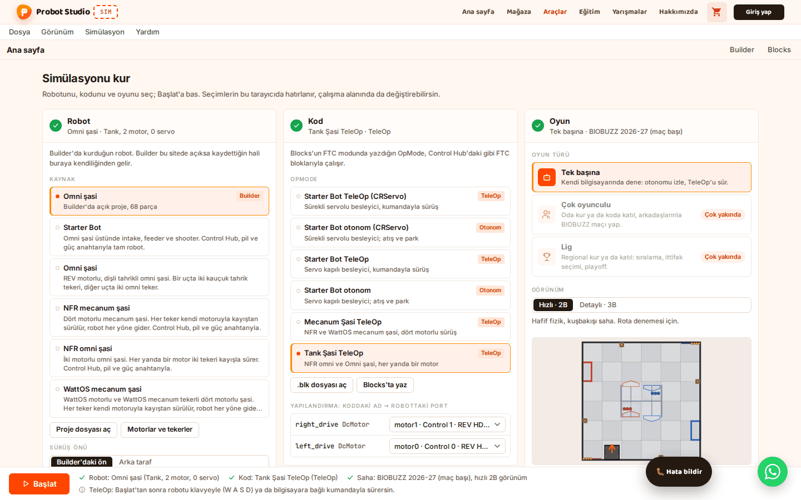
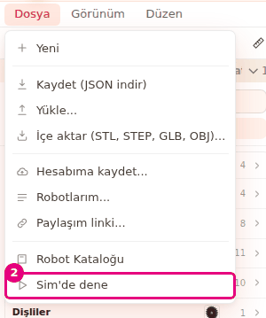
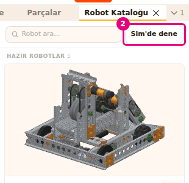

# Robotu Sim'de dene

Bu sayfada Builder'da açık olan robotunu Sim'e göndereceksin. Sim yeni sekmede açılır ve robotun
orada seçili gelir. Sim'in kendi kullanımı Sim dokümanındadır.

<!-- CAPTURE: url=https://probotstudio.com/builder/ | hazirla=hazir:Omni şasi, Dosya > Sim'de dene ile açılan Sim sekmesi | hedef=body | isaret=yok | bekle=canvas -->

## Başlamadan önce

- Sahnede bir robot var. Hazır örnekle başlamak için **Omni şasi**'yi yükle. Bkz.
  [Hazır robotla başla](hazir-robotla-basla.md).
- Motorlara ad ve port verdiysen bunlar da Sim'e gider. Bkz.
  [Motor ve servoya ad ve port ver](motor-ve-servo-ayarla.md).
- Tarayıcın bu site için yeni sekme açmaya izin veriyor.

## Dosya menüsünden Sim'de dene

1. **Menü çubuğu**nda **Dosya**'ya bas.
2. **Sim'de dene**'yi seç.
   
   <!-- CAPTURE: url=https://probotstudio.com/builder/ | hazirla=hazir:Omni şasi, Dosya menüsü açık | hedef=role=menuitem[name="Sim'de dene"] | isaret=2 | bekle=role=menuitem[name="Sim'de dene"] -->
   <!-- SAY: Dosya menüsünden Sim'de dene diyoruz ve robotumuz yeni sekmede açılıyor. -->
3. Açılan yeni sekmeye geç.

Sonuç: Sim yeni sekmede açılır. Builder'daki açık proje, proje adıyla robot olarak seçili gelir.
Builder sekmesi açık kalır, çalışman orada durur.

## Robot Kataloğu'ndan Sim'de dene

1. **Sol panel**de **Robot Kataloğu** sekmesini seç.
2. **Robot ara...** kutusunun yanındaki **Sim'de dene**'ye bas.
   
   <!-- CAPTURE: url=https://probotstudio.com/builder/ | hazirla=hazir:Omni şasi, Robot Kataloğu sekmesi önde | hedef=[data-simde-dene] | isaret=2 | bekle=[data-simde-dene] -->
   <!-- SAY: Aynı işi Robot Kataloğu'ndaki Sim'de dene ile de yapabiliyoruz. -->
3. Açılan yeni sekmeye geç.

Sonuç: Sim yeni sekmede açılır, robotun seçili gelir. İki düğme aynı işi yapar.

## Sim'e ne gider

**Sim'de dene**'ye bastığın anda sahnede ne varsa o gider. Builder önce projeyi bu tarayıcıya
kaydeder, sonra Sim'i aynı sitede açar. Sim robotu bu kayıttan okur.

Sim'e gidenler:

- Sahnedeki bütün parçalar, yerleri ve açıları.
- Parçalar arasındaki bağlar ve eklemler. Eklemi olmayan teker ve dişliler için eksik eklemler
  kendiliğinden kurulur. Senin kurduğun eklemlere dokunulmaz.
- Motor ve servoların **Ad**, **Hub**, **Port** ve **Ters yön** bilgisi. Ad ya da port vermediğin
  motorlara Sim kendisi ad ve port verir.
- Proje adı. Sim'de robot bu adla görünür.

Sonrası için:

- Builder'da robotu değiştirdikten sonra **Sim'de dene**'ye yeniden bas. Her basış yeni bir sekme açar.
- Sim'deki değişiklikler Builder'a geri gelmez.
- Hesap gerekmez.

<!-- SAY: Sim'e bastığımız andaki robot gidiyor, parçalar eklemler ve motor portları dahil. -->

## Sim'de dene ne zaman soluk

- **Sahne boşken** iki yerde de **Sim'de dene** soluktur. Katalogdakinin ipucunda "Önce sahneye bir
  robot yükle" yazar. Robot varken ipucu "Sahnedeki robotu Sim'de yeni sekmede aç" olur.
- **Sim bu sitede yanıt vermiyorsa** **Sim'de dene** iki yerde de hiç görünmez. Builder sayfa
  açılırken Sim'e bir kez sorar.

<!-- SAY: Sahne boşsa Sim'de dene soluk duruyor, önce bir robot yüklüyoruz. -->

## Sorun mu var?

- **Sim'de dene soluk:** Sahne boş. Bir robot yükle ya da parça ekle.
  Bkz. [Sorun giderme](sorunlar.md#simde-dene-soluk).
- **Sim'de dene menüde ve katalogda yok:** Sim'e ulaşılamadı. Sayfayı yenile.
  Bkz. [Sorun giderme](sorunlar.md#simde-dene-yok).
- **Yeni sekme açılmadı:** Tarayıcı açılır pencereyi engellemiş olabilir. Adres çubuğundaki uyarıdan
  bu siteye izin ver ve yeniden bas. Bkz. [Sorun giderme](sorunlar.md#yeni-sekme-acilmadi).
- **"Otomatik kayıt içe aktarılan modelleri sığdıramadı. Projeyi Dosya menüsünden Kaydet ile indir"
  bildirimi çıktı:** İçe aktardığın büyük modeller tarayıcı kaydına sığmadı. Bu modellerin şekli Sim'e
  gitmeyebilir. Projeyi **Dosya** > **Kaydet (JSON indir)** ile indir.
  Bkz. [Sorun giderme](sorunlar.md#otomatik-kayit-sigdiramadi).
- **Sim'de eski robot görünüyor:** Builder'da **Sim'de dene**'ye yeniden bas ve yeni açılan sekmeye geç.
- **"Otomatik kayıt yapılamadı: tarayıcı depolama alanı dolu" bildirimi çıktı:** Proje bu tarayıcıya
  kaydedilemedi. Sim'de Builder'daki son hâlin yerine eski kayıt ya da başka bir robot (ör. Starter Bot)
  seçili gelir. **Sim'de dene**'ye yeniden basmak tek başına düzeltmez, bildirim de sayfa yenilenene
  kadar bir daha çıkmaz. Önce projeyi **Dosya** > **Kaydet (JSON indir)** ile indir. Sonra tarayıcıda
  bu sitenin depolama alanında yer aç; bu, sitedeki diğer araçların tarayıcıdaki kayıtlarını da
  silebilir. Ardından sayfayı yenile, projeyi aç ve **Sim'de dene**'ye yeniden bas.
  Bkz. [Sorun giderme](sorunlar.md#otomatik-kayit-yapilamadi).

## Sonraki adım

- [Motor ve servoya ad ve port ver](motor-ve-servo-ayarla.md)
- [Eklem kur ve hareketi dene](eklem-kur-ve-oynat.md)
- [Robotu derle](robotu-derle.md)
