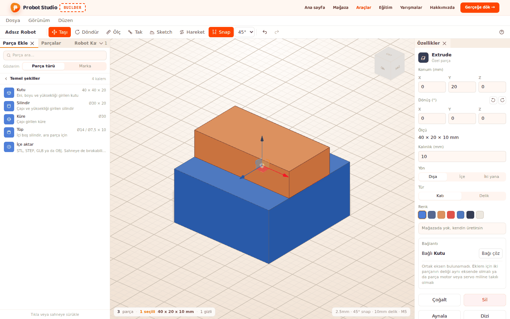
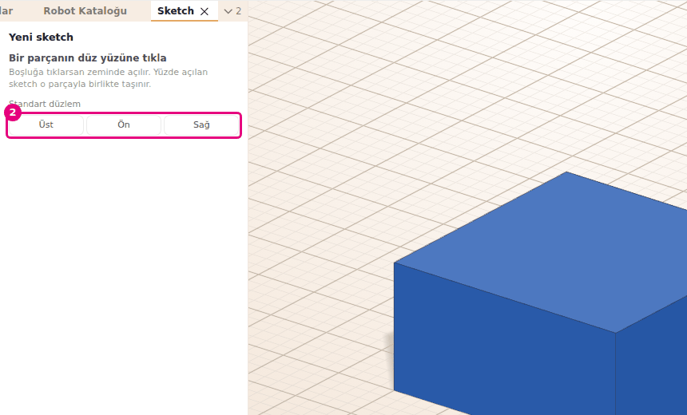
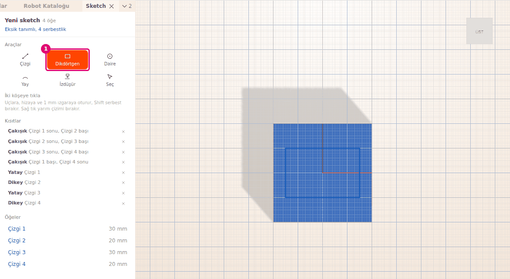
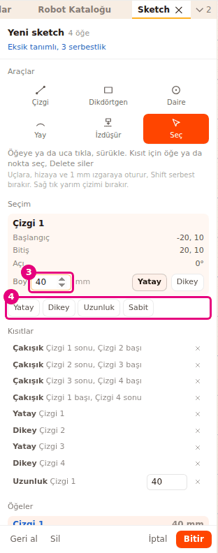
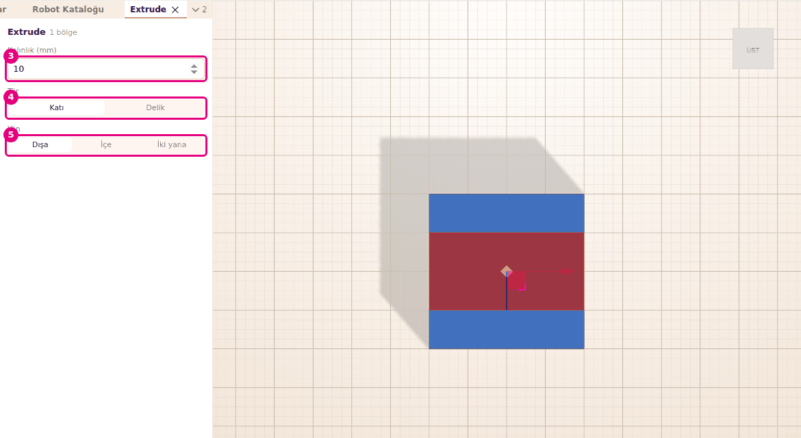

# Sketch çiz ve Extrude ile katı yap

Bu sayfada bir yüzeye ya da düzleme 2B çizim (sketch) yapacak, ölçü verecek ve onu kalınlık
vererek katı parçaya çevireceksin. Aynı yolla bir parçada delik de açarsın.

<!-- CAPTURE: url=https://probotstudio.com/builder/ | hazirla=boş sahne, dikdörtgen sketch Extrude ile katı yapılmış, seçili | hedef=body | isaret=yok | bekle=canvas -->

!!! note "Not"
    Sketch ve Extrude geliştirilmeye devam ediyor. Ekranlar ve düğmeler zamanla değişebilir.

## Başlamadan önce

- Builder açık. Boş sahneyle başlayabilirsin: **Dosya** > **Yeni**. Sahnede parça varsa "Sahnedeki parçalar
  silinecek. Yeni proje açılsın mı?" diye sorar. İşini saklamak istiyorsan önce kaydet, sonra onayla
  (bkz. [Dosyaya kaydet ve aç](dosyaya-kaydet-ve-ac.md)).
- Bir parçanın yüzüne çizmek için sahnede düz yüzlü bir parça olsun. Örnek: **Parça Ekle** >
  **Temel şekiller** > **Kutu** (bkz. [Temel şekillerle parça yap](temel-sekillerle-parca-yap.md)).
- Ölçüler milimetredir. Sketch parça değildir, parça listesine girmez.

## Sketch'i aç ve düzlem seç

1. **Araç çubuğu**nda **Sketch**'e bas (<kbd>S</kbd>). **Sol panel**de **Sketch** sekmesi açılır, başlığında "Yeni sketch" yazar.
2. **Sahne**de çizeceğin yeri seç:
    - Bir parçanın düz yüzüne tıkla. Sketch o yüzde açılır ve parçayla birlikte taşınır.
    - Ya da **Sketch** sekmesinde **Standart düzlem** satırından **Üst**, **Ön** ya da **Sağ**'a bas.
    - Boşluğa tıklarsan sketch zeminde açılır.
   
   <!-- CAPTURE: url=https://probotstudio.com/builder/ | hazirla=boş sahne, Temel şekiller > Kutu eklendi, Sketch aracı açık (düzlem seçimi) | hedef=[data-testid="sketch-paneli"];[data-testid="sketch-duzlem-ust"] | isaret=2 | bekle=text="Bir parçanın düz yüzüne tıkla" -->
   <!-- SAY: Sketch aracını açıp kutunun üst yüzüne tıklıyoruz, çizim o yüzde başlıyor. -->
3. Vazgeçersen **İptal**'e bas ya da <kbd>Esc</kbd>'e bas.

Sonuç: Kamera seçtiğin düzleme dik bakar. **Sketch** sekmesinde **Araçlar** grubu görünür ve
**Çizgi** seçilidir.

Eğri bir yüze tıklarsan "Sketch yalnız düz bir yüzde açılır" yazar. Başka bir düz yüz seç.

## Şekli çiz ve sketch'i bitir

**Sketch** sekmesindeki **Araçlar** grubunda altı araç vardır. Aracı tuşuyla da seçebilirsin.

| Araç | Tuş | Nasıl çizilir |
|---|---|---|
| **Çizgi** | <kbd>L</kbd> | Tıkla, tıkla. Başlangıca dönünce, çift tıklayınca ya da <kbd>Esc</kbd> ile biter. |
| **Dikdörtgen** | <kbd>R</kbd> | İki köşeye tıkla. Kenarlar yatay ve dikey kalır. |
| **Daire** | <kbd>C</kbd> | Merkeze, sonra çevreye tıkla. |
| **Yay** | <kbd>A</kbd> | Başlangıca, bitişe, sonra yayın geçtiği noktaya tıkla. |
| **İzdüşür** | <kbd>P</kbd> | Düzleme paralel bir parça yüzüne tıkla, yüzün kenarları sketch'e geçer. |
| **Seç** | <kbd>S</kbd> | Öğeye ya da uca tıkla, sürükle. <kbd>Del</kbd> seçili öğeyi siler. |

1. **Araçlar** grubunda **Dikdörtgen**'i seç (<kbd>R</kbd>).
2. **Sahne**de dikdörtgenin bir köşesine tıkla.
3. Karşı köşeye tıkla. Dikdörtgen çizilir.
   
   <!-- CAPTURE: url=https://probotstudio.com/builder/ | hazirla=boş sahne, Kutu eklendi, Sketch kutunun üst yüzünde açık, 30×20 mm dikdörtgen çizildi | hedef=[data-testid="sketch-arac-dikdortgen"];[data-testid="sketch-durum"] | isaret=1 | bekle=[data-testid="sketch-ogeler"] -->
   <!-- SAY: Dikdörtgen aracıyla iki köşeye tıklıyoruz, kapalı bir şekil çiziyoruz. -->
4. İstersen **Daire** ile dikdörtgenin içine bir daire çiz. Extrude'da bu daire delik olur.
5. **Sketch** sekmesinin altında **Bitir**'e bas (<kbd>Enter</kbd>).

Sonuç: Sketch kaydedilir, sahnede çizgi olarak görünür ve seçili olur. **Parçalar** listesinde "Sketch" adıyla durur.

Çizerken nokta uçlara, hizaya ve 1 mm ızgaraya oturur. <kbd>Shift</kbd> basılı tutarsan serbest
nokta alırsın. Sağ tık yarım kalan çizimi bırakır. Sketch açıkken <kbd>Ctrl</kbd>+<kbd>Z</kbd> ve
**Geri al** yalnız sketch'teki son değişikliği geri alır. **Sil** seçili öğeleri siler. **İptal**
değişiklikleri kaydetmeden kapatır. Hiç öğe çizmeden **Bitir**'e basarsan sketch eklenmez.

## Ölçü ve kısıt ver

Kısıt, öğenin boyunu, yönünü ya da başka öğeyle ilişkisini sabitler. Çizerken yakalanan uçlar
kendiliğinden **Çakışık** olur. Dikdörtgenin kenarları **Yatay** ve **Dikey** gelir.

1. **Araçlar** grubunda **Seç**'i seç (<kbd>S</kbd>).
2. **Sahne**de dikdörtgenin bir kenarına tıkla. **Seçim** grubunda öğenin adı ve **Boy** alanı görünür.
3. **Boy** alanına `40` yaz ve <kbd>Enter</kbd>'a bas. Kenar 40 mm olur.
4. Başka bir kısıt için **Seçim** grubundaki kısıt düğmelerinden birine bas.
   
   <!-- CAPTURE: url=https://probotstudio.com/builder/ | hazirla=önceki bölümün dikdörtgeni, Sketch'i düzenle ile açık, Seç aracıyla bir kenar seçili | hedef=[data-testid="sketch-olcu-deger"];[data-testid="sketch-kisit-ekle"] | isaret=3-4 | bekle=[data-testid="sketch-secili"] -->
   <!-- SAY: Kenarı seçip boyunu yazıyoruz, sonra gereken kısıtları ekliyoruz. -->
5. Sekmenin başındaki durumu oku. "Tam tanımlı" olana kadar ölçü ve kısıt ekle.

Sonuç: Sekmenin başında "Tam tanımlı" yazar. Şekil artık sürüklenince bozulmaz.

Birden çok öğe ya da nokta seçmek için <kbd>Shift</kbd> ile tıkla. Nokta seçmek için uca, merkeze
ya da orijine tıkla. Seçime göre şu kısıtlar çıkar:

| Seçim | Kısıtlar |
|---|---|
| İki nokta | **Çakışık**, **Mesafe**, **Yatay mesafe**, **Dikey mesafe** |
| Bir nokta ve bir çizgi | **Çizgi üstünde**, **Mesafe** |
| Bir ya da daha çok çizgi | **Yatay**, **Dikey**; tek çizgide **Uzunluk** |
| Bir daire ya da yay | **Yarıçap** |
| İki çizgi | **Eşit**, **Paralel**, **Dik** |
| İki daire ya da yay | **Eşit** |
| Herhangi bir öğe | **Sabit** |

Tek çizgi seçiliyken **Boy** alanının yanında **Yatay** ve **Dikey** de vardır. Daire ve yayda alanın adı
**Yarıçap**'tır. Eklenen kısıtlar **Kısıtlar** listesinde durur. Ölçülü kısıtın değerini listede
değiştirebilirsin. Kısıtı kaldırmak için satırdaki çarpıya (**Kısıtı sil**) bas.

Durum satırı üç şey söyler:

- "Tam tanımlı": her şey sabit.
- "Eksik tanımlı, N serbestlik": N hareket serbest kaldı. Şekil yine Extrude edilir.
- "Fazla ya da çelişen kısıt var, kırmızıları sil": kırmızı satırları **Kısıtı sil** ile kaldır.

## Extrude ile katı yap

Extrude, sketch'teki her kapalı bölgeye kalınlık verip katı parça yapar. Kapalı şeklin içindeki daire katıda delik olur.

!!! tip "İpucu"
    Çizgiyle çizdiysen son ucu ilk uca götürüp şekli kapat, yoksa **Extrude** soluk kalır.
    Bkz. [Sorun giderme](sorunlar.md#kapali-bolge-yok).

1. **Sahne**de sketch'i seç.
2. **Özellikler** panelinde **Extrude**'a bas. Birden çok kapalı bölge varsa düğmede "Extrude (2 bölge)" gibi sayı yazar.
3. **Sol panel**de açılan **Extrude** sekmesinde **Kalınlık (mm)** alanına kalınlığı yaz. İlk açılışta 5 mm gelir. Sonraki Extrude'larda son yazdığın kalınlık kalır (sayfa yenilenince yine 5 mm).
4. **Tür** satırında **Katı**'yı (yeni katı parça) ya da **Delik**'i (açıldığı parçadan kes) seç.
5. **Yön** satırında **Dışa**, **İçe** ya da **İki yana**'yı seç. Sahnede yarı saydam önizleme görünür: Katı'da turuncu, Delik'te gri-kahve.
   
   <!-- CAPTURE: url=https://probotstudio.com/builder/ | hazirla=boş sahne, Kutu üst yüzünde 40×20 dikdörtgen sketch, Özellikler > Extrude açık, Kalınlık 10 | hedef=[data-testid="ekstrud-panel-kalinlik"];[data-testid="ekstrud-panel-delik"];[data-testid="ekstrud-panel-yon-normal"] | isaret=3-5 | bekle=[data-testid="ekstrud-paneli"] -->
   <!-- SAY: Kalınlığı ve yönü seçiyoruz, önizlemeye bakıp katıyı ekliyoruz. -->
6. **Tamam**'a bas (<kbd>Enter</kbd>). Vazgeçmek için **İptal**'e bas (<kbd>Esc</kbd>).

Sonuç: Her kapalı bölge ayrı bir katı parça olur ve seçili gelir. Sketch gizlenir.

Extrude'u sağ tıkla da açarsın: **Sahne**de sketch'e sağ tıkla ve **Extrude**'u seç.

- Kalınlık 0,1 ile 1000 mm arasında olur. Alan 2000'e kadar yazdırır ama parça 1000 mm'de kalır.
- **Delik** seçince **Yön** kendiliğinden **İçe** olur.
- Delik, sketch'i açtığın şekli (temel şekil, Extrude parçası ya da birleşik şekil) keser ve parça birleşik
  şekil olur. Katalog parçası, içe aktarılan model ya da Delik türündeki parça kesilmez: "Bu parça kesilemez, delik ayrı Delik parçası olarak eklendi" yazar.
- Sketch zemindeyse delik ayrı parça olarak eklenir: "Delik parçası eklendi, kesmek için Birleştir kullan".
  Bkz. [Şekilleri birleştir ve delik aç](temel-sekillerle-parca-yap.md#sekilleri-birlestir-ve-delik-ac).
- Kapalı bölge yoksa **Extrude** soluktur ("Extrude için kapalı bir şekil çiz").

## Sketch'i ve Extrude parçasını sonradan değiştir

- **Sketch'i düzenle:** Sketch'e çift tıkla. Ya da sağ tıkla ve **Sketch'i düzenle**'yi seç. Ya da
  sketch seçiliyken **Özellikler** panelinde **Düzenle**'ye bas. Sekmenin başında "Sketch düzenle" yazar.
  Değişikliği **Bitir** ile kaydet. Bütün öğeleri silip **Bitir**'e basarsan sketch silinir.
- **Gizli sketch'i bul:** Extrude'dan sonra sketch gizlenir. **Parçalar** sekmesinde satırındaki
  **Göster** simgesiyle geri getir.
- **Extrude parçasını değiştir:** Parçayı seç. **Özellikler** panelinde **Kalınlık (mm)** ve **Yön**
  (**Dışa**, **İçe**, **İki yana**) ile kalınlığı değiştir. **Tür** ve **Renk** temel şekillerdeki gibidir.
- Extrude parçası sketch'ine bağlı değildir. Sketch'i değiştirmek eski Extrude parçasını değiştirmez.
  Yeni şekil için yeniden **Extrude** yap.

<!-- SAY: Sketch'i çift tıkla açıp düzeltiyoruz, extrude kalınlığını Özellikler'den değiştiriyoruz. -->

## Sorun mu var?

- **"Sketch yalnız düz bir yüzde açılır" yazdı:** Eğri bir yüze tıkladın. Düz bir yüz seç ya da standart düzlem kullan.
  Bkz. [Sorun giderme](sorunlar.md#sketch-duz-yuz).
- **"Sketch içinde kapalı bölge yok" yazdı ya da Extrude soluk:** Şekil kapanmıyor. Çizginin son ucunu ilk uca götür.
  Bkz. [Sorun giderme](sorunlar.md#kapali-bolge-yok).
- **"Fazla ya da çelişen kısıt var, kırmızıları sil" yazdı:** **Kısıtlar** listesindeki kırmızı satırları sil.
  Bkz. [Sorun giderme](sorunlar.md#celisen-kisit).
- **Sketch sekmesi kayboldu, çizim gitti:** Sekmeyi çarpıyla kapatmak sketch'i kaydetmeden kapatır. Yeniden **Sketch** aç.
- **<kbd>Esc</kbd> sketch'i kapatmıyor:** Çizim sırasında <kbd>Esc</kbd> önce yarım çizimi, sonra seçimi bırakır.
  Kapatmak için **Bitir** ya da **İptal**'e bas.
- **Seçimde sketch varken Birleştir yok:** Sketch birleştirilemez. Önce Extrude yap, Extrude parçasını birleştir.
  Bkz. [Sorun giderme](sorunlar.md#birlestirilemez).
- **Kalınlık 1000 mm'yi geçmiyor:** En büyük kalınlık 1000 mm.

## Sonraki adım

- [Temel şekillerle parça yap](temel-sekillerle-parca-yap.md)
- [Parçaları deliklerinden tak](parcalari-tak.md)
- [Gerçeğe dök: parça listesi ve sepet](gercege-dok.md)
