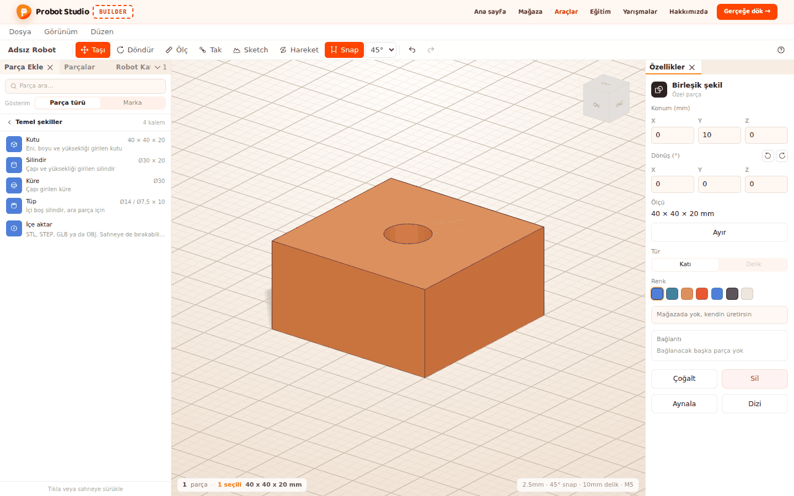
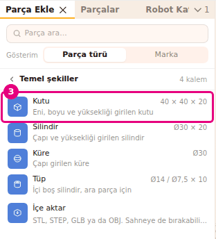
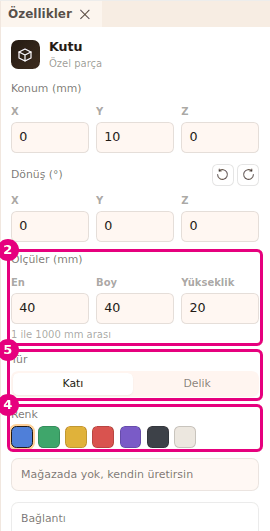
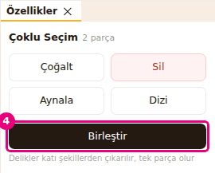
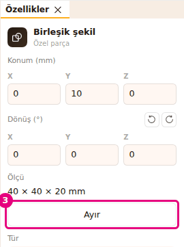

# Temel şekillerle parça yap

Bu sayfada kutu, silindir, küre ve tüpten kendi parçanı yapacaksın. Şekillere ölçü ve renk
verir, delik şekliyle oyar ve hepsini tek parçada birleştirirsin.

<!-- CAPTURE: url=https://probotstudio.com/builder/ | hazirla=boş sahne, Kutu + Delik silindir birleştirilmiş, seçili | hedef=body | isaret=yok | bekle=text="Birleşik şekil" -->

## Başlamadan önce

- Builder açık. Boş bir sahneyle başla: **Dosya** > **Yeni**'yi seç (bkz. [Dosyaya kaydet ve aç](dosyaya-kaydet-ve-ac.md)).
- İstersen şekli bir robotun yanına koy: **Omni şasi**'yi yükle (bkz. [Hazır robotla başla](hazir-robotla-basla.md)).
- Ölçüler milimetredir.

## Temel şekil ekle

Dört temel şekil vardır: **Kutu**, **Silindir**, **Küre** ve **Tüp** (içi boş silindir, ara parça için).

1. **Sol panel**de **Parça Ekle** sekmesine bas.
2. **Temel şekiller** bölümünü seç.
   
   <!-- CAPTURE: url=https://probotstudio.com/builder/ | hazirla=Dosya > Yeni ile boş sahne, Parça Ekle > Temel şekiller açık | hedef=[data-section-open="temel"];[data-part-type="ozel-kutu"] | isaret=3 | bekle=[data-part-type="ozel-tup"] -->
   <!-- SAY: Parça Ekle sekmesinde temel şekiller bölümünü açıyoruz. -->
3. **Kutu** satırını seç. Kutu sahneye eklenir ve seçili olur.
4. Şekli belli bir yere koymak istersen satırı **Sahne**ye sürükle ve bırak.

Sonuç: Sahnede 40 × 40 × 20 mm mavi bir kutu durur. **Özellikler** panelinin başında "Kutu" yazar.

Yeni şekillerin ölçüsü: **Kutu** 40 × 40 × 20 mm, **Silindir** Ø30 × 20 mm, **Küre** Ø30 mm,
**Tüp** Ø14 / Ø7,5 × 10 mm.

## Ölçü, tür ve renk ver

Şekli seçince **Özellikler** panelinde ölçü alanları, **Tür** ve **Renk** görünür.

| Şekil | Ölçü alanları |
|---|---|
| **Kutu** | **En**, **Boy**, **Yükseklik** |
| **Silindir** | **Çap**, **Yükseklik** |
| **Küre** | **Çap** |
| **Tüp** | **Dış çap**, **İç çap**, **Yükseklik** |

1. **Sahne**de şekli seç.
2. **Özellikler** panelinde **Ölçüler (mm)** altındaki bir alana yeni ölçüyü yaz, örneğin **En** alanına `60`.
3. <kbd>Enter</kbd>'a bas. Şekil yazarken değişir, tabanı yerinde kalır. <kbd>Esc</kbd> eski ölçüye döner.
   
   <!-- CAPTURE: url=https://probotstudio.com/builder/ | hazirla=boş sahne, Temel şekiller > Kutu eklendi ve seçili | hedef=[data-testid="ozel-olcu-w"];[data-testid="ozel-renkler"];[data-testid="ozel-delik"] | isaret=2,4,5 | bekle=[data-testid="ozel-sekil"] -->
   <!-- SAY: Kutunun ölçüsünü yazıyoruz, sonra türünü ve rengini seçiyoruz. -->
4. **Renk** satırında bir renk seç: Mavi, Yeşil, Sarı, Kırmızı, Mor, Siyah ya da Beyaz.
5. Şekil başka bir şekli oyacaksa **Tür** satırında **Delik**'i seç. Katı kalacaksa **Katı** seçili kalsın.

Sonuç: Kutu yazdığın ölçüde ve seçtiğin renkte görünür. Panelin altında "Mağazada yok, kendin
üretirsin" notu durur.

Ölçüler 1 ile 1000 mm arasındadır, sınır alanların altında yazar. Tüpte dış çap en az 2 mm, iç çap
en az 0,5 mm'dir ve iç çap dış çaptan en az 1 mm küçük kalır. **Delik** seçilince şekil yarı saydam gri olur, **Renk** satırı kaybolur ve not
"Delik şekli Birleştir ile katı şekilden çıkar, tek başına üretilmez" olur.

## Şekilleri birleştir ve delik aç

**Birleştir** seçili şekilleri tek parça yapar. **Delik** türündeki şekiller katı şekillerden çıkarılır.

1. Bir **Kutu** ve bir **Silindir** ekle. Silindirin **Tür**'ünü **Delik** yap.
2. Silindiri kutunun içinden geçecek yere taşı (bkz. [Parçayı taşı ve döndür](tasi-ve-dondur.md)).
3. Kutuyu seç, sonra <kbd>Shift</kbd> basılıyken silindiri seç.
4. **Özellikler** panelinde **Birleştir**'e bas.
   
   <!-- CAPTURE: url=https://probotstudio.com/builder/ | hazirla=boş sahne, Kutu (40×40×20) ve Silindir (Ø10×40, Tür Delik) kutunun ortasından geçiyor, ikisi Shift ile seçili | hedef=[data-testid="ozel-birlestir"] | isaret=4 | bekle=text="Çoklu Seçim" -->
   <!-- SAY: Kutuyu ve delik silindiri birlikte seçip birleştiriyoruz, kutuda delik açılıyor. -->

Sonuç: Kutuda silindir biçiminde bir delik açılır. **Özellikler** panelinin başında "Birleşik şekil"
yazar, **Ölçü** satırında parçanın toplam boyutu görünür.

- **Birleştir** yalnız seçimin hepsi temel şekil, birleşik şekil ya da Extrude parçası olduğunda görünür.
  Seçimde katalog parçası, içe aktarılan model ya da sketch varsa düğme çıkmaz.
- Seçimdeki şekillerin hepsi **Delik** ise **Birleştir** soluk kalır. En az bir katı şekil gerekir.
- Birleşik şekil **Delik** yapılamaz.
- Birleşik şekli yine başka şekillerle birleştirebilirsin.

## Birleşik şekli ayır

1. **Sol panel**de **Parçalar** sekmesini seç.
2. Listede birleşik şeklin satırına bas. **Özellikler** panelinin başında "Birleşik şekil" yazar.
3. **Özellikler** panelinde **Ayır**'a bas.
   
   <!-- CAPTURE: url=https://probotstudio.com/builder/ | hazirla=önceki bölümün birleşik şekli (Kutu + Delik silindir) seçili | hedef=[data-testid="ozel-ayir"] | isaret=3 | bekle=text="Birleşik şekil" -->
   <!-- SAY: Ayır düğmesiyle birleşik şekli eski parçalarına döndürüyoruz. -->

Sonuç: Şekiller birleştirmeden önceki yerlerinde, ayrı parçalar olarak durur ve hepsi seçili olur.

Birleştirmeyi geri almak için **Düzen** > **Geri al**'ı da seçebilirsin (<kbd>Ctrl</kbd>+<kbd>Z</kbd>).

## Parça listesinde gör

Temel şekiller mağazada satılmaz, onları kendin üretirsin (ör. 3B yazıcıyla). **Üst şerit**te
**Gerçeğe dök →**'e basınca bu şekiller fiyat tablosunda değil, ayrı **Özel parçalar** bölümünde
listelenir. Bölümün notu "Mağazada yok, kendin üretirsin. Toplama girmez" der. Her satırda şeklin
adı, ölçüsü ve adedi yazar. Delik şekilleri listeye girmez.

<!-- SAY: Kendi yaptığımız şekiller parça listesinde özel parçalar bölümünde görünüyor. -->

Ayrıntı: [Gerçeğe dök](gercege-dok.md).

## Sorun mu var?

- **Birleştir görünmüyor:** Seçimde en az iki parça olmalı ve hepsi temel şekil, birleşik şekil ya da Extrude
  parçası olmalı. İçe aktarılan model ve sketch birleştirilemez.
  Bkz. [Sorun giderme](sorunlar.md#birlestirilemez).
- **Birleştir soluk:** Seçili şekillerin hepsi **Delik**. Birini **Katı** yap ya da seçime katı bir şekil ekle.
  Bkz. [Sorun giderme](sorunlar.md#birlestirilemez).
- **Birleştirdim ama delik açılmadı:** Delik şekli katı şekle değmiyordu. **Ayır**'a bas, delik şeklini katının
  içine taşı, yeniden birleştir.
- **Delik seçeneği soluk:** Birleşik şekil delik yapılamaz. Önce **Ayır**'a bas.
- **"Bu parça kesilemez, delik ayrı Delik parçası olarak eklendi" yazdı:** Bu uyarı Extrude ile delik açarken
  çıkar. Sketch'i açtığın parça katalog parçası, içe aktarılan model ya da Delik şekliyse kesilmez, delik ayrı parça
  olarak eklenir. Temel şekil, birleşik şekil ve Extrude parçası kesilir. Bkz. [Sketch ve Extrude](sketch-ve-extrude.md),
  [Sorun giderme](sorunlar.md#parca-kesilemez).
- **"Montaj modunda düzenleme kapalı" yazdı:** Robot **Adım adım kur** modunda. Montaj şeridinde
  **Düzenlemeye geç**'e bas. Bkz. [Sorun giderme](sorunlar.md#montaj-modu).

## Sonraki adım

- [Sketch çiz ve Extrude ile katı yap](sketch-ve-extrude.md)
- [3B model içe aktar](model-ice-aktar.md)
- [Gerçeğe dök: parça listesi ve sepet](gercege-dok.md)
